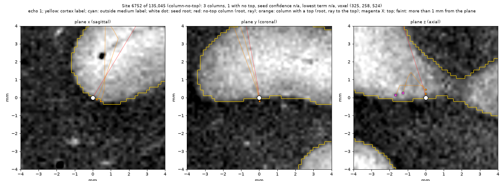
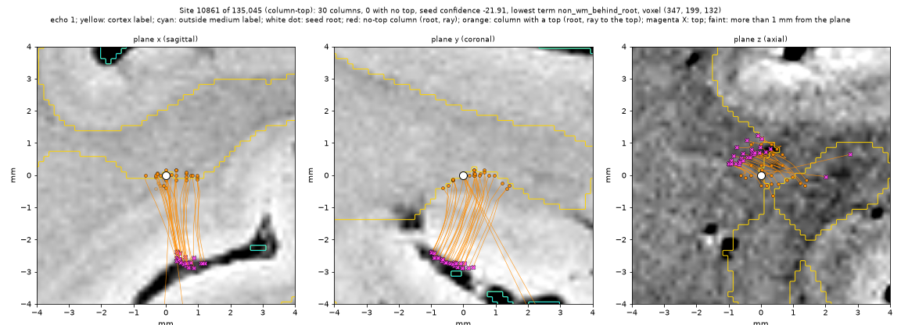
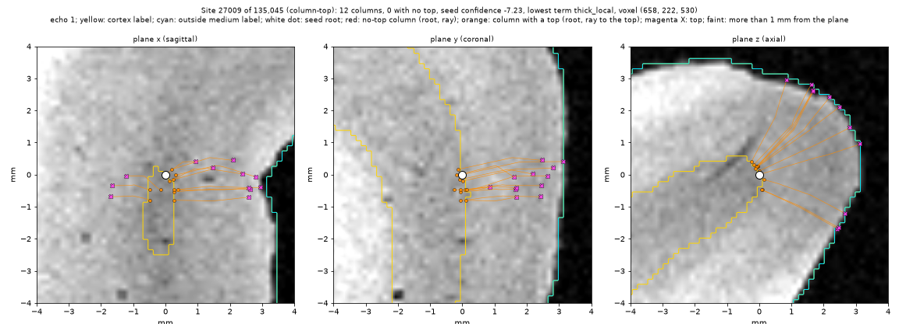
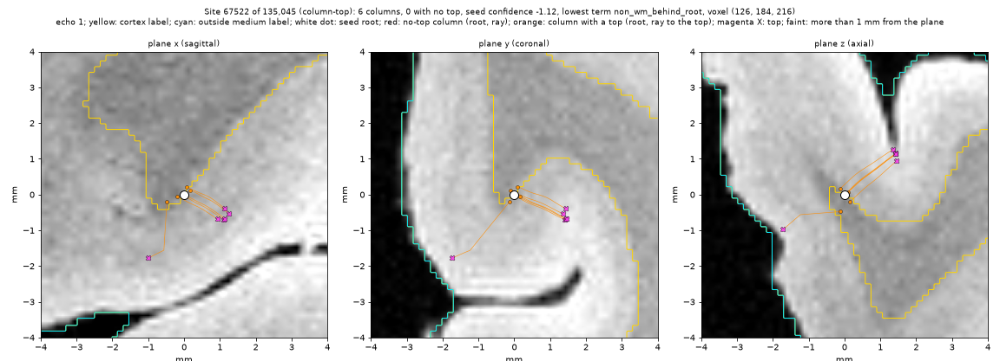

# Column sites: the column top stage's review queue as sites

## Goal

The column top stage (`reports/Column top stage.md`) gives each coarse
column a top and a confidence. Its review queue holds 1,179,148 columns.
Neighbouring columns usually share one problem, for example one root in
fluid or one strip of loose tissue. A person must answer each problem one
time, as a dseg edit.

This step groups the columns into review sites and writes the sites so that
the existing review route can use them:

1. the site queue (a file that the review pane reads);
2. the answer log (`wm-edits/1`);
3. the dseg replay of the log.

This step makes no viewer change. A later step adds the column sites to the
review pane.

## Facts from the current code

- `wm-edits/1` does not depend on the queue format. A `shown` record holds
  a site voxel, a free `SiteKind` string, a rank and a score. A session
  records the SHA-256 of the queue file that it shows. An answer is voxels
  and labels on the dseg grid. dseg replays the answers. So the log can take
  answers at column sites with no change.
- `wm-sites/1` is the queue of the WM mask. `write_sites` computes it from
  the white surface, the corrected dseg and its fixes. Its table has fixed
  columns (WM measures: faces, fixes, pieces, thickness). `read_sites`
  refuses other columns. The review pane (`viewer/review.py`) reads one
  queue file with `read_sites` and uses `kind`, `rank`, `i`, `j`, `k` and
  `score`.
- The column stage is a prototype (`prototypes/scripts/`). Its outputs are
  scratch `.npz` files with no format spec.

## Design

### A separate format, `column-sites/1`

Column sites get their own files and spec, not new kinds in `wm-sites/1`:

- The inputs are different: the top confidence and the column graph, not
  the WM fixes.
- `wm_sites.write_sites` stays free of the prototype outputs.
- The answers go to the same `wm-edits/1` log, with `SiteKind` from the
  column queue. dseg replays them as it replays the WM answers.

The table starts with the same columns as `wm-sites/1`: `rank`, `kind`,
`i`, `j`, `k`, then `score`. The review pane can then read either queue
with small changes. The files, next to the white surface (or in `--out`):

| File | Content |
|---|---|
| `sub-_ses-<ses>_hemi-<h>_desc-columnsites_sites.tsv` | One row per site, in queue order |
| `sub-_ses-<ses>_hemi-<h>_desc-columnsites_sites.json` | Sidecar, `column-sites/1` |
| `sub-_ses-<ses>_hemi-<h>_desc-columnsites_members.tsv` | One row per column: its vertex and its site's rank |

### Sites from the queue order

Confidence orders the queue. It does not gate a column. So the grouping
uses no confidence threshold:

1. Take the columns in queue order: no top first, then the lowest
   confidence first.
2. A column joins the site of a neighbour on the column graph that came
   before it. It joins only if the site then stays inside a ball of radius
   `R` mm round the site's first column (the seed). With more than one such
   site, it joins the site with the earliest seed.
3. Otherwise the column starts a new site and is its seed.

Each column is in one site. The site's score is its seed's confidence. The
sites are in the order of their seeds. The site voxel is the seed's root,
rounded to the dseg grid. The root is where the review found most errors
(roots in fluid, on loose tissue, in degenerated tissue).

`R` is the size of one review view, not a measure of correctness. The
reviewer stops where they choose. The sites at the back of the queue are
there, but a person seldom reaches them.

### The measures of a site

For each site: its columns, the columns with no top, the seed's confidence,
the median confidence, the seed's top (mm), its GM-like and fluid-like
length behind the root, and the name of the seed's lowest term. These order
nothing. They help the reviewer and the diagnostics.

## Exact tests

- On a small graph with known confidences: the sites, their seeds, their
  order and their members are as computed by hand.
- No column is in two sites. Every column is in one site.
- A site stays inside radius `R` of its seed.
- A chain of columns longer than `R` gives more than one site.
- The write and read of the files give the same rows. The sidecar passes
  `SidecarSpec`. `tests/test_bids.py` checks the format document.
- A `wm-edits/1` log takes a session on the column queue, a `shown` record
  at a column site, and an answer there. `replay` applies the answer.

## The hemisphere run

Inputs: `hemi_top_conf.npz` and the `feat_*.npz` files of the stage, the
white surface and the dseg that the stage used. Outputs go to a scratch
directory that is given as an argument.

The diagnostics, for the user: the number of sites, their sizes, the
columns per site, the share of no-top columns in the first sites, and a few
sites as echo 1 with coloured markers (root, top, site members). These are
views, not pass or fail rules. The script is
`prototypes/scripts/column_site_views.py`.

## The hemisphere result (right hemisphere, `R` = 2 mm)

| Measure | Value |
|---|---|
| Columns / edges of the column graph | 1,179,148 / 3,533,569 |
| Sites | 135,045 |
| Sites by kind | 10,860 `column-no-top`, 124,185 `column-top` |
| Columns per site, p10 / 50 / 90 / 99 / max | 1 / 3 / 25 / 66 / 179 |
| Sites with one column | 43,842 (1,517 of them in the first 5 % of the column queue) |
| Sites that hold the first 1 % / 5 % / 20 % of the column queue | 2,539 / 11,321 / 48,134 |
| Run time, peak memory | about 1 min, 2.9 GB |

All the no-top columns are in the first 10,860 sites.

The sites are small. The radius has little effect:

| `R` (mm) | Sites | One-column sites | Sites that hold the first 5 % |
|---|---|---|---|
| 1 | 148,633 | 39,858 | 13,729 |
| 2 | 135,045 | 43,842 | 11,321 |
| 4 | 132,542 | 44,294 | 10,406 |
| 8 | 132,153 | 44,271 | 10,178 |

The cause is the join rule, not the radius. Of 20,000 one-column sites with
neighbours, 19,508 have only neighbours that come later in the queue. Each
such neighbour has another neighbour in a site with an earlier seed, and
joins that site. So a local low of the confidence stays alone. A change of
the rule is the user's decision.

*Echo 1, three world planes through the seed root, ±4 mm. Yellow: cortex
label. Cyan: outside medium label. White dot: the seed root. Red: a column
with no top (root and ray). Orange: a column with a top (root and ray to the
top). Magenta X: a top. Faint markers are more than 1 mm from the plane.*

## Open decisions (the user's)

1. A separate format, or new kinds in `wm-sites/1`.
2. All columns in sites (as built), or only a part of the queue.
3. The join rule and `R`. One option: let a later column also join a site
   whose seed is a lower local value within `R`, so that local lows merge.
4. The site voxel: the seed's root (as built) or its top.
5. The order of tied columns. All no-top columns have the confidence
   `-inf`. The stage's rank orders them by column index.
