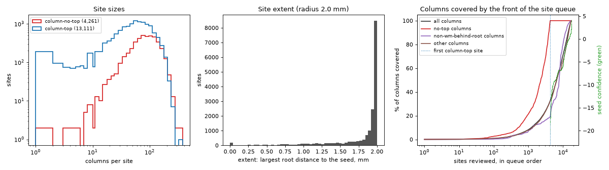
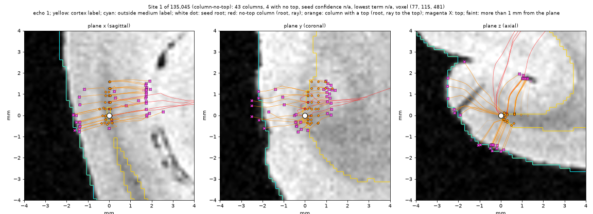
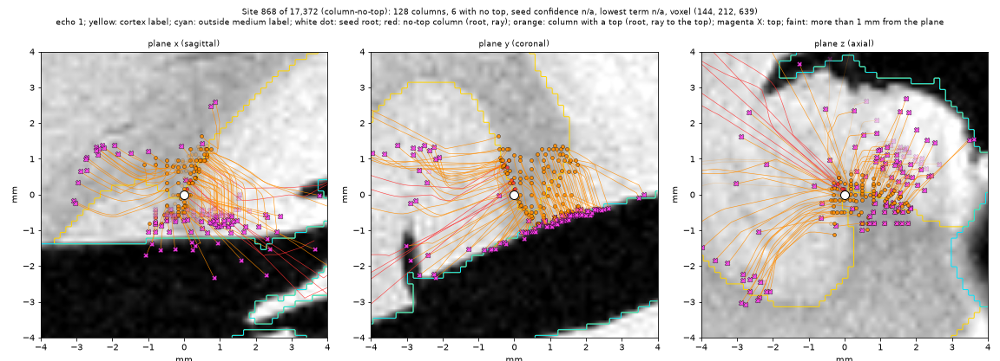
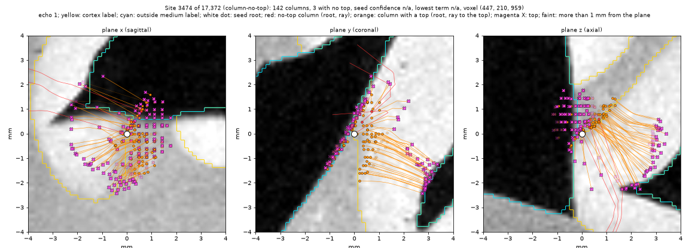
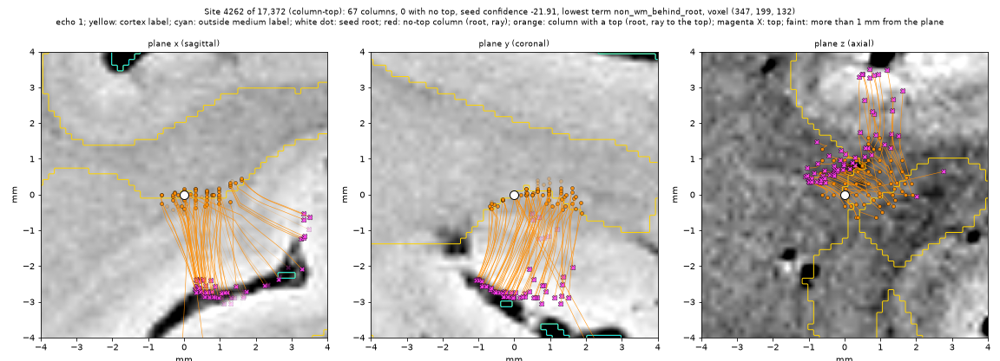
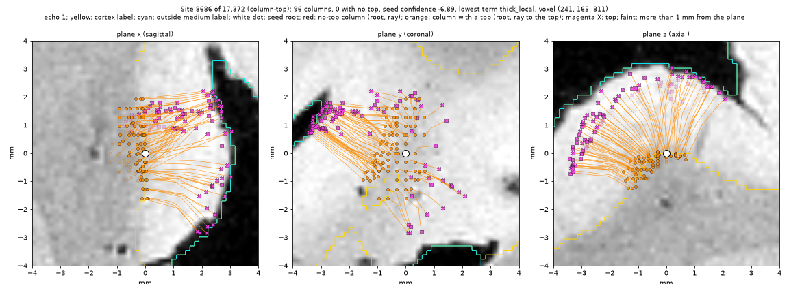

# Column sites: the column top stage's review queue as sites

## Goal

The column top stage (`reports/Column top stage.md`) gives each coarse
column a top and a confidence. Its review queue holds 1,179,148 columns.
Neighbouring columns usually share one problem, for example one root in
fluid or one strip of loose tissue. A person must answer each problem one
time, as a dseg edit.

This step groups the columns into review sites and writes the sites so that
the existing review route can use them:

1. the site queue (a file that the review pane reads);
2. the answer log (`wm-edits/1`), the record of the review queue;
3. the edits diff (`label-edits/1`), which `white_dseg --edits` applies.

This step makes no viewer change. A later plan adds the column sites to the
review pane (Open items).

## Facts from the current code

- `wm-edits/1` does not depend on the queue format. A `shown` record holds
  a site voxel, a free `SiteKind` string, a rank and a score. A session
  records the SHA-256 of the queue file that it shows. An answer is voxels
  and labels on the dseg grid. So the log can take answers at column sites
  with no change. The log is only the record of the review queue. The
  answer's labels go into the edits diff (`label-edits/1`), and
  `white_dseg --edits` applies that diff.
- `wm-sites/1` is the queue of the WM mask. `write_sites` computes it from
  the white surface, the corrected dseg and its fixes. Its table has fixed
  columns (WM measures: faces, fixes, pieces, thickness). `read_sites`
  refuses other columns. The review pane (`viewer/review.py`) reads one
  queue file with `read_sites` and uses `kind`, `rank`, `i`, `j`, `k` and
  `score`.
- The column stage is a prototype (`prototypes/scripts/`). Its outputs are
  scratch `.npz` files with no format spec.

## Design

### The user's decisions (2026-11-10)

1. A separate format, `column-sites/1`. The answers go to the same
   `wm-edits/1` log.
2. All the columns become sites, each column in one site. The sites are in
   the order of their worst column: no top first, then the lowest
   confidence. There is no cut-off.
3. Spatial sites with `R` = 2 mm. Each site records the count of each cause
   (no top, non-WM signal behind the root, other) and its dominant cause,
   for the catalogue of error types. The causes do not split the sites.
4. The site voxel is the seed's root, rounded to the dseg grid.
5. Lows that touch merge ("Merge lows that touch"). A site whose seed is a
   nearby local low merges into a touching site with a lower seed, if all
   its columns stay within `R` of that seed. There is no confidence
   threshold.

### A separate format, `column-sites/1`

Column sites get their own files and spec, not new kinds in `wm-sites/1`:

- The inputs are different: the top confidence and the column graph, not
  the WM fixes.
- `wm_sites.write_sites` stays free of the prototype outputs.
- The answers go to the same `wm-edits/1` log, with `SiteKind` from the
  column queue. An answer at a column site is recorded in the log and
  writes its labels into the edits diff, which `white_dseg --edits` applies.

The table starts with the same columns as `wm-sites/1`: `rank`, `kind`,
`i`, `j`, `k`, then `score`. The review pane can then read either queue
with small changes. The files, next to the white surface (or in `--out`):

| File | Content |
|---|---|
| `sub-_ses-<ses>_hemi-<h>_desc-columnsites_sites.tsv` | One row per site, in queue order |
| `sub-_ses-<ses>_hemi-<h>_desc-columnsites_sites.json` | Sidecar, `column-sites/1` |
| `sub-_ses-<ses>_hemi-<h>_desc-columnsites_members.tsv` | One row per column: its vertex and its site's rank |

### Sites from the queue order

Confidence orders the queue. It does not gate a column. So the grouping
uses no confidence threshold:

1. Take the columns in queue order: no top first, then the lowest
   confidence first.
2. A column joins the site of a neighbour on the column graph that came
   before it. It joins only if the site then stays inside a ball of radius
   `R` mm round the site's first column (the seed). With more than one such
   site, it joins the site with the earliest seed.
3. Otherwise the column starts a new site and is its seed.
4. Lows that touch merge. The column can touch other sites with a later
   seed than its own site. Each such site merges into the column's site if
   all its columns are within `R` mm of the column's site's seed. The
   merged site keeps that seed, the lowest of the seeds.

Each column is in one site. The site's score is its seed's confidence. The
sites are in the order of their seeds. The site voxel is the seed's root,
rounded to the dseg grid. The root is where the review found most errors
(roots in fluid, on loose tissue, in degenerated tissue).

`R` is the size of one review view, not a measure of correctness. The
reviewer stops where they choose. The sites at the back of the queue are
there, but a person seldom reaches them.

### The causes

Each column has one cause:

- `no-top`: the column has no top;
- `non-wm-behind-root`: the first of its lowest confidence terms is
  `non_wm_behind_root`;
- `other`: any other column.

The cause uses no threshold. The dominant cause of a site is the cause with
the most columns (a tie goes to the first cause in the list).

### The measures of a site

For each site: its columns, the count of each cause, the dominant cause, the seed's confidence,
the median confidence, the seed's top (mm), its GM-like and fluid-like
length behind the root, and the name of the seed's lowest term. These order
nothing. They help the reviewer and the diagnostics.

## Exact tests

- On a small graph with known confidences: the sites, their seeds, their
  order and their members are as computed by hand.
- No column is in two sites. Every column is in one site.
- A site stays inside radius `R` of its seed.
- A chain of columns longer than `R` gives more than one site.
- Two touching lows give one site, with the lower seed. A chain of lows
  longer than `R` still gives more than one site. A site does not merge if
  one of its columns is more than `R` from the lower seed.
- The write and read of the files give the same rows. The sidecar passes
  `SidecarSpec`. `tests/test_bids.py` checks the format document.
- A `wm-edits/1` log takes a session on the column queue, a `shown` record
  at a column site, and an answer there. The answer's labels go into an
  edits diff (`label_edits.paint`, `write`, `read`), and `label_edits.apply`
  gives the answer's label at the site.

## The hemisphere run

Inputs: `hemi_top_conf.npz` and the `feat_*.npz` files of the stage, the
white surface and the dseg that the stage used. Outputs go to a scratch
directory that is given as an argument.

The diagnostics, for the user: the number of sites, their sizes, the
columns per site, the share of no-top columns in the first sites, and a few
sites as echo 1 with coloured markers (root, top, site members). These are
views, not pass or fail rules. The script is
`prototypes/scripts/column_site_views.py`.

## The hemisphere result (right hemisphere, `R` = 2 mm)

Inputs: the stage's outputs as before, and the `derivatives-main` dseg after
#156 (the ventricle labels are 0). The stage's outputs do not change with it.

| Measure | Value |
|---|---|
| Columns / edges of the column graph | 1,179,148 / 3,533,569 |
| Sites | 17,372 |
| Sites by kind | 4,261 `column-no-top`, 13,111 `column-top` |
| Columns per site, p10 / 50 / 90 / 99 / max | 18 / 60 / 128 / 193 / 377 |
| Site extent (mm from the seed), p10 / 50 / 90 | 1.23 / 1.96 / 2.00 |
| Sites with one column | 190 (22 are columns with no edge; 2 are in the first 5 % of the column queue) |
| Sites that hold the first 1 % / 5 % / 10 % / 20 % of the column queue | 1,012 / 4,345 / 7,392 / 10,382 |
| Run time, peak memory | about 20 s, 1.4 GB |

All the no-top columns are in the first 4,261 sites. Most sites now fill
the ball of radius `R`.

The causes:

| Measure | `no-top` | `non-wm-behind-root` | `other` |
|---|---|---|---|
| Columns | 57,649 | 278,524 | 842,975 |
| Sites with this dominant cause | 334 | 3,667 | 13,371 |
| Dominant cause, first 1,000 sites | 56 | 181 | 763 |
| Dominant cause, first 10,000 sites | 334 | 2,632 | 7,034 |

A site with a no-top seed usually holds more columns with a top than with no
top. Site 1, for example, holds 98 columns, and 7 of them have no top. So
few sites have `no-top` as the dominant cause. The `no_top` count of a site
shows its no-top columns. The `non_wm_behind_root` term of the
`non-wm-behind-root` columns: p10 / 50 / 90 = −8.0 / −3.35 / −0.37. For
214,815 of the 278,524 columns it is below −1.

The radius sets the site size now:

| `R` (mm) | Sites | One-column sites | Median columns per site | Sites that hold the first 5 % |
|---|---|---|---|---|
| 1 | 59,701 | 1,753 | 18 | 8,864 |
| 2 | 17,372 | 190 | 60 | 4,345 |
| 4 | 4,611 | 31 | 224 | 1,853 |
| 8 | 1,067 | 23 | 985 | 684 |

With the first rule (no merge), `R` = 2 mm gave 135,045 sites, 43,842 of
them with one column, and 11,321 sites held the first 5 %. With the merge
rule, 168 one-column sites have neighbours. 11 of them have only later
neighbours. 157 have an earlier neighbour whose site seed is more than `R`
away.

*Echo 1, three world planes through the seed root, ±4 mm. Yellow: cortex
label. Cyan: outside medium label. White dot: the seed root. Red: a column
with no top (root and ray). Orange: a column with a top (root and ray to the
top). Magenta X: a top. Faint markers are more than 1 mm from the plane.*

## Open items (the user's)

1. The order of tied columns. All no-top columns have the confidence
   `-inf`. The stage's rank orders them by column index.
2. The review of column sites in the pane is a later plan: the pane reading
   `column-sites/1`, the answer for each cause, and the column view. That
   plan is made after the user looks at a blind sample of sites. It joins
   `viewer/review.py` after the label-editing joins.
