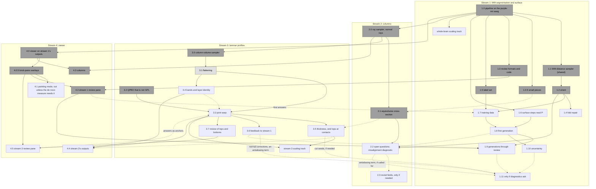

# Plan for restart of baillarger

## The approach

Most tools define a white surface and a pial surface, then treat the cortex as everything between them. We do not.

- **There is no true GM/WM boundary to find,** so we build only an approximate white surface. It may sit somewhat inside the GM or the WM.
- **The white surface exists for its normals.** We ask that its normals align with the cortical normal, so that columns traced from it run along the cortex's normal. That is how white-surface methods are judged, not by where the surface sits.
- **Everything along a column is read from the image.** The contrast along the columns identifies the laminae, the GM/WM transition and the pial edge of the cortex. Each is aligned across columns after the fact, like any other layer. There is no separately built pial surface; the pial edge is a level of that alignment.

**Why other tools take the two-surface frame, and why we can drop it.**

- **In vivo tools have no laminar contrast.** Surface tools (FreeSurfer, CAT12, CIVET) work at about 1 mm, where the two tissue-class boundaries are the only signal. In vivo laminar tools (LayNii; Nighres' volumetric layering, Waehnert 2014) work at about 0.5–0.8 mm, with no laminar contrast to read, so they impute layers from geometry between two boundaries. For all of them the frame is a consequence of the data.
- **Ex vivo MRI pipelines inherit that frame.** Edlow 2019 and purple-mri segment GM and WM and build FreeSurfer-style surfaces. Edlow's 100 µm data shows laminar contrast, but, as far as we know, the pipeline does not use it to define the cortex.
- **Our data has laminar contrast,** so the image can decide what other tools must impute.

**Precedents.**

- FreeSurfer's `mris_make_surfaces` already finds the pial edge from intensity along each vertex normal, but it then builds a surface and treats the cortex as the region between surfaces. The mechanism has precedent; the strategy does not.
- BigBrain (Wagstyl 2018, 2020; histology at 20 µm) has strong laminar contrast and still builds both surfaces first, reading layers between them. Its network nonetheless placed the layer 6/WM boundary away from the tissue-class white surface, which supports the premise that there is no single true GM/WM boundary.
- Not checked: whether any ex vivo or histology work reads the pial edge from profiles without a prior surface. The earlier survey did not cover every ex vivo pipeline.

## About this document

What the work so far has established, for a clean start.

This document states current knowledge only. How the project got here is in git, the PRs and the reports. Each item points to its evidence:

- `#N` is https://github.com/mdtisdall/baillarger/pull/N.
- SF is `reports/Seismic flattening for cortical layers.md`, and Fn is its finding n.
- CP is `reports/Crossing paths and contacts from laminar profiles.md`.
- LS is `reports/Level-set filling test plan.md`.
- PE is `reports/Pial editing and edit priority.md`.
- CL is `reports/Cortical laminae segmentation lessons.md`.
- FS is `reports/Fused sulci and thickness priors.md`.
- PL is `PLAN_LAYER_REFINE.md`.

Open PRs the plan builds on (all open as of 2026-11-04):

| PR | What the plan takes from it |
|---|---|
| #55 | A fix for closed mesh pieces in the flat map (§6c, Flat map) |
| #56 | The layer-maps diagnostics (stream 3, phase 4) |
| #80 | The review plan for tight folds (§3c, step 6). Its rules are ported into #132 |
| #81 | The site finder and `wm-sites/1`. Ported into #121 |
| #83 | `dseg` options that vary the handle fixes (stream 1, phase 4) |
| #85 | The fold repair and the initial white surface for normals |

Phase 4.0 brought in the geodesic-patch flat map (#69), the `--white` volume pane (#82) and the brick volume viewer (#84); those PRs are closed.

**The data behind every result:**

- One right hemisphere, imaged with 7 T multi-echo FLASH in Fomblin: magnitude only, TE 9.37 / 20.71 / 32.05 ms, TR 80, flip 25°.
- The voxel is 0.16028 × 0.16 × 0.16028 mm, which is not isotropic.
- The aseg comes from purple-mri at native resolution.
- Most stream 2 and 3 results come from **boxes**: 141³-voxel crops (about 22.6 mm on a side) cut from the hemisphere volume round a test site (V1V2, M1S1, PCC_SPL). The site centres in hemisphere voxels: V1V2_banks (268, 128, 135), M1S1 (455, 250, 496), PCC_SPL (514, 180, 422) (from the box crops' affines, #124). A **box face** is one of a box's six bounding planes, where the data is cut off. The results were checked against the user's marked points: M1/S1 23, V1V2 35, PCC pieces 22 and 37.
- On the whole hemisphere: stream 1's pipeline with the small pieces removed (#123), `orient` and its noise covariance (#130, #135), the review formats and a replayed answer log (#129, #133), stream 2's ray sampler (27 s) and its equivolume cross-section (#125), stream 3's column-volume check and the viewer's check. Flattening has run only on one M1S1 superblock (#131), and stream 3's analysis beyond it only on boxes.
- The wave 2 results come from the input set in `scratch/v2/derivatives/` (phase 1.0's surface, 22 pieces), except #123's outputs, which are in `scratch/v2/derivatives-1.0.5/`.

## 1. Goals, constraints and working rules

### Goals

The work is split into four streams, each a tool:

1. WM segmentation and the white surface (§3)
2. Columns (§4)
3. Laminar profiles (§5)
4. The viewer (§6)

Each stream's section gives its goal, its high-level design, its implementation design (for each design step, its inputs and outputs, then its details and lessons) and its implementation plan.

Each stream publishes its outputs in a specified format and reads only the others' published outputs. Each reaches a first version good enough for the others to build on, then improves along its own course; a change in one stream should not force work in another.

**Two kinds of published output.** A *file* in a spec'd format, or a *sampler*: a versioned function in shared code (§7) that computes an output on demand, for a superblock and its halo, from published files only. A sampler has a written contract under `docs/formats/` like any spec (its inputs, parameters, outputs and units) and exact tests (phantoms, brute force, device equality), and it gives the same result for the same column or voxel whichever superblock asks. Streams may call each other's samplers, never each other's internals; a change to a sampler's contract is a spec change. **Which outputs are samplers.** A derived quantity is a sampler when it is local and cheap to recompute from published files, and either costly to store (volume-sized: `orient`, the column volume, the ray samples) or has a parameter its readers choose (curvature's scale). A per-vertex field of the surface at a fixed definition (the normals, \|n̄\|) is a file: it is no larger than the mesh, and every column reads the same one. The samplers: `orient` (stream 1), the ray sampler (stream 2), the column volume (stream 3), and the WM distance through tissue and curvature (shared).

### Constraints

These bind every stream from its first version. A first version may be rough, but its algorithms and data structures must be ones that scale.

- **Native resolution.** Work at the acquired resolution: 160 µm now, 50 µm whole brains later. Never decimate or downsample to make a step tractable. The decimated overview is for display only.
- **Whole brain.** The target is about 2·10¹⁰ voxels and 3.5·10⁸ surface vertices. Stages work on blocks with a halo stated in mm (§2, domain edges), with no whole-volume float arrays. Volumes are read through one reader, chunked when large: NIfTI-Zarr, 64³ chunks sharded in Morton order.
- **GPU where it pays at the large scale.** PyTorch: CUDA on big machines, MPS on the laptop, with numpy as the reference. Each device is tested against numpy on the laptop. These stay on the CPU, parallel over independent pieces: sequential steps (handle removal), I/O, checks, and the ray sampler (§4d, phase 0).
- **Results identical across devices up to float32 rounding.** No discrete jump that rounding can flip.
- **Always 3D.** Slices only for seeding or display.
- **Standard formats where they fit, extended where scale needs it.** Volumes are NIfTI and surfaces GIfTI, with BIDS-derivative names and JSON sidecars that carry provenance. Where whole-brain scale needs more than a standard gives, extend it so that a standard reader still opens the file, and specify the extension:
  - `white-surf/1` is GIfTI with external binary data (nibabel reads it, memory-mapped), plus our own block index and edge keys.
  - Chunked volumes are to be NIfTI-Zarr, still a draft standard, exported to `.nii.gz` for other tools.
  - Where BIDS has no rule, names are BIDS-like and the spec records the choice.

  Each output, file or sampler (§1, Goals), has one written spec, enforced by one writer and one reader.
- **No GPL dependencies,** with no exceptions. Where only a GPL library fits, use a permissive one or write the piece ourselves. State the licence when proposing a library.
- **FreeSurfer is the model.** Its topology correction, pretess and strand thickening are the defaults to follow. Deviate only with cause and data. We do not run FreeSurfer, even as a benchmark.
- **A person decides only where the data cannot.** Places that need judgment go into one review queue per stage. Each answer is a replayable edit: the automatic result is correct without it, and the review refines it.
- **The WM label comes from our own segmentation** (from stream 1's phase 8; until then the purple-mri aseg, which gives labels only), which gives labels in the FreeSurfer convention and P(filled WM) (§3). The surface steps require both; there is no labels-only path once our own segmentation exists (stream 1's phase 8, §3d). The label is still an input with its own errors: take evidence from the echoes, not from the quirks of the labels.

### Working rules

- **Test, don't patch.** Diagnose first, then write a test with an exact answer that fails, then fix. Never move a threshold to hide a symptom.
- **Diagnostics over criteria.** While a method is exploratory, design each checkpoint around views the user can read, not pass/fail numbers. The default image view is echo 2 minus its local cortex level (§3c, step 3).
- **Keep principle, role and estimator apart.** Record each result against one estimator in one role. A failed estimator is not a failed principle.
- **Feasibility, not speed,** for prototypes and interactive tools. Correctness checks still apply.
- **Judge efficiency by analysis, not by wall time on the laptop.** For each algorithm, state:
  - its computational complexity in the sizes that grow (voxels, vertices, columns, candidate pairs);
  - its memory traffic: bytes moved per element, the working set per block, and whether it is bound by bandwidth or by compute.

  Evaluate both at whole-brain 50 µm on the target hardware. Laptop timings are supporting context only. A step that is quick on a 160 µm hemisphere can still be the wrong design if its cost grows badly, and a slow one can be right.
- **Evaluate a component's inputs before the component.** Review the raw columns before flattening, and evaluate flattening only when the columns are good enough. Later, flattening's results can update the mesh, and so the columns (§5c, step 6). An error in an input shows up in every component downstream of it.
- **Understand one unit before the joins.** Measure and explain the error of one solve (one superblock, one region) against a known truth before the error of stitching solves together. A stitching tolerance comes from that error budget, not from a fixed number.
- **A working version is a base for evaluation.** A provisional component (a σ, an estimator, a halo, a tie rule) can support the evaluation of other components, on two conditions:
  - its limits are provisionally understood and written down. Each PR has a "Known limits (provisional)" list, and work with the version adds to it;
  - an evaluation names the working versions it uses, and does not blame their errors on the component under evaluation. An error that no listed limit explains stays unattributed until its source is found.
- **Heavy runs go under `scripts/memguard`,** one at a time, with the cap at about 1.5× the run's peak. The peak is that of the whole process tree, workers included: the overview's main process peaks at 8.3 GB, but its tree with 4 workers at 13.3 GB (#123).

### Data for training, and for judging success

**Success is that the user stops editing.** The proof is in the eating: a segmentation or a surface succeeds when the user no longer needs to edit it to get what they want from a hemisphere. The goal is not a system that needs no edits, but one that learns as fast as possible from the edits it gets. So there is no fixed held-out set and no labelled test region. Data is kept apart from training only where a step inside the system needs it, and each such place is listed here.

**The rule that replaces a held-out set: score a model only on answers it has not trained on.** Every answer is made against one generation's output and carries its time, and every generation's weights are kept (§3d, phase 9). An answer made against generation g was not in g's training. So the answers, in time order, are a test set that grows by itself: each generation is scored on the answers made against it, before the next generation trains on them (prequential, train-then-test-on-next evaluation). Nothing is set aside, and no answer is withheld from training.

**What learns from data, and what each needs**

| Where | Learns or fits from | Produces | Needs data it did not train on? |
|---|---|---|---|
| nnU-Net generations (§3c, step 1; phases 7–9) | the seed labels (bootstrap only, with ignore bands) and the verified answers: site answers and scribbles | labels, P, fold spread | Yes, for three things: the fold spread, the calibration of P, and the scores of each generation. All three come from the folds and from answers not yet trained on (below), never from a fixed set |
| The update schedule (§3c, step 1 Open; phase 9) | the replayed answer history | how often and how long to train, how much replay | Yes: each schedule is scored prequentially on the answers after each update. The replay holds the answers fixed, so it scores model quality per GPU hour, not reviewer effort saved |
| σ and the fold spread (phase 10) | calibrated P; the folds | uncertainty for the queue, the antialias weights, per-vertex position | Yes: whether σ and the spread predict where edits change the labels is scored on answers made against that generation, not on answers it trained on |
| The review queue (§3c, step 6) | nothing: it ranks by margin, spread and site kind | sites | No. Its length, and the answers that change voxels, are the success measure |
| Constants set on the one hemisphere: the fold repair's s = 0.30 mm, the detectors' thresholds, `orient`'s σ, the band width limits | the counts and views on that hemisphere | fixed constants | Yes, once: each is checked unchanged on the next hemisphere. A constant that must be retuned per hemisphere was fitted to one specimen |
| Bands per region (§5c, step 4) | the stacked traces | the number of bands K | Yes, inside the fit: 2-fold cross-validation over traces chooses K. This stays |
| Thickness carried sideways (§5c, step 5) | own-bank evidence at visible tops and bottoms | the thickness field, and how far carry reaches | Yes, inside the fit: mask stretches of columns that do have own evidence, carry across them, and compare. This needs no labels and measures carry where the answer is known |
| Equal-volume depth (§5c, step 5) | V(s) between two named levels | depth within a column | Yes: it is validated against visible bands, so a band that the warp used as a level cannot also validate it. Leave each band out of the levels in turn |
| The joint warp's anchors (§5c, steps 3 and 7) | the profiles and the user's points | z(τ) per column | No training. Each answer is scored against the carried level it replaced, before the warp reads it; that is how far carry can reach (§5c, Open) |
| A normal term in `antialias`, towards the data normal or stream 3's normal corrections from laminar contrast (§5c, step 6), if adopted (§3c, Open) | the data normal; stream 3's profiles | the surface and its normals | Yes: agreement with the data normal is then no longer an independent check, so part of the evidence (one echo, or some regions) stays out of the term |

**The kinds of data apart from training**

1. **Training labels.** The seed labels during bootstrapping (phase 7), then only verified answers. Needed now. Every answer trains the next generation; none is withheld.
2. **Data held apart inside a training run.** Needed from the first generation, for two reasons that are internal to training, not a test of success: a spread that ranks the queue, and the calibration of P. The number of models is not fixed.
   - **The first generation uses nnU-Net's five folds:** each fold's model never sees its validation region. It has no answers yet, so both the spread and the calibration come from the folds.
     - **The fold spread** is the disagreement of the five fold models, the epistemic uncertainty that ranks the queue (phase 10).
     - **Calibration of P near 0.5.** A network is overconfident on its own training voxels, so P is calibrated, and if needed corrected (temperature scaling), on out-of-fold predictions only. The walls of handle removal and the queue's margins depend on it (§3c, step 1).
   - **A later generation may use one model.** Five folds cost about 5× the training of one model, and that delays the time before the answers come back as a better model. So, on a later generation, compare the fold spread with a cheaper spread from one model: test-time augmentation (nnU-Net's mirroring and flips) or a checkpoint ensemble. The measure is how well each spread predicts where the answers made against that generation change the labels, on the same answers for both. If the cheaper spread ranks as well, change to one model with that spread, and calibrate P on the last out-of-fold set plus the prequential answers, which are out of sample by construction.
   - **The limits of the prequential answers as calibration data:** they are sparse (hundreds of sites against millions of voxels), they are biased towards hard sites (the queue picks them; answers on random sites, below, are not), and the first generation has none.

   Early stopping is not used: nnU-Net keeps its final checkpoint, and the schedule length is set by the retrospective replay. With one hemisphere the folds are contiguous Morton superblocks with an ignored gap one patch wide, because neighbouring voxels share structure beyond thermal noise (§2, noise on this acquisition) and a patch's context reaches across random splits; out-of-fold predictions next to a training voxel would look calibrated when they are not. With several hemispheres the folds split by hemisphere. Calibration near 0.5 needs verified labels at the boundary, since the seed labels are ignored there: for the first generation, trained on seed labels alone, it is read from views and from where P crosses 0.5 within purple-mri's ignore band; from the second, on the verified voxels in each fold's validation region. The fold scores (Dice and the like) are not success measures.
3. **The operational measure.** Needed now, from the first review; it is the definition of success. The primary measure is the number of answers (site answers and scribbles) that change voxels of the `dseg`, per hemisphere and per generation. Reported with it: the voxels they change, the reviewer time, and the queue's length. How fast the primary measure falls, review session by review session as generations follow each other, is how fast the system learns. Leakage between neighbouring voxels helps here: a model that fixes the neighbours of an answer has learnt from it, and the user benefits. So this measures what the user experiences, not generalisation to a new specimen.

   The exact definitions of the measures are provisional until phase 9, when generations are trained and scored: what counts as an answer that changes voxels, against which generation, and per how many sites examined. The edit log therefore records raw facts, not measures (item 4), so that any definition chosen later can be computed from the full history.

   Two cautions. The queue picks hard sites (low margin, high spread), so scores on ranked site answers overstate the error elsewhere; scribbles, made wherever the reviewer sees an error, are less biased. **Random sites** remove the bias: the reviewer chooses, when an edit session starts, whether the queue includes random, unranked sites and what share; the plan fixes no default. Answers on random sites give the unbiased error rate and can find confident errors (wrong where the spread and the margin are small), so they are reported apart from the answers on ranked sites. And a model scored on answers it has already trained on measures only whether it learns what it is told: phase 9 reports the two apart.
4. **A de novo hemisphere.** Deferred: its measure is decided when results are to be published, not now. It is the next-hemisphere reading done once, on a specimen no generation has trained on. Not having it costs nothing in the system. Four records are kept from the first generation on, so that it stays possible:
   - **Training provenance per generation:** which hemispheres, and which answers by time, each generation trained on, so that an untouched hemisphere can be shown to be de novo.
   - **Each generation's weights and settings,** kept and reproducible (the export, the nnU-Net plans and schedule, the code version).
   - **The edit log** (`wm-edits/1`, append-only, each answer with its time and the SHA it was made against), which the prequential measure needs anyway. It records raw facts, from which the measures are computed afterwards, never a measure itself. For each answer and scribble: the answer, the reviewer time from opening the site to submitting the answer (logged by the review pane, stream 4, phase 2), and how the site was chosen: random, or ranked, with its rank and score. For each session: the random share chosen at its start, and every site shown, including the sites skipped, so that counts can be read per site examined. Whether an answer changes voxels of the `dseg` is computed from the answer and the `dseg` at its SHA.
   - **The first pass on each new hemisphere,** made by a generation that has seen none of its answers, with its queue, recorded before any of its answers trains. For research only: no decision, gate or queue step depends on it.
5. **Other data.**
   - **Exact tests** (phantoms, brute force, device equality) have known answers and need no held-out data (§1, working rules).
   - **A 50 µm scan of a specimen already scanned at 160 µm** gives tissue fractions at 160 µm with no labelling: a test of P as a fraction at mixed voxels, and training data for the phase 11 fraction outputs. Later, when such a scan exists.

**Consequences for the plan**

- Phase 8's first generation uses five folds, for the spread and the out-of-fold calibration, not for validation. Whether later generations keep them is decided by the spread comparison (phase 10).
- Phase 9's diagnostics score each generation on the answers made against it before it trained on them, and report the answers it trained on apart.
- The retrospective replay scores each schedule prequentially.
- The painting mode (stream 4, phase 1) stays out of the plan. Free painting has the `manual-paint` site answer and the ITK-SNAP escape hatch. It returns only if the de novo measure, when decided, needs dense labels.

## 2. Facts that cut across streams

**The image** (CL; CP)

- Laminar contrast is mostly R2\*, and that is mostly iron that follows myelin. Dark is not always myelin: cell-dense layers can be dark too.
- What each echo gives:
  - Echo 3 has the most stria contrast but is the grainiest.
  - Echo 1 has the most SNR and the best tissue/Fomblin contrast. In the log its noise is about 0.6 of echo 2's: the same thermal noise over a brighter echo (below).
  - R2\* proxies from two echoes are too noisy to use.
- **Noise on this acquisition** (`prototypes/scripts/noise_*.py`. The results are not in the repository. A local copy is in `scratch/noise-corr/`.). These describe this one scan, not acquisitions in general: the tools measure them per acquisition and build none of them in.
  - **Thermal noise is white and independent across echoes.** In background far from tissue, neighbour correlation is 0.001–0.04 on every axis and the median correlation between echoes 0.003. Its σ is about the same in every echo before the log: 28.6, 28.2 and 28.2 from a chi fit with N = 1.63 effective channels (#130). The standard deviations of the background magnitude are 35, 32 and 31. They are not σ, because the magnitude has a chi distribution. In the log it is about σ/I, so a brighter echo has less: in deep WM, (35.3/666)/(32.4/368) = 0.60.
  - **Tissue has an excess over thermal noise, shared by the echoes.** In deep WM the residual about a local mean is 1.3–1.7× thermal, neighbour correlation 0.18–0.36, and the echoes' residuals correlate at 0.43–0.59 (0.50–0.62 if the whole excess were shared). Relative to the signal it grows with TE (7.5, 10.4 and 13.6 %). So it is not noise added to each echo separately (thermal, or quantization of each echo's k-space). Its source is open: tissue texture (proton density and R2\*), or an instability along a slow phase-encoding loop, which is also shared by the echoes and grows with TE. For the instability: the voxel-scale excess is about half as large along axis 1, the 3D partition axis, as along the other two.
  - **In cortex the excess dominates** (#130). The in-plane residual of the echoes' gradients in high-coherence interior cortex has 5.7–14× the thermal variance (2.4–3.8× in standard deviation), and its echoes correlate at 0.69–0.85. This is a different measure from the deep-WM residual above. It depends on the voxels chosen: at coherence ≥ 0.3 it is 1.75–2.2× its value at coherence ≥ 0.7.
  - **Signal at the slab's ends.** Background blocks with signal above the noise floor correlate across echoes at about 0.9; they lie mostly at the two ends of axis 1, and decay more slowly than tissue. Elsewhere the background's echoes correlate at about 0.003, in and out of the tissue's shadow.
  - The sidecar's `PhaseEncodingDirection` (`j`) no longer names this array's axes, because the image was reoriented; the axes were identified from the matrix sizes and the field of view. So no step relies on sequence metadata to name the encoding axes.
  - **The noise estimator:** a white-noise model with the same gradient power: the median smallest structure-tensor eigenvalue, corrected by the derivative filter's gain and the Wishart min-eigenvalue bias (0.68 at n_eff = 39). It needs no calibration. In tissue it measures thermal noise plus the excess at the tensor's scale, which is likely why actual over predicted noise is 1.0–1.6.
- Laminar structure is planar at 160 µm everywhere, M1 included (median λ2/λ1 ≤ 0.20). Radial and tangential fibres give the same tensor signature.
- **No bias-field correction.** B1 fields at 7 T vary over about 18–60 mm (the bias FWHMs used with SPM and N4 at 7 T). Every intensity comparison here is local, over a few mm, or against Fomblin's near-zero level, and in the log a bias is additive with a negligible gradient at a voxel's scale, so the field cancels. The one global comparison is the network's per-image normalization; whether its errors follow position across the specimen is a diagnostic (3d, phase 11), and N4 (Apache-2.0) is added only if they do.

**The aseg we have, from purple-mri, errs in repeatable ways** (CP; SF F21; #46, #49)

These describe this one aseg, not asegs in general. It is the example data we have today, so these are the errors the tools must cope with now. Later versions of purple-mri may fix some of them, and another source will err in its own ways. Treat them as cases to test against, not as rules to build in.

- Its cortex runs 1–3 voxels into the Fomblin around most sulci.
- It fills thin fluid channels of collapsed sulci with cortex, and labels superficial vessels and thin Fomblin gaps at tight bends as cortex. These make false contacts. At V1V2, relabelling such cells took the columns crossing fused banks from 6,001 to 717.
- Missing tissue (excised blocks that the aseg imputes) is 14.6 % of V1V2's cortex label. It shows as FLASH below 0.25 × the cortex median.

**Domain edges: what the boxes taught**

The restart does not work on boxes. Two things from them still matter:

- **Read the box numbers with their edge bias in mind.** Most stream 2 and 3 evidence comes from boxes, and 65–99 % of column failures and a quarter to two thirds of contacts lay at box faces (SF F26, F27). The numbers here are evidence about methods; expect them to change on the hemisphere.
- **Blocked processing has the same edge effect at every block boundary.** Near any cut in the data, columns run out and fronts from beyond the cut never arrive, so their neighbours meet in their place. On the boxes it took regions at least 6 mm from every face, and leaving out roots within 2 mm of a face, to keep results clean. So a block's halo must reach as far as anything that crosses it: a column (up to the 8 mm length cap), a front, a smoothing kernel. Otherwise the result depends on where the block boundaries fall.
- **Halos are stated in mm, never in blocks.** A 64-voxel block is 10.3 mm at 160 µm but 3.2 mm at 50 µm, so "the neighbouring blocks" covers the 8 mm cap now and fails later. A column reaches 8 mm outward and 2 mm inward from its root (§4b), so sampling needs an 8 mm reach. A halo copied round each 64³ block would cost ((B + 2h)/B)³ in reads: 216× for an 8 mm halo at 50 µm. Two things keep it small:
  - **Superblocks.** Stages with long reaches (streams 2 and 3) work on a coarser level of the same Morton order: a superblock of 8³ blocks is a contiguous run of the block index, 25.6 mm at 50 µm, and an 8 mm halo then costs about 4.3×. The level is chosen by analysis for the target hardware (its working set against GPU memory). At 50 µm, level 3 (8³ blocks) suits the reads, but the ray sampler's output for the densest superblock at the full caps is about 33 GB; so level 2 with 24 GB of memory, level 3 with 80 GB, and level 1 at 160 µm on the laptop (#108). The densest superblock sets the level: it holds about 3× the columns of the median one. Each stage's own working set also sets a level, and the stages differ:
    - The ray sampler's `equivolume` method adds 9 B per sample (`area`, `volume`, `past_focus`) to the 16 B of `normal`, so the sample part of #108's figure grows by 56 % (#125).
    - The WM-distance sampler (skfmm, float64) holds about 63 B per voxel of its read box. At 50 µm, level 3, that is 77 GB at the 8 mm cap and 40 GB at a 5 mm cap. At level 2 with a 5 mm cap it is about 14 GB. A float32 march of our own with int32 indices would need about 15 B per voxel (#124).
    - Flattening with a lean solver needs about 23 kB per column. At 50 µm it fits level 1 (the densest superblock about 39 GB), not level 3, so it takes the columns of a level-3 call in level-1 parts (#131).

    The 64³ blocks of storage and of `white-surf/1` stay as they are.
  - **The halo is a set of reads, not a copy.** Volumes are sampled on demand through the chunked reader, with a chunk cache, and superblocks are visited in Morton order, so each chunk is read about once whatever the halo.
  - **Reaches compound across calls.** A caller with its own halo h adds h to the ray sampler's 8 mm, and `orient`'s sign adds the WM distance's read margin to its own reach: √3 × the cap, with `orient`'s cap of 5 mm (#124, #135). The cache keeps reads near one per chunk, but columns in a caller's halo are recomputed by each superblock that asks for them, about ((B + 2h)/B)³ of its own. The superblock level is chosen with these figures (stream 2, phase 0).
  - **Capped distances are local, up to float rounding.** A path through tissue shorter than the cap stays within the cap of its start. But a fast-marching value comes from a cone of upwind voxels, and for a front oblique to all three axes that cone reaches about √3 × the cap. So the WM distance reads a margin of √3 × the cap. Two superblocks then agree within 10⁻⁵ mm (`TOLERANCE`, measured on phantoms), not bit for bit. On the hemisphere, the float32 values were equal and the float64 values differed by at most 7.9·10⁻¹³ mm (#124). Tissue with no path within the cap is ±inf, and NaN marks only obstacles: a superblock cannot know whether a longer path exists. A reader must not decide anything at the cap, because a difference within the tolerance can move a voxel across it. It needs no global pass and is never stored.

**Identity, topology and precision** (code; #61)

- **One tetrahedralization: the Kuhn split.** Voxel topology uses Kuhn adjacency (14 neighbours, the same for object and background), so the voxels' topology equals the mesh's. Do not use the (26,6) or (6,26) codes: their answers can disagree with the mesh.
- **Vertex identity is the grid-edge key:** lin(p) × 7 + (4 s_i + 2 s_j + s_k − 1), in int64. It survives remeshing, so anything stored per vertex keys on it.
- **The block layout:** the grid starts at voxel 0, with 64-voxel blocks in Morton order (i at bit 3b+2, j at 3b+1, k at 3b). A vertex is owned by the first block that uses it.
- **Precision:** mesh steps run in float32, with float64 only for the affine, area sums and intersection tests. Torch kernels use no float64, no CSR and no atomics, so each run gives the same result. An unavailable device is an error.
- **Manual inputs** are replayable and never baked into the source (`wm-edits/1`, #78). Answers at sites are edits, applied before the automatic step; scribbles are verified training labels only, too sparse to apply, and reach the labels through the next generation. Feedback from a later stream enters as review sites, so it reaches the labels only through a person's answer; stream 3's normal corrections move the surface only through `antialias`, within its sign constraints, and change no label (§5c, step 6).

**Licences**

- **`thinqpbo` is GPL-3** (checked: its dist-info LICENSE), so it goes. Our own QPBO and QPBO-I replace it under `surfcut.qpbo` (#96, #105).
- PyMaxflow and CHOLMOD are GPL and avoided. scipy's `maximum_flow` takes int32 capacities only (with int64 it silently returns a flow of 0, #14), which is too coarse for the joint warp, so the joint warp does not use it. Its max flow takes int64 capacities: costs × 10⁹ rounded down, total below 2⁶¹ (§5c, step 3). The engine is OR-Tools' `SimpleMaxFlow` (Apache-2.0), a runtime dependency (§5d, phase 2).
- nnU-Net is Apache-2.0 (#86).
- Licences believed but not checked: Madagascar, CAT12/SPM and cut-pursuit are GPL; Nighres, LayNii, ANTs and HFM/agd are not.

**Tooling and libraries**

- Numba is a hard dependency: mesh intersection takes 0.2 s against 13 s in numpy, and a simple-point test 0.3 µs against 59 µs (#8).
- CVXPY's HiGHS breaks OR-Tools CP-SAT in the same process, so the CVXPY reference runs in its own uv project (#61).
- CI needs uv's download cache once torch is required (#63).

## 3. Stream 1: WM segmentation and the white surface

### 3a. Goal

One or more closed surfaces without handles (genus 0 each; an excision can cut a piece off) near the grey/white-matter boundary of each hemisphere (the "white surface"), at the acquired resolution, whose normals are the cortical normals.

### 3b. High-level design

1. **Segment the WM.** Our own nnU-Net segmentation of the FLASH gives labels in the FreeSurfer convention, a probability of filled WM and its spread across folds. It is trained in generations through human review, starting from the purple-mri aseg as seed labels.
2. **Correct the topology (`dseg`).** Apply the edits, fill the WM mask, then remove handles and cavities and repair tight folds, automatically.
3. **Orientation from the image (`orient`).** The structure tensor of the echoes over cortex, and from it the data normal and its coherence: the image's own cortical normal, against which the surface is judged and stream 2's rays are checked (the misalignment diagnostic).
4. **Make the surface (`mesh`).** Antialias the corrected mask and contour it by blocked marching tetrahedra into `white-surf/1`.
5. **Make an overview for display (`overview`).** A decimated mesh that maps every pick back to true vertices.
6. **Review.** Gather the places that need judgment into one queue per hemisphere. Each answer becomes an edit for step 2 and a training label for step 1.

**The flow runs one way. Feedback enters only as inputs.**

- The flow: input label + edits → `dseg` (automatic correction, with a fixes image) → white surface.
  - No later step writes back into the input label or into `dseg`. The surface stage never changes the label it read.
  - The automatic fixes (cuts, fills, thickening) stay in the derivative and its fixes image. They never become part of the input.
- The loop closes through inputs. A person's answer becomes an edit: the verified label of each voxel it covers, valid for any input. Stream 3's feedback enters as sites in the review queue; the answers to them are verified labels like any other. Stream 1 then reruns from the start.
  - Edits are kept apart from the automatic changes, so they apply again when the correction changes.
  - `DecidedAgainst` records the SHA of the `dseg` the person looked at, so a rerun can list the answers whose context changed (`wm-edits/1`, #78).
- Steps 2–5 must not depend on which generation produced the label.

**Standing decisions**

- **The white surface exists for its normals, not its position.** Columns start on it and run along its normals. There is no pial surface and no "true GM/WM boundary": the GM/WM transition is aligned afterwards like any other layer.
  - Judge methods by normal quality: neighbour-angle spread, misfacing faces, cancellation in thin blades, and agreement with the data normal from the image (step 3).
  - The surface may move into GM or WM to make normals well defined, as long as it keeps the topology and does not self-intersect.
- The input label is never rewritten. Corrections are derivatives, and manual edits are replayable inputs applied before the automatic correction.
- The generator fixes topology automatically, with no question per handle. Review refines a result that is already correct.
- WM may grow into cortex: thin gyral WM is thickened, not removed, as FreeSurfer's mri_segment does.
- The meshing uses no cortex label. Every white-mesh vertex is a column root, and what columns pass through is for later stages to judge.

### 3c. Implementation design

Measured numbers in this section come from the one hemisphere we have, segmented by purple-mri, whose aseg bootstraps our model. Read them as evidence about methods: our own labels may show other defects. That aseg's own errors are in §2.

#### Step 1: our own WM segmentation

*Inputs*

| Input | From | Use |
|---|---|---|
| The three FLASH echoes | the scan | the network's channels |
| Seed labels | the purple-mri aseg (bootstrapping only; 3d, phase 7) | weak training labels |
| Verified answers (`wm-edits/1`) | step 6 | training labels |

*Outputs*

| Output | Spec | Used by |
|---|---|---|
| `_dseg`: labels in the FreeSurfer convention; excisions are outside | none yet | step 2 (the filled mask) |
| `_label-WMfilled_probseg`: P(filled WM) | none yet | step 2 (where handle walls fall, and each fix's margin in the fix table, which step 6 reads); step 4 (the antialiasing data term) |
| `_label-WMfilled_desc-foldsd_probseg`: the spread of P across folds | none yet | step 6 (ranking the queue) |
| The model generation, in each sidecar | none yet | tracing a label to its model |

*Design and lessons*

*Aim.* The white surface needs per-voxel evidence from the FLASH itself: a probability of filled WM, improved wherever a person has answered. The network is the means to that, not a goal of its own.

*What it is*

- nnU-Net v2 (Apache-2.0), `3d_fullres` with a residual-encoder preset (M or L), trained on the three FLASH echoes as channels.
- It is trained in generations, through continuous human-in-the-loop review. Each generation segments the hemispheres, the review queue corrects its output (step 6), and the verified answers join the training labels for the next generation. No number of hemispheres or generations is fixed in advance. This needs:
  - the number of manual edits each hemisphere needs (the answers that change voxels, with the voxels changed, the reviewer time and the queue's length; §1), and views, so each generation can be compared with the last;
  - the model generation recorded in each output's sidecar, so a label can be traced to the model that made it;
  - a choice, at each generation, of whether to rerun earlier hemispheres with it. A rerun changes everything downstream of the label.
- **Success** is that the user stops needing manual edits to get what they want from a hemisphere. No data is held out for validation; each generation is scored on the answers made against it before it trains on them, and a de novo hemisphere provides a quantitative measure if one is wanted later (§1, *Data for training, and for judging success*).
- **Bootstrapping.** The first generation trains on the purple-mri aseg as weak seed labels, and verified labels gradually take their place (3d, phase 7). Until the first generation exists, the whole pipeline runs on that aseg (3d, phase 0).

*Probabilities*

- Steps 2 and 4 require labels and P; there is no labels-only path. The one exception is the bootstrap: the current code's labels-only path runs on the purple-mri aseg from phase 0 until our first generation's P replaces it (phase 8). During bootstrapping there is no P, so the queue has neither margins nor fold spread: it ranks by site kind and wall size (step 6).
- During bootstrapping there is no P: purple-mri gives labels only, and no probabilities are expected from it. The surface steps' P-reading code is still written and tested on phantoms first (3d, phase 6), so the surface work does not wait for the network; it runs on the hemisphere once the first generation exists.

The coupling that is real, decided once:

1. **The label set** (`label-set/1`, #89). The filled mask is `FILLED_LABELS`: WM, caudate, putamen, pallidum, thalamus, accumbens, ventral DC, vessel and CC. The lateral ventricles, the choroid plexus (it follows the lateral ventricle), the inferior lateral ventricle and the amygdala are outside the mask (step 2); WM hypointensities (77) are not in the set. One question is open: whether the hippocampus joins the mask (Open). The network must output at least these classes, and the hippocampus as a class of its own, separately from cortex and outside, or the surface changes.
2. **Excisions are outside.** Blocks cut out before the scan are labelled outside, like any other Fomblin; the label set has no missing-tissue class. Where the data ends needs no label and no stored output (the rule for cut faces).
3. **Calibration.** P must be calibrated near 0.5, because step 2 places walls by it. Calibration is a diagnostic of every generation, measured on out-of-fold predictions only (§1, *Data for training, and for judging success*).
4. **The defect count.** The number of handles and cavities before correction sets the length of the review queue (step 6). It is a diagnostic of every generation, not a target to optimise inside the network.
5. **Partial volume: the majority rule.** A voxel takes the class that fills most of it. A fluid channel narrower than half a voxel, or two banks pressed pia to pia with no fluid, is therefore cortex in the labels.
   - Why: a label per voxel cannot hold two interfaces inside one voxel, whatever rule it follows. Forcing a channel open in the labels (the skeleton insertion of CRUISE's ACE and CIVET's CLASP) gets the topology right by moving each bank's pial edge by up to half a voxel, and it still fails where the banks touch with no fluid.
   - The majority rule keeps P close to a tissue fraction at mixed voxels. Step 2 places walls where P is 0.5 and step 4 reads P − 0.5 as a position finer than a voxel; both assume this.
   - It is the same rule at every resolution: at 50 µm the narrower channels are resolved and the rule does not change.
   - Separating the banks across such a channel is not the labels' job. Stream 2 passes through it and records the label intervals, and stream 3 places the pial edge there from the profiles (§5c, step 5, *Contacts*). This follows FreeSurfer, whose labels fuse the banks and whose surfaces keep them apart; here the columns keep them apart.
   - Labellers (scribbles, site answers) follow the rule, and the label-set spec states it.

*Decisions taken*

- The network gives evidence. Topology is guaranteed after it, by our own code (`handles`, `antialias`), never by the network.
- Steps 2 and 4 require P as well as labels.
- Only verified labels train later generations.
- **Labelling happens in our own viewer** (stream 4): the site answers and the scribbles. It reads the blocked formats we rely on (NIfTI-Zarr volumes, `white-surf/1` with its block index, the overview), so a person can label anywhere in a whole brain at full resolution, against the surface. ITK-SNAP and 3D Slicer load whole volumes into memory and read neither format, so at 50 µm they would only ever see exported crops. The viewer also writes answers directly as spec'd edits (`wm-edits/1`). ITK-SNAP stays only as an escape hatch for free painting on an exported crop.
- **nnU-Net is an external tool, not a package dependency.** Only the export and import modules know about it: the export writes nnU-Net's raw dataset format, nnU-Net is called on it (on the cluster for training), and the import reads its predictions back into spec'd outputs.
- Training runs on a compute cluster with CUDA GPUs; how to reach it is to be settled when training starts. At 160 µm, inference and data preparation can run on the laptop; at 50 µm, inference runs on the cluster (scaling item 8).

*Literature* (from memory; check before citing)

- nnU-Net v2 and residual encoders: Isensee et al., *Nature Methods* 2021; "nnU-Net revisited", MICCAI 2024.
- Sparse labels with the ignore label: Gotkowski et al., "Embarrassingly simple scribble supervision for 3D medical segmentation", 2024.
- Interactive refinement: Wang et al., DeepIGeoS (TPAMI 2018) and BIFSeg (TMI 2018); MONAI Label (Diaz-Pinto et al., *Medical Image Analysis* 2024); nnInteractive (arXiv 2503.08373).
- Topology correction from probabilities: Han, Xu and Prince (topology-preserving level sets); Bazin and Pham (fast-marching topology correction, TOADS); Ségonne et al. (FreeSurfer's defect correction).
- Distance outputs: Xue et al., AAAI 2020; Navarro et al., MLMI 2019; Ma et al., MIDL 2020; for cortex, SegRecon (Gopinath et al. 2021), DeepCSR (Cruz et al., CVPR 2021), recon-all-clinical (Gopinath et al. 2024).
- Uncertainty: Kendall and Gal, NeurIPS 2017; β-NLL, Seitzer et al., ICLR 2022.
- Partial volume: mixel models (Santago and Gage, 1993); Shattuck et al. 2001 (BrainSuite); Van Leemput et al., IEEE TMI 2003; FSL FAST (Zhang et al. 2001); Tohka et al. 2004; PV-SynthSeg (Billot et al., MICCAI 2020).
- Multichannel structure tensors: Di Zenzo, *CVGIP* 1986; Weickert, *Coherence-enhancing diffusion of colour images*, 1999; Brox et al., nonlinear structure tensors, 2006.
- Thin sulci: CRUISE and its ACE (Han et al., *NeuroImage* 2004); CLASP in CIVET (Kim et al., *NeuroImage* 2005); FreeSurfer's pial surface and its self-intersection constraint (Dale, Fischl and Sereno 1999; Fischl and Dale 2000).
- Topology losses: Hu et al., NeurIPS 2019; clDice (Shit et al., CVPR 2021); Betti matching (Stucki et al., ICML 2023).
- purple-mri, the bootstrap labels: Khandelwal et al., *Imaging Neuroscience* 2024; the purple-mri repository (topology notes and surface scripts).

#### Step 2: topology correction (`dseg`)

*Inputs*

| Input | From | Use |
|---|---|---|
| `_dseg` and P | step 1; until phase 8, the purple-mri aseg, with no P | the filled mask; handle removal ordered by P |
| `_desc-wmedits_edits.tsv` and sidecar (`wm-edits/1`) | step 6 | edits applied before the correction |
| The FLASH | the scan | fixes chosen by intensity, only if adopted (Open) |
| The excision map, the relabelled aseg and the bubble mask (`wm-excisions/1`) | the bootstrap excision step (phase 0, purple-mri only) | excisions as outside; the bubble mask passes on to streams 2 and 3 |

*Outputs*

| Output | Spec | Used by |
|---|---|---|
| `_desc-wmtopo_dseg`: the corrected labels; filled mask with Betti (b0, 0, 0) | `wm-dseg/1` | steps 3, 4 and 6; stream 2 (masks and stops) |
| `_desc-wmtopofixes_dseg`: 1 handle cut, 2 handle fill, 3 cavity fill, 4 manual edit, 5 small piece. Each voxel shows the kind of the fix that changed it last, so its counts equal the fix table's (derivable from the diff; kept as the viewer's display layer) | `wm-dseg-fixes/1` | the viewer |
| `_desc-wmtopofixes_fixes.tsv`: one row per fix: id, kind, voxel count, centroid and bounding box in mm, wall size, signed margin in P (planned), whether it overrides an answer | `wm-dseg-fixes/1` | step 6 (ranking); process review |
| The fix diff: per changed voxel, its linear index, fix id, old label and new label, in Morton order (planned) | `wm-dseg-fixes/1` | replay and revert; process review across runs |

*Design and lessons*

- **Excisions** (PL). Blocks of tissue were cut out of the specimen before the scan, and the FLASH is black there. The purple-mri aseg labels them as if the tissue were there: 14.6 % of V1V2's cortex label.
  - The detector (FLASH below 0.25 × the cortex median after smoothing by 2 voxels, in blocks of at least 250 voxels, grown by 0.3 mm) works only against an aseg that imputes tissue, since Fomblin outside the specimen is as dark. It is a bootstrap tool: on the purple-mri hemisphere it relabels excisions to outside in phase 0's published labels, so the surface closes there; in the seed labels its excisions are ignore (3d, phase 7), so the network never learns the detector's guess. Its map of the excisions is kept as a test set for stream 3 (whether profiles alone find cut tops, §5c, Open). Once our own labels exist, it has nothing to do.
  - **The excision step** (`wm-excisions/1`, #98) writes the map and the relabelled aseg. Pieces of the map below 0.1 mm³ are dropped (`FragmentMM3`): the sizes have a gap from 0.025 to 3.2 mm³. Tissue pieces that the excisions cut off from the main piece, below 1 mm³, become outside (`CrumbMM3`). WM specks at the map's edge are not relabelled, because they join the tissue through cortex; `dseg` removes them (*Small pieces*, below).
  - **Air bubbles** grow with echo time; excisions do not. A piece is a bubble if its dark region is closed in all three echoes and grows by V3/V1 ≥ 2.0 from echo 1 to echo 3 (`BubbleRatio`). On the first hemisphere there are three (2.9–4.9×); every other piece is open, and none grows more than 1.8×. Bubbles keep their tissue labels. They are published as a separate mask (`_desc-bubbles_mask`): each bubble's echo-3 dark region, dilated by ceil(r3 − r1) voxels, with r_e the radius of a sphere of the dark volume at echo e. Streams 2 and 3 distrust samples inside it. The step reads echoes 1 and 3 for this.
  - **Known limits** (evidence: phase 1.0's `echo1_trial` and `edge_diag` views). They are accepted for a bootstrap tool; the options and a survey of existing methods are kept in phase 1.0's notes, for a possible void class in our own segmentation.
    1. Iron-rich deep grey is marked as cut: on the first hemisphere, about 99.6 k voxels of basal ganglia (piece 65). The threshold is global and reads echo 2 only, where short T2* is as dark as a void; in echo 1 this tissue has signal.
    2. The edge takes in about one voxel layer of tissue at cut faces (24.7 % of the map's outer layer is more tissue than cut). The 2-voxel smoothing moves the edge into the cut, and the fixed dilation then moves it 2 voxels out. Thin tissue tongues are taken whole.
    3. Cuts are missed where the aseg gives them another label: only WM and cortex can be marked, so about 69 k black voxels labelled putamen or caudate stay tissue near two pieces. This errs the other way: the seed labels would teach deep grey on void (phase 7, Open).
    4. The crumbs and the bubble mask take their edge from the map, so limit 2 applies to them.
- **The filled mask** (#61, #66, #67, #89). FreeSurfer's rule: `mri_fill -segmentation` uses the aseg only to assign hemispheres; the fill is what `mri_edit_wm_with_aseg` (its `edit_segmentation`) marks as WM, then the largest 18-connected component per hemisphere, with holes removed. So `edit_segmentation`'s case table is FreeSurfer's rule for the filled mask; its later passes (amygdala, inferior lateral ventricle, hippocampus) are not yet traced. FreeSurfer has no case for the CC, except that `mri_fill` makes CC_Central WM; we keep 192. Ours (`label-set/1`, #89): aseg 41 plus 49–52, 58, 60, 62 and 192 (right hemisphere; 2, 10–13, 26, 28, 30 and 192 left), with cavities filled. Pieces are counted with Kuhn adjacency, as the mesh counts them (§2), and every piece of 1 mm³ or more is kept, not only the largest: FreeSurfer's largest component would delete a gyrus that an excision cuts off (*Small pieces*, below). Each label FreeSurfer's case table treats differently has its decision and reason in that spec. The deep structures (thalamus, ...) belong in the mask.
  - **Ventricles are outside** (decided, user, 2026-11-03). This departs from FreeSurfer, which fills them by default (`-fillven`).
    - Ex vivo a ventricle holds outside medium or collapses, and has no contrast against outside. Filling it would need our segmentation to find the ventricle by position and shape alone, and both are unreliable in pathological brains (large, atypical ventricles in neurodegenerative cases).
    - As outside, nothing has to identify it. Its wall is a face where WM meets outside with no cortex between, which the rule for cut faces already finds (rule 2 below); later stages drop it as they drop cut faces.
    - The cost, measured by phase 1.0 on the purple-mri hemisphere: only the right lateral ventricle (43) is present, one piece of 13.1 cm³, open to the exterior through the medial cut. As outside, the surface gains 0.76 M vertices (+5.9 %) and 4,743 mm² of ventricle wall, the overview 39 % more faces, topology 33 more fixes, and the overview nearly 3× the self-intersection repairs. Enlarged ventricles cost more. Collapsed ventricles leave thin slits.
  - **An enclosed ventricle is filled.** A ventricle that no cut opens is a cavity inside the filled mask, and the cavity fill fills it with the WM label, as for any cavity, so the (b0, 0, 0) guarantee and `wm-dseg/1` stay as they are. Its wall has no cortex, so columns rooted on it would mean nothing. A large cavity fill is a review site. None on the purple-mri hemisphere.
  - Whether the hippocampus (53 right, 17 left) is inside the white surface or outside it is open, to be decided once there is data (Open); the surface results in this section were measured with it outside. Excisions are outside (rule below). A voxel cut from the mask takes the label of the nearest (mm) voxel outside it.
- **The rule for cut faces.** A cut face is a domain edge: close the surface there and invent nothing. This covers excisions and the knife faces where the hemisphere was separated (through the corpus callosum and the diencephalon). Nothing about it is stored.
  1. **Excisions are outside.** The labels have no missing-tissue class. The filled mask, handle removal and the cavity fill run as usual, and a fill into an excision is an ordinary fill into outside (whichever changes fewer voxels): a plug where there is no data alters nothing real, whereas forbidding it would force cuts through real WM.
  2. **Where the filled mask touches outside, the face has no cortex:** a cut, a ventricle wall (ventricles are outside), or cortex the labels miss; all three are treated as cuts. In normal anatomy cortex always lies between the filled mask and outside. So a root whose ray goes from WM straight into outside, with no cortex between, is on a cut face: the knife faces and every excision through WM. Stream 2's label intervals show it directly; no threshold, no seeds, no flag.
  3. **Excisions through cortex only** look, in the labels, like cortex reaching the pia. Whether stream 3's profiles tell a cut top apart (a truncated layer sequence; the error grows with the depth cut away) is tested against the bootstrap detector's excision map (§5c, Open). If they cannot, the fallback is cut seeds placed by the reviewer and grown into the cut (Open).
- **The guarantee still holds.** The mesh of any voxel mask is closed, and `dseg` refuses to write unless the Betti numbers are (b0, 0, 0). An excision that cuts a gyrus clean off makes another piece, which `wm-dseg/1` already allows: one or more closed, genus-0 pieces. What changes is that part of the surface is not grey/white; the rays from it show that directly.
  - On the purple-mri hemisphere, relabelling the excisions raises b1 from 111 to 154 before `dseg` removes the handles, and gives b0 = 28: one piece and 27 crumbs (129 voxels and fewer), all touching the excision map. The excision step's crumb rule removes 6 of them; the 21 it leaves are WM specks (*Small pieces*, below).
- **Small pieces** (planned; 3d, phase 0.5). After the excision step, the filled mask of the purple-mri hemisphere has 22 pieces (Kuhn adjacency): the main piece (35.8 M voxels) and 21 specks of 1 or 2 voxels, each within 2 voxels of the excision map, with outside and cortex round them. 19 of them touch the main piece only across an edge or corner diagonal, which Kuhn adjacency does not join (26-adjacency gives 3 pieces); 2 are 0.45 and 1.3 mm from it. None is an anatomical WM island or a gyrus cut off by an excision. The excision step's crumb rule misses them because it counts tissue pieces (WM and cortex together), and these join the tissue through cortex. Each is a closed mesh piece whose vertices are column roots with meaningless normals.
  - **The rule:** after the handle and cavity correction, `dseg` gives each voxel of a filled-mask piece smaller than `CrumbMM3` (1 mm³, the excision step's threshold: its largest WM crumb was 0.53 mm³) a label in layers, from the outside in, recorded as a fix of its own kind (`small_piece`, kind 5, #123). In layer 1, each voxel with a 26-neighbour that does not have a filled label takes the most common label of those neighbours. In layer k, each voxel left that has such a neighbour (outside the small pieces, or labelled in layers 1 to k − 1) takes the most common label of those neighbours. Ties go to the smaller label value. A voxel can have only filled neighbours even in a piece below 1 mm³: the centre of a 3 × 3 × 3 cube (0.11 mm³). On the hemisphere every voxel of a small piece is in layer 1: 15 pieces take outside and 6 take cortex. It runs wherever a speck is, not only at excisions, so it holds for nnU-Net labels too. A gyrus cut off by an excision is far above 1 mm³ and stays a piece of its own. On the hemisphere, b0 becomes 1.
  - Joining a speck to the main piece across its diagonal would also change one voxel, but it grows WM into outside or cortex at a cut face, where there is no data for it.
- **Handle removal** (`handles.remove_handles`; #38, #48, #67):
  - Topology uses Kuhn adjacency, so it equals the mesh's (§2).
  - Object and background fronts grow by simple points. Each handle's wall is cut or filled, whichever changes fewer voxels; ties go to the cut, then to the lowest voxel index.
  - Walls that block each other are claimed as sets (Mayer–Vietoris), or voxels are stranded.
  - Fills of one piece can touch another piece, so check the union's Betti numbers and refuse to write unless b1 = b2 = 0.
  - On the hemisphere, before the excisions were relabelled: Betti (1, 111, 182) → (1, 0, 0) in 3.4 min at about 22 GB. Most moves are 1–2 voxels.
  - The meeting wall need not be the smallest cut: one cut of 2,047 voxels ran along a thin strand.
  - Batching walls per pass changes the result, so don't.
- **Handle removal by probability** (planned; 3d, phase 6). The fronts claim voxels by P, not by distance to the other phase as the current code does: the object front claims in order of decreasing P and the background front in order of increasing P, so each wall falls where P is closest to 0.5. That is right only if P is calibrated near 0.5. Each fix records its margin in the fix table, and the review queue ranks by it. P matters to the surface mainly here: it decides which side of a fused bank a cut falls.
- **Fluid channels and vessels in purple-mri's cortex** (`pial_labels`, #46, #49). Purple-mri fills thin fluid channels of collapsed sulci, and superficial vessels, with cortex (§2). A detector finds them: closed-form darkness against the local cortex level at α = 10⁻³ (step 3), fluid fraction above ½ (the majority rule, 3b), a noise-bound component size, the stria trap. At V1V2, relabelling them took the columns crossing fused banks from 6,001 to 717.
  - It is a patch for one source's error, so it is a **bootstrap tool only**, like the excision detector: where it fires inside purple-mri's cortex, the seed labels are set to ignore (3d, phase 7). It never writes fluid into a published label, so the network is trained neither on purple-mri's error nor on the detector's guess.
  - Past the bootstrap, channels are the labels' job: visible channels are fluid under the majority rule, the network learns them from verified labels, and stream 3 reads the pial edge from the profile where a channel is missed. The diagnostic: the edits reviewers still make to thin fluid channels, per generation, and views (phase 11 holds the remedy for thin structures if it stays poor).
- **Answers before the correction.** `dseg` replays the answers on the input labels in the order they were made, each writing its voxels over whatever is there, so a correction to an earlier answer is simply a later answer. The SHA in each answer records which `dseg` the reviewer looked at; it is provenance, not a gate, so answers apply to a new generation's labels unchanged.
- **The topology guarantee wins over an answer, and says so.** Handle removal and the cavity fill rank verified voxels last, so they avoid them where they can. Where a defect can be fixed only through a verified voxel, `dseg` still fixes it, marks the fix in the fix table as overriding an answer, and the site goes to the review queue. No verified voxel changes silently.
  - **The way out of the queue.** At an override site the reviewer's answer itself would leave a handle or a cavity, so an answer could be overridden again and again. Three rules end that: each choice there is previewed through the correction, so the reviewer sees what would be kept and a choice that would be overridden again is shown as such; `leave` there accepts the fix, recorded as an answer, so the overriding fix stands as reviewed; and an answered site goes back to the queue only if its fix is new or different on a rerun (matched by voxel overlap with the kept fix diffs), for example after a new generation's labels change the context.
- **Fixes are kept as a diff** (planned). `dseg`'s change from what it read (the input labels with the edits applied) to what it wrote is published split into fixes: a table with one row per fix, and a sparse diff with each changed voxel's fix id, old label and new label, in Morton order (12–16 bytes per changed voxel; about a megabyte for a hemisphere).
  - **The margin** of a fix is the mean of P over its wall (its own voxels), signed so that a positive value supports the choice: 0.5 − mean P for a cut, mean P − 0.5 for a fill. `dseg` computes it while it has the wall; the queue ranks the most negative first, with the wall size beside it.
  - **Replay and revert.** Input labels, edits and diff reproduce `desc-wmtopo` exactly, and a rerun checks that it reproduces the stored diff (a test of determinism across devices too). Any one fix can be reverted for inspection.
  - **The wall size** of a handle fix is the voxel count of its move: the current code has no other wall size (#127). The fix table's voxel count can be smaller, because a cut voxel that gets its old label back is in no fix.
  - **Every run's diff is kept,** in `sub-/ses-<ses>/wmtopofixes-history/`, next to `anat/`, with the SHAs of its input labels, P, edits and code version in its sidecar. Diffs are small, so the history costs little, and it supports process review across generations: which fixes a new generation no longer needs, which moved or flipped between cut and fill, which reviewers overturned, and how fix counts and margins evolve. Fixes are matched across runs by voxel overlap.
- **Tight folds (misfacing faces)** (#81, #85). On the hemisphere the site finder (#81) found 152 at 91 sites. Diagonal-only contacts in the label cause most of them: in an earlier count of the same surface (90 sites), 74 had a checkerboard or corner-only contact within 4 voxels.
  - Thicken to 2s, widen gaps between surfaces, then make the mask well-composed, at s = 0.30 mm. This takes 90 sites to 5 and edges over 60° from 297 to 4, at a cost of +3.9 % area and a 90th-percentile neighbour angle of 5.4° against 3.9°.
  - s must not be a whole number of voxels along any axis: at 0.32 mm (exactly 2 voxels on one axis) the checkerboards rise from about 390 to 7,000. 0.26 mm is worse on every count; above 0.30 mm the bulk and area grow.
  - Synthetic antialiased phantoms make no misfacing faces, so fold tests need hand-built folds plus a hemisphere run.
  - Doesn't work: forcing cuts, with no fills into cortex (90 → 131 sites); voxel opening at 0.24–0.40 mm (worse at every radius, grows the area, cascades over passes).
  - Relaxing the level set needs a local "no new blade or gap voxel within s" test, or the thin-plate energy shrinks widened gaps and blades into slivers. With the test it keeps 95 % of the gain on crops, but misses tubes.

#### Step 3: orientation from the image (`orient`)

*Inputs*

| Input | From | Use |
|---|---|---|
| All FLASH echoes (trend-removed log) and their gradient-noise covariance C (§2's noise model, across echoes) | the scan | the structure tensor |
| `_desc-wmtopo_dseg` | step 2 | cortex mask for the convolution |
| WM distance through tissue (WM and cortex), capped at 8 mm; outside and other labels block | computed per superblock from `_desc-wmtopo_dseg` (shared code, §7) | the sign of the data normal |

*Outputs*

| Output | Spec | Used by |
|---|---|---|
| The structure tensor per cortex voxel (6 unique components), at derivative scale 1 voxel and integration scale 2 voxels | not stored: computed on demand for a superblock and its halo | the data normal and coherence below |
| The data normal (the tensor's leading eigenvector, signed by WM distance through tissue) and its coherence | not stored: computed on demand | step 4 (judging the surface's normals; a term only if adopted, Open); stream 2, step 2 (diagnostics: how far each ray departs from it); stream 3, step 6 (compared with its normal correction from laminar contrast); the viewer, per brick on screen |

*Design and lessons*

- **The local cortex level** (the "trend"): the log intensity's normalized convolution over the cortex mask with a Gaussian of σ in mm. It is spatial, not a depth trend, so it needs no columns. Its job is the cortex's level at a point with the laminae averaged out, which sets two goals that pull against each other:
  - **Laminae must not leak into it:** a wider window averages more of the depth structure. Once σ nears half the cortex's thickness, the mask makes the window span the full depth, so the level approaches the full-depth mean.
  - **It must follow real changes in the cortex's level,** above all areal borders: a Gaussian smears a step over about ±2σ.
  - Thickness varies from about 2 to 4.5 mm, so no single σ meets both goals by a formula. σ is chosen on the hemisphere (phase 2) by two diagnostics: the level's correlation with depth along normal rays at the test sites (leakage), and its ramp across known areal borders. The current code's 4 voxels (0.64 mm) is the starting point. At the three sites (#135), the level follows a share of the log echo's variation along a ray that falls by about half for each 0.32 mm step of σ: 0.18–0.42 at 0.64 mm, 0.09–0.28 at 0.96 mm. The share of the V1/V2 step that the level keeps in echo 3 falls from 0.51 at 0.64 mm to 0.40 at 0.96 mm, and stays at about 0.57 in echo 2. |corr(level, depth)| does not measure leakage: a smooth level is nearly monotonic over one ray. σ = 0.64 mm is provisional (Open).
- **The data normal:** the whitened multichannel structure tensor of all the log echoes, each minus its local cortex level (a high-pass whose use here is tested: the depth trend it removes points along the normal and is signal for orientation; Open), J = Σ Gᵀ C⁻¹ G over the window (G the echoes' gradients, one row per echo; C their gradient-noise covariance), at derivative scale 1 voxel and integration scale 2 voxels, by masked normalized convolution over cortex.
  - **The two scales stay in voxels on purpose:** the derivative scale is the finest the data resolves, and the integration scale fixes the noise statistics that §2's noise model and its Wishart correction (n_eff) depend on. Review both at 50 µm, where 2 voxels is a 0.1 mm window.
  - **Coherence** is c = (λ₁ − λ₂)/(λ₁ + λ₂) from the tensor's two largest eigenvalues, clipped to [0, 1]: 1 for planar structure, 0 where the two leading directions are equal. Noise adds about equally to every eigenvalue, so it lowers coherence where the signal is weak.
  - **Why all echoes.** In the log, ∇log I_e = ∇log ρ − TE_e ∇R2\*: every echo carries the same proton-density and T1 term, plus the R2\* term scaled by its TE. Both are laminar evidence and, since laminae are planar (§2), both point along the cortical normal, so echoes add aligned signal; the only question is their weight against noise. Whitening by C is the maximum-likelihood answer: if each voxel's echo gradients are one direction n shared by the echoes, times a free amplitude per echo, plus Gaussian disturbance with covariance C across echoes, then the likelihood, maximised over the amplitudes, is largest at J's leading eigenvector. C is everything in the gradients that is not laminar signal, not only thermal noise. So the data set the weights per specimen and protocol, and no subset of echoes is hard-wired. (Earlier work used echoes 2 and 3 only, without a stated reason.)
  - **C is measured per acquisition, not assumed.** Two parts:
    - **Thermal:** from the image's own background, where the noise is measured, not assumed white or independent across echoes. In the log it scales per voxel as σ_e/I_e, with I_e from each echo's local cortex level, so it changes with region and the receive field even where the signal's field cancels.
    - **The rest:** the excess shared by the echoes (§2: on this acquisition, 1.3–1.7× thermal in deep WM, correlated across echoes at 0.43–0.59) cannot be measured outside tissue. C is estimated in cortex, from the gradients' residual after the local level and the laminar direction are removed, and compared with the thermal part. Whitening uses the measured C. On this acquisition the rest dominates in cortex (§2), so C is the thermal part plus the rest (#130). C_rest is measured at coherence ≥ 0.5, a threshold set before the measurement, with the level at σ = 0.64 mm. The rest estimator is 2–5 % low on phantoms, because the direction n is fitted in the same window as the residual. The spec states the bias.
  - **Diagnostics:** each echo's own tensor and its share of J's trace, by depth and region; views of where one echo's normal departs from the combined one; and, for each of the three array axes, the agreement of the data normal with the surface normal, and the coherence, against the normal's angle to that axis. Any artefact tied to an encoding direction (drift along a slow loop, a slab profile, filtering along one axis) shows as a dependence on that angle, with no sequence metadata needed. On the whole hemisphere, echoes 2 and 3 agree within 10° in 87.3 % of interior cortex: 90.6 % at V1V2, 92.9 % at M1S1 and 86.9 % at PCC_SPL (#135). SF F1's 91 % came from the sites. The combined normal is within 10° of echo 2 or echo 3 in about 90 %, and of echo 1 in 78 %. Within 1 mm of the WM, echo 3 has about 64 % of J's trace and echo 1 about 8 %. At 2.5–3.5 mm each has about one third. The coherence and the echo agreement depend a little on the normal's angle to the array axes (coherence 0.50 at 45–55°, 0.46 at 15–25°). The surface normals agree with the data normal within 10° at 45 % of the roots and within 20° at 79 % (median about 12°, 6.6 % above 45°).
  - **A risk near edges.** Echo 1 has the best tissue/Fomblin contrast, so the pial edge, vessels and fused-sulcus partial volume give it the largest gradients, which can pull the normal towards a tissue edge rather than the laminae. All echoes share this; the remedy, if the diagnostics call for one, is in the window (robust down-weighting near edges), not in dropping an echo (Open).
  - Coherence falls to 0.05–0.38 at contacts and fundi, which is where most column failures happen.
  - The normal has no sign. Sign it by the WM distance through tissue, with outside (the fluid of a sulcus) as an obstacle. A straight-line distance flips the sign beside open sulci (CP; #46).
  - Under the majority rule (3b), a fused sulcus is cortex in the mask, so a window there can take in both banks. Coherence already falls at contacts, which marks those voxels; whether the window should also stop where the two banks' WM-distance fronts meet is open.
- **A sampler, not a file.** Every quantity here is local: derivative scale 1 voxel, integration scale 2 voxels, and the sign from the WM distance capped at 5 mm, where |∇D · n| > 10⁻³ (§2). Elsewhere the sign is 0. Recomputing reads the three echoes (12 B per voxel) and runs a few separable convolutions, so it is bandwidth-bound with little compute; reading a stored result would cost 24 B per voxel for the tensor or 16 B for the normal and coherence, and about 10¹¹ bytes of storage for a 50 µm whole brain. So `orient` is code with a written contract (the echoes, the scales, the sign rule), called for a superblock and its halo, like stream 3's column volume. A cache is an optimisation to add later if the viewer needs one, not an interface.
- It needs only the echoes and the corrected labels, not the surface, so it can run beside step 4. It belongs to stream 1 so that the surface's check and stream 2's misalignment diagnostic call one piece of code, and no stream waits on another in a cycle.
- **Doesn't work:** tracing step by step along the raw tensor normal: no field, no stop, so paths stall and run on (SF F3). Stream 2's rays use no field (§4c).

#### Step 4: the surface (`mesh`)

*Inputs*

| Input | From | Use |
|---|---|---|
| `_desc-wmtopo_dseg` | step 2 | the filled mask |
| P | step 1 | the antialiasing data term |
| The data normal and its coherence | step 3 | diagnostics only: agreement of the surface normals with the image (a term in the surface only if adopted, Open) |

*Outputs*

| Output | Spec | Used by |
|---|---|---|
| `_hemi-<h>_white.surf.gii` (+ `.dat`): vertices and triangles | `white-surf/1` | step 5; stream 2 (roots); stream 3 (column graph); the viewer |
| `_desc-normals_white.func.gii`: unit normals | `white-surf/1` | stream 2 (ray directions) |
| `_desc-normlen_white.func.gii`: the normal length \|n̄\| in [0, 1]: the norm of the unit normals smoothed by the same 10 steps with no renormalisation between steps, so it measures how much they cancel over about 10 edges (phase 0, #106) | `white-surf/1` | stream 2 (recorded per column); stream 3 (weighing evidence) |
| `_desc-edgekeys_white.func.gii`: each vertex's grid-edge key | `white-surf/1` | every per-vertex output downstream |
| `_desc-blocks_white.tsv`: the block index | `white-surf/1` | blocked readers downstream |

*Design and lessons*

- **Antialiasing beats smoothing** (#61; SF F28).
  - A thin-plate field φ with φ ≥ ε on the mask and φ ≤ −ε off it, in a band of the signed distance, solved by FISTA with restarts in PyTorch.
  - Each vertex stays on its own grid edge, so the surface has no self-intersections by construction and keeps the edge keys.
  - A tilted plane's normals come out within 0.5° (the raw staircase is 31° off).
  - On the hemisphere today (excisions relabelled, ventricles outside): 13.8 M vertices, 27.5 M faces. The first run, before those changes (12.7 M vertices, 25.3 M faces), gave one closed genus-0 piece with no self-intersecting faces; CPU and MPS identical bit for bit; 1,651 iterations, 16 min on MPS, peak 20–24 GB.
- **Antialiasing with probability** (planned; 3d, phase 6). Besides thin-plate smoothness, a data term pulls φ near the boundary towards a smooth function of P − 0.5, weighted by a per-voxel confidence (1/σ², once σ exists). The sign constraints stay, so the topology and the freedom from self-intersection stay guaranteed. This smooths the staircase where P carries sub-voxel information; position finer than a voxel is a by-product, not a goal.
- **Smoothing is the wrong tool here:**
  - Smoothing the label and then contouring loses 2-voxel WM blades: at σ = 1 voxel it loses 16 % of V1V2's thin WM, shrinks convex surfaces by about σ²κ, and makes slivers.
  - Taubin λ|μ smoothing is unstable at short cutoffs. Tukey twicing never amplifies.
- **Limits of any binary label.** Its terraces limit curvature and normals below about 1–2 mm on surfaces near a grid axis, whatever the method. Thin-blade normals keep as little as 0.56 of their length after averaging (`docs/scaling.md`): near a blade's crest the two faces point opposite ways and cancel. Stream 1 publishes the averaged normal's length per vertex, and the readers weigh roots by it. \|n̄\| is the length after the 10 steps with no renormalisation between them (#106). On the hemisphere its minimum is 0.038, so it separates thin blades; the length of the last step's average alone never fell below 0.526. Against WM blade thickness its Spearman correlation is 0.307 (0.179 for the last-step length).
- **Normals** point out of the WM: area-weighted, then 10 smoothing steps.
- **The surface depends on where the block grid falls.** On a phantom, a grid moved by one block (8 voxels) moves vertices by up to 0.075 mm and unit normals by up to 0.2 (#131). So a test of superblock independence changes the superblock level on one surface, not the grid.
- **Curvature is not published.** Its scale is an open question downstream (§5c, Open), so readers compute it from `white-surf/1` with the shared curvature code (§7), at the scale they are testing.
- **Curvature** (SF F28): the 0.32 mm mesh with curvature at 0.48 mm agrees with quadrics fitted to the voxel faces (rank correlation 0.85–0.98), with about half their jitter.
  - Never take curvature from the Hessian of a smoothed signed distance: it mixes the two sides of thin blades.
  - Valence-weighted smoothing biases Gaussian curvature. Use smoothing that keeps mass.
- **Doesn't work** (both from SF F28, which tested the surface as the start of anything that grows from it, such as a front or a level set; the smooth surface there was a mesh smoothed by twicing at 0.32 mm, which the antialiased surface now replaces):
  - **Refining the grid instead of smoothing the boundary.** The idea was to get sub-voxel accuracy by running a level set on a grid twice as fine (80 µm), started from the signed distance to the label's own voxel faces (or to the binary contour). It fails because the label's half-voxel steps are in the boundary data, and a finer grid reproduces them faithfully:
    - 6–11 % of the points within 2 voxels of the surface got the wrong inside/outside sign: they lie between the true surface and the label's steps.
    - The closest-point (foot) map jumped by more than 2 grid steps between neighbouring points at 7–11 % of pairs, so neighbouring points were assigned roots far apart.
    - The signed-distance error kept a spread of 0.05–0.08 mm on both grids: refining did not shrink it.

    A smooth surface, by contrast, gave no wrong signs, a foot-map jump p95 of 1.05 steps, and a spread of 0.013 mm. A finer grid only reduces the solver's own error, so it is worth having only once the start surface is accurate below a voxel.
  - **Taking inside/outside from the closest face's normal.** A signed distance to a mesh needs the sign of each point: inside or outside. Reading it from the normal of the face that holds the closest point fails when the closest point lies on an edge or a vertex, which is common on a staircase-like surface: on the 2× grid, points sat exactly in a face's plane, the dot product with its normal was 0, and they got distance 0 with no sign. Use the angle-weighted pseudonormal of the closest feature (face, edge or vertex; Bærentzen and Aanæs 2005), which gives the right sign on any closed mesh. An exact test covers this case.

#### Step 5: the overview (`overview`)

*Inputs*

| Input | From | Use |
|---|---|---|
| `white-surf/1` | step 4 | the mesh to decimate |

*Outputs*

| Output | Spec | Used by |
|---|---|---|
| `_desc-overview_white.surf.gii`: the decimated mesh | `white-overview/1` | the viewer |
| `_desc-overviewids_white.func.gii`: the true vertex of each overview vertex | `white-overview/1` | the viewer (picks) |
| `_desc-overviewcarry_white.func.gii`: the true vertices each face carries | `white-overview/1` | the viewer (mapping back) |

*Design and lessons*

- `decimate` (#70–#77): 27.5 M → 340 k faces at ε = 0.1 mm in two passes (19 s of block work on today's mesh), keeping topology, the ε bound, unmoved true vertices, orientation and no self-intersections. The Numba block worker is bit for bit the Python reference.
- The fold test must compare against the input normals each face stands for, not the face's last state; otherwise 1,027 faces turned over.
- Pairs of sheets closer than 2ε at necks cross. Pinning the crossing faces' input vertices and re-decimating clears them.
- Map anything back to true vertices with the decimation's own carried-vertex map. A nearest-face search lands on the wrong side of thin sheets.
- For display only: nothing is measured on it.
- On the hemisphere after the small pieces go (#123): one piece, genus 0, 172,285 vertices and 344,566 faces, in 383 s with 4 workers, peak 13.3 GB for the process tree.

#### Step 6: review

*Inputs*

| Input | From | Use |
|---|---|---|
| Corrected labels and fixes image | step 2 | finding sites |
| P and fold spread | step 1 (from phase 8) | finding and ranking sites |
| Sites from stream 3: where the GM/WM transition along the columns disagrees with the WM label | stream 3, step 6 (`wm-sites/1`) | more sites |
| The fix table | step 2 | ranking by wall size; by margin from phase 8 |
| The surface | step 4 | finding sites (tight folds, misfacing faces); display |
| The FLASH | the scan | display |
| The overview | step 5 | display in the viewer |

*Outputs*

| Output | Spec | Used by |
|---|---|---|
| The sites in the queue | `wm-sites/1` (#81) | the viewer's review pane |
| The answers: `_desc-wmedits_edits.tsv` and sidecar | `wm-edits/1` | step 2 (edits); step 1 (verified training labels) |

*Design and lessons*

The design follows `wm-edits/1` (#78), the review plan in #80 and the site finder in #81.

- **The queue.** The pipeline finds the sites that need judgment and gathers them into one queue per hemisphere, after the automatic result:
  - tight folds (`wm-sites/1`) and large handle fixes, by wall size (from phase 3). A handle fix is a site if its wall has at least `MIN_WALL` voxels. On the hemisphere the walls give 57 sites at 5 voxels, 44 at 10 and 33 at 20, and the largest wall has 3,548 voxels (#129);
  - fixes that override an answer (from phase 3);
  - the fixes with the smallest margin in P (from the fix table; from phase 8, when P exists);
  - the places with the largest fold spread, where the model is least sure (from phase 8);
  - stream 3's sites, where the profiles disagree with the WM label (from stream 3's phase 6);
  - random, unranked sites, if the reviewer chooses them for the session, in the share chosen (§1, *Data for training, and for judging success*); each is marked as random.

  During bootstrapping the queue ranks by site kind and wall size; margins and fold spread join it from phase 8.
- **Each answer serves twice:**
  - as an edit that corrects this hemisphere now;
  - as a verified label for training the next generation.
- **Answers stand on their own.** Each is the verified label of each voxel it covers, valid for any input, not a diff against one segmentation. That way answers survive from one generation to the next. Each records its site (if any), choice, time and the SHA of the `dseg` the person looked at. An answer with no voxels (`leave`) is recorded too, so the site counts as answered; at a site where a fix overrides an answer, `leave` accepts the fix (step 2).
- **The answer log is append-only.** A correction is a new answer that supersedes an earlier one, never a rewrite, so the log is its own history: what each reviewer saw and chose, and when. Together with the kept fix diffs, it shows how later generations agreed with each answer.
- **Two kinds of answer:**
  - **Site answers:** at a site from the queue, the viewer offers a few concrete choices with previews: `remove-strand`, `thicken`, `fill-gap`, `widen-gap`, `leave`, `manual-paint`. Each choice is a function of the current label that returns the voxels it changes (`wm-choices`, #132). `widen-gap` takes one voxel from each wall, so a one-voxel gap opens to three voxels. `remove-strand` leaves a one-voxel stub where a one-voxel strand meets a wall. The preview runs the correction on the choice's support plus a 1 mm halo and copies the labels it gets, so a caller passes a box, not the hemisphere. ITK-SNAP, on an exported crop (`wm-paint/1`), is the escape hatch for free painting.
  - **Scribbles:** a few strokes, each marking its voxels with one class from the label set (picked with a key; WM or cortex by default, the common cases), wherever the reviewer sees an error, including errors no site finder flags. Everything unmarked stays unlabelled, so nnU-Net trains on the strokes with its ignore label. Scribbles cost little per answer.
- Only verified labels train the model. Automatic fixes and the model's own predictions never do.
- **Overrides are rare.** Handle removal takes verified voxels last, so the correction can cut or fill a handle that an answer makes through unverified voxels. So an answer from one of the five choices practically never gets an override. A manual paint that verifies a whole ring can get one (#132).
- **The preview's box.** Its box (support plus 1 mm) meets WM at a face at nearly every site on the hemisphere, so the preview is marked approximate each time. In a box, `leave` can also give a non-zero correction (5 voxels at (367, 133, 464)), from the box edges or the fix itself (#133).

#### Open

- Fixes chosen by intensity (FreeSurfer's cut or fill by intensity; #85 step 2); the tube case; the size threshold for exceptions; whether fills through cortex are as acceptable as thickening.
- Cut faces: how far a cut face bends the normals of vertices near it but not on it.
- **Cuts the bootstrap detector misses** (step 2, limit 3): black voxels that the purple-mri aseg labels as deep grey would enter the seed labels as deep grey. Whether phase 7 covers them (with ignore, or by letting the detector mark the deep-grey labels too), or accepts them.
- **The fallback for excisions through cortex, if stream 3's profiles cannot find their tops:** cut seeds, points in scanner mm placed by the reviewer and replayable like edits. A seed in the bite grows through outside voxels, kept inside the specimen's envelope (a closing of tissue, radius R) and out of sulci (an opening, radius r); a seed on a flat face grows over the tissue boundary while it stays close to a plane fitted as it grows. The faces are derived on each run, so they follow the current labels. Whether flat faces are planar enough is unknown. Decided by stream 3's cut-top test (its phase 5); the work is phase 11's.
- Whether depth 0 (the column roots) should come from the image's own WM contrast rather than the label. BigBrain puts the L6/WM boundary superficial to the tissue-class white surface (CL).
- Hidden fluid gaps (a thin, slowly decaying dark strip inside labelled cortex; SF F21): under the majority rule they stay cortex, and stream 3 finds them along the columns. Open: whether a detector before tracing is still worth having, as a diagnostic or to rank review sites.
- Whether normal smoothing should stop at blade crests (feature-preserving smoothing, such as bilateral normal filtering, Zheng et al. 2011) instead of letting the two faces cancel.
- Whether `orient`'s window should stop where the WM-distance fronts of two banks meet, so that it never spans a fused sulcus (step 3).
- Whether `orient` should subtract the local cortex level at all: compare with and without, by echo agreement, coherence and the misalignment diagnostic.
- Whether `orient` needs a robust window near the pia, vessels and fused sulci, where tissue-edge gradients (largest in echo 1) can outweigh the laminae (step 3).
- **σ of the local cortex level: 0.64 mm or 0.96 mm** (step 3). The views favour 0.96 mm for orientation (about half the leakage, a laminar gradient about 10–15 % larger), at the cost of a weaker areal step in echo 3 and a reach of 2.9 mm (3σ) across fused banks. 0.96 mm needs C_rest measured again. Whether σ and C_rest's coherence threshold are chosen together.
- Whether a phantom at oblique angles is needed to tell the derivative stencil from anatomy as the cause of the axis dependence (step 3).
- **Whether antialiasing should align the surface with the image's normal.** A term in step 4 would pull the surface normals towards a target near the boundary: step 3's data normal, weighted by its coherence (high in most cortex, low at contacts and fundi), or stream 3's normal corrections from laminar contrast (§5c, step 6), weighted by how much each improves the fit, which can hold where coherence is low. The sign constraints stay, so the topology stays guaranteed. The cost: agreement with the data normal would stop being an independent check of the surface. Keep part of the evidence out of the term (one echo, or held-out regions), or judge the surface by something else, such as how straight the columns run.
  - Its reach is limited: the sign constraints keep the surface within about half a voxel of the mask, so the term can smooth the staircase and short-wavelength tilt, but cannot turn a region whose mask faces the wrong way; that needs a different label.
  - The data normal at the boundary comes from the deepest layers (WM has no laminar texture), where coherence may be lower.
  - Whether to use it is decided by stream 2's misalignment diagnostic (§4c, Open): misalignment set at the root and constant along the rays points here; misalignment that grows with depth points to steering the rays instead.

  Phase 11's work, if stream 2's diagnostic (2.2) calls for it. The data normal is not a network input: it is a fixed function of the echoes the network already sees, and nnU-Net's mirroring and rotation would treat its components as scalars and contradict the image.
- **Whether a scribble also corrects the current hemisphere,** or only trains the next generation. A few strokes give no full-voxel edit, so the current correction needs something to spread them: a rerun after fine-tuning, or an interactive model. Candidates (from memory; check before choosing):
  - **nnInteractive** (DKFZ, 2025): a promptable 3D model from the nnU-Net team, taking points, scribbles, boxes and lassos, with no retraining. Code Apache-2.0; the weights are believed to be non-commercial and share-alike (CC BY-NC-SA), which must be read before use.
  - **MONAI Label with DeepEdit** (Apache-2.0): a U-Net with click inputs, whose server can train in the background as labels are saved. Fully permissive, but a looser fit with nnU-Net.
  - **VISTA3D** (NVIDIA, via MONAI): automatic and interactive segmentation in one model; weights believed non-commercial.
  - 3D SAM variants (SAM-Med3D, SegVol): general-purpose and weak on fine structure; not a first choice.

  Since labelling happens in our viewer, an interactive model would run on the viewer's server, not inside Slicer or ITK-SNAP. Whichever spreads a scribble, its output is the model's guess, not a verified label. Only the strokes, and what the reviewer explicitly accepts, train the next generation.
- Whether an automatic fix that a reviewer accepted (`leave`) counts as verified, and so trains the model.
- `MIN_WALL`: 10 voxels is provisional (step 6).
- Whether override sites from the five choices' answers matter, since verified-first handle removal makes them practically absent (step 6).
- The preview: a larger box, or a preview that shows only the difference from `leave` (step 6).
- Whether the site finder writes the fix sites into the queue itself.
- The data type that ITK-SNAP writes on save: the import compares values only, and no ITK-SNAP run was done.
- Which of stream 3's disagreements become sites, and how they rank against the other site finders.
- Open decisions for our own segmentation:
  - **The hippocampus: inside the white surface or outside it.** To be decided once there is data, by looking at both on our own segmentation. If inside, stream 2 must also decide how to treat roots on the part of the surface that wraps it, which is not neocortex: a medial-wall label, or roots kept and judged later.
  - **How fast a generation follows a review.** nnU-Net can start from the previous weights (`-pretrained_weights`) with a short custom schedule, sampling patches mostly round the new verified labels and replaying the older labels so the model does not forget them. On a CUDA GPU that is hours, not days, so a generation could follow each review session. How often to train, how long, and how much replay are to be found by experiment, not chosen in advance (3d, phase 9):
    - **Retrospective replay.** Every answer carries its time, and each generation's weights are kept, so the answer history can be replayed offline at different update frequencies (each session, every N answers, each hemisphere) and schedule lengths. For each, measure GPU hours against the generation diagnostics (3d, phase 9), each model scored only on the answers made after its last update (prequential, §1).
    - **What replay cannot show.** A model updated more often changes which sites reach the queue, and so what reviewers would have answered. Replay holds the answers fixed, so it measures model quality per GPU hour, not reviewer effort saved. A partial estimate of the latter: how many later answers the more frequently updated model already gets right, and so would not have queued.
  - **Whether a different network would do better.** Probably not by architecture: in "nnU-Net revisited" (MICCAI 2024) careful benchmarking erased most claimed gains of transformer and Mamba models (Swin UNETR, nnFormer, U-Mamba); MedNeXt was on a par. The bottleneck is labels. Worth testing once there are several hemispheres: self-supervised pretraining of the residual-encoder nnU-Net on all our unlabelled FLASH volumes (DKFZ has tooling for this; check its state and licence).

### 3d. Implementation plan

The whole stream proceeds in phases. Phase 0 runs the pipeline on the purple-mri aseg as it is, so the other streams get real outputs early; each later phase refines a step (the segmentation, the surface, the review) keeping the published formats (extended in place, never replaced), and downstream streams rerun on the new outputs. Each phase is one or more PRs.

Order: phase 0 first. Phases 0.5, 1, 3 and 5 can then start alongside each other, phase 2 follows phase 1, and phase 4 follows phase 2. Phase 6 is written with phase 8. The viewer's review pane (stream 4, phase 2) builds on phase 3, and answers exist only once the review pane does. Phase 7 needs phases 2 and 5 (and gains from phase 3's answers); phase 8 needs phases 6 and 7; phase 9 needs phase 8 and the review pane (stream 4, phase 2); phase 10 needs phase 8; phase 11 only if the diagnostics of phases 9 and 10 ask for it. Whole-brain scaling is a track of its own, alongside phases 1–11, and must be done before the first whole brain.

- **Phase 0: the pipeline on the purple-mri aseg.** **Done** (#91, #98, #106); the hemisphere outputs are rerun whenever the label set changes. Changed in round 1: the excision step (fragments, crumbs, the bubble mask, `wm-excisions/1`) was added. The excision detector stays at bootstrap quality, because the purple-mri aseg only bootstraps; its known limits are in step 2. Labels only, with the current code's labels-only path (handle removal ordered by distance, antialiasing by smoothness alone). The aim is the published outputs streams 2–4 need: `wm-dseg/1`, `white-surf/1`, `white-overview/1`.
  - Port as is: `handles` (hemisphere scale), `wm_edits`, `decimate`, and the core it needs (§7).
  - Port with changes: `white`, split into `dseg`, surface and overview modules plus readers, without the box `white_mesh`; `antialias` with its band path, the only one it has (the blocked solve is scaling item 4).
  - Add the normal length \|n̄\| to `white-surf/1` (`_desc-normlen_white.func.gii`) and its spec, since stream 2's phase 0 records it on each column. Exact tests: 1 on a plane; below 1 at the crest of a thin blade.
  - The rule for cut faces (step 2): relabel the purple-mri aseg's excisions to outside with the detector, and keep its excision map as a test set. The excision step drops map fragments, makes crumbs outside and publishes the bubble mask (step 2, `wm-excisions/1`). Phantom tests: an excision through WM that leaves a tunnel (fixed by a plug), and one that cuts a piece off (b0 rises).
- **Phase 0.5: small pieces.** The rule of step 2 (*Small pieces*) in `dseg`: filled-mask pieces below `CrumbMM3` take, layer by layer from the outside in, the most common label of their non-filled neighbours, as a fix of a new kind in `wm-dseg/1`, with its count in the sidecar. Phantom tests: a voxel that touches the main piece only across a diagonal, and an isolated two-voxel speck, both removed; a piece just above 1 mm³ kept. On the hemisphere, b0 goes from 22 to 1. Every vertex of a piece is a column root, so streams 2 and 3 and the flat map (§6c) read the result.
- **Phase 1: the WM-distance sampler** (shared code, §7). Port `tissue_wm_distance` from `streamlines` as a sampler: the distance through WM and cortex, with outside (fluid, excisions, ventricles) and the other labels as obstacles, capped at 8 mm or less (`orient` uses 5 mm), per superblock with its halo and a read margin of √3 × the cap (§2). The sign of the data normal needs it only in cortex, at most one cortical thickness (about 4.5 mm) from its own WM through tissue, so the cap leaves margin. Exact tests: the straight-line distance where nothing blocks the path, a path forced round a sulcus (outside), and the same value, within `TOLERANCE` and 1 float32 ulp, whichever superblock computes it. Phase 2 (`orient`) builds on it, for the sign of the data normal.
- **Phase 2: `orient`** (step 3). Port the tensor tools from `streamlines` (torch, blocks) as an on-demand sampler of the local cortex level, the structure tensor and the signed data normal with its coherence, with exact tests (phantom planes and spheres), and add agreement of the surface normals with it to the surface diagnostics. C is measured on the hemisphere (step 3): the thermal part from the background, scaled by the local level, against the full C in cortex, and whitening uses the measured one. The diagnostic against the angle to each array axis runs on the hemisphere. σ of the local cortex level is chosen by the leakage and border diagnostics (step 3).
- **Phase 3: the review's formats and code** on phase 0's output (the steps of the #80 plan, with #81 as its first PR). Everything here is stream 1's and needs no viewer; the viewer's review pane (stream 4, phase 2) is built on it, and the answers made there correct the hemisphere now and become the first verified training labels.
  1. The site finder, written as a derivative with its own spec (`wm-sites/1`, #81), including random, unranked sites drawn on request for a session, each marked as random (§1).
  2. `wm-edits/1` edited so that answers stand on their own, in an append-only log with supersession, including scribbles (one class per stroke), each answer with its reviewer time and how its site was chosen (random, or ranked with its rank and score), and each session with its random share and the sites shown, skipped ones included: raw facts only, the measures computed from them (§1); and `dseg` applies them by the rules of step 2: replayed in the order they were made, and the topology guarantee winning over an answer, with such a fix marked and queued.
  3. The site-answer choices (`remove-strand`, `thicken`, `fill-gap`, `widen-gap`, `leave`) as published code with a written contract: each a function of the current label and the site that returns the voxels it changes. The review pane calls them for its previews and writes what the reviewer picks; at a site where a fix overrides an answer, the preview runs the correction too, so it shows what would be kept. Exact tests on phantoms, among them a manual paint that verifies a whole ring with its rod: its preview shows the override, and `leave` accepts the fix and keeps the site out of the queue on a rerun. An answer from the five choices practically never gets an override (step 6), so the test uses a manual paint.
  4. The ITK-SNAP escape hatch, as a command-line tool: export a crop, import the painted voxels as an answer.
  5. `dseg` publishes its fixes as a table and a sparse diff (step 2), under `wm-dseg-fixes/1`, with replay and revert tests; every run's diff is kept, keyed by its input SHAs.
- **Phase 4: fold repair.** After phase 2, so that the variants are judged with the data normal. Finish the fold repair of #85 on phase 0's output: intensity-chosen fixes (step 2 there), the relaxation on the hemisphere with the blade/gap test, the tube case, the exception size threshold. To compare the fixes, start from #83: its `dseg` options (fill cost, thickening of cuts and fills, thread trimming) vary the handle fixes and are off by default. Run the variants on the hemisphere and compare the tight-fold sites by kind (GM or fluid, near a fix or not), the voxels changed and the surface area. The comparison answers the Open item on fills through cortex against thickening (3c).
- **Phase 5: the label set.** **Done** (#89, #95, #117), except the hippocampus (phase 8). Changed in round 1: the phase was "data, label set, test regions". The list of hemispheres was dropped: there are many, and the models improve as they train on them. The test regions were dropped: no data is held out (§1). The ventricles were moved outside (step 2).
  - Fix the label set (FreeSurferColorLUT): outside, WM, cortex, the `FILLED_LABELS` deep structures, hippocampus, and other labels only if a later stage needs them. Check `FILLED_LABELS` against FreeSurfer's fill (`mri_edit_wm_with_aseg`) and decide each label it treats differently, with the reason recorded. Write the label-set spec with the majority rule for partial volume (3b), as the rule labellers follow. Done: `label-set/1` and `labels.py` (#89, #95); the decisions are in 3b and step 2. Open: the hippocampus (phase 8). The ventricles are outside (step 2) (`labels.py` and `label-set/1`, #117).
- **Phase 6: the surface steps read probabilities.** Written with phase 8, not before: the code fixes what P means (a probability, or a tissue fraction for a sub-voxel position), which is settled with the first generation's calibration. Code and exact-answer tests on phantoms, then phase 8 runs it on the hemisphere.
  1. `handles.remove_handles` takes a required priority volume, P: the object front claims in order of decreasing P and the background front in order of increasing P, so the walls fall where P is closest to 0.5. Distance ordering goes. Phantom test: a handle whose bridge has a known low-P place away from its thinnest place; the cut must fall there.
  2. `antialias` takes a required data term: near the boundary, φ is pulled towards a smooth function of P − 0.5, weighted by a per-voxel confidence. The sign constraints stay, so the topology and the freedom from self-intersection stay guaranteed. Phantom test: a plane at a known sub-voxel offset, with P a blurred step across it; the vertices must recover the offset.
  3. The fix table gains each fix's signed margin in P (step 2). The review queue ranks by it.
- **Phase 7: training data.**
  - Export to nnU-Net's raw dataset format: the three echoes as channels `_0000`–`_0002`, with labels that use an ignore label. The ignore label exists only in the export: its value is defined in the export spec, above every label in the label set.
  - Bootstrapping: purple-mri's labels as weak seed labels. Its labels in the interiors; ignore where the excision detector fires, as for the fluid-channel detector, so the network never learns the detector's guess; ignore in a band of about 2 voxels each side of every purple-mri boundary (so the network never learns purple-mri's choices at mixed voxels), and where the bootstrap detector of fluid channels and vessels fires inside purple-mri's cortex (`pial_labels` ported as that check, step 2, on phase 2's local cortex level; checked by views).
    - The detector misses cuts that the aseg labels as deep grey (§3c, step 2, limit 3). Decide how the seed labels treat them before the export (§3c Open).
  - The answers made so far (`wm-edits`, phase 3's format, through the review pane) as verified labels, never ignored.
  - Verified labels are kept apart from seed labels, with provenance, so a generation can be retrained with or without the seed.
  - The export is a package module (`baillarger.wmseg`) with its own format spec. nnU-Net stays an external tool, called on the exported dataset.
- **Phase 8: the first generation.** Its labels and P replace the purple-mri aseg as stream 1's input, and the surface steps read P on the hemisphere for the first time; streams 2–4 rerun on the new outputs.
  - Then remove the labels-only path (distance ordering, smoothness-only antialiasing).
  - Five folds, split by hemisphere when there are several; whether later generations keep them is decided in phase 10. With one hemisphere, five spatial folds of contiguous Morton superblocks, with a gap one patch wide set to ignore between each fold's training and validation regions, so no patch straddles both. The folds exist for the fold spread and for calibrating P on out-of-fold predictions, not for validation (§1, *Data for training, and for judging success*); their scores are not success measures. Spatial folds make the fold spread include spatial variation as well as what more labels can fix.
  - Inference writes the `_dseg`, the WM-filled `_probseg` and the fold spread, with sidecars.
  - Diagnostics against the purple-mri seed labels as a baseline, on the hemisphere: the length of the review queue and the number of manual edits it needs; calibration of P near 0.5; handles and cavities before correction; the phase 6 walls and their margins, with P ordering against the labels-only path's distance ordering (where the walls move, the normal metrics, views of the walls that move most); views of where ours and purple-mri's differ most.
  - With its data, mesh the hemisphere with the hippocampus inside and outside the filled mask, and decide from views of both (Open).
- **Phase 9: generations through review.** As in step 6. Each generation is retrained from the previous one's weights with the verified labels added. Its diagnostics: those of phase 8, among them the length of the queue and the number of manual edits per hemisphere; views; and where the generation's own prediction, before the answers are applied, disagrees with verified voxels (a view and a count: those places are already answered), reported apart for answers it trained on (does it learn what it is told) and answers made against it (does it generalise; §1).
  - Keep every generation's weights and settings, reproducibly, with the hemispheres and answers it trained on, and the time of every answer, from the first generation on: the update-frequency experiment and the prequential scores need them, and they keep a de novo measure possible (§1).
  - Once enough answers have accumulated, run the retrospective replay (step 1 Open) and set the update frequency, schedule length and replay from it.
- **Phase 10: uncertainty.**
  - Two estimates that need no new network output:
    - the spread, which is epistemic: what more labels can fix. From the folds in the first generation; on a later generation, compared with a one-model spread (test-time augmentation, or a checkpoint ensemble) by how well each predicts where the answers made against that generation change the labels, on the same answers. If the one-model spread ranks as well, later generations train one model, and P is calibrated on the last out-of-fold set plus the prequential answers (§1);
    - σ from a calibrated P and a distance, which is aleatoric: what the image leaves open. If the boundary distance d at a voxel is Gaussian, d ~ N(μ, σ²), then P(inside) = Φ(−μ/σ).
  - Uses:
    - Rank the queue. A high-spread site is a good training label; a high-σ site is a judgment and is recorded as one.
    - Weight the antialias data term by 1/σ².
    - Give each white-surface vertex a position uncertainty.
  - Diagnostic: do σ and the spread predict where the manual edits change the labels, on answers made against that generation (§1)?
- **Phase 11: only if the diagnostics ask for it.**
  - A signed-distance output (capped at about 5 voxels, L1, trained only where every voxel within the cap is labelled), or a Laplace head with β-NLL, if the σ derived from P is poorly calibrated or saturated where it matters.
  - N4 bias correction, if the network's errors (where the manual edits change its labels) follow position across the specimen or a smooth fit of WM intensity (§2).
  - Synthetic training images from label maps (SynthSeg, PostSynth), as augmentation, if the problem is generalising to other hemispheres or protocols.
  - Outputs that hold more than one interface per voxel, if stream 3's contacts need more than the profiles give: an unsigned distance to the pial interface (a channel narrower than a voxel is a valley that never reaches zero, which a signed distance cannot hold), or tissue fractions trained on 50 µm data averaged down to 160 µm, where the fractions are known.
  - A topology loss (clDice, Betti matching), if the queue is too long. It can only reduce defects; the guarantee stays in step 2's correction.
  - A normal term in `antialias` (§3c Open), pulling the surface's normals towards a target near the boundary, with the sign constraints kept: the data normal, if stream 2's misalignment diagnostic (its phase 2) finds misalignment set at the root and constant along the rays; stream 3's normal corrections from laminar contrast (its phase 6), if they improve the fit; or both. The surface moves, its normals stay its shape's own, and streams 2 and 3 rerun once on it.
  - Cut seeds for excisions through cortex (§3c Open), if stream 3's cut-top test (its phase 5) finds that profiles cannot find them.

**Whole-brain scaling** (alongside phases 1–11; `docs/scaling.md`)

In this order:

1. The virtual midline cut, for whole brains only (the corpus callosum joins the hemispheres): planes through the commissures and the pons, from seed points, applied only inside the structures that join the hemispheres, as FreeSurfer's `mri_fill` does. Hemisphere specimens need none: their knife faces are cut faces (step 2).
2. `dseg` in blocks: blocked connected components with a merge, Euler sums per block, the cavity fill, and handle removal as "find globally, fix in local boxes". That last part needs a design and a prototype first: one piece is about 43 GB, and whole-array `dseg` at 50 µm is about 1 TB.
3. NIfTI-Zarr volumes, together with item 2.
4. A band-only multigrid antialias solver with a fused kernel: FISTA on the whole volume costs about h⁻⁵; the target is about h⁻² per cycle.
5. Decimation with int32 ids and a block-wise first pass.
6. Normals and their smoothing by mesh block, with a halo: they are now computed on the whole mesh.
7. The site finders per block, with a global merge of the queue.
8. Inference at 50 µm: sliding-window nnU-Net on the cluster, writing NIfTI-Zarr chunks directly, and an import that never holds a whole volume.
9. The fix diff written per block, in Morton order.
10. The viewer's brick pyramid built from NIfTI-Zarr (with item 3).

`orient`, the WM distance and curvature are local samplers and need no item; the excision and fluid-channel detectors run only on the bootstrap hemisphere.

GPU, by cost: antialias first, then the normal-smoothing tables, then mesh and volume connected components. Handle removal, cut relabelling, decimation and I/O stay on the CPU.

## 4. Stream 2: columns

### 4a. Goal

A complete ray from every white-surface vertex, from inside the WM under it to well beyond the cortex, recording every label it crosses, so that stream 3 reads the cortex from the profile.

### 4b. High-level design

1. **Roots.** One root per `white-surf/1` vertex, keyed by edge key.
2. **Rays of bounded extent, with no field.** Each root's ray runs up to 2 mm inward (into the WM under it) and up to 8 mm outward, as far as the caller asks, along the smoothed surface normal, with each column's cross-sectional area A(s) and volume V(s) measured on the rays. None reads the image.
3. **Record what each ray crosses.** The label intervals along it. Nothing is cut and nothing stops a ray: the cut is read from the profile in stream 3.
4. **The ray sampler.** Stream 2's output is a spec'd sampler (§1): stream 3 and the viewer call it for a superblock and its halo. Nothing per column is stored.

Rays that follow a field fitted to the image (T), and fronts grown from the surface, are not part of the design. On every measure that matters downstream they did no better than straight rays and often worse (4c, *Later-phase methods*). Revisiting them is later-phase work, only if something obvious was missed.

**Standing decisions**

- **Columns are complete rays:** up to 8 mm outward and 2 mm inward, ending only at those caps or the edge of the image. The caps come from anatomy, not from the data: cortex is at most about 4.5 mm thick, and a ray only has to leave its own cortex, so 8 mm outward leaves margin for a poor normal or root (a ray about 55° off the bank's true normal still crosses 4.5 mm of cortex). Reaching the far bank's WM is not a goal: on the hemisphere 9.9 % of the columns meet neither outside nor WM within 8 mm (74 % open, 16 % in WM; stream 2, phase 0), mostly rays at contacts that run on in or along the far bank's cortex; stream 3 reads the own top from the profile, and a top not found within the cap is censored (§5c); and the white surface is taken as reasonable, so the GM/WM transition lies within 2 mm behind it. The caller sets each extent within the caps; a sample at a given s does not depend on the extent, so a longer ray only adds samples. They never stop at fluid, WM, a cut or a contact: they record where they cross each label, and stream 3 decides where the cortex ends. Seismic practice is the model: record the full trace, pick the horizons in interpretation.
- **Column rules stay simple.** An artefact is recorded in a test, never patched with a new clause.
- Normal rays stay straight (user, #47).
- No step uses the fixes image to decide where to search, or re-finds a boundary as the depth origin.
- **No step labels banks, and no column is paired with another.** A column belongs to its root, and nothing more. A fold and a contact differ only along a continuum (step 1, Theory), and where banks meet at an angle, no point where two columns or fronts meet marks the contact (step 3). So stream 2 records no meetings; stream 3 reads each column on its own bank (§5c, step 3).
- **What a correct column looks like.** Cortex is a continuous sheet with no faults, its folding and thickness change at the mm scale, and the columns are about 0.16 mm apart. So correct columns give raw samples that vary smoothly between neighbours on the mesh, and a sharp jump in depth between neighbours points to an error in the white surface or in the ray. The review (§9, wave 2.5) reads the raw samples with these limits:
  - A shift of the layers in depth is an error sign. A change in the profile's content (the stria ends at V1/V2) is a facies change, not an error.
  - Jitter of about one voxel is expected, because the mesh comes from voxels and the roots are not the true GM/WM edge. A major jump is well above 1–2 voxels, or a step that persists along a border between groups of columns.
  - The samples are anchored at the WM. A jump near the root is the strongest sign. Near the outer end, a real thickness change can be fast (M1 against S1 near the fundus of the central sulcus).
  - The test holds inside the cortex only. Past the pial edge or a contact, samples can change sharply where the far bank's geometry changes. Across a thin WM blade, close roots face opposite ways and are not neighbours on the mesh.
  - Vessels, tears, bubbles and excisions change the intensity locally, but they do not shift the layers.
  - Smooth does not prove correct: rays tilted the same way over a region give smooth samples, stretched by 1/cos θ. The data normal (§3c, step 3) is the independent check.
- **Excisions need no special treatment here.** They are outside in the labels; a ray crosses into them as into any outside. Where an excision exposes WM, the root has no cortex interval at all. Whether stream 3's profiles tell a cut top from the pia is tested there (§5c, Open).

### 4c. Implementation design

#### Step 1: roots

*Inputs*

| Input | From | Use |
|---|---|---|
| `white-surf/1`: vertices, triangles, normals, normal lengths, edge keys, block index | stream 1, step 4 | one root per vertex; each root's normal length recorded on its column; dual areas |

*Outputs*

| Output | Spec | Used by |
|---|---|---|
| Roots keyed by edge key, with position, normal and normal length | internal | steps 2–3 |
| The across-triangle mesh graph | shared code (§7) | stream 3: neighbours, and distances along the bank |

*Design and lessons*

- One root per white-mesh vertex (about one per voxel).
- **Distances on the mesh** need the edges across neighbouring triangles: 8.2 % bound on a plane, against 41 % along edges alone (#10, #45).
- **Theory** (SF; shock theory): because the WM is connected, every collision is a front meeting itself. A fold and a contact differ only in how far apart the meeting roots lie along the surface, which is a continuum, so no pointwise quantity separates them.

#### Step 2: rays

*Inputs*

| Input | From | Use |
|---|---|---|
| Roots | step 1 | ray starts and directions |
| `white-surf/1` triangles | stream 1, step 4 | dual areas for the column's cross-section |

*Outputs*

| Output | Spec | Used by |
|---|---|---|
| Per root and method, one ray from s = −e_in to s = e_out (the extents the caller asks for, at most 2 mm inward and 8 mm outward): positions at any requested step, arc length, A(s) and V(s) | internal | step 3; the sampler (step 4) |

*Design and lessons*

Measured at the marked points (CP; #47, #52, #58):

- **normal** (straight rays along the smoothed white normal): keeps the right class on every phantom and almost never returns to its own bank (386 and 26 columns at V1V2 and M1S1). Its profile split is the best at M1/S1 (median 0.17 mm) and 0.075 mm at V1V2, as good as any method there (measured with the mirrored template, which assumes the banks meet face to face; a record, §5c). Its costs:
  - a straight ray can graze a far bank that is not parallel to its own, past another bank's front at 2.4–2.7 mm, and cross neither outside nor WM within 8 mm;
  - 0.18–0.41 mm path error against the phantoms' curved true columns at crowns (0.25 mm at kissing pairs).
- **equivolume** (normal's rays, with the column's cross-section A(s) and volume V(s) measured on the rays: the cross-section is its root's dual area with every vertex of its 1-ring moved along its own normal). The same paths as normal, with a volume that follows the neighbouring rays. It needs only the root's 1-ring, so it is local.
- **Bok's measure** for a vertex is the exact flux of its dual cell. Equivolume depth is (V(s) − V(s₀)) / (V(s₁) − V(s₀)), with s₀ the GM/WM transition and s₁ the pial edge.
  - Neither end is known here: both are read in stream 3 (its phase 3). So the sampler publishes A(s) and V(s), and stream 3 normalises.
  - A(s) = a₀ + a₁ s + a₂ s² exactly, because each vertex moves linearly in s. The sampler publishes the coefficients per column (`area_coef`).
  - V(s) is measured from the inward cap, V(−`CAP_IN`) = 0, so V at each s does not depend on the extent the caller asks for. It never falls along the ray. The root is not the GM/WM boundary, so it is not an origin of anything; only differences of V enter the depth, so the origin cancels.
  - **Focal points.** The 1-ring's rays meet at a focal point about one radius of curvature from a tight fundus outward, or inside a thin blade inward. The test is not A(s) ≤ 0: in general A/A₀ ≈ (1 + κ₁s)(1 + κ₂s), so A is positive again past the second focal point, and on a sphere A ≥ 0 everywhere. The sampler finds (r_lo, r_hi), the largest interval round s = 0 with A > 0 (`focus`), and marks the samples at or past it (`past_focus`). V is constant there. If A(0) ≤ 0, every sample is marked and V = 0. A double root counts only within a rounding bound propagated from the float32 inputs, so a flat column is not marked by rounding (#125). Stream 3 decides what the marks mean.
  - **The 1-ring estimator on the hemisphere** (#125). This is one estimator in role 1 (depth within a column), not the principle of equal volume. The 1-ring cross-section with the smoothed normals is dominated by voxel-scale curvature: the map of A(+2 mm)/A(0) is a speckle that does not follow the gyri and sulci. 37 % of the columns have an outward focal point within 3 mm and 51 % within 4.5 mm. 55 % are saddles (a₂ < 0). A(+2 mm)/A(0) has a median of 0.67, and 20.6 % are ≤ 0. Columns with a lower \|n̄\| have more samples past a focal point. So on most columns V stops rising before the pial edge, and a reader checks `focus` before it normalises V. A cross-section at a larger scale (a k-ring, or positions and normals smoothed at a stated mm scale) is a candidate (Open).
- **The inward extension** (s from −e_in to 0) runs back along −n into the WM under the root, so the profile covers the GM/WM transition wherever the surface sits: the surface may lie in GM or in WM, and stream 3 reads the transition as a level of z(τ).
  - The extents are bounds, not estimates. The pial edge and the transition are estimated in stream 3, jointly across columns (§5c, step 3); the extents only have to contain them. Stream 3 sets them per column, from the label intervals first and longer where a level is cut off (§5c, step 3).
  - In a thin WM blade, the inward ray crosses the blade and enters the opposite bank's cortex within a fraction of a mm. The label intervals record it like any crossing, and the root's normal length \|n̄\| flags such roots.

#### Step 3: recording what each ray crosses

*Inputs*

| Input | From | Use |
|---|---|---|
| The rays | step 2 | what each column crosses |
| `_desc-wmtopo_dseg` | stream 1, step 2 | the label intervals |
| The data normal and its coherence | stream 1, step 3 (sampler) | diagnostics only: how far each ray departs from the image's own normal |

*Outputs*

| Output | Spec | Used by |
|---|---|---|
| Per column: the label intervals (where it enters and leaves cortex, WM, outside, or the grid); a class derived from the intervals, for diagnostics | internal | the sampler (step 4) |

*Design and lessons*

- **Label intervals, not stops.** Every crossing is recorded, including short WM runs from the staircase, a surface that sits off the label, a ray that grazes its own WM, and WM strands or islands inside the cortex. None of them cuts a column short; stream 3 reads which crossing is the pia, which WM is the far bank's, and where the transition lies.
- **No meetings.** The prototype recorded where a column met another bank's front: `first_fall` (where the WM distance through tissue stops rising) and `meet_at` (where an equivolume column entered a voxel another bank's column reached first). Both are equal-arrival points, where two fronts meet; when the banks meet at an angle or differ in thickness, those lie away from the pial contact (equal arrival misses M1/S1 by 0.63–0.68 mm; T's crest is the midline between the WM surfaces, not the contact). They go. A contact column is one whose intervals run from cortex into WM with no fluid between.
- **Classes are summaries,** derived from the intervals for diagnostics only: open (outside before any far WM), in WM (WM entered after cortex), neither within 8 mm. They decide nothing. The current code's split of WM ends into crossing and own-bank return at `SAME_MM` (5 mm along the mesh) goes, with nothing in its place.
- Fluid in the labels follows the majority rule (3b): channels that fill most of a voxel are fluid; narrower ones, and any the labels miss, stay cortex, and stream 3 finds them in the profiles.
- **Doesn't work:** any threshold on bend angle, turn, or root separation along the surface. Each cuts a continuum: between 10° and 60°, 5–34 % of classes change. A 5 mm "same bank" fallback is wrong at both faces.

#### Step 4: the ray sampler

*Inputs*

| Input | From | Use |
|---|---|---|
| Steps 1–3, as code | this stream | the sampler |
| `white-surf/1`, `_desc-wmtopo_dseg` | stream 1 | its only data inputs |

*Outputs*

| Output | Spec | Used by |
|---|---|---|
| The ray sampler: for a superblock and its halo and a method, every column's samples (positions, arc length, A(s) and V(s) with a mark at or past the first focal point, between the requested extents, at a requested step), label intervals over the full caps, and normal length, keyed by edge key | `ray-sampler/1` (a sampler, §1) | stream 3; the viewer |
| Diagnostics: the misalignment views, outcomes by normal length, the derived classes | none (views) | the user |

*Design and lessons*

- **Nothing per column is stored.** Every method in the design is per column and local: a straight ray, a 1-ring for the equivolume cross-section, labels within 8 mm. So the sampler recomputes columns for a superblock and its halo (§2) on each call, deterministically, and the same column gives the same result whichever superblock asks.
- At 50 µm a whole brain has about 3.5·10⁸ columns per method; stored with per-sample positions they would take hundreds of GB per method. Computing them reads only the labels along each ray, which stream 3 reads anyway to sample the echoes.
- `ray-sampler/1` (`docs/formats/ray-sampler.md`, #100) replaces the prototype traces (a `.npz` with no spec, on a box white mesh with no edge keys). TCK stays only as the viewer's export.
- If a later method bends rays in a way that is not local (a grown front, a fitted field), it is stored or proven local before it joins the sampler.

#### Later-phase methods: fields and fronts (not in the design)

Every method below followed the image through a field or grew a front from the surface, and none did better than straight rays where it mattered downstream. A front couples columns over the mesh, so its reach grows with every step and it is not local (4c, step 4):

- **front-equivolume** (the white mesh grown along its own smoothed normals at speed A₀/A, so the fronts are the equivolume layers and the columns bend to stay normal to them): bends 0.25–0.31 mm off the straight ray, ends many columns at the caps, splits poorly at M1/S1 (0.55 mm), and runs 8–9× slower. It was never shown to be right.

- **The evidence against them** (CP, the methods on one field, labels and roots):
  - **Own-bank returns:** traverse sent 32,320 (V1V2) and 30,568 (M1S1) columns back into their own WM, crest 2,394 and 2,353, normal 386 and 26.
  - **Crests from T, not the geometry:** 62 % (V1V2) and 56 % (M1S1) of crest's open columns met another bank, against 12 % and 6 % for normal rays. T's crest test fires inside 5–10 % of the cortex, even after relabelling the fluid channels.
  - **The profile split** at M1/S1 (mirrored template; a record, §5c): normal 0.17 mm, crest 0.24, front 0.36, traverse 0.41. At V1V2 all were within 0.065–0.075 mm. Stream 3's open item on M1/S1 tops records the same: 0.5–0.8 mm on tensor paths, 0.17 on normal rays.
  - **Their one advantage** is on phantoms: field paths stay closer to curved true columns (0.11–0.33 mm against 0.18–0.41 at crowns). Whether real columns curve is unknown.
- **What was learned about T**, for a revisit:
- **The fitted field T** (Lomask-style least squares of ∇T against the data normal, T = 0 on WM) has no stalls and bridges fused gaps.
  - T is not a distance: it under-reads long columns.
  - It must be extended 1 voxel into fluid and 0.5 mm into WM, or it makes spurious turns at the pia.
  - pyamg needs local Jacobi weights to be deterministic (#40, #45).
- **T's crest is the midline between the two WM surfaces, not the contact.** On the kissing phantom it sits 0.3 mm from the contact, even across a fluid gap (CP). The crest test (T rises into a voxel but not beyond, with a slope change above L²κ plus noise) needs no calibration.
- **Crests on the aseg's errors.** Many crests sit on the aseg's fluid channels and vessels, so crest methods needed those relabelled first (`pial_labels`, #46, #49; now a bootstrap check only, §3c, step 2).
- **front** (the white mesh grown as one surface, directions coupled along the mesh at 2 voxels): the most accurate wherever folds are 0.64 mm or wider (contact p90 0.054 mm), and it reaches all 35 V1V2 points. Its swept volume matches equal volume within 0.2 %. It is worst at 0.32 mm crowns (p90 0.77 mm), because the coupling scale equals the crown radius.
- **crest and traverse,** with the **fitted_blend start** (mesh normal at the root, blended into the field over 0.3 mm): the most accurate field tracers at tight fundi and contacts. The blended start removes the turn spike at 0.3 mm from the WM (turns fall from 11–16 % to 0.5–2.4 %).
  - **The crossing rule** (user, #52; `column_front.past_crest`), shared by traverse and front: climb ∇T; inside T's crest stencil, keep the heading; on leaving it, if T falls ahead, descend −∇T for good. **crest** cut at T's largest value instead, and one-pass had a turn rule and a fallback.
- **one-pass** (fronts from all WM in one fast-marching pass):
  - `baillarger.fronts` (Mirebeau's Selling stencils) is causal for anisotropic metrics and never jumps a one-voxel wall. Arrival is first order (4–8 % error from a point source); arc length is good only where paths follow the metric's direction; 141³ takes about 10 s at 2.7 GB.
  - Per-source start times and speeds give crystal growth: connected regions.
  - The root's position must be carried through the pass, as arc length is; it then lands within 0.01 mm. One label per root voxel triples the arrival error, and root patches misplace the root by 0.36–0.80 mm (SF F23).
  - It is a sequential heap on whole arrays: box scale only.
- **Doesn't work:**
  - Tracing step by step along the raw tensor normal: no field, no stop, so paths stall and run on (SF F3).
  - Laplace streamlines: they make fused cortex look open (49 k open against 348 crossing at V1V2) and need the outer boundary first.
  - A single all-WM field cannot place an unequal contact: its ridge is the geometric midline (F11).
  - Dijkstra or 6-neighbour fast marching for anisotropic metrics: about 29° lattice bias.
  - A lattice step across T's crest: about 31 k returns to the own bank per site.
  - Sorting front sides by connected pieces, and geometric walls between banks: fragile where banks join round a fundus.

#### Open

- Which paths are right in real cortex: straight rays, or rays that bend with the equivolume layers or the laminae. The planned check is phantoms with curved, equivolume true columns.
- **Where the rays and the image disagree, and so what to steer.** The diagnostic: the angle between each normal ray and the data normal at every sample, from the root outward, where coherence is high, shown by depth and by site as views, not a pass/fail number. It decides between two ways of steering by the image, and may call for both at different scales:
  - **Misalignment set at the root and roughly constant along the ray:** the surface faces the wrong way and the cortex runs straight beyond it. Steer the surface: stream 1's antialiasing term towards the data normal (§3c, Open).
  - **Misalignment small at the root and growing with depth:** the columns curve. Steer the rays: a **deflected normal ray**, which starts along the surface normal and leans towards the data normal, with no field T:
    - the unsigned data normal is taken along the axis closest to the current heading, so no field is fitted and there are no crests, no crossing rule and no stalls;
    - the pull is weighted by coherence, so the ray runs straight at contacts and fundi, where fields went wrong;
    - the bending rate is capped (κ_max per mm), so the heading cannot kink;
    - the total angle from the root normal is capped (θ_max, for example 20–30°), so the ray keeps moving away from its root and cannot return to its own WM.

    An alternative form: trace the straight ray, then relax the whole path towards the data normal with a bending stiffness, as a short 1D problem per column. Judge it against normal on one footing: path error on curved phantoms, classes and own-bank returns at the sites, the profile split at the marked points (normal's 0.17 mm at M1/S1 is the bar), and its sensitivity to κ_max and θ_max, which is a finding to report, never a setting to tune away.
- **Radial fibres.** At 160 µm the texture is planar, so no source shows radial fibres giving column orientation. Their fade-out depth can still be a planar laminar edge.
- **The scale of the equivolume cross-section.** The 1-ring is dominated by voxel-scale curvature (step 2). Which larger scale (a k-ring, or a stated mm scale) to test.
- **The per-sample equivolume arrays** (`area`, `volume`, `past_focus`) add 56 % to the samples (§2). Whether they become optional, with readers computing A and V in closed form from `area_coef` and `focus`.
- **Near-umbilic focal points.** A real focal point whose normals err above the float32 level is not cut, so V rises again past it: 1.8 % of the hemisphere's columns (#125). Whether a later phase needs more than the rounding bound.

### 4d. Implementation plan

The stream proceeds in phases, as stream 1 does. Phase 0 gives stream 3 and the viewer a real ray sampler early; later phases add the equivolume cross-section and settle the open questions, keeping the sampler's contract (extended in place, never replaced). Whenever stream 1 publishes a new white surface or labels (its phases 4 and 8, each review's answers and each generation in phase 9, and phase 11 when it moves the surface), the sampler gives new columns on the next call: nothing has to be rerun. Each phase is one or more PRs.

Order: phase 0 needs stream 1's phase 0. Phase 1 follows phase 0. Phase 2 needs phase 1 and stream 1's `orient` (its phase 2). Phase 3 only if phase 2 shows something obvious was missed.

- **Phase 0: the ray sampler, with normal rays, on stream 1's phase 0 surface.** **Done** (#94, #100, #101, #102, #108, #113).
  - Write the ray-sampler spec first: it is the interface stream 3 and the viewer wait on.
  - Rewrite `column_traces` as the sampler: roots on `white-surf/1` vertices by edge key; rays with no stops, their inward and outward extents call parameters up to the caps, 2 mm inward and 8 mm outward (label intervals always over the full caps, since they read labels only); label intervals; classes derived for diagnostics, without the bank split. The inward extension is new.
  - The **normal** method: straight rays along the smoothed white normal (`streamlines.ray`).
  - Port `mesh_graph` in a local form, on the duplicate-edge fix (§7).
  - Work by superblock, with halos in mm (§2, domain edges): 8 mm for the labels each ray samples. Read the labels through the chunked reader and its cache. Give the analysis that picks the superblock level (§2). Test that a column is identical whichever superblock computes it.
  - **CPU only, in exact float64.** The hemisphere at 160 µm takes 27 s; a 50 µm whole brain takes about 26 min on 10 cores, or about 4 min on 64 (#108). A GPU path is revisited only if a 50 µm whole-brain run shows the sampler is a bottleneck.
- **Phase 1: the equivolume cross-section.** Add **equivolume** to the sampler: each column's A(s) and V(s) (`offset_equivolume`), with V zero at the inward cap (`CAP_IN`) and the marks at or past the first focal point (step 2); stream 3 normalises them. Exact tests: on a plane A is constant; on a sphere of radius R, A(s) = A₀(1 + s/R)².
- **Phase 2: the open questions** (4c, Open), on the hemisphere away from domain edges:
  - the misalignment diagnostic (4c, Open), and from it the steering it calls for: the deflected normal ray here, stream 1's antialiasing term there, or both;
  - which paths are right, by phantoms with curved, equivolume true columns;
  - column outcomes and the misalignment diagnostic against the root's normal length \|n̄\| (thin blades);
  - radial fibres;
  - with stream 1's hippocampus decision (its phase 8), how roots on the surface round the hippocampus are treated.
- **Phase 3, only if phase 2 shows something was missed, and the deflected normal ray does not cover it: revisit fields and fronts** (4c, *Later-phase methods*). Nothing of `fitted_field`, `past_crest`, `column_front` or `fronts` is ported before then; they stay in git, with the lessons above.

## 5. Stream 3: laminar profiles, contacts and alignment

### 5a. Goal

Where each layer lies along every column, read from the image's own contrast and aligned across columns, each column's top and bottom read from its own bank and put to the user where only sideways carry places them, with what it learns fed back to stream 1 as an input.

### 5b. High-level design

1. **The column volume.** Sample the echoes along the columns of a block, each sample keeping its 3D position: computed on demand, never stored.
2. **Flatten.** Estimate shifts between neighbouring traces and fit a warp, so that layers become level.
3. **The joint warp.** One monotone depth map per column, anchored where its own profile shows a clear top or bottom and carried sideways along its own bank where it does not. Its levels are ordered, with no absolute zero: the pial edge and the GM/WM transition are two named levels, and every other level lies between them. Each column records whether its top and bottom come from its own profile or from carry alone.
4. **Bands and layer identity.** Find the bands in the flattened frame, and tell which layer each is, including where an area's pattern changes.
5. **Thickness.** Carry thickness sideways along each bank from where it is visible.
6. **Feed back** to stream 1 as a spec'd input.
7. **Review tops and bottoms.** Where only sideways carry places a column's top or bottom, the user places it; the answers enter the joint warp as anchors.

**Standing decisions**

- **Where there is contrast, the data decide; where there is none, depth follows equal volume.** "The metric" is two roles: depth within a column, and thickness carried sideways. Each has its own estimator status. A third, arrival at a contact, went with the cross-bank geometry (step 5, *Contacts*).
- **No faults in cortex.** A depth jump between neighbouring columns is an upstream error. Areal borders are facies changes: a thickness kink, a pinch-out, or a contrast change at continuous depth. A fused contact is a boundary between two stacks, not a fault.
- Never label banks by geometry. A voxel's bank is its column's root.
- **Each column is read on its own bank.** Its top and bottom come from its own profile, or are carried sideways from its own bank's columns. Nothing quantitative comes from the far bank: where banks meet at an angle θ, the far bank's layers cross the ray stretched by about 1/cos θ, not mirrored, and the point where two columns or fronts meet is not the contact.
- **Carry alone is flagged.** Where no evidence in a column's own profile places its top or bottom, the user is asked (step 7).
- Search only bands of at least 2–3 voxels; thinner layers ride along on the levels. The stria is at this limit and is the reference case.
- **Build order into the representation; let contrast decide placement** (CL). Constraints that hold everywhere (ordering, no crossings, zero thickness allowed, topology) belong in the representation; those that hold only on average (smoothness, equal volume, templates) belong in the energy. Every surveyed method that broke this rule needed patches.
- The B0-orientation covariate is deferred: a possible later check only if facies changes track folding.

### 5c. Implementation design

#### Step 1: the column volume

*Inputs*

| Input | From | Use |
|---|---|---|
| The ray sampler, for one superblock and its halo (in mm): samples, label intervals | stream 2, step 4 | where to sample; what each column crosses |
| The FLASH echoes, for the same region | the scan | the samples |

*Outputs*

| Output | Spec | Used by |
|---|---|---|
| The column volume of a block: each column's echoes sampled every 0.04 mm, each sample with its 3D position | `column-volume/1` (#103, #104): a sampler, not stored | steps 2–5; the viewer, for the columns on screen |

*Design and lessons*

- **A sampler, not a file.** The column volume is a fixed function of stream 2's rays (themselves a sampler) and the echoes, so it is computed per superblock when a step needs it, kept in memory while that step works on it, and never stored. It is published as a sampler (§1), because the viewer calls it too. Storing it would cost more than it saves: at 0.04 mm steps each column samples the 0.16 mm image about four times per voxel it crosses, and neighbouring columns overlap, so a stored column volume is larger than the echoes it came from (hundreds of GB per method at whole-brain scale), and reading it moves more bytes than reading the echo block and interpolating. Trilinear sampling on a given trace is exact, so recomputing gives the same samples every time. A per-run cache is allowed only if a measured cost shows it pays. Exact tests: samples on a linear image are exact; a straight trace through a slab gives the slab's profile.
- **Batches of columns.** At 50 µm the echo box of a level-3 superblock (§2) is about 6.9 GB, so callers take a superblock's columns in batches. At 50 µm the sampler needs its GPU path; at 160 µm numpy is enough.
- **Extents per column.** The column volume samples each column between the extents stream 3 asks for (step 3), not the full caps: the echo samples, and the joint warp's search range over them, are the costly part, and cortex is 2–4.5 mm thick.
- One trace per white-mesh vertex, sampled every 0.04 mm, each sample keeping its 3D position. It reads like a seismic section: the stria runs as a continuous band from open into fused cortex, and the far bank's stria appears past a contact (CP). Where the banks meet at an angle θ it is stretched by about 1/cos θ, so it is no mirror image of this bank's and no template for it.
- **No partial-volume mark.** The sampler does not mark samples near a label change: the labels are not tissue edges, and the pia itself is found only in step 3. The fits (steps 2 and 3) handle partial volume, and may use the label intervals to do it. Their evidence: samples within 1 voxel of a label change made half the data term and drew 30 % of band boundaries when they were kept (PL; #24).

#### Step 2: flattening

*Inputs*

| Input | From | Use |
|---|---|---|
| The column volume | step 1 | the traces to align |
| Neighbouring columns | the mesh graph on `white-surf/1` | which traces to compare |

*Outputs*

| Output | Spec | Used by |
|---|---|---|
| Shifts between neighbouring traces, and the fitted warp | internal | steps 3 and 4 |

*Design and lessons*

- **Shifts between neighbours** (`flatten`; Lucas–Kanade shifts, the Lomask / Wu–Hale form, CG):
  - Exact on synthetic warps.
  - On the boxes: 5–6 min, 6–7 GB, weighted RMS misfit 0.033–0.042 mm.
  - It keeps real upstream faults visible rather than smoothing them away.
- **On the column-volume sampler** (#131):
  - The pairs are the white-mesh edges between columns, about 5.9 per column. The prototype's proximity pairs (0.25 mm) give 15.6 neighbours per column on the hemisphere's mesh, 5.3× the mesh edges, against 4.9 in the prototype boxes.
  - A pair's orientation must not depend on the call: it is by edge key. With pairs ordered by column index, local and global solves differed by up to 0.36 mm.
  - The cortex level of each feature is a 1D Gaussian along the column, because the column volume has samples along the columns only.
  - The feature scales and the energy reference come from the columns of a call, so they break "the same result whichever superblock asks". They are arguments, taken from one superblock (§10, 3.3).
- **The gauge.** The data rows see only differences between columns, so at each level one constant added to every column is free, and the solve sets the mean over its own columns to 0. So a local solve has its own constant per level, and no halo removes it: at M1S1, local and region solves differ by p50 0.16–0.18 mm at halos of 0.5–2 mm. A two-level solve removes it: local solves per superblock, then one offset per superblock and level, fitted by least squares on the columns two superblocks share, with the hemisphere mean 0 (`gauge_offsets`).
- **The decay is algebraic, not exponential.** One pair's shift of 0.08 mm moves the warp by 1.7·10⁻³ mm at 1 mm and 2.5·10⁻⁴ mm at 8 mm. After the gauge is removed, the linear solve's error at a 2 mm halo is p50 0.0087 mm and p99 0.072 mm, against a criterion of 8·10⁻⁴ mm (1 % of dtau × slope). By extrapolation the criterion needs a halo of about 5–6 mm.
- **The nonlinear warp has several minima.** With the full Gauss–Newton passes, local and region solves differ by a p99 of about 0.1 mm at every halo up to 3 mm. A larger halo does not select one minimum.
- **Overlapping Schwarz with a constant coarse space is not local.** With 5.12 mm sub-cubes, a 2 mm Dirichlet halo and the gauge offsets after each sweep, the linear error falls by only 1–3 % per sweep (p99 0.835 → 0.655 mm over 19 sweeps). The change per sweep is about 70× smaller than the error. Smooth fields explain only 23–44 % of the slow error, so the slow modes are local. In the Gauss–Newton sweeps some columns move by 0.8–0.9 mm at each sweep.
- **Cost.** CG with a Jacobi preconditioner needs about 2,000 iterations per pass for 10⁴ columns and more. A line preconditioner saves 3 % of the iterations and is 3.3× slower in numpy. A matrix-free CG needs about 23 kB per column (scipy uses 110 kB). The CG step is bound by bandwidth: a 50 µm whole brain at level 1 with a 2 mm halo moves about 1.7·10¹⁷ B, about 23 h at 2 TB/s. So the solve goes to the GPU (a matrix-free torch CG, float32, a padded neighbour list), with fewer iterations from a coarse space or multigrid, before the first whole brain.
- **Dynamic warping adds nothing between neighbours.** It agrees with the gradient shifts on 98.4 % of samples, and widening the bound makes the fit worse. Use it for long-range matching: templates, across gaps, between areas (#57, #60).
- **Doesn't work:** phase-unwrapping relative geologic time (it slips cycles at facies changes).

#### Step 3: the joint warp

*Inputs*

| Input | From | Use |
|---|---|---|
| Flattened traces and shifts | step 2 | conservation of shifts |
| Label intervals | stream 2's sampler | the readings below; first extents |
| Detected bands | step 4 | levels, when placed at them |
| Answers on tops and bottoms | `laminar-edits/1` (step 7) | anchors on the named levels |

*Outputs*

| Output | Spec | Used by |
|---|---|---|
| Per column, the position along its ray (arc length s) of each ordered level, with each level's censoring; the pial edge and the GM/WM transition are named among them, each with its source (own profile or carry alone) | none yet | steps 4–7; the viewer |

*Design and lessons*

- One monotone z(τ) per column. τ only orders the levels and has no zero; z is arc length along the ray, whose origin (the root) is a coordinate, not a depth or a level. Solved by QPBO at a few levels and then filled between them.
- Its terms: conservation of shifts between columns whose roots are neighbours on the white mesh, robust anchors at tops and bottoms read from the column's own profile (a top: a partial-volume dip, or the end of its own layer sequence; a bottom: the profile's flat, textureless WM plateau where a WM interval of the labels agrees), anchors from the user's answers (step 7), weak lateral smoothness, thickness carried from neighbours (step 5), a vertical prior and hard ordering. No term ties a column to another bank's column.
- **Readings that were once stream 2's stops.** Stream 2's rays never stop, so this step reads from the profile and the label intervals: the pial edge (a fluid interval is evidence, not a decision); an open top, where the profile and a fluid interval agree with no WM beyond within reach. At a contact, the top is read from the column's own profile where it shows one and otherwise carried along its own bank. The far bank's WM entry along the ray, and the point where two banks' columns meet, are not used: where the banks meet at an angle or differ in thickness, neither marks the contact.
- **The source of each top and bottom is recorded.** Per column, each named level is marked as read from its own profile or placed by sideways carry alone, with the distance along the bank to the nearest column with its own evidence. Carry-only stretches go to review (step 7). A diagnostic view shows the two banks' top surfaces at contacts, with their overlaps and gaps (neither is forced to meet the other), and each bottom against the label's WM interval.
- **Extents by censoring.** Each column's trace starts from extents read off its label intervals: outward to the end of the cortex interval and inward to the start of the label's WM, each with a margin. A level that the warp places at the end of its trace is censored: the data stop there, and the true level may lie beyond. Wherever a top or a bottom is censored, the region's extents grow and its warp is solved again; a level found inside the trace, by more than the warp's resolution, is left alone. Since a sample does not depend on the extent, growing it changes no level that was already inside. Levels censored at the caps (2 mm inward, 8 mm outward) are recorded as censored and never extended. The extents are deterministic, from the labels and this rule, so the ray sampler stays a function of published files and call parameters.
- It certifies 96.6–100 % of variables, so the remaining errors belong to the model.
- **The vertical prior has no origin.** It is written on consecutive intervals, |(z_ℓ₊₁ − z_ℓ) − r_ℓ (z_ℓ − z_ℓ₋₁)|, with r_ℓ from the spacing of the levels. The earlier lesson, that it must be the chain form |z_ℓ − (τ_ℓ/τ_ℓ₊₁) z_ℓ₊₁|, held for a model that measured z from an absolute zero (the WM stop); the levels now have none. Retest the relative form against the results below, which were measured with the anchored one.
- Levels placed at detected bands tighten the stria's spread by about 40 %. It reaches 0.08 mm at both M1/S1 and V1V2.
- The first pial surface is the joint warp's top named level, not a separate cut. The fill between levels uses distance until an equal-volume estimator is validated; the equal-volume candidate normalises stream 2's V(s) between the GM/WM transition and the pial edge, only where no focal point lies between them (`focus`, §4c step 2).
- **QPBO engineering** (#30–#33, #96, #105):
  - Capacities are int64: costs × 10⁹, rounded down. Every flow of the rounded graph is then a flow of the true one, so the bound is a valid lower bound of the true energy by weak duality. With int32 (costs × 1000 to the nearest integer, total below 2³⁰) the bound rose above the energy (V1V2 fine pass: 4845.24 against 4838.38), because the rounding errors of the active costs summed to the excess.
  - Hard costs must be 1 + the finite total, not 1000×; it is an error if that reaches 2⁶¹.
  - "Certified" means persistent for the rounded energy: for the true energy, a labelling with the other value can be better by at most the total rounding error, which the log reports. Rounding can break a tie between two true minima.
  - QPBO-I must use its own seeded generator, with no global random state, for determinism.
  - No term may depend on a window's centre (that made the passes cycle).
  - Our own QPBO and QPBO-I replace `thinqpbo` (GPL-3) (5d, phase 2).
- **Doesn't work:** a single darkness horizon for the pia. Where the dark line fades it jumps to the far bank's stria, a decoy (CP).

#### Step 4: bands and layer identity

*Inputs*

| Input | From | Use |
|---|---|---|
| Traces in the flattened frame | steps 2 and 3 | band search |
| The column graph | stream 1's `white-surf/1` | stacking neighbours; regions |

*Outputs*

| Output | Spec | Used by |
|---|---|---|
| Bands per region: position in τ, bright or dark, width | none yet | step 3 (levels); step 5; the viewer |
| Which layer each band is, and where an area's pattern changes | none yet | step 5; the viewer |

*Design and lessons*

- **Bands in τ:** stack each trace with neighbours weighted by profile correlation, and keep extrema at least 1.5 voxels wide. A 2.5-voxel threshold drops the stria (1.67 voxels).
  - V1V2: bright at τ 0.18, the stria at 0.37, bright at 0.81.
  - M1S1 has a dark band at τ 0.33 that is not a stria.
- **Bands per region** (PL; #12–#24): Bellman DP, with K chosen by 2-fold cross-validation. Do not refit the held-out gain, and take the least K within max(1 SE, 5 % of the held-out gain). This finds the true K in 160 of 160 synthetic cases.
- Ward merging stops at the column graph's connected pieces. Cumulative bottom tests react late, so test each bin on its own.
- **From the literature** (CL; FS): nothing published fits a depth field to laminar contrast. Areal types are astriate (M1), unistriate (V2) and bistriate (V1); counting peaks mislabels unistriate areas. Keep "present but invisible" apart from "pinched out"; model partial volume at both edges; use sub-voxel boundaries; avoid top-down sequential chains; put a soft prior on changes of band thickness.
- **Doesn't work:** multi-object level sets (they cannot let a band vanish); k-means with no spatial prior; per-column classifiers glued together afterwards.

#### Step 5: thickness, and tops at contacts

*Inputs*

| Input | From | Use |
|---|---|---|
| The joint warp and column tops | step 3 | thickness evidence |
| White-surface curvature | computed from stream 1's `white-surf/1` (shared code, §7), at the scale under test | the depth estimators |

*Outputs*

| Output | Spec | Used by |
|---|---|---|
| A thickness field on the white-surface vertices | none yet | step 3 (thickness carried from neighbours); the viewer |
| Depth within each column, by the chosen estimator | none yet | the viewer |

*Design and lessons*

**Depth within a column (role 1)**

- Geometry alone cannot put layers on level sets: one equal-volume surface lies in different layers in different areas (Wagstyl 2018).
- The current estimator is distance, until an equal-volume estimator is validated against visible bands. The results so far:
  - **The closed form from white-surface curvature** (A/A₀ = (1 + κ₁s)(1 + κ₂s)): the evidence conflicts (open, below).
  - **Carried area / div u:** over-corrects about 2× and is noisy upwind (SF F6, F10; #23).
  - **The volume form of the level set:** its carried area is biased (LS).
  - **The front's swept volume:** exact on phantoms, not yet tested against bands (CP). Fronts are not in the design (§4c); kept as a record.
  - **Stream 2's 1-ring cross-section** (#125): dominated by voxel-scale curvature on the hemisphere. Half the columns have an outward focal point within 4.5 mm, so V stops rising before the pial edge. A failed estimator in this role, not a failed principle. A cross-section at a larger scale is the candidate (§4c, Open).
  - **Two-surface forms with the pial curvature:** too noisy (PL).
- On open V1, curvature moves depth between the deep and superficial parts while total thickness barely changes (Bok's effect).

**Thickness carried sideways (role 2)**

- Thickness is the arc length between a column's GM/WM transition and pial edge levels.

- Crowns are thicker than fundi everywhere measured: V1V2 slope +1.2 mm per (1/mm), M1S1 +2.7. Fit the slope per area, because M1S1 mixes an areal step with folding (SF F10).
- Volume per unit white-surface area is the least conserved quantity against curvature (ρ 0.95). Equal-volume thickness does not absorb the curvature trend.
- A stationary Matérn/SPDE field (on log thickness, about 2 mm long, on the white-mesh vertices) fits tightly at the evidence. But across the 1–2.5 mm without evidence before a contact it reverts to a broad mean and over-predicts the thin bank by 0.26–0.92 mm (F13–F16). Those runs supplied the missing evidence as sums t₁ + t₂ = L at contacts, which hold only where the banks meet face to face; they are a record. Where the field cannot carry a top across such a stretch, the columns are carry-only and go to review (step 7).
- Thickness evidence is each column's top and GM/WM transition levels from the joint warp (step 3), from roots at least 2 mm from any domain edge, with a guard against wandering tops. Convert to mm with the median, exp(m), not the lognormal mean (LS). Columns whose root normal cancelled (low \|n̄\|, thin blades) can be down-weighted as evidence; how is a choice of the likelihood.
- Region-specific thickness priors are future work, as soft regions.

**Contacts**

- **Contacts are where the labels cannot separate the banks.** Under stream 1's majority rule (3b), a fluid channel narrower than half a voxel and pia touching pia are cortex in the labels. The pial edge there comes from each column's own profile: the partial-volume dip where there is one (V1V2's residual dark line), or the end of its own layer sequence. Where neither shows (M1/S1), the top is carried along its own bank and flagged for review (step 7).
- **The far bank gives nothing quantitative.** Banks meet at an angle in general. The far bank's layers then cross a ray stretched by about 1/cos θ, not mirrored, and the far bank's WM entry along the ray does not lie at the sum of two thicknesses: c_A + c_B = L and the mirrored template hold only for face-to-face banks. Two banks' tops may overlap or leave a gap; the diagnostic view shows both (step 3).
- **M1/S1 is genuinely unequal:** 2.0 mm against 3.2–3.3 mm. At its contact two layer I's meet with no fluid gap, and the superficial layers are 0.1–0.15 mm thinner per side than at open pia (F12, F13, F17).
- V1V2's banks are near equal (2.18 and 2.31 mm) and sit on a residual dark line, which explains much of every estimator's success there.
- Equal arrival is right only for near-equal banks: at M1/S1 it misses by 0.63–0.68 mm.
- **Results that assumed face-to-face banks** (a record; none is in the design):
  - The profile likelihood of a split (template A stretched to x, B reversed to L − x) was within 0.02–0.09 mm on spliced columns with a known answer, 2–3× overconfident because the residuals are correlated, and the top-anchored stretch beat the linear one. At M1/S1 it missed by 0.5–0.8 mm into the thin bank, undiagnosed.
  - Splits shared the misfit by σ² (the Gaussian posterior) or by σ (equal z-scores); the two fronts' errors are correlated, and a σ² split cancelled a shared bias. Past runs used both.

#### Step 6: feedback to stream 1

*Inputs*

| Input | From | Use |
|---|---|---|
| The GM/WM transition and other levels | steps 3–5 | the feedback |
| Reviewed bottoms | step 7 | a reviewed GM/WM transition that disagrees with the WM label |
| The column volume, the joint warp's levels and the bands | steps 1, 3 and 4 | the normal correction from laminar contrast |
| The data normal | stream 1, step 3 | compared with the normal correction |

*Outputs*

| Output | Spec | Used by |
|---|---|---|
| Sites for stream 1's review queue: where the GM/WM transition along the columns disagrees with the WM label | `wm-sites/1` | stream 1, step 6 |
| Per root: a corrected normal from laminar contrast, with how much it improves the fit | a spec of its own, written in phase 6 | stream 1, step 4 (a normal term in `antialias`; phase 11) |

*Design and lessons*

- Nothing is built. The feedback arrives as sites in stream 1's queue, in `wm-sites/1`, never as a code dependency and never as labels. Stream 3's output is a machine output: it neither edits the labels nor trains the model unless a person answers its site (stream 1's rule against drift).
- **Normal correction from laminar contrast.** Per column, the tilt of the ray that makes its measured contrast most consistent with the cortex's laminar structure: for example sharper bands, or a better fit to the joint warp's levels in neighbouring columns. It reads the whole laminar sequence, not a 2-voxel window, so it can hold at contacts and fundi, where `orient`'s coherence falls to 0.05–0.38. It is compared with the data normal, and published per root with how much it improves the fit; the estimator is chosen in phase 6.
  - **It moves the white surface.** Stream 1 takes the corrections as a target for a normal term in `antialias` (§3c, Open; phase 11): the surface moves until its own normals agree, within the sign constraints, so its topology and freedom from self-intersection stay guaranteed and its normals stay those of its shape. The new surface gives new roots and normals.
  - **One round, then measure.** Streams 2 and 3 rerun on the moved surface (reruns, §9), and the change in fit and in the corrections is measured. Another round only if the diagnostics ask for it.
  - It changes no label, so stream 1's rule against drift is untouched; but agreement between the surface's normals and the laminar contrast is then no longer an independent check (§1).

#### Step 7: review of tops and bottoms

*Inputs*

| Input | From | Use |
|---|---|---|
| Each column's named levels and their sources | step 3 | the sites |
| The across-triangle mesh graph | shared code (§7) | connected stretches; distance along the bank |

*Outputs*

| Output | Spec | Used by |
|---|---|---|
| Sites: connected stretches of carry-only columns, each labelled with the level it concerns (top or bottom) and ranked by how far the carry reaches | `laminar-sites/1` | stream 4's stream 3 review pane |
| Answers: points in world mm on the pial edge or the GM/WM transition | `laminar-edits/1`, written by the viewer | step 3, as anchors; step 6 |

*Design and lessons*

- **Where carry alone places a top or bottom, a person looks.** A site is a connected stretch of columns whose top (or bottom) has no evidence in its own profile. Its rank is how far the carry reaches: the distance along the bank from the nearest column with its own evidence, a continuum, not a threshold.
- **Answers are points.** The user places points in world mm on the pial edge or the GM/WM transition. The file is append-only and replayed in time order, as stream 1's answers are. The joint warp reads them as anchors on that named level, and each run records which answers it used.
- **Only answers are verified.** The warp's outputs never become answers (stream 1's rule against drift).
- **Apart from stream 1's sites.** These sites concern stream 3's levels and have their own specs. A reviewed bottom that disagrees with the WM label becomes a stream 1 site through step 6.

#### Open

- **Cut tops from profiles alone.** An excision through cortex is outside in the labels, so its column looks like one reaching the pia. Do the profiles flag it (a thickness that drops against its neighbours, or a layer sequence that ends early), and how large are the errors where they do not? Tested in phase 5 (§5d), against the bootstrap detector's excision map (§3c, step 2). If not, stream 1 adds cut seeds (its phase 11; §3c, Open).
- **Conflict: the equal-volume closed form from white-surface curvature.** PL (#23) adopted it with curvature smoothed at 1 mm (no stria trend); SF F10 lists it as failed with curvature at 0.32–0.80 mm (over-corrects on open V1, ρ −0.69, because the pia is flatter than a parallel shell). The tests differ in curvature scale, columns and measure, so the dependence on scale is unresolved. Normal rays (#47) used it at 0.5 mm, unvalidated; stream 2's sampler now measures A(s) and V(s) along each ray, which phase 3.5 can test it against.
- **Tops at M1/S1, where no dip shows.** The old estimators disagreed by path and score (the field prior alone 0.07–0.12 mm on crossing paths, 0.26–0.33 mm in other scores; the profile split 0.5–0.8 mm off on tensor paths, 0.17 mm on normal rays), and all assumed face-to-face banks. Measure how own-bank evidence and carry place the top there, and how long the carry-only stretch is, on one shared set of columns with one score.
- **The flattening solve** (step 2). It waits for two evaluations, in this order (§1, working rules): the review of the raw columns (wave 2.5, §9), then the error of one solve against a known truth (phantoms on the hemisphere's own columns and pairs, a known warp, the measured noise; one cause at a time; several start points, to find where the several minima are). The stitching design comes after them. The options known now: (A') the two-level solve with a halo of 5–6 mm, which meets the criterion for the linear problem only (read factor 24 at 50 µm, level 1). (B') Overlapping Schwarz with the coarse gauge and a better preconditioner or a coarse space for the local slow modes. (C) A weak per-column prior r_v(τ) → 0, a model change that makes the gauge local and can select one minimum. The halo (`HALO_MM` = 2.0 mm) is provisional until then.
- Whether flattening weights the echoes by a noise model, as `orient` does.
- How far carry can reach before a person should look: read off the review answers (step 7) as a ranking, not set as a threshold.
- An honest likelihood: measure the residual correlation, or use Student-t.
- Band identity beyond the stria; whether equal τ is the same layer across an areal border; what M1S1's τ 0.33 band is.
- Which disagreements become sites, and how they are ranked.

### 5d. Implementation plan

The stream proceeds in phases, as streams 1 and 2 do: each phase adds one design step on the column volume, keeping earlier outputs' formats (extended in place, never replaced). Whenever stream 1 or 2 publishes a new surface, labels or sampler version, the stream reruns on it. Each phase is one or more PRs. The old patch pipeline (`columns`, `regions`, `surfaces`, `bottom`, `tv`, `refine`, `output`) is not ported: it needs a pial exit and writes no BIDS output.

Order: phase 0 needs stream 2's phase 0, and phase 1 follows it. Phase 2 needs nothing and can start at once, so the solver is off the critical path. Phase 3 needs phases 1 and 2; phase 4 needs phase 1 and can run alongside phase 3 (its bands become the joint warp's levels); phase 5 needs phase 3 and gains from stream 2's phase 1; phases 6 and 7 need phase 3. Stream 4's phase 5 (the review pane) needs phase 7, and its answers rerun phase 3's warp.

- **Phase 0: the column-volume sampler** **Done** (#103, #104, #109). On stream 2's ray sampler: the column volume of a superblock and its halo (in mm, §2), computed on demand through the chunked reader and its cache, between extents given per column, with exact tests. No file; a sampler contract (§1), since the viewer calls it too.
- **Phase 1: flattening.** Port `flatten` on the column-volume sampler, with a local solve per superblock and the coarse gauge offsets (5c, step 2). The solve design that gives the same result whichever superblock asks is open (5c, Open). The torch version comes before the first whole brain.
- **Phase 2: a QPBO that is not GPL.** It replaces `thinqpbo` (GPL-3) under `surfcut.qpbo`, and needs nothing from any other phase. **Done** (#96, #105).
  - A survey of permissive libraries and other algorithms, with GPU support and whole-brain scale, came first (`docs/plans/phase-3.2-survey.md`, #105). Its outcome: QPBO and QPBO-I are our own, on an int64 max flow behind one function (`_flow.max_flow`). The engine behind it is OR-Tools' `SimpleMaxFlow` (Apache-2.0, push-relabel), so `ortools` is a runtime dependency. Our own int64 max flow in numba comes later, as the first step of scaling item 2. No exact route runs on the GPU today; the GPU routes are research for scaling item 2.
  - Exact tests: brute force on small problems; on submodular problems it must equal the plain min-cut; the same answer on every run; the same bound and strong labels as dwave-preprocessing's `roof_duality` (Apache-2.0), and the same bound as the local-polytope LP. No GPL code, not even as a test reference.
  - The engineering lessons of 5c, step 3: int64 capacities with costs rounded down, hard costs of 1 + the finite total below 2⁶¹, no term that depends on a window's centre, and determinism without a global random state.
- **Phase 3: the joint warp.**
  - Port `surfcut.model` and `surfcut.cut`, on phase 2's QPBO.
  - Extents by censoring (5c, step 3): first extents from the label intervals, regions re-solved where a top or bottom is censored; each level's censoring is reported. Views of where the levels lie against the trace ends, by region.
  - Publish z(τ) per column: ordered levels with no absolute zero, the pial edge and the GM/WM transition named among them, each with its censoring and its source (own profile or carry alone). Write its spec.
  - Views of the two banks' top surfaces at contacts (overlaps and gaps), and of each bottom against the label's WM interval.
- **Phase 4: bands and layer identity.**
  - Rewrite `bands` (DP with the cross-validated K) and `gain` only if they are needed.
  - Salvage the layer-maps diagnostics from #56 (isopachs, pinch-outs, facies; `layer_maps_lib.py` and its tests).
- **Phase 5: thickness, and tops at contacts.** Resolve the equal-volume conflict and measure the M1/S1 tops (5c, Open) on one shared set of hemisphere columns, away from domain edges, then publish the thickness field with its spec.
  - The cut-top test (5c, Open): views of tops and thickness against the bootstrap excision map. If the profiles cannot find the cut tops, stream 1 adds cut seeds (its phase 11).
- **Phase 6: feedback to stream 1.** Write the site finder for disagreements between the GM/WM transition and the WM label, publishing sites in `wm-sites/1`. Then the normal correction from laminar contrast (step 6): choose its estimator, write its spec, compare it with the data normal on the hemisphere, and publish it for stream 1's phase 11.
- **Phase 7: review of tops and bottoms.** Write `laminar-sites/1` and `laminar-edits/1`, the site finder for carry-only stretches ranked by reach, and the joint warp's reading of answers as anchors, replayed in time order. Exact tests: an answer point moves its level to it; of two conflicting answers the later wins. The pane that writes the answers is stream 4's phase 5.

**Whole-brain scaling** (each blocked design in the phase that builds its solve; the track is complete once phases 3 and 5 are, and before the first whole brain)

The column volume and the shift estimates are local, but three solves are global, and each needs a blocked design, with the efficiency analysis, in the phase that builds it:

1. The flattening warp fit: a blocked or multigrid least-squares solve. A local solve has a free constant per level (the gauge), so it needs a coarse solve, and its slow modes are local, so Schwarz with a constant coarse space converges at 1–3 % per sweep (5c, step 2).
2. The joint warp: QPBO is a graph cut over every column, tied to its neighbours by the shift terms. Per column (V1V2 box) the coarse pass has 35 binary nodes and 474 pairs, the fine pass 26 and 270, so a superblock of 10⁶ columns has 1.1–2.0·10⁹ arcs and a whole-brain pass 4–7·10¹¹. Phase 2's solver uses about 130 B per arc, 147–256 GB for one superblock, which does not fit; a lean CSR (int32 heads and reverse-arc index, int64 residuals) needs 16–20 B per arc, 23–40 GB. The route: our own int64 max flow in numba behind `_flow.max_flow` (it replaces OR-Tools there), then QPBO on a blocked (region) integer max flow (Delong and Boykov 2008; Shekhovtsov and Hlaváč 2013; Strandmark and Kahl 2010), exact, with memory per region only and the same labels on every device. GPU dual decomposition with certificates is the research alternative. Design and prototype it before the first whole brain. It is the largest scaling risk in the plan.
3. The thickness field (Matérn/SPDE on the white mesh): a multigrid or blocked sparse solver.

## 6. Stream 4: the viewer

### 6a. Goal

A way to see any result at full resolution anywhere in a whole brain, and to answer each stage's review queue.

### 6b. High-level design

1. **A server next to the data,** holding the data and doing the computation, with shared state across any number of browser windows.
2. **Panes** on that state: volume, surface (true or inflated), sections, flat-map patch.
3. **Review panes** for each stage's queue, saving answers as spec'd edits.
4. **Only published outputs** are read, never a stream's internals.

**Standing decisions**

- The server binds 127.0.0.1. Keep a server on a big machine with a tunnelled browser possible: no response may scale with the whole mesh or volume.
- Looking comes first; which correction tools to build waits until the data can be seen well.
- **The viewer is the labelling tool** for every stream, because it reads the blocked formats that whole-brain data needs and general tools do not (§3c, step 1).
- Review queues offer a few concrete options per site with previews, not a free-form editor, plus scribbles for stream 1.

### 6c. Implementation design

#### Step 1: the server and shared state

*Inputs*

| Input | From | Use |
|---|---|---|
| Paths of the published outputs to show | the user | what the server loads |

*Outputs*

| Output | Spec | Used by |
|---|---|---|
| Shared state (crosshair in world mm, selected true vertex) over POST /state and Server-Sent Events | internal | every pane and window |
| Binary arrays | internal | the panes |

*Design and lessons*

- One server; shared state over POST /state and Server-Sent Events, so any number of windows and panes stay in step (#43, #44).
- Two linked points: a crosshair in world mm, and a selected true vertex.
- Send binary arrays, not VTK. Caches are keyed by the source SHA.

#### Step 2: panes

*Inputs*

| Input | From | Use |
|---|---|---|
| Volumes: the FLASH, labels, P | the scan; stream 1 | the volume pane |
| `white-surf/1`, `white-overview/1` | stream 1 | surface, sections, inflation, flat map |
| The ray sampler; stream 3's outputs and samplers | streams 2 and 3, as their specs appear | their panes |

*Outputs*

| Output | Spec | Used by |
|---|---|---|
| Views; picks written to the shared state | internal | the user; other panes |

*Design and lessons*

- **Volume:** the brick pyramid (32³ bricks, 2×2×2 means, a WebGL2 page-table atlas). The hemisphere echo builds in 6.8 s at 1.4 GB, and every sampled pixel matches the data. Its `BrickSource` is the interface for a NIfTI-Zarr store (#84).
- **Surface:** through the overview. Every pick maps to a true vertex and nothing is measured on the overview. Hemisphere start takes 24 s the first time and 0.8 s cached (#70–#72). Our own WebGL view, because a click on a NiiVue mesh does not move the crosshair.
- **Sections:** exact plane cuts of the true mesh, which cannot fork, drawn on a 2D canvas (16–22 ms for 873 k triangles). NiiVue 0.69's 2D mesh display is unusable at 160 µm.
- **Inflation** (navigation only: every region must keep clickable area, no spike may hide or cross the body, and the layout must stay recognisable).
  - Closed pieces inflate by mapping back to their own second moments (area restoration alone gives a needle); open pieces need their boundary pinned.
  - **The uniform umbrella Laplacian fails on thin parts.** On the hemisphere overview at lam 400, about 3 % of the area shrinks by more than 2^10 and 20 % by more than 2^5. The collapse is in thin WM blades and strands (39 %), excision crack walls and stalks (24 %), topology fixes (3 %) and elsewhere (34 %); 13 spikes are 3 mm or longer. Causes, each shown by a phantom: the umbrella shrinks thin cross-sections fast and the moment restore is one global map, so a finger keeps its length, loses 95 % of its area and sticks out (the spikes), and a slot's walls collapse (the cracks); the umbrella ignores edge length, so sparse regions shrink more; vertex-weighted moments flatten an unevenly sampled surface (small here). The flat lens is the block's own shape, not a fault.
  - **Decided (user, 2026-11-03): a local metric-preserving term with length-aware smoothing.** Distance springs on each vertex's neighbours, as in FreeSurfer's `mris_inflate` (whose default weight, 0.1, is too weak here: see the result), with the cotangent or scale-dependent umbrella in place of the uniform one. Only a metric or area term keeps thin parts. The weight is chosen by reasoning, not tuned to a hemisphere. Rejected: the cotangent operator or conformalized mean curvature flow alone (removes the sampling bias and the spikes, but a finger's area still goes to 2^-16 and the slot is unchanged); leaving excision walls out (fixes 24 % only); area-preserving maps (strong shear, high cost); less inflation (the collapse is already there at lam 100).
  - **Result (#115):** with the metric term (weight 1, length-aware edge weights, area-weighted moments), the area collapsed below 2^-10 at a diffusion length of 40 mm goes from 3,243 mm² to 0, and the needles of 3 mm or more go from 18 to 5 (about 4 mm). The inflation is 10× faster (3 s for three levels) and about half as strong (median displacement 5.4 mm against 9.8 mm). The weight is 1, not FreeSurfer's 0.1, from a force balance: the hoop strain of a thin part is about h / (weight · r), and 0.1 kept only 7 % of a phantom finger's area.
  - References: Fischl, Sereno & Dale 1999, *NeuroImage* 9:195–207 (`mris_inflate`, the distance term; FreeSurfer's own licence, the idea is free to reuse); Desbrun, Meyer, Schröder & Barr 1999, SIGGRAPH (implicit fairing; the umbrella distorts irregular meshes); Taubin 1995, SIGGRAPH (λ|μ smoothing); Kazhdan, Solomon & Ben-Chen 2012, *CGF* 31:1745–1754 (cMCF); Angenent et al. 1999, *IEEE TMI* 18:700–711, and Gu et al. 2004, *IEEE TMI* 23:949–958 (conformal brain maps); Zhao et al. 2013, *IEEE TVCG* 19:2838–2850 (optimal mass transport); Choi & Rycroft 2018, *SIAM J Imaging Sci* 11:1134–1178 (density-equalising maps); Drury et al. 1996, *J Cogn Neurosci* 8:1–28, and Van Essen 2005, *NeuroImage* 28:635–662 (Caret; GPL, ideas only).
- **Flat map:** per geodesic patch round a selection (LSCM, R ≤ 5 mm in 0.1–0.44 s). A whole-hemisphere flat map is out of scope. `splu` with MMD and no pivoting; pyamg does not converge on LSCM; CHOLMOD is GPL.
  - **Known case: closed pieces.** A gyrus that an excision cuts off is a closed piece of the mesh (stream 1 phase 0.5 removes the specks smaller than 1 mm³; none is left on the bootstrap hemisphere). A patch that covers a whole closed piece has no boundary, and `lscm` stops ("LSCM needs a boundary"). Options: #55's slit, which opens a closed piece before LSCM (written for the box flat map); the `exp` patch method (`exp_map`, geodesic polar coordinates about the patch's root vertex), if it handles a closed piece; or no flat map for a closed piece. Decide when the hemisphere viewer first meets one.
- **NiiVue 0.69 pitfalls:** load it from the pinned `+esm` URL; `readTCK` drops the first line (start the data with a NaN row); `loadMeshes`/`removeMesh` race (use `addMeshFromUrl`); catch keys in the capture phase.

#### Step 3: review panes

*Inputs*

| Input | From | Use |
|---|---|---|
| Each stage's queue and the data round each site (stream 1: `wm-sites/1`, labels, P, surface; stream 3: `laminar-sites/1`, the columns and their levels) | the stage | site answers, scribbles, and points on a level |

*Outputs*

| Output | Spec | Used by |
|---|---|---|
| Answers as spec'd edits (stream 1: `wm-edits/1`; stream 3: `laminar-edits/1`) | the stage's edit spec | the stage that queued them |

*Design and lessons*

- **Lessons from the pial editor** (PE; CP):
  - Edits are stored as data (world mm, voxels, roots) that replay exactly, in the order they were made. Where two edits overlap, the later wins; elsewhere order does not matter. A vertex drag must be saved as that vertex.
  - An edit reaches about 1 mm, so the base matters most, and an editor needs a worklist over every doubtful site.
  - A surface built as heights over crossing columns tangles. A contoured base cannot cross itself.
- The stream 1 review pane is described in §3c, step 6.

#### Open

- The 3D tile on the brick viewer.
- Placing points from the volume pane.
- A camera shared between windows.
- **A root-list call in the ray sampler.** The columns pane needs about 2 k columns, but a call traverses every root of the superblock and its halo (30–200 k), at 0.06–0.5 s. `ray-sampler/1` has no call for a list of roots (#128).
- **A local graph near a vertex.** The first columns request on a superblock takes 3.5–5 s, mostly `mesh_graph.local_graph` on about 1.4 M faces of 27 blocks; later requests take 0.04–0.5 s. A smaller halo meets the same blocks (#128).

### 6d. Implementation plan

The viewer proceeds in phases that follow the other streams: each phase adds panes for outputs that have just been published. It reads only published outputs, so it never waits on another stream's internals. Each phase is one or more PRs.

Order: phase 0 needs stream 1's phase 0, and phase 0.5 follows it. Phases 1 and 2 follow phase 0.5 and can run alongside each other: phase 2 also needs stream 1's review formats and code (its phase 3). Phase 3 needs phase 0 and stream 2's phase 0; phase 4 needs phase 0 and stream 3's published outputs (its phases 3 and 4). Phase 5 needs phase 0.5 and stream 3's review formats (its phase 7).

- **Phase 0: the viewer on stream 1's outputs.** **Done** (#92, #97, #99, #114, #115, #116). The hemisphere check on main passed in every pane. Changed in round 1: two fixes were added, the metric term in the inflation (#115, §6c) and the depth test for the selected point in the large surface pane (#116).
  - Port with changes: `viewer.server`, `viewer.overview`, `viewer.white_view`, `viewer.surface` (the parts that already read published outputs).
  - Port as is: `viewer.flatmap`, `viewer.sections`. `viewer.inflation` gets the metric-preserving term (§6c, Inflation).
  - Bring in the brick volume viewer (#84) and the `--white` volume pane (#82); expect a small conflict between them.
  - Bring in the geodesic-patch flat map (#69), on the fixed `mesh_graph` (§7).
- **Phase 0.5: overlays on the brick pane:** the labels, from a label-brick pyramid built like the echo's (the most common label of each 2×2×2 block in place of the mean), then mesh outlines. The review panes (phases 2 and 5) and the painting mode (phase 1) draw on the brick pane, not on NiiVue: NiiVue loads one box into the browser, which does not scale to 50 µm whole brain. Changed in round 1: split from phase 2, because phases 1, 2 and 5 all draw on these overlays.
- **Phase 1: a painting mode** (brush and fill by class, slice by slice with 3D checks): out of the plan. It has no evaluation role (§1, *Data for training, and for judging success*): scribbles and site answers are made in the review pane (phase 2), free painting has `manual-paint` and the ITK-SNAP escape hatch, and no test regions are labelled. It returns only if the de novo measure, when decided, needs dense labels. Changed in round 1: the phase existed to paint the test regions, which were dropped.
- **Phase 2: the stream 1 review pane:** the queue from `wm-sites/1`, the site-answer choices with previews (calling stream 1's published choice code), and scribbles (one class per stroke), writing `wm-edits/1`. It logs each answer's reviewer time, from opening the site to submitting the answer, into the edit log (§1, *Data for training, and for judging success*). A session option, set when the session starts, includes random, unranked sites in the queue at a share the reviewer chooses, with no fixed default. The pane logs the share, every site it shows (skipped ones included) and how each was chosen: random, or ranked with its rank and score. Stream 1's phase 3 publishes all three; the pane holds no stream 1 logic of its own. Changed in round 1: the brick-pane overlays moved to phase 0.5.
- **Phase 3: columns.** Rewrite against the ray sampler, calling it for what is on screen: the viewer's `data`, `filters`, `labels`, `streamlines` and page, which read prototype `.npz` files today. Keep the filter-job pattern and the TCK writer. The site mode and the labels-only mode go: `viewer.data`, `viewer.labels`, `viewer.streamlines`, `viewer.sections` and the `.npz` part of `viewer.filters`, with their routes (#134). The columns pane has its own profile section. The prototype scripts `streamline_view.py` and `pia_sections.py` import the removed modules. The server limits a request to 4,000 columns and a radius of 5 mm, and calls the sampler at level 0 (peak 4.2 GB on the hemisphere).
- **Phase 4: stream 3's outputs,** a pane for each as its spec appears: the columns sampled on request, z(τ) and its levels with their sources, bands, thickness, and the two banks' tops at contacts.
- **Phase 5: the stream 3 review pane:** the queue from `laminar-sites/1`, each site shown on its columns and on sections through them, with the carried level drawn; the user places points on the pial edge or the GM/WM transition, written to `laminar-edits/1`. The pane holds no stream 3 logic; stream 3's warp reads the answers on its next run.

## 7. Shared code

Each stream's plan lists its own modules. These are shared, or belong to no stream. Most tests are exact: phantoms, brute force, reference solvers, device equality.

| Verdict | Modules |
|---|---|
| Port as is | `backend`, `bids` (strict sidecars, spec docs tested against code), `gifti`, `timing`, `_jit`, `mesh` (Kuhn marching, edge keys, Morton blocks: the most reusable piece), `mesh_intersect`, `phantoms`, `scripts/check`, `scripts/affected-tests`, `scripts/memguard` |
| Port with changes | `blocks` (add the chunked source; never read large inputs whole: `NiftiSource` now reads a `.nii.gz` whole, and `BlockReader` keeps volumes up to 4 GB resident on the device), `mesh_torch` (block-local tables), `mesh_smoothing` (keep normals, edges, pieces), `mesh_graph` (local form; fix the bug below) |
| Drop | `topology` and `wellcomposed` ((26,6) codes), `growth` and `joint` (old seam model), `frame` (its `missing_tissue` detector moves to stream 1 as the bootstrap's excision detector). A dropped module stays until the phase that replaces its callers deletes it. |

Samplers that belong to no stream (§1, Goals), computed on demand from published files, so every reader gets the same answer from the same code:

- **Curvature of `white-surf/1`** at a scale given in mm, with smoothing that keeps mass (§3c, step 4). Readers: stream 3 (depth estimators), the viewer.
- **The WM distance through tissue** (WM and cortex), capped at 8 mm, with outside and the other labels as obstacles, per superblock with its halo (§2). Reader: stream 1's `orient` (the sign of the data normal). Today it is `tissue_wm_distance` in `streamlines`. It is stream 1's phase 1, a PR of its own straight after its phase 0, before `orient` builds on it.

Problems in the current code that a restart should not inherit:

- **A bug:** `mesh_graph.edge_graph` builds a COO matrix and `tocsr()` sums duplicates, so a vertex pair that occurs twice gets twice its length. On a marching-tetrahedra ball the duplicates are across-triangle edges that `_across` makes twice (the same pair from two triangle pairs); an across edge that is also a mesh edge occurs only on meshes such as a tetrahedron. `column_traces` and `pial_labels` use it. Fixed by #94, and #113 removes the duplicates by int64 key and builds the CSR directly; stream 2's phase 0 and the viewer's flat map build on it.
- **Four white-mesh constructions.** The restart has one: `white-surf/1`.
- **Scales hard-wired to 0.16 mm voxels:** the 0.04 mm sampling, the 1.5-voxel band width, the tapers, the 0.32 mm twicing and the 2-voxel coupling. Restate each as mm or as voxels on purpose, since 50 µm data changes the voxel.
- **Streams coupled through code:**
  - `pial_labels` and `column_traces` import each other's outputs.
  - The viewer reads prototype files.
  - `pyproject.toml` collects 14 prototype test files, and the prototypes import `src` modules.

## 8. Interfaces between streams

The specs in `docs/formats/` stay at version 1 until a release, edited in place. A file's spec is enforced by a `bids.SidecarSpec`; a sampler's contract (§1) by its exact tests. Each document is tested against the code. A spec not yet written is written at the start of the phase that first publishes its output, before that output's code.

| Spec | Defines | Written in |
|---|---|---|
| `wm-dseg/1` and `wm-dseg-fixes/1` (one document, `wm-dseg.md`) | The corrected segmentation and the fixes image (1 cut, 2 fill, 3 cavity, 4 manual, 5 small piece); Betti before and after; each move. To be extended with the fix table and the sparse fix diff (stream 1, phase 3) and the margin (phase 6) | exists (#61) |
| `wm-excisions/1` | The bootstrap excision step: the excision map, the relabelled aseg, the bubble mask, and in the sidecar the detector's parameters (`FragmentMM3`, `CrumbMM3`, `BubbleRatio`) and the counts | exists (#98) |
| `label-set/1` | The segmentation's classes (FreeSurferColorLUT values), the filled mask, and the labelling rule | exists (#89) |
| `white-surf/1` | GIfTI with external data: float32 vertices in scanner mm, int32 triangles, float32 normals, float32 normal lengths (added in stream 1, phase 0), int64 edge keys, a block index in Morton order | exists (#61) |
| `white-overview/1` | The decimated display mesh, its true-vertex ids and the true vertices each face carries; five guarantees | exists (#70) |
| `wm-edits/1` | Exists as voxel-row diffs against a SHA-pinned aseg, with each answer's site and choice; to be revised so answers stand on their own (verified labels, valid for any input), in an append-only log where a correction supersedes and never rewrites | exists (#78); revision: stream 1, phase 3 |
| `wm-sites/1` | The review queue's sites | stream 1, phase 3 (#81) |
| Training export | The nnU-Net dataset, with seed and verified labels kept apart, with provenance | stream 1, phase 7 |
| Our `_dseg`, P, fold spread | The network's outputs, with the model generation in each sidecar | stream 1, phase 8 |
| `orient` (sampler) | The structure tensor, the signed data normal and its coherence, for a superblock and its halo (§3c, step 3) | stream 1, phase 2 |
| The ray sampler | Per column, keyed by edge key and method: samples between the requested extents, up to 2 mm inward and 8 mm outward (positions, arc length, A(s) and V(s)); label intervals over the full caps; normal length (§4c, step 4) | exists (`ray-sampler/1`, #100) |
| The column volume (sampler) | Each column's echoes sampled along its ray, with 3D positions (§5c, step 1; `column-volume/1`) | exists (#103) |
| WM distance through tissue (sampler) | §7 | stream 1, phase 1 |
| Curvature (sampler) | §7 | with its first reader: stream 3, phase 5 |
| z(τ) | Depth maps per column: ordered levels with no absolute zero, the pial edge and the GM/WM transition named among them, each with its censoring and its source (own profile or carry alone) | stream 3, phase 3 |
| Bands; thickness | Bands per region and layer identity; the thickness field | stream 3, phases 4–5 |
| Feedback to stream 1 | Sites in `wm-sites/1` (no spec of its own) | stream 3, phase 6 |
| `laminar-sites/1` | Stream 3's review sites: connected stretches of carry-only columns, the level each concerns (top or bottom), and its rank (how far the carry reaches) | stream 3, phase 7 |
| `laminar-edits/1` | Answers on stream 3's levels: points in world mm on the pial edge or the GM/WM transition, each with its site; append-only, replayed in time order | stream 3, phase 7 |

## 9. Dependencies between phases

Each stream's plan (§3d, §4d, §5d, §6d) gives its own order. This section puts the four together. Stream 1's phase 0 gates everything, in two parts: its spec and code (the formats, the readers, the split of `white`), and its outputs on the hemisphere. The phase 0 of streams 2, 3 and 4 needs only the first part to start (each writes its spec first and tests on phantoms), and the hemisphere outputs only for its hemisphere run and checks. The table below says where a phase needs only one part.

Shading: dark grey, done; light grey, partly done; no shading, not started. The table gives each phase's PRs.

A solid arrow means "needs"; a dashed arrow means "gains from", "only if", or feedback that enters as an input.

| Phase | Wave | Status | Needs | Notes |
|---|---|---|---|---|
| 1.0 | 1 | **Done** (#91, #98, #106) | — | gates every stream |
| 1.0.5 | 2 | **Done** (#123) | 1.0 | `dseg` removes filled-mask pieces below 1 mm³ (b0 22 → 1 on the hemisphere); streams 2 and 3 and the flat map read the result |
| 1.1 | 2 | **Done** (#124) | 1.0 | shared code (§7); `orient`'s sign builds on it |
| 1.2 | 2 | **Done** (#130, #135) | 1.1 | `orient`: the local cortex level, the data normal and its coherence |
| 1.3 | 2 | **Done** (#121, #127, #129, #132) | 1.0 | the formats and code the review pane (4.2) is built on; no viewer needed |
| 1.4 | 3 |  | 1.2 | judged with 1.2's data normal; compares the #83 variants first |
| 1.5 | 1 | **Done** (#89, #95, #117) | 1.0 | writes the label-set spec |
| 1.6 | later |  | 1.0 | written with 1.8, once the meaning of P is settled; code and phantom tests, then 1.8 runs it on the hemisphere |
| 1.7 | 3 |  | 1.2, 1.5 | the `pial_labels` check reads 1.2's local cortex level; gains from the answers made in 4.2 |
| 1.8 | later |  | 1.6, 1.7 | replaces the purple-mri aseg; first P on the hemisphere, then the labels-only path goes; streams 2–4 rerun; decides the hippocampus |
| 1.9 | later |  | 1.8, 4.2 | queues 3.6's sites when they exist |
| 1.10 | later |  | 1.8 | |
| 1.11 | later |  | each item when its own diagnostic asks: 1.9, 1.10; 2.2 for the antialiasing term; 3.5 for cut seeds; 3.6 for the antialiasing term towards laminar normals | only if their diagnostics ask |
| Scaling track | later |  | 1.0 | alongside 1.1–1.11; done before the first whole brain |
| 2.0 | 1 | **Done** (#94, #100, #101, #102, #108, #113) | 1.0 | writes the ray-sampler spec first; 1.0's hemisphere outputs only for its hemisphere run |
| 2.1 | 2 | **Done** (#125) | 2.0 | |
| 2.2 | 3 |  | 2.1; 1.2 (data normal) | the hippocampus roots wait on 1.8; its diagnostic decides between steering the rays here and stream 1's antialiasing term |
| 2.3 | later |  | 2.2 | only if 2.2 shows something was missed |
| 3.0 | 1 | **Done** (#103, #104, #109) | 2.0 | starts once 2.0's spec exists; 2.0's code and 1.0's hemisphere outputs only for its hemisphere run |
| 3.1 | 2 | **Partly done** (#131): a working version, not evaluated | 3.0 | |
| 3.2 | 1 | **Done** (#96, #105) | — | the QPBO solver; can start at once, off the critical path |
| 3.3 | 3 |  | 3.1, 3.2 | gains from 3.4 (bands as levels); reads 3.7's answers as anchors once 4.5 writes them |
| 3.4 | 3 |  | 3.1 | alongside 3.3 |
| 3.5 | later |  | 3.3 | gains from 2.1 (V(s), for equal-volume depth); tests cut tops against the excision map |
| 3.6 | later |  | 3.3 | feeds stream 1 as review sites, and with normal corrections for its antialiasing term (1.11); gains from 3.7 (reviewed bottoms) |
| 3.7 | later |  | 3.3 | writes `laminar-sites/1` and `laminar-edits/1` first |
| Stream 3 scaling track | later |  | 3.3, 3.5 | done before the first whole brain |
| 4.0 | 1 | **Done** (#92, #97, #99, #114, #115, #116) | 1.0 | porting and merging need only 1.0's formats and split; the hemisphere outputs only for its hemisphere check |
| 4.0.5 | 2 | **Done** (#126) | 4.0 | split from 4.2 in round 1 |
| 4.1 | later |  | 4.0.5 | the painting mode; out of the plan unless the de novo measure, when decided, needs dense labels |
| 4.2 | 2 | **Done** (#133) | 4.0.5, 1.3 | the review pane, on 1.3's formats and choice code |
| 4.3 | 2 | **Done** (#122, #128, #134) | 2.0, 4.0 | |
| 4.4 | later |  | 3.3, 3.4, 4.0 | 3.5 adds panes when it publishes |
| 4.5 | later |  | 3.7, 4.0.5 | the stream 3 review pane |

**Waves.** The phases are done in waves; each wave holds the phases whose needs the earlier waves meet, and the plan's findings are settled for a wave's phases before it starts.

- **Wave 1** (round 1): 1.0, 1.5, 2.0, 3.0, 3.2 and 4.0, all done.
- **Wave 2:** 1.0.5, 1.1, 1.2, 1.3, 2.1, 3.1, 4.0.5, 4.2 and 4.3, done. It built the infrastructure that the evaluation of the algorithms needs. Its results (σ, the 1-ring cross-section, the flattening solve) are the first steps of that evaluation, not settings. Each PR lists its known limits.
- **Wave 2.5: review of the wave 2 outputs.** It adds only the tools that a disciplined review needs, then the user reviews. No new algorithm, estimator or stitching work.
  1. **The input set.** After #123 is on `main`, `dseg`, the white surface and the overview are made again from `main`, one heavy run at a time. The old set keeps its own name. Each evaluation names its input set, and vertex-indexed results are not compared across sets without a vertex map.
  2. **Signals per column**, as batch runs on that set, each with the provisional limits of the working version it comes from:
     - the angle between the data normal (1.2) and the surface normal, and the coherence;
     - misfacing (`wm-sites/1`);
     - the distance to the first focal point (2.1);
     - the length of the first cortex run;
     - the neighbour shifts: for each mesh edge, the depth shift between the two columns' raw profiles, and for each mesh triangle, the sum of the shifts round it. This uses the pair-shift step of 3.1, not the warp solve.
  3. **Viewer tools** (stream 4):
     - the signals as an overlay on the overview, with a ranked list that opens the column;
     - the signals of the selected column in the columns pane, with the data normal drawn next to the surface normal;
     - a notes log: for each note, the site, what the user saw, the cause the user blames (surface, casting, a working version, or unattributed), and the view (root vertex, section axis u, half width, echo, input set), so that the view opens again exactly after a fix;
     - fixes for the known viewer bugs (#126).
  4. **The review.** The user reviews the raw columns first, in the profile section of the columns pane (§4b, *What a correct column looks like*). The stream 1 review session (1.3, 4.2) can run in the same wave. Review comes before fold repair (1.4), so some of the sites reviewed may be ones fold repair would fix; the answers still stand on their own and train the first generation.
  5. **The plan revision** from the wave 2 findings and the review notes. It writes wave 3.
- **Wave 3:** to be written from the wave 2.5 review. Its candidates now: 1.4, 1.7, 2.2, 3.3 and 3.4. 3.3 builds on flattening, so it waits until the columns are good enough and one flattening solve is evaluated (§1, working rules).
- **Later:** the first generation and what follows it (1.6, 1.8–1.11), 2.3, 3.5–3.7, 4.1, 4.4, 4.5 and the scaling tracks; the outcome measures are settled with 1.9 (§1).

**Reruns are not dependencies.** When an upstream stream publishes a new version of an output (stream 1 at 1.4, 1.8, each review's answers and each generation in 1.9, and 1.11 when it moves the surface; a new version of a sampler), the stored outputs that read it rerun on it: stream 1's own, and stream 3's z(τ), bands and thickness. Samplers need no rerun: they compute from whatever is published on the next call. Nothing waits for a new version: each phase works on whatever is published.

**The first complete pass** through all four streams: 1.0; then 2.0 and 4.0 in parallel; then 3.0, 3.1 and 3.3, with 4.3 alongside, and 3.2 written from the start. It gives a white surface, columns, the viewer, and the first depth maps with a pial edge.

## 10. Open points, by phase

A review of this plan found points that do not bear on wave 2. Each is listed under the phase where it matters, and is settled when that phase's wave starts: the text it names is changed then, not before.

**1.4 (tight folds and the #83 variants)**

- The fold-repair scale s = 0.30 mm "must not be a whole number of voxels along any axis" (§3c step 2), but 0.30 mm is 6 voxels at 50 µm. The data table checks constants on the next hemisphere, not at a new resolution.
- Phase 4 compares the #83 variants by tight-fold sites, voxels changed and area. The standing decision judges surfaces by normal quality (angle spread, misfacing faces, blade cancellation, agreement with the data normal), and "acceptable" is a judgment made from views, not a criterion.
- `wellcomposed` is on §7's drop list, but fold repair "makes the mask well-composed" (§3c step 2). Nothing in `src/` uses it, and #85 is not merged.

**1.8 (the first generation)**

- Temperature scaling divides logits by T, so the P = 0.5 contour, where handle walls fall, does not move; only the margins change. Moving the 0.5 crossing needs a bias term (Platt or vector scaling). Generation 1 has no labels in the 0.5 band (seed labels are ignored there), so its calibration near 0.5 cannot be measured, yet phase 8 removes the labels-only path.
- P has two meanings. §3c step 1 (coupling 5) and `antialias` read P as a tissue fraction (P − 0.5 a sub-voxel position); phase 10 reads it as a probability, P = Φ(−μ/σ). A calibrated classifier on majority labels estimates Pr(fraction > ½ | image), which sharpens to a step as the image gets more informative.
- §1's "no discrete jump that rounding can flip" cannot hold as written: wall order by P and its ties, the 0.25× and 2.0 thresholds, majority labels and QPBO tie-breaks are discrete decisions on float inputs.
- §2's "every intensity comparison here is local" conflicts with the excision detector's global threshold (bootstrap only; limit 1 admits it).
- How a network trained at 160 µm runs at 50 µm without resampling, under the native-resolution rule (the patch context shrinks about 3×).

**1.9 (the outcome measures)**

- The outcome measures do not state the version they judge, a reference made against that version, the exposure (what was examined, and whether it was chosen by rank or at random), or the goal they serve. So counts are not rates, the queue (chosen by the model) scores the model, and σ, the spread and carry reach are judged on sites they chose. Proposed rule for §1: every outcome measure states these four; what the model computes about itself (queue length, margins, spread) is a diagnostic only. The edit log already records the raw facts (phase 1.3), so any definition chosen here can be computed from the history.
- §1 counts "answers (site answers and scribbles) that change voxels of the `dseg`", but scribbles are not applied to the `dseg`, so for scribbles the count is always 0, and "corrects this hemisphere now" is false for them. Redefine the count, or settle the open item on applying scribbles.
- "The number of handles and cavities … sets the length of the review queue" (§3c step 1, coupling 4), but the queue also holds folds, margins, spread, stream 3 sites and random sites, and it ranks with no threshold, so nothing sets its length; yet the data table calls its length a success measure.

**1.10 (P as σ)**

- With one hemisphere, inference runs on the training hemisphere: at each voxel 4 of 5 fold models trained on it. The spread is then mostly one out-of-fold model against four in-sample ones, not "what more labels can fix".
- σ = −μ/Φ⁻¹(P) is 0/0 at the boundary (μ → 0, P → 0.5), where the antialias weight 1/σ² acts.

**2.2 (the deflected ray)**

- The case against fields counts "own-bank returns", which needs a same-bank test; the plan drops `SAME_MM` as "wrong at both faces" and no step labels banks. The same count is a criterion for the deflected ray.
- Normal rays' 0.17 mm at M1/S1 is "the bar" for the deflected ray, but it was measured with the mirrored template, which §5c calls a record that assumes face-to-face banks. The case for straight rays over fields leans on the same measure.
- |n̄| "separates thin blades" (§3c step 4) rests on a minimum of 0.038 and a Spearman 0.307 against blade thickness: weak support for weighting roots by it.

**3.3 (the joint warp)**

- The rule for flattening's feature scales and energy reference per hemisphere: today they come from one superblock (§5c step 2).
- Circularity in §5c steps 3–5: bands are found in τ from the warp, and the warp places levels at bands; thickness is a warp term, and thickness evidence comes from the warp; contact tops use "the end of its own layer sequence", which needs layer identity (step 4). There is no order of iteration or stopping rule. §9 says 3.4 needs only 3.1, but step 4's inputs list step 3.
- "Since a sample does not depend on the extent, growing it changes no level that was already inside": the joint warp is a coupled energy, so new samples change the data term and can move levels in the same column and its neighbours.
- τ "has no zero" and "only orders the levels", but r_ℓ comes "from the spacing of the levels", and bands sit at τ 0.18, 0.37, 0.81. Spacing needs a metric on τ.
- "Certifies 96.6–100 % of variables, so the remaining errors belong to the model" holds only for the certified variables; up to 3.4 % can carry solver error.
- Streams 2 and 3 "distrust samples inside" the bubble mask, but no input table of theirs lists it and no code reads it. After phase 8 no step makes it.

**3.4 (bands)**

- §5b's "only bands of at least 2–3 voxels; the stria is at this limit" conflicts with step 4's 1.5-voxel minimum, chosen because the stria is 1.67 voxels and a 2.5-voxel threshold drops it.
- "Bands per region" and Ward merging, but `regions` is not ported and the design does not define a region.

**3.5 (thickness and tops at contacts)**

- §5b's "where there is none, depth follows equal volume" conflicts with "the current estimator is distance, until an equal-volume estimator is validated".
- The excision map is the test set for cut tops, but it has a known one-voxel edge error at cut faces (limit 2), where cut tops are measured.
- The curvature rank correlation 0.85–0.98 (§3c step 4) was measured on the old twicing mesh at 0.32 mm, not on the antialiased surface.

**3.7 (review of tops and bottoms)**

- How a point answer becomes anchors: which columns, how far it reaches, and what "two conflicting answers" are in phase 7's test.

**The scaling tracks**

- Scales fixed in mesh steps or mm: the 10 normal-smoothing steps (and so |n̄|), the 0.04 mm column step. §7 asks for hard-wired scales to be restated on purpose.
