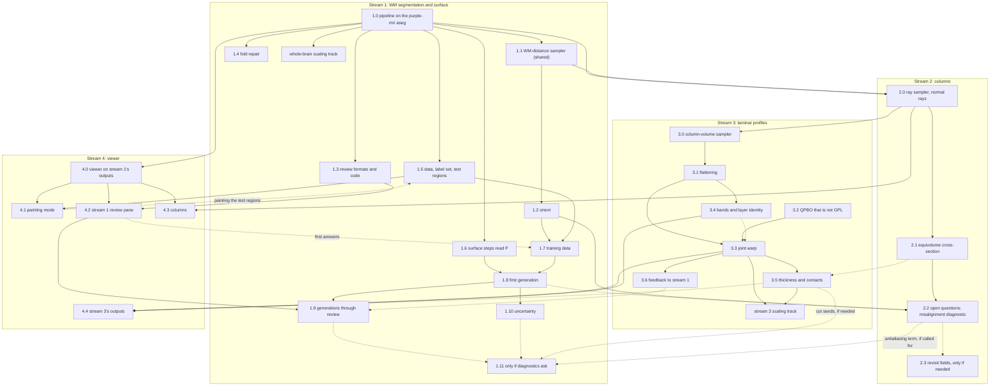

# Plan for restart of baillarger

## The approach

Most tools define a white surface and a pial surface, then treat the cortex as everything between them. We do not.

- **There is no true GM/WM boundary to find,** so we build only an approximate white surface. It may sit somewhat inside the GM or the WM.
- **The white surface exists for its normals.** We ask that its normals align with the cortical normal, so that columns traced from it run along the cortex's normal. That is how white-surface methods are judged, not by where the surface sits.
- **Everything along a column is read from the image.** The contrast along the columns identifies the laminae, the GM/WM transition and the pial edge of the cortex. Each is aligned across columns after the fact, like any other layer. There is no separately built pial surface; the pial edge is a level of that alignment.

**Why other tools take the two-surface frame, and why we can drop it.**

- **In vivo tools have no laminar contrast.** Surface tools (FreeSurfer, CAT12, CIVET) work at about 1 mm, where the two tissue-class boundaries are the only signal. In vivo laminar tools (LayNii; Nighres' volumetric layering, Waehnert 2014) work at about 0.5–0.8 mm, with no laminar contrast to read, so they impute layers from geometry between two boundaries. For all of them the frame is a consequence of the data.
- **Ex vivo MRI pipelines inherit that frame.** Edlow 2019 and purple-mri segment GM and WM and build FreeSurfer-style surfaces. Edlow's 100 µm data shows laminar contrast, but, as far as we know, the pipeline does not use it to define the cortex.
- **Our data has laminar contrast,** so the image can decide what other tools must impute.

**Precedents.**

- FreeSurfer's `mris_make_surfaces` already finds the pial edge from intensity along each vertex normal, but it then builds a surface and treats the cortex as the region between surfaces. The mechanism has precedent; the strategy does not.
- BigBrain (Wagstyl 2018, 2020; histology at 20 µm) has strong laminar contrast and still builds both surfaces first, reading layers between them. Its network nonetheless placed the layer 6/WM boundary away from the tissue-class white surface, which supports the premise that there is no single true GM/WM boundary.
- Not checked: whether any ex vivo or histology work reads the pial edge from profiles without a prior surface. The earlier survey did not cover every ex vivo pipeline.

## About this document

What the work so far has established, for a clean start.

This document states current knowledge only. How the project got here is in git, the PRs and the reports. Each item points to its evidence:

- `#N` is https://github.com/mdtisdall/baillarger/pull/N.
- SF is `reports/Seismic flattening for cortical layers.md`, and Fn is its finding n.
- CP is `reports/Crossing paths and contacts from laminar profiles.md`.
- LS is `reports/Level-set filling test plan.md`.
- PE is `reports/Pial editing and edit priority.md`.
- CL is `reports/Cortical laminae segmentation lessons.md`.
- FS is `reports/Fused sulci and thickness priors.md`.
- PL is `PLAN_LAYER_REFINE.md`.

Open PRs the plan builds on (all open as of 2026-11-02):

| PR | What the plan takes from it |
|---|---|
| #69 | The geodesic-patch flat map, and the `edge_graph` fix (§7) |
| #80 | The review plan for tight folds (§3c, step 6) |
| #81 | The site finder and `wm-sites/1` |
| #82 | The `--white` volume pane |
| #84 | The brick volume viewer and its `BrickSource` |
| #85 | The fold repair and the initial white surface for normals |

**The data behind every result:**

- One right hemisphere, imaged with 7 T multi-echo FLASH in Fomblin: magnitude only, TE 9.37 / 20.71 / 32.05 ms, TR 80, flip 25°.
- The voxel is 0.16028 × 0.16 × 0.16028 mm, which is not isotropic.
- The aseg comes from purple-mri at native resolution.
- Most stream 2 and 3 results come from **boxes**: 141³-voxel crops (about 22.6 mm on a side) cut from the hemisphere volume round a test site (V1V2, M1S1, PCC_SPL). A **box face** is one of a box's six bounding planes, where the data is cut off. The results were checked against the user's marked points: M1/S1 23, V1V2 35, PCC pieces 22 and 37.
- Only stream 1 has run on the whole hemisphere.

## 1. Goals, constraints and working rules

### Goals

The work is split into four streams, each a tool:

1. WM segmentation and the white surface (§3)
2. Columns (§4)
3. Laminar profiles (§5)
4. The viewer (§6)

Each stream's section gives its goal, its high-level design, its implementation design (for each design step, its inputs and outputs, then its details and lessons) and its implementation plan.

Each stream publishes its outputs in a specified format and reads only the others' published outputs. Each reaches a first version good enough for the others to build on, then improves along its own course; a change in one stream should not force work in another.

**Two kinds of published output.** A *file* in a spec'd format, or a *sampler*: a versioned function in shared code (§7) that computes an output on demand, for a superblock and its halo, from published files only. A sampler has a written contract under `docs/formats/` like any spec (its inputs, parameters, outputs and units) and exact tests (phantoms, brute force, device equality), and it gives the same result for the same column or voxel whichever superblock asks. Streams may call each other's samplers, never each other's internals; a change to a sampler's contract is a spec change. Whatever can be computed locally from published files is a sampler, not a file: storing it would cost more traffic and space than recomputing it. The samplers: `orient` (stream 1), the ray sampler (stream 2), the column volume (stream 3), and the WM distance through tissue and curvature (shared).

### Constraints

These bind every stream from its first version. A first version may be rough, but its algorithms and data structures must be ones that scale.

- **Native resolution.** Work at the acquired resolution: 160 µm now, 50 µm whole brains later. Never decimate or downsample to make a step tractable. The decimated overview is for display only.
- **Whole brain.** The target is about 2·10¹⁰ voxels and 3.5·10⁸ surface vertices. Stages work on blocks with a halo stated in mm (§2, domain edges), with no whole-volume float arrays. Volumes are read through one reader, chunked when large: NIfTI-Zarr, 64³ chunks sharded in Morton order.
- **GPU where it pays at the large scale.** PyTorch: CUDA on big machines, MPS on the laptop, with numpy as the reference. Each device is tested against numpy on the laptop. These stay on the CPU, parallel over independent pieces: sequential steps (handle removal), I/O and checks.
- **Results identical across devices up to float32 rounding.** No discrete jump that rounding can flip.
- **Always 3D.** Slices only for seeding or display.
- **Standard formats where they fit, extended where scale needs it.** Volumes are NIfTI and surfaces GIfTI, with BIDS-derivative names and JSON sidecars that carry provenance. Where whole-brain scale needs more than a standard gives, extend it so that a standard reader still opens the file, and specify the extension:
  - `white-surf/1` is GIfTI with external binary data (nibabel reads it, memory-mapped), plus our own block index and edge keys.
  - Chunked volumes are to be NIfTI-Zarr, still a draft standard, exported to `.nii.gz` for other tools.
  - Where BIDS has no rule, names are BIDS-like and the spec records the choice.

  Each output, file or sampler (§1, Goals), has one written spec, enforced by one writer and one reader.
- **No GPL dependencies,** with no exceptions. Where only a GPL library fits, use a permissive one or write the piece ourselves. State the licence when proposing a library.
- **FreeSurfer is the model.** Its topology correction, pretess and strand thickening are the defaults to follow. Deviate only with cause and data. We do not run FreeSurfer, even as a benchmark.
- **A person decides only where the data cannot.** Places that need judgment go into one review queue per stage. Each answer is a replayable edit: the automatic result is correct without it, and the review refines it.
- **The WM label comes from our own segmentation** (from stream 1's phase 8; until then the purple-mri aseg, which gives labels only), which gives labels in the FreeSurfer convention and P(filled WM) (§3). The surface steps require both; there is no labels-only path once our own segmentation exists (stream 1's phase 8, §3d). The label is still an input with its own errors: take evidence from the echoes, not from the quirks of the labels.

### Working rules

- **Test, don't patch.** Diagnose first, then write a test with an exact answer that fails, then fix. Never move a threshold to hide a symptom.
- **Diagnostics over criteria.** While a method is exploratory, design each checkpoint around views the user can read, not pass/fail numbers. The default image view is echo 2 minus its local cortex level (§3c, step 3).
- **Keep principle, role and estimator apart.** Record each result against one estimator in one role. A failed estimator is not a failed principle.
- **Feasibility, not speed,** for prototypes and interactive tools. Correctness checks still apply.
- **Judge efficiency by analysis, not by wall time on the laptop.** For each algorithm, state:
  - its computational complexity in the sizes that grow (voxels, vertices, columns, candidate pairs);
  - its memory traffic: bytes moved per element, the working set per block, and whether it is bound by bandwidth or by compute.

  Evaluate both at whole-brain 50 µm on the target hardware. Laptop timings are supporting context only. A step that is quick on a 160 µm hemisphere can still be the wrong design if its cost grows badly, and a slow one can be right.
- **Heavy runs go under `scripts/memguard`,** one at a time, with the cap at about 1.5× the run's peak.

## 2. Facts that cut across streams

**The image** (CL; CP)

- Laminar contrast is mostly R2\*, and that is mostly iron that follows myelin. Dark is not always myelin: cell-dense layers can be dark too.
- What each echo gives:
  - Echo 3 has the most stria contrast but is the grainiest.
  - Echo 1 has the most SNR and the best tissue/Fomblin contrast, with noise about 0.6 of echo 2's.
  - R2\* proxies from two echoes are too noisy to use.
- **The noise is spatially correlated:** neighbouring voxels correlate at 0.5–0.67, even in deep WM. What works is a white-noise model with the same gradient power: the median smallest structure-tensor eigenvalue, corrected by the derivative filter's gain and the Wishart min-eigenvalue bias (0.68 at n_eff = 39). It needs no calibration (actual over predicted noise is 1.0–1.6).
- Laminar structure is planar at 160 µm everywhere, M1 included (median λ2/λ1 ≤ 0.20). Radial and tangential fibres give the same tensor signature.
- **No bias-field correction.** B1 fields at 7 T vary over about 18–60 mm (the bias FWHMs used with SPM and N4 at 7 T). Every intensity comparison here is local, over a few mm, or against Fomblin's near-zero level, and in the log a bias is additive with a negligible gradient at a voxel's scale, so the field cancels. The one global comparison is the network's per-image normalization; whether its errors follow position across the specimen is a diagnostic (3d, phase 11), and N4 (Apache-2.0) is added only if they do.

**The aseg we have, from purple-mri, errs in repeatable ways** (CP; SF F21; #46, #49)

These describe this one aseg, not asegs in general. It is the example data we have today, so these are the errors the tools must cope with now. Later versions of purple-mri may fix some of them, and another source will err in its own ways. Treat them as cases to test against, not as rules to build in.

- Its cortex runs 1–3 voxels into the Fomblin around most sulci.
- It fills thin fluid channels of collapsed sulci with cortex, and labels superficial vessels and thin Fomblin gaps at tight bends as cortex. These make false contacts. At V1V2, relabelling such cells took the columns crossing fused banks from 6,001 to 717.
- Missing tissue (excised blocks that the aseg imputes) is 14.6 % of V1V2's cortex label. It shows as FLASH below 0.25 × the cortex median.

**Domain edges: what the boxes taught**

The restart does not work on boxes. Two things from them still matter:

- **Read the box numbers with their edge bias in mind.** Most stream 2 and 3 evidence comes from boxes, and 65–99 % of column failures and a quarter to two thirds of contacts lay at box faces (SF F26, F27). The numbers here are evidence about methods; expect them to change on the hemisphere.
- **Blocked processing has the same edge effect at every block boundary.** Near any cut in the data, columns run out and fronts from beyond the cut never arrive, so their neighbours meet in their place. On the boxes it took regions at least 6 mm from every face, and leaving out roots within 2 mm of a face, to keep results clean. So a block's halo must reach as far as anything that crosses it: a column (up to the 8 mm length cap), a front, a smoothing kernel. Otherwise the result depends on where the block boundaries fall.
- **Halos are stated in mm, never in blocks.** A 64-voxel block is 10.3 mm at 160 µm but 3.2 mm at 50 µm, so "the neighbouring blocks" covers the 8 mm cap now and fails later. Reaches add up: a column reaches 8 mm outward and 2 mm inward from its root (§4b), so two columns can meet only if their roots lie within 16 mm, and finding meetings needs a 16 mm reach, sampling an 8 mm one. A halo copied round each 64³ block would cost ((B + 2h)/B)³ in reads: 216× for an 8 mm halo at 50 µm. Two things keep it small:
  - **Superblocks.** Stages with long reaches (streams 2 and 3) work on a coarser level of the same Morton order: a superblock of 8³ blocks is a contiguous run of the block index, 25.6 mm at 50 µm, and an 8 mm halo then costs about 4.3×. The level is chosen by analysis for the target hardware (its working set against GPU memory). The 64³ blocks of storage and of `white-surf/1` stay as they are.
  - **The halo is a set of reads, not a copy.** Volumes are sampled on demand through the chunked reader, with a chunk cache, and superblocks are visited in Morton order, so each chunk is read about once whatever the halo.
  - **Reaches compound, and the halo's columns are rebuilt.** For a superblock's own columns, the ray sampler reads labels within 8 mm and the WM distance within 16 mm (8 mm of ray plus the 8 mm cap), and to find their meetings it builds the rays (geometry, and V(s) for equivolume) of every column rooted within 16 mm. A caller with its own halo h adds h to each. The cache keeps reads near one per chunk, but the columns in the 16 mm ring are rebuilt by each superblock that needs them: about ((B + 32 mm)/B)³, roughly 11× at B = 25.6 mm. The superblock level is chosen with these figures, not the 8 mm halo alone (stream 2, phase 0).
  - **Capped distances are local.** A path through tissue shorter than 8 mm stays within 8 mm of its start, so the WM distance through tissue, capped at the 8 mm column length, is exact when computed per superblock with that halo. It needs no global pass and is never stored.

**Identity, topology and precision** (code; #61)

- **One tetrahedralization: the Kuhn split.** Voxel topology uses Kuhn adjacency (14 neighbours, the same for object and background), so the voxels' topology equals the mesh's. Do not use the (26,6) or (6,26) codes: their answers can disagree with the mesh.
- **Vertex identity is the grid-edge key:** lin(p) × 7 + (4 s_i + 2 s_j + s_k − 1), in int64. It survives remeshing, so anything stored per vertex keys on it.
- **The block layout:** the grid starts at voxel 0, with 64-voxel blocks in Morton order (i at bit 3b+2, j at 3b+1, k at 3b). A vertex is owned by the first block that uses it.
- **Precision:** mesh steps run in float32, with float64 only for the affine, area sums and intersection tests. Torch kernels use no float64, no CSR and no atomics, so each run gives the same result. An unavailable device is an error.
- **Manual inputs** are replayable and never baked into the source (`wm-edits/1`, #78). Answers at sites are edits, applied before the automatic step; scribbles are verified training labels only, too sparse to apply, and reach the labels through the next generation. Feedback from a later stream enters as review sites, so it reaches the labels only through a person's answer.

**Licences**

- **`thinqpbo` is GPL-3** (checked: its dist-info LICENSE), so it has to go. `surfcut.qpbo` wraps it for the joint warp. `src/` imports it only behind `surfcut.qpbo`; the prototypes call it.
- PyMaxflow and CHOLMOD are GPL and avoided. scipy's `maximum_flow` gives the same optimal cuts on int32 capacities. Keep the total below 2³⁰, because int64 silently returns a flow of 0 (#14).
- nnU-Net is Apache-2.0 (#86).
- Licences believed but not checked: Madagascar, CAT12/SPM and cut-pursuit are GPL; Nighres, LayNii, ANTs and HFM/agd are not.

**Tooling and libraries**

- Numba is a hard dependency: mesh intersection takes 0.2 s against 13 s in numpy, and a simple-point test 0.3 µs against 59 µs (#8).
- CVXPY's HiGHS breaks OR-Tools CP-SAT in the same process, so the CVXPY reference runs in its own uv project (#61).
- CI needs uv's download cache once torch is required (#63).

## 3. Stream 1: WM segmentation and the white surface

### 3a. Goal

One or more closed surfaces without handles (genus 0 each; an excision can cut a piece off) near the grey/white-matter boundary of each hemisphere (the "white surface"), at the acquired resolution, whose normals are the cortical normals.

### 3b. High-level design

1. **Segment the WM.** Our own nnU-Net segmentation of the FLASH gives labels in the FreeSurfer convention, a probability of filled WM and its spread across folds. It is trained in generations through human review, starting from the purple-mri aseg as seed labels.
2. **Correct the topology (`dseg`).** Apply the edits, fill the WM mask, then remove handles and cavities and repair tight folds, automatically.
3. **Orientation from the image (`orient`).** The structure tensor of the echoes over cortex, and from it the data normal and its coherence: the image's own cortical normal, against which the surface is judged and stream 2's rays are checked (the misalignment diagnostic).
4. **Make the surface (`mesh`).** Antialias the corrected mask and contour it by blocked marching tetrahedra into `white-surf/1`.
5. **Make an overview for display (`overview`).** A decimated mesh that maps every pick back to true vertices.
6. **Review.** Gather the places that need judgment into one queue per hemisphere. Each answer becomes an edit for step 2 and a training label for step 1.

**The flow runs one way. Feedback enters only as inputs.**

- The flow: input label + edits → `dseg` (automatic correction, with a fixes image) → white surface.
  - No later step writes back into the input label or into `dseg`. The surface stage never changes the label it read.
  - The automatic fixes (cuts, fills, thickening) stay in the derivative and its fixes image. They never become part of the input.
- The loop closes through inputs. A person's answer becomes an edit: the verified label of each voxel it covers, valid for any input. Stream 3's feedback enters as sites in the review queue; the answers to them are verified labels like any other. Stream 1 then reruns from the start.
  - Edits are kept apart from the automatic changes, so they apply again when the correction changes.
  - `DecidedAgainst` records the SHA of the `dseg` the person looked at, so a rerun can list the answers whose context changed (`wm-edits/1`, #78).
- Steps 2–5 must not depend on which generation produced the label.

**Standing decisions**

- **The white surface exists for its normals, not its position.** Columns start on it and run along its normals. There is no pial surface and no "true GM/WM boundary": the GM/WM transition is aligned afterwards like any other layer.
  - Judge methods by normal quality: neighbour-angle spread, misfacing faces, cancellation in thin blades, and agreement with the data normal from the image (step 3).
  - The surface may move into GM or WM to make normals well defined, as long as it keeps the topology and does not self-intersect.
- The input label is never rewritten. Corrections are derivatives, and manual edits are replayable inputs applied before the automatic correction.
- The generator fixes topology automatically, with no question per handle. Review refines a result that is already correct.
- WM may grow into cortex: thin gyral WM is thickened, not removed, as FreeSurfer's mri_segment does.
- The meshing uses no cortex label. Every white-mesh vertex is a column root, and what columns pass through is for later stages to judge.

### 3c. Implementation design

Measured numbers in this section come from the one hemisphere we have, segmented by purple-mri, whose aseg bootstraps our model. Read them as evidence about methods: our own labels may show other defects. That aseg's own errors are in §2.

#### Step 1: our own WM segmentation

*Inputs*

| Input | From | Use |
|---|---|---|
| The three FLASH echoes | the scan | the network's channels |
| Seed labels | the purple-mri aseg (bootstrapping only; 3d, phase 7) | weak training labels |
| Verified answers (`wm-edits/1`) | step 6 | training labels |
| Test regions | labelled from scratch (3d, phase 5) | evaluation only, never training |

*Outputs*

| Output | Spec | Used by |
|---|---|---|
| `_dseg`: labels in the FreeSurfer convention; excisions are outside | none yet | step 2 (the filled mask) |
| `_label-WMfilled_probseg`: P(filled WM) | none yet | step 2 (where handle walls fall, and each fix's margin in the fix table, which step 6 reads); step 4 (the antialiasing data term) |
| `_label-WMfilled_desc-foldsd_probseg`: the spread of P across folds | none yet | step 6 (ranking the queue) |
| The model generation, in each sidecar | none yet | tracing a label to its model |

*Design and lessons*

*Aim.* The white surface needs per-voxel evidence from the FLASH itself: a probability of filled WM, improved wherever a person has answered. The network is the means to that, not a goal of its own.

*What it is*

- nnU-Net v2 (Apache-2.0), `3d_fullres` with a residual-encoder preset (M or L), trained on the three FLASH echoes as channels.
- It is trained in generations, through continuous human-in-the-loop review. Each generation segments the hemispheres, the review queue corrects its output (step 6), and the verified answers join the training labels for the next generation. No number of hemispheres or generations is fixed in advance. This needs:
  - held-out test regions that never enter training, so each generation can be compared with the last;
  - the model generation recorded in each output's sidecar, so a label can be traced to the model that made it;
  - a choice, at each generation, of whether to rerun earlier hemispheres with it. A rerun changes everything downstream of the label.
- **Bootstrapping.** The first generation trains on the purple-mri aseg as weak seed labels, and verified labels gradually take their place (3d, phase 7). Until the first generation exists, the whole pipeline runs on that aseg (3d, phase 0).

*Probabilities*

- Steps 2 and 4 require labels and P; there is no labels-only path. The one exception is the bootstrap: the current code's labels-only path runs on the purple-mri aseg from phase 0 until our first generation's P replaces it (phase 8). During bootstrapping there is no P, so the queue has neither margins nor fold spread: it ranks by site kind and wall size (step 6).
- During bootstrapping there is no P: purple-mri gives labels only, and no probabilities are expected from it. The surface steps' P-reading code is still written and tested on phantoms first (3d, phase 6), so the surface work does not wait for the network; it runs on the hemisphere once the first generation exists.

The coupling that is real, decided once:

1. **The label set.** The filled mask is `FILLED_LABELS` (WM, lateral ventricle, caudate, putamen, pallidum, thalamus, CC; whether the hippocampus joins them is open). The network must output at least these classes, and the hippocampus as a class of its own, separately from cortex and outside, or the surface changes.
2. **Excisions are outside.** Blocks cut out before the scan are labelled outside, like any other Fomblin; the label set has no missing-tissue class. Where the data ends needs no label and no stored output (the rule for cut faces).
3. **Calibration.** P must be calibrated near 0.5, because step 2 places walls by it. Calibration is a diagnostic of every generation.
4. **The defect count.** The number of handles and cavities before correction sets the length of the review queue (step 6). It is a diagnostic of every generation, not a target to optimise inside the network.
5. **Partial volume: the majority rule.** A voxel takes the class that fills most of it. A fluid channel narrower than half a voxel, or two banks pressed pia to pia with no fluid, is therefore cortex in the labels.
   - Why: a label per voxel cannot hold two interfaces inside one voxel, whatever rule it follows. Forcing a channel open in the labels (the skeleton insertion of CRUISE's ACE and CIVET's CLASP) gets the topology right by moving each bank's pial edge by up to half a voxel, and it still fails where the banks touch with no fluid.
   - The majority rule keeps P close to a tissue fraction at mixed voxels. Step 2 places walls where P is 0.5 and step 4 reads P − 0.5 as a position finer than a voxel; both assume this.
   - It is the same rule at every resolution: at 50 µm the narrower channels are resolved and the rule does not change.
   - Separating the banks across such a channel is not the labels' job. Stream 2 passes through it and records the meeting, and stream 3 places the pial edge there from the profiles (§5c, step 5, *Contacts*). This follows FreeSurfer, whose labels fuse the banks and whose surfaces keep them apart; here the columns keep them apart.
   - Labellers (test regions, scribbles, site answers) follow the rule, and the label-set spec states it.

*Decisions taken*

- The network gives evidence. Topology is guaranteed after it, by our own code (`handles`, `antialias`), never by the network.
- Steps 2 and 4 require P as well as labels.
- Only verified labels train later generations.
- Test regions are labelled from scratch and never trained on.
- **Labelling happens in our own viewer** (stream 4): the test regions, the site answers and the scribbles. It reads the blocked formats we rely on (NIfTI-Zarr volumes, `white-surf/1` with its block index, the overview), so a person can label anywhere in a whole brain at full resolution, against the surface. ITK-SNAP and 3D Slicer load whole volumes into memory and read neither format, so at 50 µm they would only ever see exported crops. The viewer also writes answers directly as spec'd edits (`wm-edits/1`). ITK-SNAP stays only as an escape hatch for free painting on an exported crop.
- **nnU-Net is an external tool, not a package dependency.** Only the export and import modules know about it: the export writes nnU-Net's raw dataset format, nnU-Net is called on it (on the cluster for training), and the import reads its predictions back into spec'd outputs.
- Training runs on a compute cluster with CUDA GPUs; how to reach it is to be settled when training starts. At 160 µm, inference and data preparation can run on the laptop; at 50 µm, inference runs on the cluster (scaling item 8).

*Literature* (from memory; check before citing)

- nnU-Net v2 and residual encoders: Isensee et al., *Nature Methods* 2021; "nnU-Net revisited", MICCAI 2024.
- Sparse labels with the ignore label: Gotkowski et al., "Embarrassingly simple scribble supervision for 3D medical segmentation", 2024.
- Interactive refinement: Wang et al., DeepIGeoS (TPAMI 2018) and BIFSeg (TMI 2018); MONAI Label (Diaz-Pinto et al., *Medical Image Analysis* 2024); nnInteractive (arXiv 2503.08373).
- Topology correction from probabilities: Han, Xu and Prince (topology-preserving level sets); Bazin and Pham (fast-marching topology correction, TOADS); Ségonne et al. (FreeSurfer's defect correction).
- Distance outputs: Xue et al., AAAI 2020; Navarro et al., MLMI 2019; Ma et al., MIDL 2020; for cortex, SegRecon (Gopinath et al. 2021), DeepCSR (Cruz et al., CVPR 2021), recon-all-clinical (Gopinath et al. 2024).
- Uncertainty: Kendall and Gal, NeurIPS 2017; β-NLL, Seitzer et al., ICLR 2022.
- Partial volume: mixel models (Santago and Gage, 1993); Shattuck et al. 2001 (BrainSuite); Van Leemput et al., IEEE TMI 2003; FSL FAST (Zhang et al. 2001); Tohka et al. 2004; PV-SynthSeg (Billot et al., MICCAI 2020).
- Multichannel structure tensors: Di Zenzo, *CVGIP* 1986; Weickert, *Coherence-enhancing diffusion of colour images*, 1999; Brox et al., nonlinear structure tensors, 2006.
- Thin sulci: CRUISE and its ACE (Han et al., *NeuroImage* 2004); CLASP in CIVET (Kim et al., *NeuroImage* 2005); FreeSurfer's pial surface and its self-intersection constraint (Dale, Fischl and Sereno 1999; Fischl and Dale 2000).
- Topology losses: Hu et al., NeurIPS 2019; clDice (Shit et al., CVPR 2021); Betti matching (Stucki et al., ICML 2023).
- purple-mri, the bootstrap labels: Khandelwal et al., *Imaging Neuroscience* 2024; the purple-mri repository (topology notes and surface scripts).

#### Step 2: topology correction (`dseg`)

*Inputs*

| Input | From | Use |
|---|---|---|
| `_dseg` and P | step 1; until phase 8, the purple-mri aseg, with no P | the filled mask; handle removal ordered by P |
| `_desc-wmedits_edits.tsv` and sidecar (`wm-edits/1`) | step 6 | edits applied before the correction |
| The FLASH | the scan | fixes chosen by intensity, only if adopted (Open) |

*Outputs*

| Output | Spec | Used by |
|---|---|---|
| `_desc-wmtopo_dseg`: the corrected labels; filled mask with Betti (b0, 0, 0) | `wm-dseg/1` | steps 3, 4 and 6; stream 2 (masks and stops) |
| `_desc-wmtopofixes_dseg`: 1 handle cut, 2 handle fill, 3 cavity fill, 4 manual edit (derivable from the diff; kept as the viewer's display layer) | `wm-dseg-fixes/1` | the viewer |
| `_desc-wmtopofixes_fixes.tsv`: one row per fix: id, kind, voxel count, centroid and bounding box in mm, wall size, signed margin in P (planned), whether it overrides an answer | `wm-dseg-fixes/1` | step 6 (ranking); process review |
| The fix diff: per changed voxel, its linear index, fix id, old label and new label, in Morton order (planned) | `wm-dseg-fixes/1` | replay and revert; process review across runs |

*Design and lessons*

- **Excisions** (PL). Blocks of tissue were cut out of the specimen before the scan, and the FLASH is black there. The purple-mri aseg labels them as if the tissue were there: 14.6 % of V1V2's cortex label.
  - The detector (FLASH below 0.25 × the cortex median after smoothing by 2 voxels, in blocks of at least 250 voxels, grown by 0.3 mm) works only against an aseg that imputes tissue, since Fomblin outside the specimen is as dark. It is a bootstrap tool: on the purple-mri hemisphere it relabels excisions to outside in phase 0's published labels, so the surface closes there; in the seed labels its excisions are ignore (3d, phase 7), so the network never learns the detector's guess. Its map of the excisions is kept as a test set for stream 3 (whether profiles alone find cut tops, §5c, Open). Once our own labels exist, it has nothing to do.
- **The filled mask** (#61, #66, #67). Aseg 41 plus 43, 49–52 and 192 (right hemisphere; 2, 4, 10–13 and 192 left), with cavities filled. The deep structures (ventricle, thalamus, ...) belong in the mask. Whether the hippocampus (53 right, 17 left) is inside the white surface or outside it is open, to be decided once there is data (Open); the surface results in this section were measured with it outside. Excisions are outside (rule below). A voxel cut from the mask takes the label of the nearest (mm) voxel outside it.
- **The rule for cut faces.** A cut face is a domain edge: close the surface there and invent nothing. This covers excisions and the knife faces where the hemisphere was separated (through the corpus callosum and the diencephalon). Nothing about it is stored.
  1. **Excisions are outside.** The labels have no missing-tissue class. The filled mask, handle removal and the cavity fill run as usual, and a fill into an excision is an ordinary fill into outside (whichever changes fewer voxels): a plug where there is no data alters nothing real, whereas forbidding it would force cuts through real WM.
  2. **Where the filled mask touches outside, the face is a cut.** In normal anatomy cortex always lies between the filled mask and outside. So a root whose ray goes from WM straight into outside, with no cortex between, is on a cut face: the knife faces and every excision through WM. Stream 2's label intervals show it directly; no threshold, no seeds, no flag.
  3. **Excisions through cortex only** look, in the labels, like cortex reaching the pia. Whether stream 3's profiles tell a cut top apart (a truncated layer sequence; the error grows with the depth cut away) is tested against the bootstrap detector's excision map (§5c, Open). If they cannot, the fallback is cut seeds placed by the reviewer and grown into the cut (Open).
- **The guarantee still holds.** The mesh of any voxel mask is closed, and `dseg` refuses to write unless the Betti numbers are (b0, 0, 0). An excision that cuts a gyrus clean off makes another piece, which `wm-dseg/1` already allows: one or more closed, genus-0 pieces. What changes is that part of the surface is not grey/white; the rays from it show that directly.
- **Handle removal** (`handles.remove_handles`; #38, #48, #67):
  - Topology uses Kuhn adjacency, so it equals the mesh's (§2).
  - Object and background fronts grow by simple points. Each handle's wall is cut or filled, whichever changes fewer voxels; ties go to the cut, then to the lowest voxel index.
  - Walls that block each other are claimed as sets (Mayer–Vietoris), or voxels are stranded.
  - Fills of one piece can touch another piece, so check the union's Betti numbers and refuse to write unless b1 = b2 = 0.
  - On the hemisphere: Betti (1, 111, 182) → (1, 0, 0) in 3.4 min at about 22 GB. Most moves are 1–2 voxels.
  - The meeting wall need not be the smallest cut: one cut of 2,047 voxels ran along a thin strand.
  - Batching walls per pass changes the result, so don't.
- **Handle removal by probability** (planned; 3d, phase 6). The fronts claim voxels by P, not by distance to the other phase as the current code does: the object front claims in order of decreasing P and the background front in order of increasing P, so each wall falls where P is closest to 0.5. That is right only if P is calibrated near 0.5. Each fix records its margin in the fix table, and the review queue ranks by it. P matters to the surface mainly here: it decides which side of a fused bank a cut falls.
- **Fluid channels and vessels in purple-mri's cortex** (`pial_labels`, #46, #49). Purple-mri fills thin fluid channels of collapsed sulci, and superficial vessels, with cortex (§2). A detector finds them: closed-form darkness against the local cortex level at α = 10⁻³ (step 3), fluid fraction above ½ (the majority rule, 3b), a noise-bound component size, the stria trap. At V1V2, relabelling them took the columns crossing fused banks from 6,001 to 717.
  - It is a patch for one source's error, so it is a **bootstrap tool only**, like the excision detector: where it fires inside purple-mri's cortex, the seed labels are set to ignore (3d, phase 7). It never writes fluid into a published label, so the network is trained neither on purple-mri's error nor on the detector's guess.
  - Past the bootstrap, channels are the labels' job: visible channels are fluid under the majority rule, the network learns them from verified labels, and stream 3 reads the pial edge from the profile where a channel is missed. The diagnostic: recall of thin fluid channels on the test regions, per generation (phase 11 holds the remedy for thin structures if it stays poor).
- **Answers before the correction.** `dseg` replays the answers on the input labels in the order they were made, each writing its voxels over whatever is there, so a correction to an earlier answer is simply a later answer. The SHA in each answer records which `dseg` the reviewer looked at; it is provenance, not a gate, so answers apply to a new generation's labels unchanged.
- **The topology guarantee wins over an answer, and says so.** Handle removal and the cavity fill rank verified voxels last, so they avoid them where they can. Where a defect can be fixed only through a verified voxel, `dseg` still fixes it, marks the fix in the fix table as overriding an answer, and the site goes to the review queue. No verified voxel changes silently.
- **Fixes are kept as a diff** (planned). `dseg`'s change from what it read (the input labels with the edits applied) to what it wrote is published split into fixes: a table with one row per fix, and a sparse diff with each changed voxel's fix id, old label and new label, in Morton order (12–16 bytes per changed voxel; about a megabyte for a hemisphere).
  - **The margin** of a fix is the mean of P over its wall (its own voxels), signed so that a positive value supports the choice: 0.5 − mean P for a cut, mean P − 0.5 for a fill. `dseg` computes it while it has the wall; the queue ranks the most negative first, with the wall size beside it.
  - **Replay and revert.** Input labels, edits and diff reproduce `desc-wmtopo` exactly, and a rerun checks that it reproduces the stored diff (a test of determinism across devices too). Any one fix can be reverted for inspection.
  - **Every run's diff is kept,** with the SHAs of its input labels, P, edits and code version in its sidecar. Diffs are small, so the history costs little, and it supports process review across generations: which fixes a new generation no longer needs, which moved or flipped between cut and fill, which reviewers overturned, and how fix counts and margins evolve. Fixes are matched across runs by voxel overlap.
- **Tight folds (misfacing faces)** (#81, #85). On the hemisphere the surface has 152 at 91 sites. Diagonal-only contacts in the label cause most of them: 74 of 90 sites have a checkerboard or corner-only contact within 4 voxels.
  - Thicken to 2s, widen gaps between surfaces, then make the mask well-composed, at s = 0.30 mm. This takes 90 sites to 5 and edges over 60° from 297 to 4, at a cost of +3.9 % area and a 90th-percentile neighbour angle of 5.4° against 3.9°.
  - s must not be a whole number of voxels along any axis: at 0.32 mm (exactly 2 voxels on one axis) the checkerboards rise from about 390 to 7,000. 0.26 mm is worse on every count; above 0.30 mm the bulk and area grow.
  - Synthetic antialiased phantoms make no misfacing faces, so fold tests need hand-built folds plus a hemisphere run.
  - Doesn't work: forcing cuts, with no fills into cortex (90 → 131 sites); voxel opening at 0.24–0.40 mm (worse at every radius, grows the area, cascades over passes).
  - Relaxing the level set needs a local "no new blade or gap voxel within s" test, or the thin-plate energy shrinks widened gaps and blades into slivers. With the test it keeps 95 % of the gain on crops, but misses tubes.

#### Step 3: orientation from the image (`orient`)

*Inputs*

| Input | From | Use |
|---|---|---|
| All FLASH echoes (trend-removed log) and their gradient-noise covariance C (§2's noise model, across echoes) | the scan | the structure tensor |
| `_desc-wmtopo_dseg` | step 2 | cortex mask for the convolution |
| WM distance through tissue, capped at 8 mm, with fluid and outside as obstacles | computed per superblock from `_desc-wmtopo_dseg` (shared code, §7) | the sign of the data normal |

*Outputs*

| Output | Spec | Used by |
|---|---|---|
| The structure tensor per cortex voxel (6 unique components), at derivative scale 1 voxel and integration scale 2 voxels | not stored: computed on demand for a superblock and its halo | the data normal and coherence below; stream 3 (planned checks of laminar orientation) |
| The data normal (the tensor's leading eigenvector, signed by WM distance through tissue) and its coherence | not stored: computed on demand | step 4 (judging the surface's normals; a term only if adopted, Open); stream 2, step 2 (diagnostics: how far each ray departs from it); the viewer, per brick on screen |

*Design and lessons*

- **The local cortex level** (the "trend"): the log intensity's normalized convolution over the cortex mask with a Gaussian of σ in mm. It is spatial, not a depth trend, so it needs no columns. Its job is the cortex's level at a point with the laminae averaged out, and two bounds set σ:
  - **Laminae must not leak into it.** The slowest laminar component is the whole profile, wavelength about one cortical thickness T. A Gaussian keeps exp(−2π²σ²/λ²) of a wavelength λ, so a leak of at most ε at λ = T needs σ ≥ T·√(ln(1/ε)/(2π²)). With T = 2.0 mm (the thinnest cortex measured, M1/S1) and ε = 0.05, σ ≈ 0.8 mm. Once σ nears T/2, the mask also forces the average along the sheet, over the full depth.
  - **It must follow real changes in the cortex's level,** above all areal borders: a Gaussian smears a step over about ±2σ, so σ ≤ T/2 ≈ 1 mm keeps the bias within one cortical thickness of a border.
  - **Diagnostic:** the level's correlation with depth along normal rays at the test sites (laminar leakage) and its ramp across known areal borders.
  - The current code uses 4 voxels (0.64 mm), just below the lower bound.
- **The data normal:** the whitened multichannel structure tensor of all the log echoes, each minus its local cortex level (a high-pass whose use here is tested: the depth trend it removes points along the normal and is signal for orientation; Open), J = Σ Gᵀ C⁻¹ G over the window (G the echoes' gradients, one row per echo; C their gradient-noise covariance), at derivative scale 1 voxel and integration scale 2 voxels, by masked normalized convolution over cortex.
  - **The two scales stay in voxels on purpose:** the derivative scale is the finest the data resolves, and the integration scale fixes the noise statistics that §2's noise model and its Wishart correction (n_eff) depend on. Review both at 50 µm, where 2 voxels is a 0.1 mm window.
  - **Coherence** is c = (λ₁ − λ₂)/(λ₁ + λ₂) from the tensor's two largest eigenvalues, clipped to [0, 1]: 1 for planar structure, 0 where the two leading directions are equal. Noise adds about equally to every eigenvalue, so it lowers coherence where the signal is weak.
  - **Why all echoes.** In the log, ∇log I_e = ∇log ρ − TE_e ∇R2\*: every echo carries the same proton-density and T1 term, plus the R2\* term scaled by its TE. Both are laminar evidence and, since laminae are planar (§2), both point along the cortical normal, so echoes add aligned signal; the only question is their weight against noise. Whitening by C is the maximum-likelihood answer under the Gaussian noise model, so the data set the weights per specimen and protocol, and no subset of echoes is hard-wired. (Earlier work used echoes 2 and 3 only, without a stated reason.)
  - **C** extends §2's calibration-free noise estimate from one echo to the cross-echo covariance; if the echoes' noise is independent, C is diagonal and each echo is weighted by 1/σ_e².
  - **Diagnostics:** each echo's own tensor and its share of J's trace, by depth and region; views of where one echo's normal departs from the combined one. The echoes agree within 10° in about 91 % of interior cortex (SF F1, echoes 2 and 3).
  - **A risk near edges.** Echo 1 has the best tissue/Fomblin contrast, so the pial edge, vessels and fused-sulcus partial volume give it the largest gradients, which can pull the normal towards a tissue edge rather than the laminae. All echoes share this; the remedy, if the diagnostics call for one, is in the window (robust down-weighting near edges), not in dropping an echo (Open).
  - Coherence falls to 0.05–0.38 at contacts and fundi, which is where most column failures happen.
  - The normal has no sign. Sign it by the WM distance through tissue, with fluid as an obstacle. A straight-line distance flips the sign beside open sulci (CP; #46).
  - Under the majority rule (3b), a fused sulcus is cortex in the mask, so a window there can take in both banks. Coherence already falls at contacts, which marks those voxels; whether the window should also stop where the two banks' WM-distance fronts meet is open.
- **A sampler, not a file.** Every quantity here is local: derivative scale 1 voxel, integration scale 2 voxels, and the sign from the capped WM distance (§2). Recomputing reads the three echoes (12 B per voxel) and runs a few separable convolutions, so it is bandwidth-bound with little compute; reading a stored result would cost 24 B per voxel for the tensor or 16 B for the normal and coherence, and about 10¹¹ bytes of storage for a 50 µm whole brain. So `orient` is code with a written contract (the echoes, the scales, the sign rule), called for a superblock and its halo, like stream 3's column volume. A cache is an optimisation to add later if the viewer needs one, not an interface.
- It needs only the echoes and the corrected labels, not the surface, so it can run beside step 4. It belongs to stream 1 so that the surface's check and stream 2's misalignment diagnostic call one piece of code, and no stream waits on another in a cycle.
- **Doesn't work:** tracing step by step along the raw tensor normal: no field, no stop, so paths stall and run on (SF F3). Stream 2's rays use no field (§4c).

#### Step 4: the surface (`mesh`)

*Inputs*

| Input | From | Use |
|---|---|---|
| `_desc-wmtopo_dseg` | step 2 | the filled mask |
| P | step 1 | the antialiasing data term |
| The data normal and its coherence | step 3 | diagnostics only: agreement of the surface normals with the image (a term in the surface only if adopted, Open) |

*Outputs*

| Output | Spec | Used by |
|---|---|---|
| `_hemi-<h>_white.surf.gii` (+ `.dat`): vertices and triangles | `white-surf/1` | step 5; stream 2 (roots); stream 3 (column graph); the viewer |
| `_desc-normals_white.func.gii`: unit normals | `white-surf/1` | stream 2 (ray directions) |
| `_desc-normlen_white.func.gii`: the length of the averaged normal before renormalising, \|n̄\| in [0, 1] (phase 0) | `white-surf/1` | stream 2 (recorded per column); stream 3 (weighing evidence) |
| `_desc-edgekeys_white.func.gii`: each vertex's grid-edge key | `white-surf/1` | every per-vertex output downstream |
| `_desc-blocks_white.tsv`: the block index | `white-surf/1` | blocked readers downstream |

*Design and lessons*

- **Antialiasing beats smoothing** (#61; SF F28).
  - A thin-plate field φ with φ ≥ ε on the mask and φ ≤ −ε off it, in a band of the signed distance, solved by FISTA with restarts in PyTorch.
  - Each vertex stays on its own grid edge, so the surface has no self-intersections by construction and keeps the edge keys.
  - A tilted plane's normals come out within 0.5° (the raw staircase is 31° off).
  - On the hemisphere: one closed genus-0 piece, 12.7 M vertices, 25.3 M faces, no self-intersecting faces; CPU and MPS identical bit for bit; 1,651 iterations, 16 min on MPS, peak 20–24 GB.
- **Antialiasing with probability** (planned; 3d, phase 6). Besides thin-plate smoothness, a data term pulls φ near the boundary towards a smooth function of P − 0.5, weighted by a per-voxel confidence (1/σ², once σ exists). The sign constraints stay, so the topology and the freedom from self-intersection stay guaranteed. This smooths the staircase where P carries sub-voxel information; position finer than a voxel is a by-product, not a goal.
- **Smoothing is the wrong tool here:**
  - Smoothing the label and then contouring loses 2-voxel WM blades: at σ = 1 voxel it loses 16 % of V1V2's thin WM, shrinks convex surfaces by about σ²κ, and makes slivers.
  - Taubin λ|μ smoothing is unstable at short cutoffs. Tukey twicing never amplifies.
- **Limits of any binary label.** Its terraces limit curvature and normals below about 1–2 mm on surfaces near a grid axis, whatever the method. Thin-blade normals keep as little as 0.56 of their length after averaging (`docs/scaling.md`): near a blade's crest the two faces point opposite ways and cancel. Stream 1 publishes the averaged normal's length per vertex, and the readers weigh roots by it.
- **Normals** point out of the WM: area-weighted, then 10 smoothing steps.
- **Curvature is not published.** Its scale is an open question downstream (§5c, Open), so readers compute it from `white-surf/1` with the shared curvature code (§7), at the scale they are testing.
- **Curvature** (SF F28): the 0.32 mm mesh with curvature at 0.48 mm agrees with quadrics fitted to the voxel faces (rank correlation 0.85–0.98), with about half their jitter.
  - Never take curvature from the Hessian of a smoothed signed distance: it mixes the two sides of thin blades.
  - Valence-weighted smoothing biases Gaussian curvature. Use smoothing that keeps mass.
- **Doesn't work** (both from SF F28, which tested the surface as the start of anything that grows from it, such as a front or a level set; the smooth surface there was a mesh smoothed by twicing at 0.32 mm, which the antialiased surface now replaces):
  - **Refining the grid instead of smoothing the boundary.** The idea was to get sub-voxel accuracy by running a level set on a grid twice as fine (80 µm), started from the signed distance to the label's own voxel faces (or to the binary contour). It fails because the label's half-voxel steps are in the boundary data, and a finer grid reproduces them faithfully:
    - 6–11 % of the points within 2 voxels of the surface got the wrong inside/outside sign: they lie between the true surface and the label's steps.
    - The closest-point (foot) map jumped by more than 2 grid steps between neighbouring points at 7–11 % of pairs, so neighbouring points were assigned roots far apart.
    - The signed-distance error kept a spread of 0.05–0.08 mm on both grids: refining did not shrink it.

    A smooth surface, by contrast, gave no wrong signs, a foot-map jump p95 of 1.05 steps, and a spread of 0.013 mm. A finer grid only reduces the solver's own error, so it is worth having only once the start surface is accurate below a voxel.
  - **Taking inside/outside from the closest face's normal.** A signed distance to a mesh needs the sign of each point: inside or outside. Reading it from the normal of the face that holds the closest point fails when the closest point lies on an edge or a vertex, which is common on a staircase-like surface: on the 2× grid, points sat exactly in a face's plane, the dot product with its normal was 0, and they got distance 0 with no sign. Use the angle-weighted pseudonormal of the closest feature (face, edge or vertex; Bærentzen and Aanæs 2005), which gives the right sign on any closed mesh. An exact test covers this case.

#### Step 5: the overview (`overview`)

*Inputs*

| Input | From | Use |
|---|---|---|
| `white-surf/1` | step 4 | the mesh to decimate |

*Outputs*

| Output | Spec | Used by |
|---|---|---|
| `_desc-overview_white.surf.gii`: the decimated mesh | `white-overview/1` | the viewer |
| `_desc-overviewids_white.func.gii`: the true vertex of each overview vertex | `white-overview/1` | the viewer (picks) |
| `_desc-overviewcarry_white.func.gii`: the true vertices each face carries | `white-overview/1` | the viewer (mapping back) |

*Design and lessons*

- `decimate` (#70–#77): 25.3 M → 210 k faces at ε = 0.1 mm in 186 s, keeping topology, the ε bound, unmoved true vertices, orientation and no self-intersections. The Numba block worker is bit for bit the Python reference.
- The fold test must compare against the input normals each face stands for, not the face's last state; otherwise 1,027 faces turned over.
- Pairs of sheets closer than 2ε at necks cross. Pinning the crossing faces' input vertices and re-decimating clears them.
- Map anything back to true vertices with the decimation's own carried-vertex map. A nearest-face search lands on the wrong side of thin sheets.
- For display only: nothing is measured on it.

#### Step 6: review

*Inputs*

| Input | From | Use |
|---|---|---|
| Corrected labels and fixes image | step 2 | finding sites |
| P and fold spread | step 1 (from phase 8) | finding and ranking sites |
| Sites from stream 3: where the GM/WM transition along the columns disagrees with the WM label | stream 3, step 6 (`wm-sites/1`) | more sites |
| The fix table | step 2 | ranking by wall size; by margin from phase 8 |
| The surface | step 4 | finding sites (tight folds, misfacing faces); display |
| The FLASH | the scan | display |
| The overview | step 5 | display in the viewer |

*Outputs*

| Output | Spec | Used by |
|---|---|---|
| The sites in the queue | `wm-sites/1` (#81) | the viewer's review pane |
| The answers: `_desc-wmedits_edits.tsv` and sidecar | `wm-edits/1` | step 2 (edits); step 1 (verified training labels) |

*Design and lessons*

The design follows `wm-edits/1` (#78), the review plan in #80 and the site finder in #81.

- **The queue.** The pipeline finds the sites that need judgment and gathers them into one queue per hemisphere, after the automatic result:
  - tight folds (`wm-sites/1`) and large handle fixes, by wall size (from phase 3);
  - fixes that override an answer (from phase 3);
  - the fixes with the smallest margin in P (from the fix table; from phase 8, when P exists);
  - the places with the largest fold spread, where the model is least sure (from phase 8);
  - stream 3's sites, where the profiles disagree with the WM label (from stream 3's phase 6).

  During bootstrapping the queue ranks by site kind and wall size; margins and fold spread join it from phase 8.
- **Each answer serves twice:**
  - as an edit that corrects this hemisphere now;
  - as a verified label for training the next generation.
- **Answers stand on their own.** Each is the verified label of each voxel it covers, valid for any input, not a diff against one segmentation. That way answers survive from one generation to the next. Each records its site (if any), choice, time and the SHA of the `dseg` the person looked at. An answer with no voxels (`leave`) is recorded too, so the site counts as answered.
- **The answer log is append-only.** A correction is a new answer that supersedes an earlier one, never a rewrite, so the log is its own history: what each reviewer saw and chose, and when. Together with the kept fix diffs, it shows how later generations agreed with each answer.
- **Two kinds of answer:**
  - **Site answers:** at a site from the queue, the viewer offers a few concrete choices with previews: `remove-strand`, `thicken`, `fill-gap`, `widen-gap`, `leave`, `manual-paint`. Each choice is a function of the current label that returns the voxels it changes. ITK-SNAP, on an exported crop, is the escape hatch for free painting.
  - **Scribbles:** a few strokes, each marking its voxels with one class from the label set (picked with a key; WM or cortex by default, the common cases), wherever the reviewer sees an error, including errors no site finder flags. Everything unmarked stays unlabelled, so nnU-Net trains on the strokes with its ignore label. Scribbles cost little per answer.
- Only verified labels train the model. Automatic fixes and the model's own predictions never do.
- The held-out test regions are labelled from scratch, apart from the queue.

#### Open

- Fixes chosen by intensity (FreeSurfer's cut or fill by intensity; #85 step 2); the tube case; the size threshold for exceptions; whether fills through cortex are as acceptable as thickening.
- Cut faces: how far a cut face bends the normals of vertices near it but not on it.
- **The fallback for excisions through cortex, if stream 3's profiles cannot find their tops:** cut seeds, points in scanner mm placed by the reviewer and replayable like edits. A seed in the bite grows through outside voxels, kept inside the specimen's envelope (a closing of tissue, radius R) and out of sulci (an opening, radius r); a seed on a flat face grows over the tissue boundary while it stays close to a plane fitted as it grows. The faces are derived on each run, so they follow the current labels. Whether flat faces are planar enough is unknown. Decided by stream 3's cut-top test (its phase 5); the work is phase 11's.
- Whether depth 0 (the column roots) should come from the image's own WM contrast rather than the label. BigBrain puts the L6/WM boundary superficial to the tissue-class white surface (CL).
- Hidden fluid gaps (a thin, slowly decaying dark strip inside labelled cortex; SF F21): under the majority rule they stay cortex, and stream 3 finds them along the columns. Open: whether a detector before tracing is still worth having, as a diagnostic or to rank review sites.
- Whether normal smoothing should stop at blade crests (feature-preserving smoothing, such as bilateral normal filtering, Zheng et al. 2011) instead of letting the two faces cancel.
- Whether `orient`'s window should stop where the WM-distance fronts of two banks meet, so that it never spans a fused sulcus (step 3).
- Whether `orient` should subtract the local cortex level at all: compare with and without, by echo agreement, coherence and the misalignment diagnostic.
- Whether `orient` needs a robust window near the pia, vessels and fused sulci, where tissue-edge gradients (largest in echo 1) can outweigh the laminae (step 3).
- **Whether antialiasing should align the surface with the data normal.** A data term in step 4 would pull the surface normals towards step 3's data normal near the boundary, weighted by its coherence (high in most cortex, low at contacts and fundi). The sign constraints stay, so the topology stays guaranteed. The cost: agreement with the data normal would stop being an independent check of the surface. Keep part of the evidence out of the term (one echo, or held-out regions), or judge the surface by something else, such as how straight the columns run.
  - Its reach is limited: the sign constraints keep the surface within about half a voxel of the mask, so the term can smooth the staircase and short-wavelength tilt, but cannot turn a region whose mask faces the wrong way; that needs a different label.
  - The data normal at the boundary comes from the deepest layers (WM has no laminar texture), where coherence may be lower.
  - Whether to use it is decided by stream 2's misalignment diagnostic (§4c, Open): misalignment set at the root and constant along the rays points here; misalignment that grows with depth points to steering the rays instead.

  Phase 11's work, if stream 2's diagnostic (2.2) calls for it. The data normal is not a network input: it is a fixed function of the echoes the network already sees, and nnU-Net's mirroring and rotation would treat its components as scalars and contradict the image.
- **Whether a scribble also corrects the current hemisphere,** or only trains the next generation. A few strokes give no full-voxel edit, so the current correction needs something to spread them: a rerun after fine-tuning, or an interactive model. Candidates (from memory; check before choosing):
  - **nnInteractive** (DKFZ, 2025): a promptable 3D model from the nnU-Net team, taking points, scribbles, boxes and lassos, with no retraining. Code Apache-2.0; the weights are believed to be non-commercial and share-alike (CC BY-NC-SA), which must be read before use.
  - **MONAI Label with DeepEdit** (Apache-2.0): a U-Net with click inputs, whose server can train in the background as labels are saved. Fully permissive, but a looser fit with nnU-Net.
  - **VISTA3D** (NVIDIA, via MONAI): automatic and interactive segmentation in one model; weights believed non-commercial.
  - 3D SAM variants (SAM-Med3D, SegVol): general-purpose and weak on fine structure; not a first choice.

  Since labelling happens in our viewer, an interactive model would run on the viewer's server, not inside Slicer or ITK-SNAP. Whichever spreads a scribble, its output is the model's guess, not a verified label. Only the strokes, and what the reviewer explicitly accepts, train the next generation.
- Whether an automatic fix that a reviewer accepted (`leave`) counts as verified, and so trains the model.
- Which of stream 3's disagreements become sites, and how they rank against the other site finders.
- Open decisions for our own segmentation:
  - **The hippocampus: inside the white surface or outside it.** To be decided once there is data, by looking at both on our own segmentation. If inside, stream 2 must also decide how to treat roots on the part of the surface that wraps it, which is not neocortex: a medial-wall label, or roots kept and judged later.
  - **How fast a generation follows a review.** nnU-Net can start from the previous weights (`-pretrained_weights`) with a short custom schedule, sampling patches mostly round the new verified labels and replaying the older labels so the model does not forget them. On a CUDA GPU that is hours, not days, so a generation could follow each review session. How often to train, how long, and how much replay are to be found by experiment, not chosen in advance (3d, phase 9):
    - **Retrospective replay.** Every answer carries its time, and each generation's weights are kept, so the answer history can be replayed offline at different update frequencies (each session, every N answers, each hemisphere) and schedule lengths. For each, measure GPU hours against the test-region diagnostics.
    - **What replay cannot show.** A model updated more often changes which sites reach the queue, and so what reviewers would have answered. Replay holds the answers fixed, so it measures model quality per GPU hour, not reviewer effort saved. A partial estimate of the latter: how many later answers the more frequently updated model already gets right, and so would not have queued.
  - **Whether a different network would do better.** Probably not by architecture: in "nnU-Net revisited" (MICCAI 2024) careful benchmarking erased most claimed gains of transformer and Mamba models (Swin UNETR, nnFormer, U-Mamba); MedNeXt was on a par. The bottleneck is labels. Worth testing once there are several hemispheres: self-supervised pretraining of the residual-encoder nnU-Net on all our unlabelled FLASH volumes (DKFZ has tooling for this; check its state and licence).

### 3d. Implementation plan

The whole stream proceeds in phases. Phase 0 runs the pipeline on the purple-mri aseg as it is, so the other streams get real outputs early; each later phase refines a step (the segmentation, the surface, the review) keeping the published formats (extended in place, never replaced), and downstream streams rerun on the new outputs. Each phase is one or more PRs.

Order: phase 0 first. Phases 1, 3, 4, 5 and 6 can then start alongside each other, and phase 2 follows phase 1. The viewer builds on two of them: its painting mode (stream 4, phase 1) on phase 5's test-region spec, and its review pane (stream 4, phase 2) on phase 3. Labelling the test regions waits for the painting mode, and answers exist only once the review pane does. Phase 7 needs phases 2 and 5 (and gains from phase 3's answers); phase 8 needs phases 6 and 7; phase 9 needs phase 8 and the review pane (stream 4, phase 2); phase 10 needs phase 8; phase 11 only if the diagnostics of phases 9 and 10 ask for it. Whole-brain scaling is a track of its own, alongside phases 1–11, and must be done before the first whole brain.

- **Phase 0: the pipeline on the purple-mri aseg.** Labels only, with the current code's labels-only path (handle removal ordered by distance, antialiasing by smoothness alone). The aim is the published outputs streams 2–4 need: `wm-dseg/1`, `white-surf/1`, `white-overview/1`.
  - Port as is: `handles` (hemisphere scale), `wm_edits`, `decimate`, and the core it needs (§7).
  - Port with changes: `white`, split into `dseg`, surface and overview modules plus readers, without the box `white_mesh`; `antialias` band only.
  - Add the normal length \|n̄\| to `white-surf/1` (`_desc-normlen_white.func.gii`) and its spec, since stream 2's phase 0 records it on each column. Exact tests: 1 on a plane; falling towards 0 at the crest of a thin blade.
  - The rule for cut faces (step 2): relabel the purple-mri aseg's excisions to outside with the detector, and keep its excision map as a test set. Phantom tests: an excision through WM that leaves a tunnel (fixed by a plug), and one that cuts a piece off (b0 rises).
- **Phase 1: the WM-distance sampler** (shared code, §7). Port `tissue_wm_distance` from `streamlines` as a sampler: the distance through tissue, capped at 8 mm, with fluid and outside as obstacles, per superblock with its halo (§2). Exact tests: the straight-line distance where nothing blocks the path, a path forced round a fluid obstacle, and the same value whichever superblock computes it. Stream 2's phase 0 (`first_fall`) and phase 2 (`orient`'s sign) build on it.
- **Phase 2: `orient`** (step 3). Port the tensor tools from `streamlines` (torch, blocks) as an on-demand sampler of the local cortex level, the structure tensor and the signed data normal with its coherence, with exact tests (phantom planes and spheres), and add agreement of the surface normals with it to the surface diagnostics.
- **Phase 3: the review's formats and code** on phase 0's output (the steps of the #80 plan, with #81 as its first PR). Everything here is stream 1's and needs no viewer; the viewer's review pane (stream 4, phase 2) is built on it, and the answers made there correct the hemisphere now and become the first verified training labels.
  1. The site finder, written as a derivative with its own spec (`wm-sites/1`, #81).
  2. `wm-edits/1` edited so that answers stand on their own, in an append-only log with supersession, including scribbles (one class per stroke); and `dseg` applies them by the rules of step 2: replayed in the order they were made, and the topology guarantee winning over an answer, with such a fix marked and queued.
  3. The site-answer choices (`remove-strand`, `thicken`, `fill-gap`, `widen-gap`, `leave`) as published code with a written contract: each a function of the current label and the site that returns the voxels it changes. The review pane calls them for its previews and writes what the reviewer picks; exact tests on phantoms.
  4. The ITK-SNAP escape hatch, as a command-line tool: export a crop, import the painted voxels as an answer.
  5. `dseg` publishes its fixes as a table and a sparse diff (step 2), under `wm-dseg-fixes/1`, with replay and revert tests; every run's diff is kept, keyed by its input SHAs.
- **Phase 4: fold repair.** Finish the fold repair of #85 on phase 0's output: intensity-chosen fixes (step 2 there), the relaxation on the hemisphere with the blade/gap test, the tube case, the exception size threshold.
- **Phase 5: data, label set, test regions.**
  - List the FLASH hemispheres that exist and are expected, with protocol, resolution and missing blocks. The answer decides how much phase 11 is needed.
  - Fix the label set (FreeSurferColorLUT): outside, WM, cortex, the `FILLED_LABELS` deep structures, hippocampus, and other labels only if a later stage needs them. Check `FILLED_LABELS` against FreeSurfer's fill (`mri_edit_wm_with_aseg`) and decide each label it omits, with the reason recorded: accumbens (26/58), ventral DC (28/60), the inferior lateral ventricle (5/44), choroid plexus (31/63), vessel (30/62). Write the label-set spec with the majority rule for partial volume (3b), as the rule labellers follow.
  - Test regions: a few boxes per hemisphere (start with V1V2, PCC_SPL, M1S1, and the V1V2 seam review points). They are labelled from scratch, not by correcting the seed labels, so the seed does not anchor them, and they are never used in training. Format: a BIDS `_dseg` with a versioned sidecar spec that records the box and the labeller. They are painted in the viewer's painting mode (stream 4, phase 1).
- **Phase 6: the surface steps read probabilities.** Code and exact-answer tests on phantoms only: there is no P on the real hemisphere until phase 8, which runs it there.
  1. `handles.remove_handles` takes a required priority volume, P: the object front claims in order of decreasing P and the background front in order of increasing P, so the walls fall where P is closest to 0.5. Distance ordering goes. Phantom test: a handle whose bridge has a known low-P place away from its thinnest place; the cut must fall there.
  2. `antialias` takes a required data term: near the boundary, φ is pulled towards a smooth function of P − 0.5, weighted by a per-voxel confidence. The sign constraints stay, so the topology and the freedom from self-intersection stay guaranteed. Phantom test: a plane at a known sub-voxel offset, with P a blurred step across it; the vertices must recover the offset.
  3. The fix table gains each fix's signed margin in P (step 2). The review queue ranks by it.
- **Phase 7: training data.**
  - Export to nnU-Net's raw dataset format: the three echoes as channels `_0000`–`_0002`, with labels that use an ignore label. The ignore label exists only in the export: its value is defined in the export spec, above every label in the label set.
  - Bootstrapping: purple-mri's labels as weak seed labels. Its labels in the interiors; ignore where the excision detector fires, as for the fluid-channel detector, so the network never learns the detector's guess; ignore in a band of about 2 voxels each side of every purple-mri boundary (so the network never learns purple-mri's choices at mixed voxels), and where the bootstrap detector of fluid channels and vessels fires inside purple-mri's cortex (`pial_labels` ported as that check, step 2, on phase 2's local cortex level; checked on the test regions).
  - The answers made so far (`wm-edits`, phase 3's format, through the review pane) as verified labels, never ignored.
  - Verified labels are kept apart from seed labels, with provenance, so a generation can be retrained with or without the seed.
  - The export is a package module (`baillarger.wmseg`) with its own format spec. nnU-Net stays an external tool, called on the exported dataset.
- **Phase 8: the first generation.** Its labels and P replace the purple-mri aseg as stream 1's input, and the surface steps read P on the hemisphere for the first time; streams 2–4 rerun on the new outputs.
  - Then remove the labels-only path (distance ordering, smoothness-only antialiasing).
  - Five folds, split by hemisphere when there are several. With one hemisphere, five spatial folds of contiguous Morton superblocks, with a gap one patch wide set to ignore between each fold's training and validation regions, so no patch straddles both; the test regions are in no fold. Spatial folds make the folds' accuracy an upper bound, and the fold spread then includes spatial variation as well as what more labels can fix.
  - Inference writes the `_dseg`, the WM-filled `_probseg` and the fold spread, with sidecars.
  - Diagnostics against the purple-mri seed labels as a baseline, on the test regions and the hemisphere: boundary distance and Dice on the test regions; calibration of P near 0.5; handles and cavities before correction; the phase 6 walls and their margins, with P ordering against the labels-only path's distance ordering (where the walls move, the normal metrics, views of the walls that move most); views of where ours and purple-mri's differ most.
  - With its data, mesh the hemisphere with the hippocampus inside and outside the filled mask, and decide from views of both (Open).
- **Phase 9: generations through review.** As in step 6. Each generation is retrained from the previous one's weights with the verified labels added. Its diagnostics: those of phase 8, on the test regions only; the length of the queue; and where the generation's own prediction, before the answers are applied, disagrees with verified voxels (a view and a count: those places are already answered).
  - Keep every generation's weights and the time of every answer, from the first generation on: the update-frequency experiment needs both.
  - Once enough answers have accumulated, run the retrospective replay (step 1 Open) and set the update frequency, schedule length and replay from it.
- **Phase 10: uncertainty.**
  - Two estimates that need no new network output:
    - the fold spread, which is epistemic: what more labels can fix;
    - σ from a calibrated P and a distance, which is aleatoric: what the image leaves open. If the boundary distance d at a voxel is Gaussian, d ~ N(μ, σ²), then P(inside) = Φ(−μ/σ).
  - Uses:
    - Rank the queue. A high-spread site is a good training label; a high-σ site is a judgment and is recorded as one.
    - Weight the antialias data term by 1/σ².
    - Give each white-surface vertex a position uncertainty.
  - Diagnostic: does σ predict the boundary errors on the test regions?
- **Phase 11: only if the diagnostics ask for it.**
  - A signed-distance output (capped at about 5 voxels, L1, trained only where every voxel within the cap is labelled), or a Laplace head with β-NLL, if the σ derived from P is poorly calibrated or saturated where it matters.
  - N4 bias correction, if the network's errors on the test regions follow position across the specimen or a smooth fit of WM intensity (§2).
  - Synthetic training images from label maps (SynthSeg, PostSynth), as augmentation, if the problem is generalising to other hemispheres or protocols.
  - Outputs that hold more than one interface per voxel, if stream 3's contacts need more than the profiles give: an unsigned distance to the pial interface (a channel narrower than a voxel is a valley that never reaches zero, which a signed distance cannot hold), or tissue fractions trained on 50 µm data averaged down to 160 µm, where the fractions are known.
  - A topology loss (clDice, Betti matching), if the queue is too long. It can only reduce defects; the guarantee stays in step 2's correction.
  - A data-normal term in `antialias` (§3c Open), if stream 2's misalignment diagnostic (its phase 2) finds misalignment set at the root and constant along the rays.
  - Cut seeds for excisions through cortex (§3c Open), if stream 3's cut-top test (its phase 5) finds that profiles cannot find them.

**Whole-brain scaling** (alongside phases 1–11; `docs/scaling.md`)

In this order:

1. The virtual midline cut, for whole brains only (the corpus callosum joins the hemispheres): planes through the commissures and the pons, from seed points, applied only inside the structures that join the hemispheres, as FreeSurfer's `mri_fill` does. Hemisphere specimens need none: their knife faces are cut faces (step 2).
2. `dseg` in blocks: blocked connected components with a merge, Euler sums per block, the cavity fill, and handle removal as "find globally, fix in local boxes". That last part needs a design and a prototype first: one piece is about 43 GB, and whole-array `dseg` at 50 µm is about 1 TB.
3. NIfTI-Zarr volumes, together with item 2.
4. A band-only multigrid antialias solver with a fused kernel: FISTA on the whole volume costs about h⁻⁵; the target is about h⁻² per cycle.
5. Decimation with int32 ids and a block-wise first pass.
6. Normals and their smoothing by mesh block, with a halo: they are now computed on the whole mesh.
7. The site finders per block, with a global merge of the queue.
8. Inference at 50 µm: sliding-window nnU-Net on the cluster, writing NIfTI-Zarr chunks directly, and an import that never holds a whole volume.
9. The fix diff written per block, in Morton order.
10. The viewer's brick pyramid built from NIfTI-Zarr (with item 3).

`orient`, the WM distance and curvature are local samplers and need no item; the excision and fluid-channel detectors run only on the bootstrap hemisphere.

GPU, by cost: antialias first, then the normal-smoothing tables, then mesh and volume connected components. Handle removal, cut relabelling, decimation and I/O stay on the CPU.

## 4. Stream 2: columns

### 4a. Goal

A complete ray from every white-surface vertex, from inside the WM under it to well beyond the cortex, recording every label it crosses and every column it meets, so that stream 3 reads the cortex from the profile.

### 4b. High-level design

1. **Roots.** One root per `white-surf/1` vertex, keyed by edge key.
2. **Rays of bounded extent, with no field.** Each root's ray runs up to 2 mm inward (into the WM under it) and up to 8 mm outward, as far as the caller asks, along the smoothed surface normal, with each column's cross-sectional area A(s) and volume V(s) measured on the rays. None reads the image.
3. **Record what each ray meets.** The label intervals along it and its meetings with other columns. Nothing is cut and nothing stops a ray: the cut is read from the profile in stream 3.
4. **The ray sampler.** Stream 2's output is a spec'd sampler (§1): stream 3 and the viewer call it for a superblock and its halo. Nothing per column is stored.

Rays that follow a field fitted to the image (T), and fronts grown from the surface, are not part of the design. On every measure that matters downstream they did no better than straight rays and often worse (4c, *Later-phase methods*). Revisiting them is later-phase work, only if something obvious was missed.

**Standing decisions**

- **Columns are complete rays:** up to 8 mm outward and 2 mm inward, ending only at those caps or the edge of the image. The caps come from anatomy, not from the data: cortex is at most about 4.5 mm thick, so 8 mm outward crosses a fused contact into the far bank's WM even when the ray meets it at an angle; and the white surface is taken as reasonable, so the GM/WM transition lies within 2 mm behind it. The caller sets each extent within the caps; a sample at a given s does not depend on the extent, so a longer ray only adds samples. They never stop at fluid, WM, a cut or a contact: they record where they cross each label and where they meet other columns, and stream 3 decides where the cortex ends. Seismic practice is the model: record the full trace, pick the horizons in interpretation.
- **Column rules stay simple.** An artefact is recorded in a test, never patched with a new clause.
- Normal rays stay straight (user, #47).
- No step uses the fixes image to decide where to search, or re-finds a boundary as the depth origin.
- **No step labels banks.** A column belongs to its root, and nothing more. Where a ray enters WM or meets another column, the distance along the white mesh between the two roots is recorded as a number, never thresholded into "same bank" or "other bank": a fold and a contact differ only along that continuum (step 1, Theory). The distance uses the across-triangle graph, so the two sides of a thin blade stay far apart.
- **Excisions need no special treatment here.** They are outside in the labels; a ray crosses into them as into any outside. Where an excision exposes WM, the root has no cortex interval at all. Whether stream 3's profiles tell a cut top from the pia is tested there (§5c, Open).

### 4c. Implementation design

#### Step 1: roots

*Inputs*

| Input | From | Use |
|---|---|---|
| `white-surf/1`: vertices, triangles, normals, normal lengths, edge keys, block index | stream 1, step 4 | one root per vertex; each root's normal length recorded on its column; dual areas |

*Outputs*

| Output | Spec | Used by |
|---|---|---|
| Roots keyed by edge key, with position, normal and normal length | internal | steps 2–3 |
| The across-triangle mesh graph | internal | distances along the surface (step 3) |

*Design and lessons*

- One root per white-mesh vertex (about one per voxel).
- **Distances on the mesh** need the edges across neighbouring triangles: 8.2 % bound on a plane, against 41 % along edges alone (#10, #45).
- **Theory** (SF; shock theory): because the WM is connected, every collision is a front meeting itself. A fold and a contact differ only in how far apart the meeting roots lie along the surface, which is a continuum, so no pointwise quantity separates them.

#### Step 2: rays

*Inputs*

| Input | From | Use |
|---|---|---|
| Roots | step 1 | ray starts and directions |
| `white-surf/1` triangles | stream 1, step 4 | dual areas for the column's cross-section |

*Outputs*

| Output | Spec | Used by |
|---|---|---|
| Per root and method, one ray from s = −e_in to s = e_out (the extents the caller asks for, at most 2 mm inward and 8 mm outward): positions at any requested step, arc length, A(s) and V(s) | internal | step 3; the sampler (step 4) |

*Design and lessons*

Measured at the marked points (CP; #47, #52, #58):

- **normal** (straight rays along the smoothed white normal): keeps the right class on every phantom and almost never returns to its own bank (386 and 26 columns at V1V2 and M1S1). Its profile split is the best at M1/S1 (median 0.17 mm) and 0.075 mm at V1V2, as good as any method there. Its costs:
  - a straight ray can graze a far bank that is not parallel to its own, past another bank's front at 2.4–2.7 mm, and cross neither fluid nor WM within 8 mm;
  - 0.18–0.41 mm path error against the phantoms' curved true columns at crowns (0.25 mm at kissing pairs).
- **equivolume** (normal's rays, with the column's cross-section A(s) and volume V(s) measured on the rays: the cross-section is its root's dual area with every vertex of its 1-ring moved along its own normal). The same paths as normal, with a volume that follows the neighbouring rays. It needs only the root's 1-ring, so it is local.
- **Bok's measure** for a vertex is the exact flux of its dual cell. Equivolume depth is (V(s) − V(s₀)) / (V(s₁) − V(s₀)), with s₀ the GM/WM transition and s₁ the pial edge.
  - Neither end is known here: both are read in stream 3 (its phase 3). So the sampler publishes A(s) and V(s), and stream 3 normalises.
  - V(s) is measured from the ray's inward end, V(−e_in) = 0, and never falls along the ray. The root is not the GM/WM boundary, so it is not an origin of anything; only differences of V enter the depth, so the origin cancels.
  - Where A(s) reaches zero (the 1-ring's rays meet at a focal point, about one radius of curvature from a tight fundus outward, or inside a thin blade inward), V(s) stops rising. The sampler marks those samples, and stream 3 decides what they mean.
- **The inward extension** (s from −e_in to 0) runs back along −n into the WM under the root, so the profile covers the GM/WM transition wherever the surface sits: the surface may lie in GM or in WM, and stream 3 reads the transition as a level of z(τ).
  - The extents are bounds, not estimates. The pial edge and the transition are estimated in stream 3, jointly across columns (§5c, step 3); the extents only have to contain them. Stream 3 sets them per column, from the label intervals first and longer where a level is cut off (§5c, step 3).
  - In a thin WM blade, the inward ray crosses the blade and enters the opposite bank's cortex within a fraction of a mm. The label intervals record it like any crossing, and the root's normal length \|n̄\| flags such roots.

#### Step 3: recording what each ray meets

*Inputs*

| Input | From | Use |
|---|---|---|
| The rays | step 2 | what each column meets |
| `_desc-wmtopo_dseg` | stream 1, step 2 | the label intervals |
| WM distance through tissue, capped at 8 mm | computed per superblock (shared code, §7) | `first_fall` |
| The across-triangle mesh graph | step 1 | the distance along the surface between meeting roots |
| The data normal and its coherence | stream 1, step 3 (sampler) | diagnostics only: how far each ray departs from the image's own normal |

*Outputs*

| Output | Spec | Used by |
|---|---|---|
| Per column: the label intervals (where it enters and leaves cortex, WM, fluid or outside); its meetings (`first_fall`, `meet_at`), each with the root met and its distance along the surface; a class derived from the intervals, for diagnostics | internal | the sampler (step 4) |

*Design and lessons*

- **Label intervals, not stops.** Every crossing is recorded, including short WM runs from the staircase, a surface that sits off the label, a ray that grazes its own WM, and WM strands or islands inside the cortex. None of them cuts a column short; stream 3 reads which crossing is the pia, which WM is the far bank's, and where the transition lies.
- **Meetings are recorded along the whole column,** inward and outward, and never end a ray. Each records on which side of each root it falls, so stream 3 can tell crossings in the WM core from those in the cortex; stream 2 filters none.
- Meetings are recorded on the column (`first_fall` where the WM distance through tissue stops rising along a normal ray; `meet_at` where an equivolume column meets another bank's columns at a smaller depth), with the root met and its distance along the mesh, and never acted on. A contact is a meeting.
- **Classes are summaries,** derived from the intervals for diagnostics only: open (fluid before any WM), in WM (WM entered after cortex), neither within 8 mm. They decide nothing. The current code's split of WM ends into crossing and own-bank return at `SAME_MM` (5 mm along the mesh) goes; the distance is recorded instead.
- Fluid in the labels follows the majority rule (3b): channels that fill most of a voxel are fluid; narrower ones, and any the labels miss, stay cortex, and the rays record them as meetings for stream 3.
- **Doesn't work:** any threshold on bend angle, turn, or root separation along the surface. Each cuts a continuum: between 10° and 60°, 5–34 % of classes change. A 5 mm "same bank" fallback is wrong at both faces.

#### Step 4: the ray sampler

*Inputs*

| Input | From | Use |
|---|---|---|
| Steps 1–3, as code | this stream | the sampler |
| `white-surf/1`, `_desc-wmtopo_dseg` | stream 1 | its only data inputs |

*Outputs*

| Output | Spec | Used by |
|---|---|---|
| The ray sampler: for a superblock and its halo and a method, every column's samples (positions, arc length, A(s) and V(s) with a mark where A(s) ≤ 0, between the requested extents, at a requested step), label intervals and meetings over the full caps, and normal length, keyed by edge key | the ray-sampler spec (a sampler, §1; none yet) | stream 3; the viewer |
| Diagnostics: the misalignment views, outcomes by normal length, the derived classes | none (views) | the user |

*Design and lessons*

- **Nothing per column is stored.** Every method in the design is per column and local: a straight ray, a 1-ring for the equivolume cross-section, labels within 8 mm, meetings within 16 mm. So the sampler recomputes columns for a superblock and its halo (§2) on each call, deterministically, and the same column gives the same result whichever superblock asks.
- At 50 µm a whole brain has about 3.5·10⁸ columns per method; stored with per-sample positions they would take hundreds of GB per method. Computing them reads only the labels along each ray, which stream 3 reads anyway to sample the echoes.
- Today the traces are a prototype `.npz` with no spec, built on a box white mesh with no edge keys. TCK stays only as the viewer's export.
- If a later method bends rays in a way that is not local (a grown front, a fitted field), it is stored or proven local before it joins the sampler.

#### Later-phase methods: fields and fronts (not in the design)

Every method below followed the image through a field or grew a front from the surface, and none did better than straight rays where it mattered downstream. A front couples columns over the mesh, so its reach grows with every step and it is not local (4c, step 4):

- **front-equivolume** (the white mesh grown along its own smoothed normals at speed A₀/A, so the fronts are the equivolume layers and the columns bend to stay normal to them): bends 0.25–0.31 mm off the straight ray, ends many columns at the caps, splits poorly at M1/S1 (0.55 mm), and runs 8–9× slower. It was never shown to be right.

- **The evidence against them** (CP, the methods on one field, labels and roots):
  - **Own-bank returns:** traverse sent 32,320 (V1V2) and 30,568 (M1S1) columns back into their own WM, crest 2,394 and 2,353, normal 386 and 26.
  - **Crests from T, not the geometry:** 62 % (V1V2) and 56 % (M1S1) of crest's open columns met another bank, against 12 % and 6 % for normal rays. T's crest test fires inside 5–10 % of the cortex, even after relabelling the fluid channels.
  - **The profile split** at M1/S1, the measure stream 3 uses: normal 0.17 mm, crest 0.24, front 0.36, traverse 0.41. At V1V2 all were within 0.065–0.075 mm. The open conflict in stream 3 says the same: 0.5–0.8 mm on tensor paths, 0.17 on normal rays.
  - **Their one advantage** is on phantoms: field paths stay closer to curved true columns (0.11–0.33 mm against 0.18–0.41 at crowns). Whether real columns curve is unknown.
- **What was learned about T**, for a revisit:
- **The fitted field T** (Lomask-style least squares of ∇T against the data normal, T = 0 on WM) has no stalls and bridges fused gaps.
  - T is not a distance: it under-reads long columns.
  - It must be extended 1 voxel into fluid and 0.5 mm into WM, or it makes spurious turns at the pia.
  - pyamg needs local Jacobi weights to be deterministic (#40, #45).
- **T's crest is the midline between the two WM surfaces, not the contact.** On the kissing phantom it sits 0.3 mm from the contact, even across a fluid gap (CP). The crest test (T rises into a voxel but not beyond, with a slope change above L²κ plus noise) needs no calibration.
- **Crests on the aseg's errors.** Many crests sit on the aseg's fluid channels and vessels, so crest methods needed those relabelled first (`pial_labels`, #46, #49; now a bootstrap check only, §3c, step 2).
- **front** (the white mesh grown as one surface, directions coupled along the mesh at 2 voxels): the most accurate wherever folds are 0.64 mm or wider (contact p90 0.054 mm), and it reaches all 35 V1V2 points. Its swept volume matches equal volume within 0.2 %. It is worst at 0.32 mm crowns (p90 0.77 mm), because the coupling scale equals the crown radius.
- **crest and traverse,** with the **fitted_blend start** (mesh normal at the root, blended into the field over 0.3 mm): the most accurate field tracers at tight fundi and contacts. The blended start removes the turn spike at 0.3 mm from the WM (turns fall from 11–16 % to 0.5–2.4 %).
  - **The crossing rule** (user, #52; `column_front.past_crest`), shared by traverse and front: climb ∇T; inside T's crest stencil, keep the heading; on leaving it, if T falls ahead, descend −∇T for good. **crest** cut at T's largest value instead, and one-pass had a turn rule and a fallback.
- **one-pass** (fronts from all WM in one fast-marching pass):
  - `baillarger.fronts` (Mirebeau's Selling stencils) is causal for anisotropic metrics and never jumps a one-voxel wall. Arrival is first order (4–8 % error from a point source); arc length is good only where paths follow the metric's direction; 141³ takes about 10 s at 2.7 GB.
  - Per-source start times and speeds give crystal growth: connected regions.
  - The root's position must be carried through the pass, as arc length is; it then lands within 0.01 mm. One label per root voxel triples the arrival error, and root patches misplace the root by 0.36–0.80 mm (SF F23).
  - It is a sequential heap on whole arrays: box scale only.
- **Doesn't work:**
  - Tracing step by step along the raw tensor normal: no field, no stop, so paths stall and run on (SF F3).
  - Laplace streamlines: they make fused cortex look open (49 k open against 348 crossing at V1V2) and need the outer boundary first.
  - A single all-WM field cannot place an unequal contact: its ridge is the geometric midline (F11).
  - Dijkstra or 6-neighbour fast marching for anisotropic metrics: about 29° lattice bias.
  - A lattice step across T's crest: about 31 k returns to the own bank per site.
  - Sorting front sides by connected pieces, and geometric walls between banks: fragile where banks join round a fundus.

#### Open

- Which paths are right in real cortex: straight rays, or rays that bend with the equivolume layers or the laminae. The planned check is phantoms with curved, equivolume true columns.
- **Where the rays and the image disagree, and so what to steer.** The diagnostic: the angle between each normal ray and the data normal at every sample, from the root outward, where coherence is high, shown by depth and by site as views, not a pass/fail number. It decides between two ways of steering by the image, and may call for both at different scales:
  - **Misalignment set at the root and roughly constant along the ray:** the surface faces the wrong way and the cortex runs straight beyond it. Steer the surface: stream 1's antialiasing term towards the data normal (§3c, Open).
  - **Misalignment small at the root and growing with depth:** the columns curve. Steer the rays: a **deflected normal ray**, which starts along the surface normal and leans towards the data normal, with no field T:
    - the unsigned data normal is taken along the axis closest to the current heading, so no field is fitted and there are no crests, no crossing rule and no stalls;
    - the pull is weighted by coherence, so the ray runs straight at contacts and fundi, where fields went wrong;
    - the bending rate is capped (κ_max per mm), so the heading cannot kink;
    - the total angle from the root normal is capped (θ_max, for example 20–30°), so the ray keeps moving away from its root and cannot return to its own WM.

    An alternative form: trace the straight ray, then relax the whole path towards the data normal with a bending stiffness, as a short 1D problem per column. Judge it against normal on one footing: path error on curved phantoms, classes and own-bank returns at the sites, the profile split at the marked points (normal's 0.17 mm at M1/S1 is the bar), and its sensitivity to κ_max and θ_max, which is a finding to report, never a setting to tune away.
- Rays that cross neither fluid nor WM within 8 mm (a straight ray grazing a far bank): what stream 3 anchors their tops to.
- **Radial fibres.** At 160 µm the texture is planar, so no source shows radial fibres giving column orientation. Their fade-out depth can still be a planar laminar edge.

### 4d. Implementation plan

The stream proceeds in phases, as stream 1 does. Phase 0 gives stream 3 and the viewer a real ray sampler early; later phases add the equivolume cross-section and settle the open questions, keeping the sampler's contract (extended in place, never replaced). Whenever stream 1 publishes a new white surface or labels (its phases 3, 4, 6 and 8, and each generation after), the sampler gives new columns on the next call: nothing has to be rerun. Each phase is one or more PRs.

Order: phase 0 needs stream 1's phases 0 and 1 (the surface and the WM-distance sampler). Phase 1 follows phase 0. Phase 2 needs phase 1 and stream 1's `orient` (its phase 2). Phase 3 only if phase 2 shows something obvious was missed.

- **Phase 0: the ray sampler, with normal rays, on stream 1's phase 0 surface.**
  - Write the ray-sampler spec first: it is the interface stream 3 and the viewer wait on.
  - Rewrite `column_traces` as the sampler: roots on `white-surf/1` vertices by edge key; rays with no stops, their inward and outward extents call parameters up to the caps, 2 mm inward and 8 mm outward (label intervals and meetings always over the full caps, since they read labels only); label intervals and meetings; classes derived for diagnostics, without the bank split. The inward extension is new.
  - The **normal** method: straight rays along the smoothed white normal (`streamlines.ray`, and `first_fall` on the shared WM-distance sampler, §7).
  - Port `mesh_graph` in a local form, on the duplicate-edge fix (§7).
  - Work by superblock, with halos in mm (§2, domain edges): 8 mm for the labels each ray samples, 16 mm for the rays it may meet. Read the labels through the chunked reader and its cache. Give the analysis that picks the superblock level, with each part's reach (§2) and the rebuild factor of the 16 mm ring, ((B + 32 mm)/B)³. Compare it with building each column once and exchanging results with neighbouring superblocks: no rebuild, and a 26-neighbour exchange when B is at least twice the 8 mm reach from a root, at the cost of a temporary per-run intermediate (the binned ray segments) whose size the analysis states. Test that a column is identical whichever superblock computes it.
- **Phase 1: the equivolume cross-section.** Add **equivolume** to the sampler: each column's A(s) and V(s) (`offset_equivolume`), with V zero at the inward end and the A(s) ≤ 0 marks; stream 3 normalises them. Exact tests: on a plane A is constant; on a sphere of radius R, A(s) = A₀(1 + s/R)².
- **Phase 2: the open questions** (4c, Open), on the hemisphere away from domain edges:
  - the misalignment diagnostic (4c, Open), and from it the steering it calls for: the deflected normal ray here, stream 1's antialiasing term there, or both;
  - which paths are right, by phantoms with curved, equivolume true columns;
  - rays that cross neither fluid nor WM within 8 mm;
  - column outcomes and the misalignment diagnostic against the root's normal length \|n̄\| (thin blades);
  - radial fibres;
  - with stream 1's hippocampus decision (its phase 8), how roots on the surface round the hippocampus are treated.
- **Phase 3, only if phase 2 shows something was missed, and the deflected normal ray does not cover it: revisit fields and fronts** (4c, *Later-phase methods*). Nothing of `fitted_field`, `past_crest`, `column_front` or `fronts` is ported before then; they stay in git, with the lessons above.

## 5. Stream 3: laminar profiles, contacts and alignment

### 5a. Goal

Where each layer lies along every column, read from the image's own contrast and aligned across columns and across contacts between banks, with what it learns fed back to stream 1 as an input.

### 5b. High-level design

1. **The column volume.** Sample the echoes along the columns of a block, each sample keeping its 3D position: computed on demand, never stored.
2. **Flatten.** Estimate shifts between neighbouring traces and fit a warp, so that layers become level.
3. **The joint warp.** One monotone depth map per column, tied across contacts and anchored where the profile shows a clear top or bottom. Its levels are ordered, with no absolute zero: the pial edge and the GM/WM transition are two named levels, and every other level lies between them.
4. **Bands and layer identity.** Find the bands in the flattened frame, and tell which layer each is, including where an area's pattern changes.
5. **Thickness and contacts.** Carry thickness sideways from where it is visible, and place each contact between two banks.
6. **Feed back** to stream 1 as a spec'd input.

**Standing decisions**

- **Where there is contrast, the data decide; where there is none, depth follows equal volume.** "The metric" is three roles: depth within a column, thickness carried sideways, and arrival at a contact. Each has its own estimator status.
- **No faults in cortex.** A depth jump between neighbouring columns is an upstream error. Areal borders are facies changes: a thickness kink, a pinch-out, or a contrast change at continuous depth. A fused contact is a boundary between two stacks, not a fault.
- Never label banks by geometry. A voxel's bank is its column's root.
- Search only bands of at least 2–3 voxels; thinner layers ride along on the levels. The stria is at this limit and is the reference case.
- **Build order into the representation; let contrast decide placement** (CL). Constraints that hold everywhere (ordering, no crossings, zero thickness allowed, topology) belong in the representation; those that hold only on average (smoothness, equal volume, templates) belong in the energy. Every surveyed method that broke this rule needed patches.
- The B0-orientation covariate is deferred: a possible later check only if facies changes track folding.

### 5c. Implementation design

#### Step 1: the column volume

*Inputs*

| Input | From | Use |
|---|---|---|
| The ray sampler, for one superblock and its halo (in mm): samples, label intervals, meetings | stream 2, step 4 | where to sample; what each column crosses |
| The FLASH echoes, for the same region | the scan | the samples |

*Outputs*

| Output | Spec | Used by |
|---|---|---|
| The column volume of a block: each column's echoes sampled every 0.04 mm, each sample with its 3D position; partial-volume samples marked | not stored: computed on demand | steps 2–5; the viewer, for the columns on screen |

*Design and lessons*

- **A sampler, not a file.** The column volume is a fixed function of stream 2's rays (themselves a sampler) and the echoes, so it is computed per superblock when a step needs it, kept in memory while that step works on it, and never stored. It is published as a sampler (§1), because the viewer calls it too. Storing it would cost more than it saves: at 0.04 mm steps each column samples the 0.16 mm image about four times per voxel it crosses, and neighbouring columns overlap, so a stored column volume is larger than the echoes it came from (hundreds of GB per method at whole-brain scale), and reading it moves more bytes than reading the echo block and interpolating. Trilinear sampling on a given trace is exact, so recomputing gives the same samples every time. A per-run cache is allowed only if a measured cost shows it pays. Exact tests: samples on a linear image are exact; a straight trace through a slab gives the slab's profile.
- **Extents per column.** The column volume samples each column between the extents stream 3 asks for (step 3), not the full caps: the echo samples, and the joint warp's search range over them, are the costly part, and cortex is 2–4.5 mm thick.
- One trace per white-mesh vertex, sampled every 0.04 mm, each sample keeping its 3D position. It reads like a seismic section: the stria runs as a continuous band from open into fused cortex, and the far bank's stria appears mirrored past a contact (CP).
- Samples within 1 voxel of a label change along the ray (from the label intervals) are marked partial volume; the pia itself is found only in step 3. They made half the data term and drew 30 % of band boundaries; leave them out (PL; #24).

#### Step 2: flattening

*Inputs*

| Input | From | Use |
|---|---|---|
| The column volume | step 1 | the traces to align |
| Neighbouring columns | the mesh graph on `white-surf/1` | which traces to compare |

*Outputs*

| Output | Spec | Used by |
|---|---|---|
| Shifts between neighbouring traces, and the fitted warp | internal | steps 3 and 4 |

*Design and lessons*

- **Shifts between neighbours** (`flatten`; Lucas–Kanade shifts, the Lomask / Wu–Hale form, CG):
  - Exact on synthetic warps.
  - On the boxes: 5–6 min, 6–7 GB, weighted RMS misfit 0.033–0.042 mm.
  - It keeps real upstream faults visible rather than smoothing them away.
- **Dynamic warping adds nothing between neighbours.** It agrees with the gradient shifts on 98.4 % of samples, and widening the bound makes the fit worse. Use it for long-range matching: templates, across gaps, between areas (#57, #60).
- **Doesn't work:** phase-unwrapping relative geologic time (it slips cycles at facies changes).

#### Step 3: the joint warp

*Inputs*

| Input | From | Use |
|---|---|---|
| Flattened traces and shifts | step 2 | conservation of shifts |
| Meetings and label intervals | stream 2's sampler | ties; the readings below |
| Detected bands | step 4 | levels, when placed at them |

*Outputs*

| Output | Spec | Used by |
|---|---|---|
| Per column, the position along its ray (arc length s) of each ordered level, with each level's censoring; the pial edge and the GM/WM transition are named among them | none yet | steps 4–6; the viewer |

*Design and lessons*

- One monotone z(τ) per column. τ only orders the levels and has no zero; z is arc length along the ray, whose origin (the root) is a coordinate, not a depth or a level. Solved by QPBO at a few levels and then filled between them.
- Its terms: conservation of shifts between columns whose roots are neighbours on the white mesh, the two-sided tie c_A + c_B = L at contacts (the user's choice), robust anchors at open tops and at clear bottoms (the profile's flat, textureless WM plateau where a WM interval of the labels agrees), weak lateral smoothness, a vertical prior and hard ordering.
- **Readings that were once stream 2's stops.** Stream 2's rays never stop, so this step reads from the profile and the label intervals: the pial edge (a fluid interval is evidence, not a decision); an open top, where the profile and a fluid interval agree with no WM beyond within reach; and the far bank's WM entry for the tie's L, chosen among the WM intervals together with the profile.
- **Extents by censoring.** Each column's trace starts from extents read off its label intervals: outward to the end of the cortex interval and inward to the start of the label's WM, each with a margin. A level that the warp places at the end of its trace is censored: the data stop there, and the true level may lie beyond. Wherever a top or a bottom is censored, the region's extents grow and its warp is solved again; a level found inside the trace, by more than the warp's resolution, is left alone. Since a sample does not depend on the extent, growing it changes no level that was already inside. Levels censored at the caps (2 mm inward, 8 mm outward) are recorded as censored and never extended. The extents are deterministic, from the labels and this rule, so the ray sampler stays a function of published files and call parameters.
- It certifies 96.6–100 % of variables, so the remaining errors belong to the model.
- **The vertical prior has no origin.** It is written on consecutive intervals, |(z_ℓ₊₁ − z_ℓ) − r_ℓ (z_ℓ − z_ℓ₋₁)|, with r_ℓ from the spacing of the levels. The earlier lesson, that it must be the chain form |z_ℓ − (τ_ℓ/τ_ℓ₊₁) z_ℓ₊₁|, held for a model that measured z from an absolute zero (the WM stop); the levels now have none. Retest the relative form against the results below, which were measured with the anchored one.
- Levels placed at detected bands tighten the stria's spread by about 40 %. It reaches 0.08 mm at both M1/S1 and V1V2.
- The first pial surface is the joint warp's top named level, not a separate cut. The fill between levels uses distance until an equal-volume estimator is validated; the equal-volume candidate normalises stream 2's V(s) between the GM/WM transition and the pial edge.
- **QPBO engineering** (#30–#33):
  - Hard costs must be 1 + the finite total, not 1000×.
  - QPBO-I must reseed rand() for determinism.
  - No term may depend on a window's centre (that made the passes cycle).
  - scipy's `maximum_flow` takes int32 capacities only; keep the total below 2³⁰.
  - The QPBO in use (`thinqpbo`) is GPL-3 and has to be replaced (5d, phase 2).
- **Doesn't work:** a single darkness horizon for the pia. Where the dark line fades it jumps to the far bank's stria, a mirrored decoy (CP).

#### Step 4: bands and layer identity

*Inputs*

| Input | From | Use |
|---|---|---|
| Traces in the flattened frame | steps 2 and 3 | band search |
| The column graph | stream 1's `white-surf/1` | stacking neighbours; regions |

*Outputs*

| Output | Spec | Used by |
|---|---|---|
| Bands per region: position in τ, bright or dark, width | none yet | step 3 (levels); step 5; the viewer |
| Which layer each band is, and where an area's pattern changes | none yet | step 5; the viewer |

*Design and lessons*

- **Bands in τ:** stack each trace with neighbours weighted by profile correlation, and keep extrema at least 1.5 voxels wide. A 2.5-voxel threshold drops the stria (1.67 voxels).
  - V1V2: bright at τ 0.18, the stria at 0.37, bright at 0.81.
  - M1S1 has a dark band at τ 0.33 that is not a stria.
- **Bands per region** (PL; #12–#24): Bellman DP, with K chosen by 2-fold cross-validation. Do not refit the held-out gain, and take the least K within max(1 SE, 5 % of the held-out gain). This finds the true K in 160 of 160 synthetic cases.
- Ward merging stops at the column graph's connected pieces. Cumulative bottom tests react late, so test each bin on its own.
- **From the literature** (CL; FS): nothing published fits a depth field to laminar contrast. Areal types are astriate (M1), unistriate (V2) and bistriate (V1); counting peaks mislabels unistriate areas. Keep "present but invisible" apart from "pinched out"; model partial volume at both edges; use sub-voxel boundaries; avoid top-down sequential chains; put a soft prior on changes of band thickness.
- **Doesn't work:** multi-object level sets (they cannot let a band vanish); k-means with no spatial prior; per-column classifiers glued together afterwards.

#### Step 5: thickness and contacts

*Inputs*

| Input | From | Use |
|---|---|---|
| The joint warp and column tops | step 3 | thickness evidence |
| Contacts and their lengths L | step 3 (the far bank's WM entry, read from the intervals and the profile) | contact splits |
| White-surface curvature | computed from stream 1's `white-surf/1` (shared code, §7), at the scale under test | the depth estimators |

*Outputs*

| Output | Spec | Used by |
|---|---|---|
| A thickness field on the white-surface vertices | none yet | contact splits; the viewer |
| Each contact's split, reported three ways | none yet | step 6; the viewer |
| Depth within each column, by the chosen estimator | none yet | the viewer |

*Design and lessons*

**Depth within a column (role 1)**

- Geometry alone cannot put layers on level sets: one equal-volume surface lies in different layers in different areas (Wagstyl 2018).
- The current estimator is distance, until an equal-volume estimator is validated against visible bands. The results so far:
  - **The closed form from white-surface curvature** (A/A₀ = (1 + κ₁s)(1 + κ₂s)): the evidence conflicts (open, below).
  - **Carried area / div u:** over-corrects about 2× and is noisy upwind (SF F6, F10; #23).
  - **The volume form of the level set:** its carried area is biased (LS).
  - **The front's swept volume:** exact on phantoms, not yet tested against bands (CP). Fronts are not in the design (§4c); kept as a record.
  - **Two-surface forms with the pial curvature:** too noisy (PL).
- On open V1, curvature moves depth between the deep and superficial parts while total thickness barely changes (Bok's effect).

**Thickness carried sideways (role 2)**

- Thickness is the arc length between a column's GM/WM transition and pial edge levels.

- Crowns are thicker than fundi everywhere measured: V1V2 slope +1.2 mm per (1/mm), M1S1 +2.7. Fit the slope per area, because M1S1 mixes an areal step with folding (SF F10).
- Volume per unit white-surface area is the least conserved quantity against curvature (ρ 0.95). Equal-volume thickness does not absorb the curvature trend.
- A stationary Matérn/SPDE field (on log thickness, about 2 mm long, on the white-mesh vertices) fits tightly at the evidence. But across the 1–2.5 mm without evidence before a contact it reverts to a broad mean and over-predicts the thin bank by 0.26–0.92 mm. The missing evidence is the sums t₁ + t₂ = L at contacts (F13–F16).
- Thickness evidence is each column's top and GM/WM transition levels from the joint warp (step 3), from roots at least 2 mm from any domain edge, with a guard against wandering tops. Convert to mm with the median, exp(m), not the lognormal mean (LS). Columns whose root normal cancelled (low \|n̄\|, thin blades) can be down-weighted as evidence; how is a choice of the likelihood.
- Region-specific thickness priors are future work, as soft regions.

**Contacts**

- **Contacts are where the labels cannot separate the banks.** Under stream 1's majority rule (3b), a fluid channel narrower than half a voxel and pia touching pia are cortex in the labels. The split places the pial edge there: from the profile's partial-volume dip where there is one (V1V2's residual dark line), and from the thickness of the two sides where there is none (M1/S1).
- **M1/S1 is genuinely unequal:** 2.0 mm against 3.2–3.3 mm. At its contact two layer I's meet with no fluid gap, and the superficial layers are 0.1–0.15 mm thinner per side than at open pia (F12, F13, F17).
- V1V2's banks are near equal (2.18 and 2.31 mm) and sit on a residual dark line, which explains much of every estimator's success there.
- Equal arrival is right only for near-equal banks: at M1/S1 it misses by 0.63–0.68 mm.
- The two fronts' errors are correlated. Where both banks are over-predicted alike, a σ² split cancels the bias.
- How a contact split shares the misfit: the Gaussian posterior shares it in proportion to σ², and equal z-scores share it in proportion to σ. Past runs used both, so they are not directly comparable.
- **The profile likelihood of a split** (template A stretched to x, B reversed to L − x):
  - On spliced columns with a known answer it is within 0.02–0.09 mm.
  - It is 2–3× overconfident, because the residuals are correlated.
  - The top-anchored stretch beats the linear one.
  - At M1/S1 it misses by 0.5–0.8 mm into the thin bank. This is not diagnosed. Templates from open tops far from the fused stretch are one suspect.
- Report a split three ways (profile alone, profile with field, field alone), and with both stretches.

#### Step 6: feedback to stream 1

*Inputs*

| Input | From | Use |
|---|---|---|
| The GM/WM transition and other levels | steps 3–5 | the feedback |

*Outputs*

| Output | Spec | Used by |
|---|---|---|
| Sites for stream 1's review queue: where the GM/WM transition along the columns disagrees with the WM label | `wm-sites/1` | stream 1, step 6 |

*Design and lessons*

- Nothing is built. The feedback arrives as sites in stream 1's queue, in `wm-sites/1`, never as a code dependency and never as labels. Stream 3's output is a machine output: it neither edits the labels nor trains the model unless a person answers its site (stream 1's rule against drift).

#### Open

- **Cut tops from profiles alone.** An excision through cortex is outside in the labels, so its column looks like one reaching the pia. Do the profiles flag it (a thickness that drops against its neighbours, or a layer sequence that ends early), and how large are the errors where they do not? Tested in phase 5 (§5d), against the bootstrap detector's excision map (§3c, step 2). If not, stream 1 adds cut seeds (its phase 11; §3c, Open).
- **Conflict: the equal-volume closed form from white-surface curvature.** PL (#23) adopted it with curvature smoothed at 1 mm (no stria trend); SF F10 lists it as failed with curvature at 0.32–0.80 mm (over-corrects on open V1, ρ −0.69, because the pia is flatter than a parallel shell). The tests differ in curvature scale, columns and measure, so the dependence on scale is unresolved. Normal rays (#47) use it at 0.5 mm, unvalidated.
- **Conflict: the best M1/S1 estimator depends on the paths and the score.** The field prior alone on crossing paths gives 0.07–0.12 mm, against 0.26–0.33 mm in other scores. The profile split misses by 0.5–0.8 mm on tensor paths but gets 0.17 mm on normal rays. The crossing path's L and the column arc lengths were never reconciled. Compare estimators only on one shared set of paths with one score.
- The joint fit of the thickness field to visible tops and to the contact sums L, and whether it converges.
- σ or σ² on the contact. It should follow a stated principle.
- The M1/S1 profile miss. The candidates: template locality, superficial thinning at the contact, or an areal border.
- An honest likelihood: measure the residual correlation, or use Student-t.
- Band identity beyond the stria; whether equal τ is the same layer across an areal border; what M1S1's τ 0.33 band is.
- Which disagreements become sites, and how they are ranked.

### 5d. Implementation plan

The stream proceeds in phases, as streams 1 and 2 do: each phase adds one design step on the column volume, keeping earlier outputs' formats (extended in place, never replaced). Whenever stream 1 or 2 publishes a new surface, labels or sampler version, the stream reruns on it. Each phase is one or more PRs. The old patch pipeline (`columns`, `regions`, `surfaces`, `bottom`, `tv`, `refine`, `output`) is not ported: it needs a pial exit and writes no BIDS output.

Order: phase 0 needs stream 2's phase 0, and phase 1 follows it. Phase 2 needs nothing and can start at once, so the solver is off the critical path. Phase 3 needs phases 1 and 2; phase 4 needs phase 1 and can run alongside phase 3 (its bands become the joint warp's levels); phase 5 needs phase 3 and gains from stream 2's phase 1; phase 6 needs phase 3.

- **Phase 0: the column-volume sampler** on stream 2's ray sampler: the column volume of a superblock and its halo (in mm, §2), computed on demand through the chunked reader and its cache, between extents given per column, with exact tests. No file; a sampler contract (§1), since the viewer calls it too.
- **Phase 1: flattening.** Port `flatten` with a blocked or local solve, and a torch version if it stays heavy.
- **Phase 2: a QPBO that is not GPL.** It replaces `thinqpbo` (GPL-3) under `surfcut.qpbo`, and needs nothing from any other phase.
  - QPBO and QPBO-I, our own on scipy's `maximum_flow` (BSD), or a permissive library whose licence has been read.
  - Exact tests: brute force on small problems; on submodular problems it must equal the plain min-cut; the same answer on every run. No GPL code, not even as a test reference.
  - The engineering lessons of 5c, step 3: hard costs of 1 + the finite total, no term that depends on a window's centre, capacities below 2³⁰, and determinism without a global random state.
- **Phase 3: the joint warp.**
  - Port `surfcut.model` and `surfcut.cut`, on phase 2's QPBO.
  - Extents by censoring (5c, step 3): first extents from the label intervals, regions re-solved where a top or bottom is censored; each level's censoring is reported. Views of where the levels lie against the trace ends, by region.
  - Publish z(τ) per column: ordered levels with no absolute zero, the pial edge and the GM/WM transition named among them, each with its censoring. Write its spec.
- **Phase 4: bands and layer identity.**
  - Rewrite `bands` (DP with the cross-validated K) and `gain` only if they are needed.
  - Salvage the layer-maps diagnostics from #56 (isopachs, pinch-outs, facies; `layer_maps_lib.py` and its tests).
- **Phase 5: thickness and contacts.** Resolve the two conflicts (5c, Open) on one shared set of hemisphere columns, away from domain edges, then publish the thickness field and the contact splits with their specs.
  - The cut-top test (5c, Open): views of tops and thickness against the bootstrap excision map. If the profiles cannot find the cut tops, stream 1 adds cut seeds (its phase 11).
- **Phase 6: feedback to stream 1.** Write the site finder for disagreements between the GM/WM transition and the WM label, publishing sites in `wm-sites/1`.

**Whole-brain scaling** (alongside phases 3–5; done before the first whole brain)

The column volume and the shift estimates are local, but three solves are global, and each needs a blocked design, with the efficiency analysis, in the phase that builds it:

1. The flattening warp fit: a blocked or multigrid least-squares solve.
2. The joint warp: QPBO is a graph cut over every column, tied across contacts, and a graph cut cannot be split into blocks exactly. Solve on overlapping superblocks and check that neighbouring solutions agree in the overlap, or use a dual decomposition, on phase 2's solver; design and prototype it before the first whole brain. It is the largest scaling risk in the plan.
3. The thickness field (Matérn/SPDE on the white mesh): a multigrid or blocked sparse solver.

## 6. Stream 4: the viewer

### 6a. Goal

A way to see any result at full resolution anywhere in a whole brain, and to answer each stage's review queue.

### 6b. High-level design

1. **A server next to the data,** holding the data and doing the computation, with shared state across any number of browser windows.
2. **Panes** on that state: volume, surface (true or inflated), sections, flat-map patch.
3. **Review panes** for each stage's queue, saving answers as spec'd edits.
4. **Only published outputs** are read, never a stream's internals.

**Standing decisions**

- The server binds 127.0.0.1. Keep a server on a big machine with a tunnelled browser possible: no response may scale with the whole mesh or volume.
- Looking comes first; which correction tools to build waits until the data can be seen well.
- **The viewer is the labelling tool** for every stream, because it reads the blocked formats that whole-brain data needs and general tools do not (§3c, step 1).
- Review queues offer a few concrete options per site with previews, not a free-form editor, plus scribbles for stream 1.

### 6c. Implementation design

#### Step 1: the server and shared state

*Inputs*

| Input | From | Use |
|---|---|---|
| Paths of the published outputs to show | the user | what the server loads |

*Outputs*

| Output | Spec | Used by |
|---|---|---|
| Shared state (crosshair in world mm, selected true vertex) over POST /state and Server-Sent Events | internal | every pane and window |
| Binary arrays | internal | the panes |

*Design and lessons*

- One server; shared state over POST /state and Server-Sent Events, so any number of windows and panes stay in step (#43, #44).
- Two linked points: a crosshair in world mm, and a selected true vertex.
- Send binary arrays, not VTK. Caches are keyed by the source SHA.

#### Step 2: panes

*Inputs*

| Input | From | Use |
|---|---|---|
| Volumes: the FLASH, labels, P | the scan; stream 1 | the volume pane |
| `white-surf/1`, `white-overview/1` | stream 1 | surface, sections, inflation, flat map |
| The ray sampler; stream 3's outputs and samplers | streams 2 and 3, as their specs appear | their panes |

*Outputs*

| Output | Spec | Used by |
|---|---|---|
| Views; picks written to the shared state | internal | the user; other panes |

*Design and lessons*

- **Volume:** the brick pyramid (32³ bricks, 2×2×2 means, a WebGL2 page-table atlas). The hemisphere echo builds in 6.8 s at 1.4 GB, and every sampled pixel matches the data. Its `BrickSource` is the interface for a NIfTI-Zarr store (#84).
- **Surface:** through the overview. Every pick maps to a true vertex and nothing is measured on the overview. Hemisphere start takes 24 s the first time and 0.8 s cached (#70–#72). Our own WebGL view, because a click on a NiiVue mesh does not move the crosshair.
- **Sections:** exact plane cuts of the true mesh, which cannot fork, drawn on a 2D canvas (16–22 ms for 873 k triangles). NiiVue 0.69's 2D mesh display is unusable at 160 µm.
- **Inflation:** closed pieces inflate by mapping back to their own second moments (area restoration gives a needle); open pieces need their boundary pinned.
- **Flat map:** per geodesic patch round a selection (LSCM, R ≤ 5 mm in 0.1–0.44 s). A whole-hemisphere flat map is out of scope. `splu` with MMD and no pivoting; pyamg does not converge on LSCM; CHOLMOD is GPL.
- **NiiVue 0.69 pitfalls:** load it from the pinned `+esm` URL; `readTCK` drops the first line (start the data with a NaN row); `loadMeshes`/`removeMesh` race (use `addMeshFromUrl`); catch keys in the capture phase.

#### Step 3: review panes

*Inputs*

| Input | From | Use |
|---|---|---|
| Each stage's queue and the data round each site (stream 1: `wm-sites/1`, labels, P, surface) | the stage | site answers and scribbles |

*Outputs*

| Output | Spec | Used by |
|---|---|---|
| Answers as spec'd edits (stream 1: `wm-edits/1`) | the stage's edit spec | the stage that queued them |

*Design and lessons*

- **Lessons from the pial editor** (PE; CP):
  - Edits are stored as data (world mm, roots) that replay exactly in any order. A vertex drag must be saved as that vertex.
  - An edit reaches about 1 mm, so the base matters most, and an editor needs a worklist over every doubtful site.
  - A surface built as heights over crossing columns tangles. A contoured base cannot cross itself.
- The stream 1 review pane is described in §3c, step 6.

#### Open

- Overlays, mesh outlines and the 3D tile on the brick viewer.
- Placing points from the volume pane.
- A camera shared between windows.

### 6d. Implementation plan

The viewer proceeds in phases that follow the other streams: each phase adds panes for outputs that have just been published. It reads only published outputs, so it never waits on another stream's internals. Each phase is one or more PRs.

Order: phase 0 needs stream 1's phase 0. Phases 1 and 2 follow phase 0 and can run alongside each other: phase 1 needs stream 1's test-region spec (its phase 5, which writes the spec first), and phase 2 needs stream 1's review formats and code (its phase 3). Phase 3 needs stream 2's phase 0, and phase 4 needs stream 3's published outputs.

- **Phase 0: the viewer on stream 1's outputs.**
  - Port with changes: `viewer.server`, `viewer.overview`, `viewer.white_view`, `viewer.surface` (the parts that already read published outputs).
  - Port as is: `viewer.flatmap`, `viewer.inflation`, `viewer.sections`.
  - Bring in the brick volume viewer (#84) and the `--white` volume pane (#82); expect a small conflict between them.
  - Bring in the geodesic-patch flat map (#69), on the fixed `mesh_graph` (§7).
- **Phase 1: a painting mode** for labelling test regions from scratch (brush and fill by class, slice by slice with 3D checks), writing the test-region `_dseg` with the box and labeller in its sidecar, to the spec of stream 1's phase 5.
- **Phase 2: the stream 1 review pane:** the queue from `wm-sites/1`, the site-answer choices with previews (calling stream 1's published choice code), and scribbles (one class per stroke), writing `wm-edits/1`. Stream 1's phase 3 publishes all three; the pane holds no stream 1 logic of its own.
- **Phase 3: columns.** Rewrite against the ray sampler, calling it for what is on screen: the viewer's `data`, `filters`, `labels`, `streamlines` and page, which read prototype `.npz` files today. Keep the filter-job pattern and the TCK writer.
- **Phase 4: stream 3's outputs,** a pane for each as its spec appears: the columns sampled on request, z(τ) and its levels, bands, thickness and contacts.

## 7. Shared code

Each stream's plan lists its own modules. These are shared, or belong to no stream. Most tests are exact: phantoms, brute force, reference solvers, device equality.

| Verdict | Modules |
|---|---|
| Port as is | `backend`, `bids` (strict sidecars, spec docs tested against code), `gifti`, `timing`, `_jit`, `mesh` (Kuhn marching, edge keys, Morton blocks: the most reusable piece), `mesh_intersect`, `phantoms`, `scripts/check`, `scripts/affected-tests`, `scripts/memguard` |
| Port with changes | `blocks` (add the chunked source; never read large inputs whole: `NiftiSource` now reads a `.nii.gz` whole, and `BlockReader` keeps volumes up to 4 GB resident on the device), `mesh_torch` (block-local tables), `mesh_smoothing` (keep normals, edges, pieces), `mesh_graph` (local form; fix the bug below) |
| Drop | `topology` and `wellcomposed` ((26,6) codes), `growth` and `joint` (old seam model), `frame` (its `missing_tissue` detector moves to stream 1 as the bootstrap's excision detector) |

Samplers that belong to no stream (§1, Goals), computed on demand from published files, so every reader gets the same answer from the same code:

- **Curvature of `white-surf/1`** at a scale given in mm, with smoothing that keeps mass (§3c, step 4). Readers: stream 3 (depth estimators), the viewer.
- **The WM distance through tissue,** capped at 8 mm, with fluid and outside as obstacles, per superblock with its halo (§2). Readers: stream 1's `orient` (the sign of the data normal), stream 2 (`first_fall`). Today it is `tissue_wm_distance` in `streamlines`. It is stream 1's phase 1, a PR of its own straight after its phase 0, before stream 2's `first_fall` and `orient` build on it.

Problems in the current code that a restart should not inherit:

- **A bug:** `mesh_graph.edge_graph` builds a COO matrix and `tocsr()` sums duplicates. An across-triangle edge that is also a mesh edge therefore gets twice its length (2.8 % of entries on a marching-tetrahedra ball). `column_traces` and `pial_labels` use it. #69 has the fix; it lands first, as its own PR with the shared `mesh_graph` port, before stream 2's meetings and the viewer's flat map (each in its phase 0) build on it.
- **Four white-mesh constructions.** The restart has one: `white-surf/1`.
- **Scales hard-wired to 0.16 mm voxels:** the 0.04 mm sampling, the 1.5-voxel band width, the tapers, the 0.32 mm twicing and the 2-voxel coupling. Restate each as mm or as voxels on purpose, since 50 µm data changes the voxel.
- **Streams coupled through code:**
  - `pial_labels` and `column_traces` import each other's outputs.
  - The viewer reads prototype files.
  - `pyproject.toml` collects 14 prototype test files, and the prototypes import `src` modules.

## 8. Interfaces between streams

The specs in `docs/formats/` stay at version 1 until a release, edited in place. A file's spec is enforced by a `bids.SidecarSpec`; a sampler's contract (§1) by its exact tests. Each document is tested against the code. A spec not yet written is written at the start of the phase that first publishes its output, before that output's code.

| Spec | Defines | Written in |
|---|---|---|
| `wm-dseg/1`, `wm-dseg-fixes/1` | The corrected segmentation and the fixes image (1 cut, 2 fill, 3 cavity, 4 manual); Betti before and after; each move. To be extended with the fix table and the sparse fix diff (stream 1, phase 3) and the margin (phase 6) | exists |
| `white-surf/1` | GIfTI with external data: float32 vertices in scanner mm, int32 triangles, float32 normals, float32 normal lengths (added in stream 1, phase 0), int64 edge keys, a block index in Morton order | exists |
| `white-overview/1` | The decimated display mesh, its true-vertex ids and the true vertices each face carries; five guarantees | exists |
| `wm-edits/1` | Exists as voxel-row diffs against a SHA-pinned aseg, with each answer's site and choice; to be revised so answers stand on their own (verified labels, valid for any input), in an append-only log where a correction supersedes and never rewrites | revision: stream 1, phase 3 |
| `wm-sites/1` | The review queue's sites | stream 1, phase 3 (#81) |
| Test regions | Labelled boxes, with the box and the labeller | stream 1, phase 5 |
| Training export | The nnU-Net dataset, with seed and verified labels kept apart, with provenance | stream 1, phase 7 |
| Our `_dseg`, P, fold spread | The network's outputs, with the model generation in each sidecar | stream 1, phase 8 |
| `orient` (sampler) | The structure tensor, the signed data normal and its coherence, for a superblock and its halo (§3c, step 3) | stream 1, phase 2 |
| The ray sampler | Per column, keyed by edge key and method: samples between the requested extents, up to 2 mm inward and 8 mm outward (positions, arc length, A(s) and V(s)); label intervals and meetings over the full caps, each meeting with its side of each root; normal length (§4c, step 4) | stream 2, phase 0, first: stream 3 and the viewer wait on it |
| The column volume (sampler) | Each column's echoes sampled along its ray, with 3D positions and partial-volume marks (§5c, step 1) | stream 3, phase 0 |
| WM distance through tissue (sampler) | §7 | stream 1, phase 1 |
| Curvature (sampler) | §7 | with its first reader: stream 3, phase 5 |
| z(τ) | Depth maps per column: ordered levels with no absolute zero, the pial edge and the GM/WM transition named among them, each with its censoring | stream 3, phase 3 |
| Bands; thickness and contacts | Bands per region and layer identity; the thickness field and contact splits | stream 3, phases 4–5 |
| Feedback to stream 1 | Sites in `wm-sites/1` (no spec of its own) | stream 3, phase 6 |

## 9. Dependencies between phases

Each stream's plan (§3d, §4d, §5d, §6d) gives its own order. This section puts the four together. Stream 1's phase 0 gates everything: once it has published the white surface, each other stream can start its phase 0 (stream 2's also needs the WM-distance sampler, 1.1).

A solid arrow means "needs"; a dashed arrow means "gains from", "only if", or feedback that enters as an input. Phase 1.5 and the painting mode meet in two steps: 1.5 writes the test-region spec, which 4.1 needs, and the regions are painted once 4.1 exists.

| Phase | Needs | Notes |
|---|---|---|
| 1.0 | — | gates every stream |
| 1.1 | 1.0 | shared code (§7); stream 2's `first_fall` and `orient`'s sign build on it |
| 1.2 | 1.1 | `orient`: the local cortex level, the data normal and its coherence |
| 1.3 | 1.0 | the formats and code the review pane (4.2) is built on; no viewer needed |
| 1.4 | 1.0 | |
| 1.5 | 1.0 | writes the test-region spec first; painting the regions waits for 4.1 |
| 1.6 | 1.0 | code and phantom tests only; no P on the hemisphere until 1.8, which runs it there |
| 1.7 | 1.2, 1.5 | the `pial_labels` check reads 1.2's local cortex level; gains from the answers made in 4.2 |
| 1.8 | 1.6, 1.7 | replaces the purple-mri aseg; first P on the hemisphere, then the labels-only path goes; streams 2–4 rerun; decides the hippocampus |
| 1.9 | 1.8, 4.2 | queues 3.6's sites when they exist |
| 1.10 | 1.8 | |
| 1.11 | each item when its own diagnostic asks: 1.9, 1.10; 2.2 for the antialiasing term; 3.5 for cut seeds | only if their diagnostics ask |
| Scaling track | 1.0 | alongside 1.1–1.11; done before the first whole brain |
| 2.0 | 1.0, 1.1 | writes the ray-sampler spec first |
| 2.1 | 2.0 | |
| 2.2 | 2.1; 1.2 (data normal) | the hippocampus roots wait on 1.8; its diagnostic decides between steering the rays here and stream 1's antialiasing term |
| 2.3 | 2.2 | only if 2.2 shows something was missed |
| 3.0 | 2.0 | |
| 3.1 | 3.0 | |
| 3.2 | — | the QPBO solver; can start at once, off the critical path |
| 3.3 | 3.1, 3.2 | gains from 3.4 (bands as levels) |
| 3.4 | 3.1 | alongside 3.3 |
| 3.5 | 3.3 | gains from 2.1 (V(s), for equal-volume depth); tests cut tops against the excision map |
| 3.6 | 3.3 | feeds stream 1 as review sites |
| Stream 3 scaling track | 3.3, 3.5 | done before the first whole brain |
| 4.0 | 1.0 | |
| 4.1 | 4.0; 1.5's test-region spec | the painting mode |
| 4.2 | 4.0, 1.3 | the review pane, on 1.3's formats and choice code |
| 4.3 | 2.0, 4.0 | |
| 4.4 | 3.3, 3.4, 4.0 | 3.5 adds panes when it publishes |

**Reruns are not dependencies.** When an upstream stream publishes a new version of an output (stream 1 at 1.4, 1.8, each review's answers and each generation in 1.9; a new version of a sampler), the stored outputs that read it rerun on it: stream 1's own, and stream 3's z(τ), bands and thickness. Samplers need no rerun: they compute from whatever is published on the next call. Nothing waits for a new version: each phase works on whatever is published.

**The first complete pass** through all four streams: 1.0 and 1.1; then 2.0 and 4.0 in parallel; then 3.0, 3.1 and 3.3, with 4.3 alongside, and 3.2 written from the start. It gives a white surface, columns, the viewer, and the first depth maps with a pial edge.
