# Bent columns trial

**Question.** Can an optimisation on the data bend the columns we have
into a better form at a fundus? The data are the contrast along each
column, the agreement with its neighbours, and the smoothness of cortex.
The plan is `docs/plans/bent-columns-trial.md`. "Normal rays stay
straight" (#47) stays the rule. This report is evidence for the user, not a
change of the rule.

**How to read it (user, review of 2026-11-07).** The design the user has
in mind keeps two things apart. Straight rays are *probes*: cast once,
they collect laminar evidence, including where the top and the bottom are.
The *columns* are a discretised diffeomorphism (they cannot cross at any
length), refined in parallel with the laminar agreement. This trial bent
the rays themselves, so it tests a way to improve the probes, not the
user's column design. "The best cheap probe is an important discovery"
(user): *Probes* below compares cheap probes at the site.

**Status.** Phases 0–6 ran, then the probe comparison from the review. Phase 7 (a second site) did not run: the plan
makes it the user's decision at H3. The user was away during phases 5 and
6 and told the coordinator not to stop at a checkpoint. So H2 and H3 are
open, and the phase 6 results are provisional until H2 is answered.

**Short answer.**

- At the site, the fit hardly bends the columns. The median bend at the
  top is 0.14–0.17°, the 90th percentile is below 0.65°, and the median
  shear is about 5 µm. The four arms give almost the same views.
- The fit does not remove the sawtooth. The painted labels removed the
  first drop before any fit. The second drop stays in every arm.
- The large errors at the fundus come from the direction of the rays. The
  labels are close to correct there (user). Rays from the fundus floor pass
  the slot tip and run up the wall's cortex at a shallow angle, so they
  meet the outside late or not at all (*The failing stretch*). The
  stand-in top adds to this: 1,619 of 15,123 inner columns find no top
  with it, and 1,255 with the antialiased top.
- On the fold phantoms the fit moves the columns by up to 0.19 mm. Where
  it moves a column most, it mostly moves it toward the true column, but
  the change in the median error is below 0.007 mm. The phantom errors
  (0.03–0.4 mm, from the mesh normals) are much smaller than the site's
  errors (1–6 mm, from the top).
- No fit converged in its budget of 4 rounds.
- **Probes.** A short local bend with only the agreement, alignment,
  length and bending terms (no barrier, crowding, shear or length
  agreement) is the best probe tested: with the antialiased top, 528
  censored inner probes against 1,255 for the straight rays, and drop 2
  gone. It moves the probes by a median of 0.034 mm (p90 0.10 mm).

## The code

All code is in `prototypes/scripts/`. Nothing moves to `src`.

| File | Phase | What it does |
|---|---|---|
| `bent_box.py` | 1, test 2 | The box at a vertex: columns, roots, faces, labels, echoes. `--paint` applies painted crops to the box labels only. |
| `bent_texture.py` | 2 | The structure tensor (`orient`) on the box, with dark outliers removed first (`--outlier-k`, `--outlier-grow`). |
| `bent_phantom.py` | 4 | The curved phantom with known bent columns. |
| `bent_sample.py`, `bent_terms.py` | 3 | Paths as splines from fixed roots, sampling, and the cost terms in torch. |
| `bent_fit.py` | 5 | The alternating fit: refit the warp, then L-BFGS on the paths. Phantom runs. |
| `bent_columns.py`, `bent_views.py` | 6 | The site fits, the wrong-label mask, the sparse-depth test, the weight scan, the views. |
| `bent_probes.py` | review | Cheap probes with the antialiased top, scored side by side; the local Jacobian for folding. |

The column top stage for the whole hemisphere (tops from contrast, with a
confidence and a review queue) has its own report: `reports/Column top
stage.md`.

The cost terms (the plan, *The model*): 1 agreement of the profiles after
the warp, 2 length, 3 length agreement (form A: equal lengths; form B:
smooth lengths), 4 bending, shear, 5 barrier on face inversion (extended,
δ = 0.1), 6 crowding at the top, return (no re-entry into WM), 7 laminar
alignment c·sin²θ to the data normal l1.

## Site, labels and texture (phases 1–2, H1, test 2)

**The box.** True vertex 12182770, hemisphere R, radius 5 mm, halo 1 mm:
21,132 columns, 15,123 inner. The section runs along the fundus. The banks
are about 2.5 mm and 1.2 mm thick.

**H1 (answered).** The user: "At this spatial scale we do not expect to
visualize radial fibers." So no radial-texture cost was built. Cost 7 is
the laminar alignment instead (user decision): it keeps the path
perpendicular to the laminae, where coherence is high.

**Painted labels (test 2).** The user painted 410 voxels in a crop at the
fundus. The fit uses the painted box labels. The dseg and the answer log do
not change. The rays' label intervals still come from the unpainted dseg.

Columns with no outside within 8 mm (bank −u / fundus / bank +u):

| | dseg | painted |
|---|---|---|
| Straight rays | 34 / 682 / 927 | 0 / 452 / 182 |
| l1 streamlines | 1,345 / 1,203 / 553 | 1,485 / 1,463 / 95 |

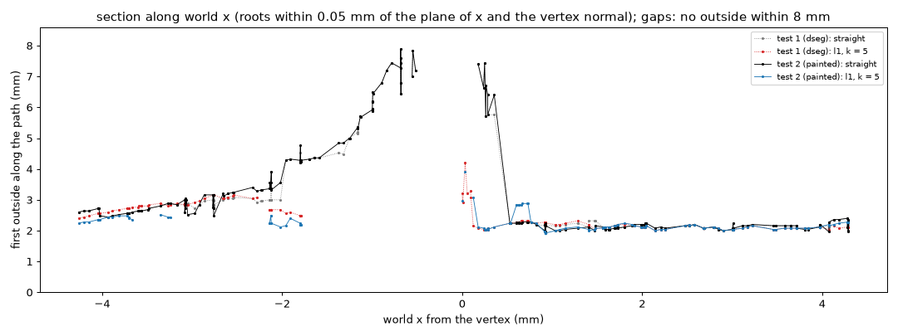

**Why l1 streamlines turn.** A streamline that follows l1 turns sideways
beside the end of the slot. There, the laminae rotate by 90°: parallel to
the fundus floor below, parallel to the slot wall above. At the crossover,
coherence is low (median 0.12) and the heading is almost perpendicular to
l1. So the tracer's sign rule cannot choose a direction. 86 % of the paths
that return to WM go away from the nearest outside. This is a fault of the
tracer, not of the field. Cost 7 has no sign, so this fault does not apply
to it.

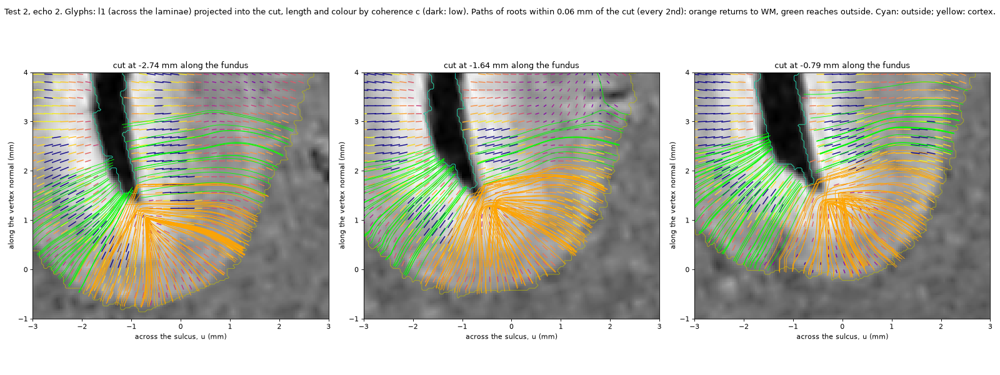

**Vessels and the outlier mask.** The user marked three vessels in the
cortex. Dark voxels bias the tensor near them.

- The first rule (dark below −5 robust SD in every echo, dilated by 1
  voxel) masked 229, 28 and 6 of the dark voxels of the three vessels. It
  missed thin vessels that are dark in different voxels in each echo.
- Near the third vessel, l1 changed by a median of 54° within 0.3 mm
  when the vessel was masked, and by 22° at 0.3–0.6 mm. Beyond 1 mm the
  change is small.
- The fits use the two-threshold rule (user decision): seeds below −5 in
  one echo, grown through 26-connected voxels below −3 in any echo, in the
  cortex, dilated by 1. It masks 388/390, 65/65 and 39/40 vessel voxels.
- Its cost: it masks 8.1 % of the cortex (first rule 3.1 %). That is 73 %
  of the cortex within 0.32 mm of outside (the partial-volume rim), and
  3.5 % beyond 1 mm.

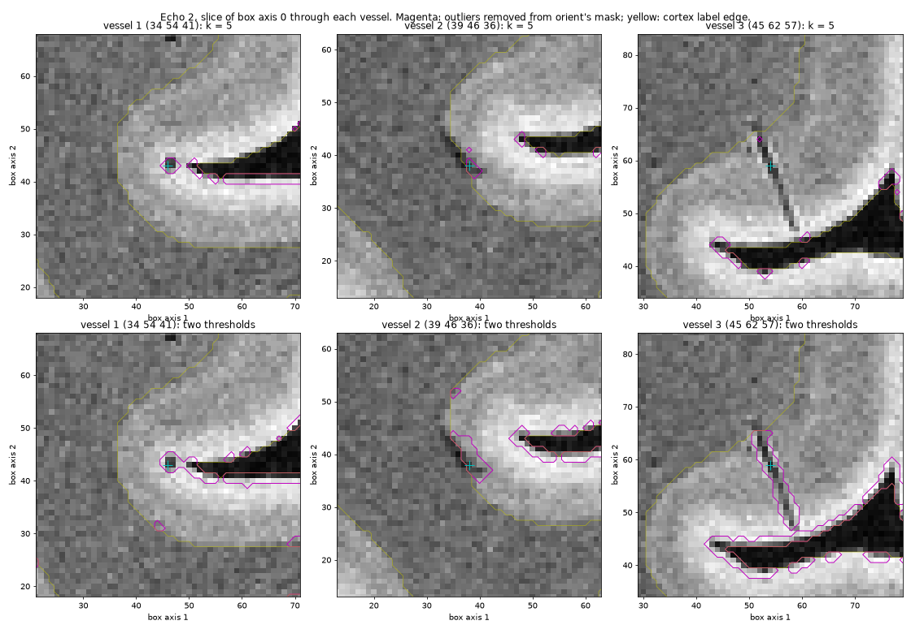

**A shape filter (tested, not used).** The Hessian of the darkest echo at
one, two or five scales should separate sheets (the pial rim) from tubes
(vessels). It did not: vessel 2 is 63 % sheet. Most interior "sheet" seeds
are dark outside medium that the labels call cortex: the slot ends and a
pocket near box voxel [59, 84, 10]. These are label errors, and the mask
must keep them out of the tensor.

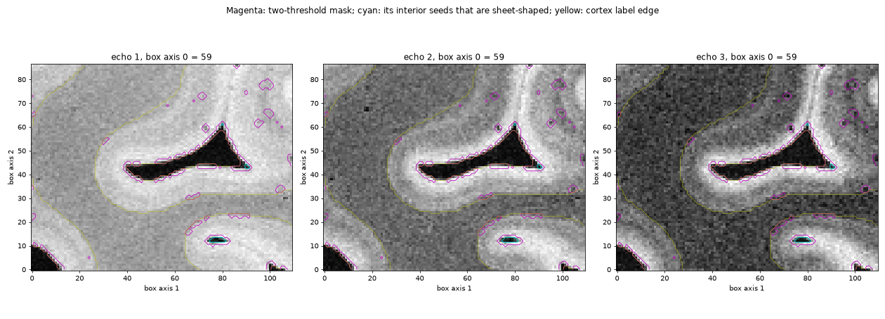

## The fit on the phantoms (phase 5, H2 open)

**Settings.** 8 phantoms × 4 arms (form A or B, with or without cost 7):
32 fits. 4 rounds of at most 15 L-BFGS iterations, float32 on cpu. Start
weights make each term 1 at the straight rays (w = 1/|T(p0)|). Terms that
are 0 there use a reference bend (curvature 0.05/mm).

**Disclosure.** The first weight rule gave the return term a weight of
1.7e28 from a float32 rounding. The sub-agent replaced the rule after one
run of crown_w0.32 and ran every phantom again. It had seen that run's
errors. The change was not chosen to improve them.

**Results.**

- The path errors hardly change. The median largest error changes by less
  than 0.007 mm on every phantom, in every arm. At the 90th percentile,
  crown_w0.32 goes from 0.415 to 0.404 mm and fundus_g0.16 from 0.101 to
  0.093 mm.
- The fold phantoms do not stay straight. The largest shear is
  0.02–0.19 mm, largest on the thin crown and the kissing pair.
- Column by column (figure below), the columns the fit moves most mostly
  move toward the true column. The straight rays' errors grow linearly with
  depth: they come from small angle errors of the mesh normals. Columns
  better / worse by more than 0.01 mm / within 0.01 mm: thin crown (arm B)
  106 / 95 / 205 of 406; narrow fundus (B7) 31 / 7 / 448 of 486; kissing
  pair (B7) 195 / 103 / 1,462 of 1,760. The fit removes part of the error
  of the columns it moves, at best about half.
- These errors are not the kind that matter at the site. The phantoms have
  no fused gap where label 0 ends below the dark band, no banks of very
  different thickness, and no real bend to recover.
- A gradient check at the start points to cost 3 on the crowns (it evens
  out lengths that differ because of the mesh normals' own errors) and to
  the barrier at the fundi (the rays converge and faces invert). This is
  an indication, not a proof of cause.
- Most fits still moved 0.01–0.07 mm in their last round.
- **The soft top fails at a narrow slot.** At a 0.16 mm slot, smoothed
  label 0 reaches only 0.72 and is below 0.5 on many rays. Those rays
  cross the slot without a top and run into the other bank: 503 of 4,219
  columns on fundus_g0.16, 922 of 4,860 on the curved phantom. This is
  the stand-in for the outside, not the fit.
- The curved phantom's bend is small. The straight rays have a median
  error of 0.028 mm. So the phantom says little about how well the fit
  finds a real bend.

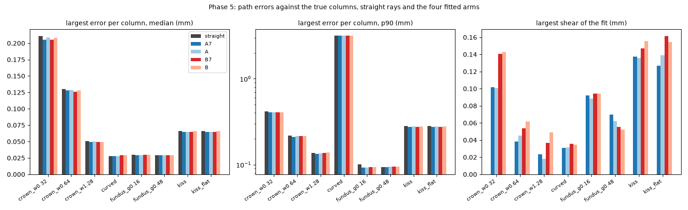

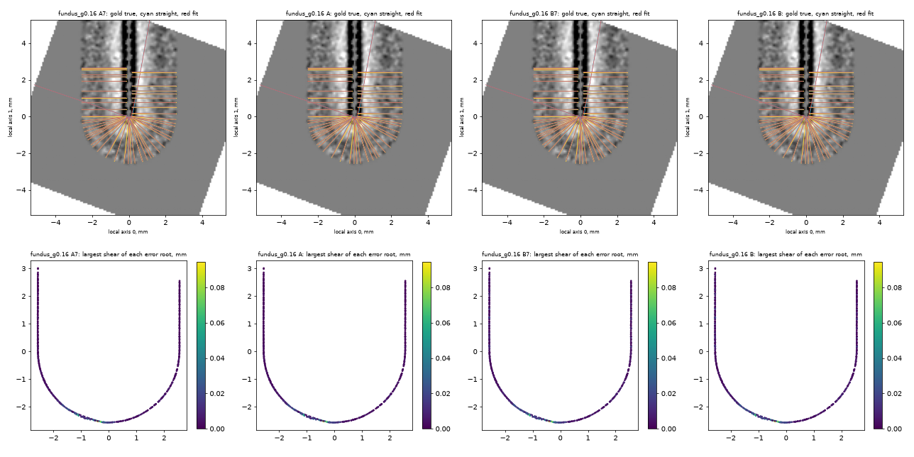

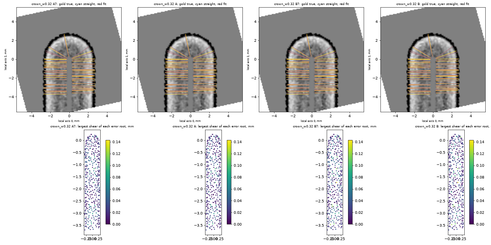

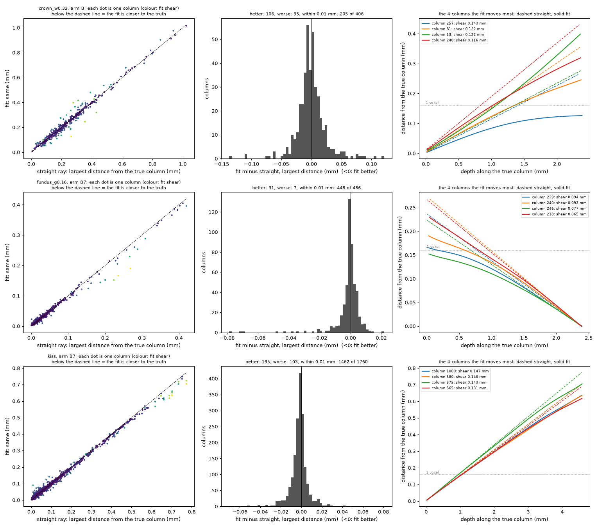

## The fit at the site (phase 6, H3 open)

**Settings.** The painted box, the two-threshold texture, the phantom
settings (4 rounds × 15 L-BFGS, extend 0.1, seed 0). Each arm took about
545 s, with a peak of 14.0 GB for the four arms in one process. Building
the problem took 20 s; the straight warp took 138 s.

**Costs.** Most of the drop in total cost comes from the barrier and
crowding terms. Agreement, length, return and alignment stay near 1 (their
value at the straight rays). No arm converged: the last round moved the
paths by 0.021–0.043 mm.

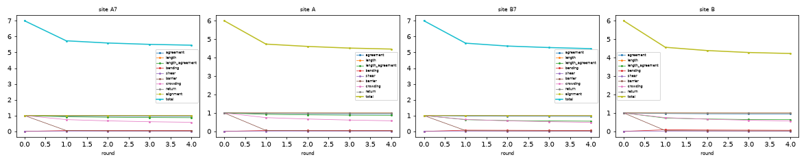

**Bend.** The four arms bend the same columns by the same small amounts.
In every arm, the angle to the normal at the root has a median of
0.12–0.14° and a p90 of 0.45–0.51°. At the top, the median is 0.14–0.17°
and the p90 is 0.52–0.64°. The median shear by depth is 1–6 µm.

| | Straight | A7 | A | B7 | B |
|---|---|---|---|---|---|
| Shear, largest (mm) | 0 | 0.215 | 0.225 | 0.245 | 0.266 |
| Censored inner columns | 1,619 | 1,627 | 1,643 | 1,641 | 1,658 |
| Jumps > 1 mm between neighbours (section) | 46 | 31 | 31 | 31 | 31 |
| Own-bank returns | 5 | 5 | 5 | 7 | 7 |
| Outside before the top (not censored) | 639 | 617 | 614 | 604 | 596 |

The largest bend is at the top, on bank −u and the fundus.

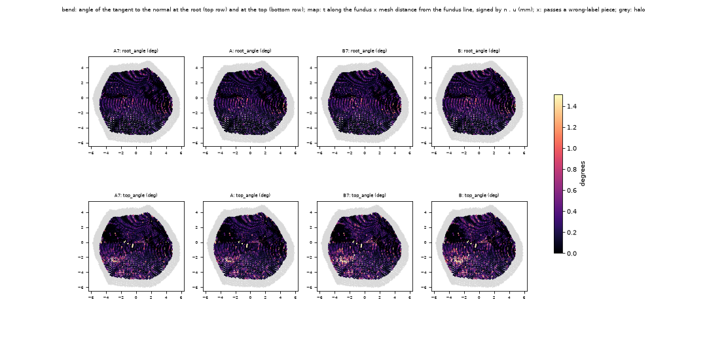

**The sawtooth.** Drop 1 (columns 4924217 / 4924847) is gone in the
straight rays already, because of the painted labels. Drop 2 (columns
12183700 / 12184198) stays in every arm. There, the first label 0 is at
5.92 and 2.24 mm, but the soft tops are at 5.84 and 5.58 mm (straight)
and 5.80 and 5.61 mm (B7). Column 12184198 passes through thin outside
medium where smoothed label 0 is below 0.5. The antialiased top does not
remove the drop (5.89 and 5.60 mm), but a lean of a fraction of a voxel
does (the short bend, 5.59 and 2.22 mm). So the straight ray only grazes
this medium: the path's direction makes this drop.

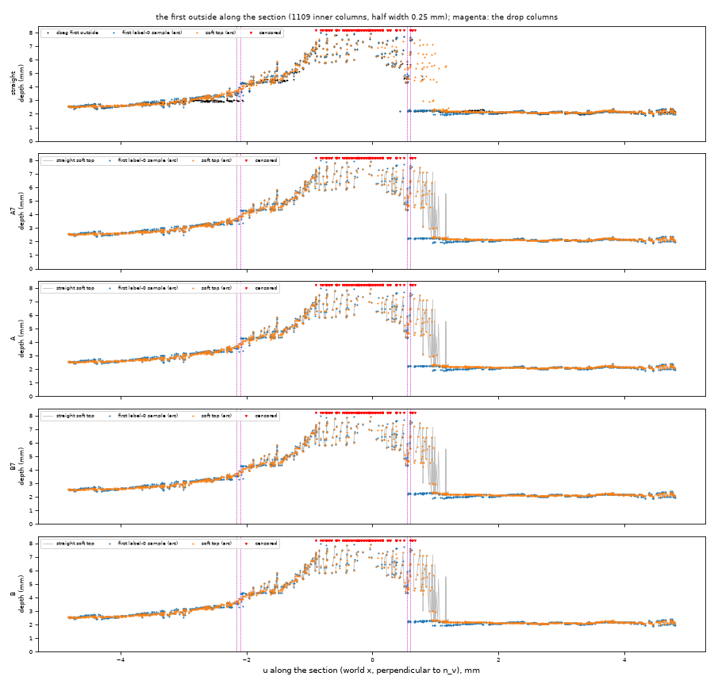

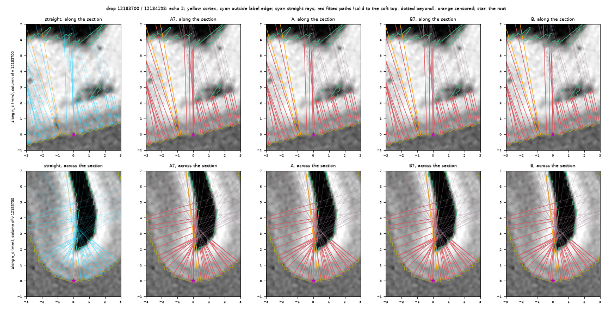

**Tops of the fundus columns** (5,137): tip 54.6 %, wall of bank −u
27.6 %, wall of bank +u 0.4 %, censored 17.4 %, about the same in every
run. The asymmetry between the walls was not checked: it can come from the
classification rule (∇O at 45°).

**Crowding.** About 40 % of the top triangles are inverted. The fit hardly
changes this. A per-triangle count overstates folding: the mesh has 2,797
inner sliver triangles (smallest angle below 5°) that flip with any small
change of direction. *Folding of the columns* gives a measure that does
not depend on the triangles.

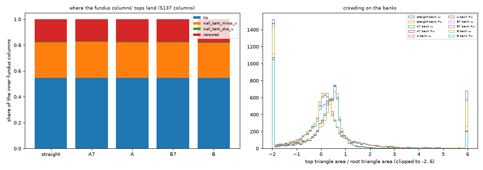

**Alignment to l1** where c ≥ 0.7 (median / p90): bank −u 23.9° / 35°,
fundus 19.8° / 84.8°, bank +u 6.6° / 73.4°. The values are the same with
and without cost 7. So cost 7 does not move the paths by a measurable
amount at these weights, and the arms without cost 7 are the independent
check.

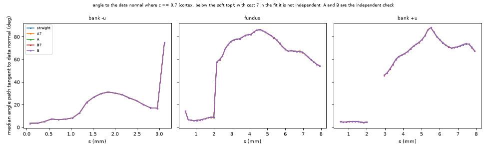

**Lengths.** The median length is 2.72 mm. The fit changes the lengths by
about ±0.01–0.02 mm (p10/p90). The soft top is past the first label 0 by
1.32–1.35 mm at the 90th percentile, because it misses thin outside medium.

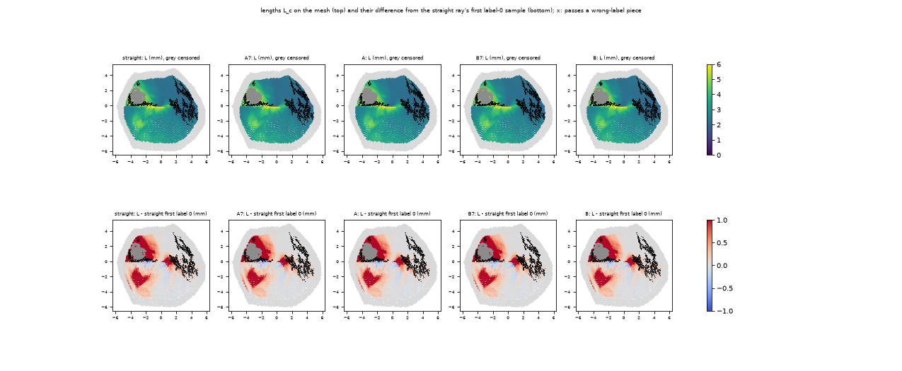

**Censored columns.** 985 of the 1,619 censored straight rays pass through
label 0. Their closest approach to an outside voxel has a median of
0.09 mm, and 1,205 come closer than 0.16 mm.

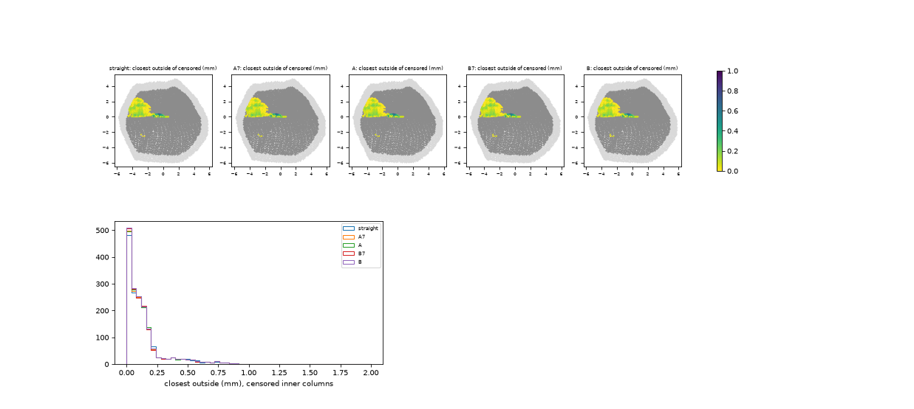

**Columns on wrong labels.** Voxels below −5 robust SD in every echo, in
26-connected pieces of at least 200 voxels: 12 pieces, 4,258 voxels. The
rule also marks the partial-volume rim, so most inner columns (2,031
straight) pass a piece. Only 35 (straight) to 46 (B) pass a piece deeper
than 0.32 mm from label 0. The pocket at box voxel [59, 84, 10] is not in
a piece (the nearest marked voxel is [59, 80, 12]).

**Weight scan** (arm B7, each weighted term × 0.1 and × 10, one at a time).
18 runs, 2 h 40 min.

| Run | Shear median / p90 (mm) | Censored inner |
|---|---|---|
| B7 | 0.005 / 0.015 | 1,641 |
| crowding × 0.1 | 0.017 / 0.049 | 1,488 |
| agreement × 10 | 0.012 / 0.036 | 1,565 |
| alignment × 10 | 0.008 / 0.026 | 1,512 |
| length_agreement × 10 | 0.008 / 0.035 (stopped: total rose) | 1,711 |
| length_agreement × 0.1 | 0.003 / 0.010 | 1,612 |
| all other runs | 0.003–0.006 / 0.010–0.018 | 1,627–1,655 |

The full table is `scratch/bent-columns/fit-site/scan.md`. Only three
changes bend the paths more than B7, and the largest median shear is
17 µm. Fewer columns are censored when crowding is weaker or alignment is
stronger. The views of these runs were not made, so it is not known if
those columns are better.

## The column ends and folding (review)

**The end surface.** The ends of the columns form an implicit "pial"
surface. Its smoothness is the measure the user named: not that the ends
of neighbours are close, but that the surface they make is smooth. Mean
angle between each end's surface normal and its neighbours' (median /
p90): white surface (the roots) 1.5° / 3.7°; ends of the straight rays
32° / 116°; B7 31° / 107°; crowding × 0.1 6.9° / 90°.

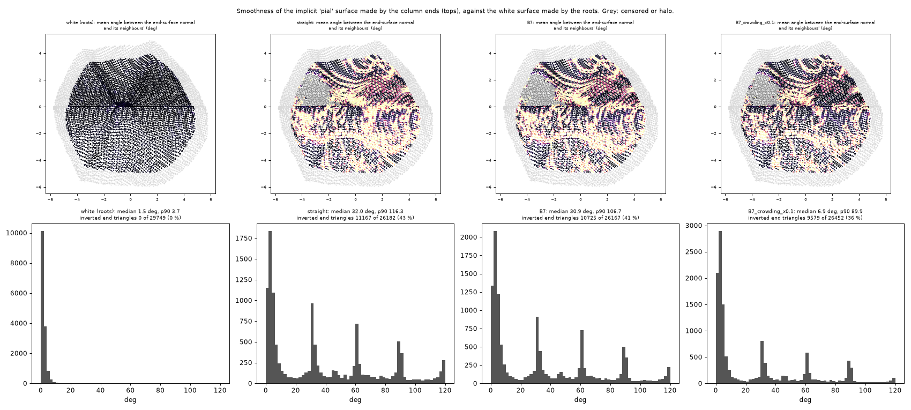

**An antialiased top.** The top can come from the white surface's own
method: `baillarger.antialias.thin_plate` on label 0 gives the smoothest
field that keeps every voxel's label (5.9 s on the box), and the top is
its first crossing of 0. The top then lies anywhere between an inside and
an outside voxel centre, so it is not tied to the label staircase.

- Censored inner columns: straight 1,619 → 1,255; B7 1,641 → 1,247. A
  one-voxel slot still crosses 0, where smoothed label 0 stays below 0.5.
- The end surface is as rough as before (straight 31.9° / 116°), and
  drop 2 stays (5.89 / 5.60 mm). So the roughness is not the staircase.

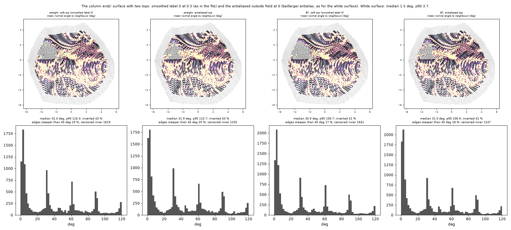

**Folding of the columns.** The local Jacobian of the map from the roots
to the ray points at a depth, by least squares over the roots within
0.4 mm, in the root's tangent plane (`bent_probes.fold_dets`). It does not
depend on the shape of single triangles.

| Rays along | det < 0 at 1 mm | at 2.5 mm | folded before their own top |
|---|---|---|---|
| The box normals | 0 % | 25 % | 16.1 % |
| Normals smoothed about 0.6 mm (97 steps) | 0 % | 16 % | 13.6 % |

The straight rays do not fold in the first 1.5 mm. Deeper, a quarter
fold, and about one in six fold before they reach their top. So they are
not a valid discrete diffeomorphism through the full depth. Probes may
fold; columns may not.

## Probes (review)

`bent_probes.py` scores cheap probes at the site, all with the antialiased
top, on the 15,123 inner columns. The constants were set before the run.

- **normal:** straight along the box normals.
- **smooth24, smooth97:** straight along normals smoothed by 24 and 97
  more steps (about 0.3 and 0.6 mm).
- **l1:** a streamline of l1 with the sign closest to the heading, used
  only where c ≥ 0.3 and the turn is at most 45°; else the heading is
  kept. The tensor has the two-threshold vessel mask.
- **bend_ac:** the alternating fit with only agreement, alignment, length
  and bending (form B, cost 7 on; the other weights 0), 4 rounds × 15
  L-BFGS. It was not converged: the rounds moved the paths 0.2–0.35 mm.
- **B7:** the phase 6 fit.

| Probe | Censored | Far top | Section jumps > 1 mm | Drop 2 (mm) | Profile difference, med / p90 | Folded before top | Seconds |
|---|---|---|---|---|---|---|---|
| normal | 1,255 | 711 | 40 | 5.89 / 5.59 | 0.079 / 0.427 | 16.1 % | 0.1 |
| smooth24 | 1,245 | 733 | 41 | 6.04 / 5.61 | 0.075 / 0.401 | 14.6 % | 0.2 |
| smooth97 | 1,141 | 785 | 46 | 5.75 / 5.45 | 0.073 / 0.374 | 13.6 % | 0.3 |
| l1 | 2,186 | 627 | 99 | 4.04 / 4.68 | 0.060 / 0.420 | 11.0 % | 10 |
| **bend_ac** | **528** | 670 | **25** | **5.59 / 2.22** | **0.058 / 0.306** | 14.2 % | 655 |
| B7 | 1,247 | 711 | 31 | 5.85 / 5.63 | 0.072 / 0.373 | 16.0 % | 550 |

Far top: the top is more than twice the distance from the root to the
nearest label 0. Profile difference: mean squared difference of the
detrended log echo 2 of the two probes of a mesh edge, at equal arc
length, to the shorter top (in robust SD²). No probe returns into WM. The
angle to l1 (c ≥ 0.7) is about 7° / 30° (median / p90) for all probes
except l1, which follows l1 by construction.

- **bend_ac is the best probe on every score but folding.** 733 probes
  that the straight rays censor find a top, at a median of 2.31 mm (p90
  3.59 mm), with a median shift of 0.127 mm: a sub-voxel lean onto thin
  outside medium that the straight ray passes. Drop 2's second column now
  meets the top at 2.22 mm, where label 0 is (2.24 mm).
- Its moves are small: the largest shift below the top has a median of
  0.034 mm (p90 0.103, max 0.42). B7's is 0.005 mm. So the barrier,
  crowding, shear and length-agreement terms held B7's probes back.
- Smoothed normals help a little (fewer censored, less folding) and cost
  nothing. The l1 streamline is worse on censoring and jumps.
- **Not independent:** bend_ac has the agreement and length terms in its
  cost, so its profile difference and censored count are partly what it
  optimised. Drop 2 and the far tops are not in its cost.
- **What no probe fixes:** along the section, u from −2 to 0.7 mm, every
  probe keeps far tops of 4–8 mm (*The failing stretch*).

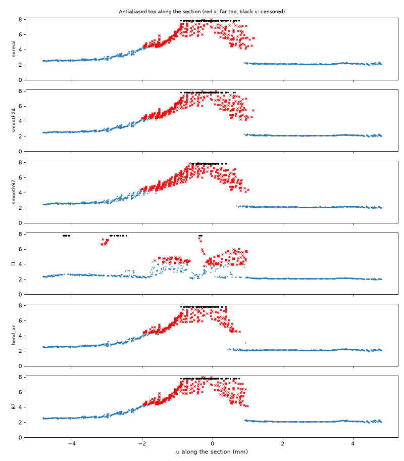

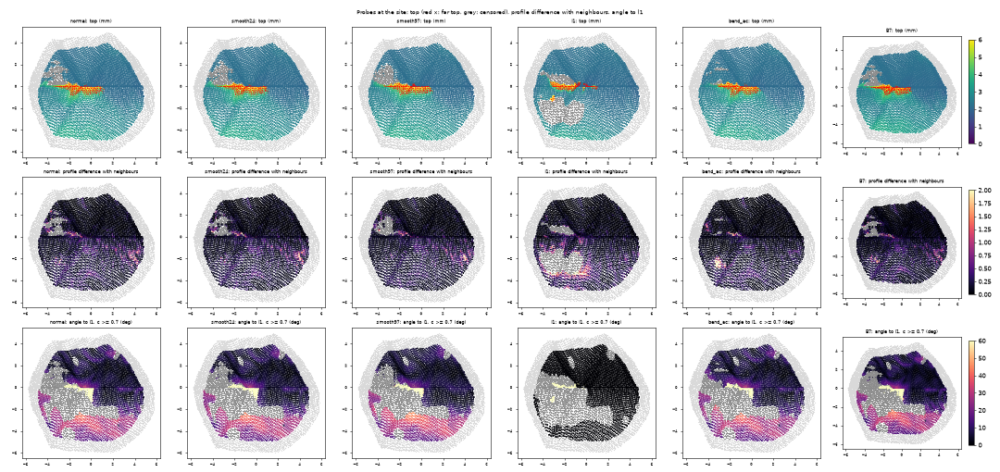

## The failing stretch (review)

The rays on the section from u = −2 to 0.7 mm meet the outside at 4–8 mm
or not at all, with every probe.

**The labels are not the cause.** The user read the cuts: label 0 is very
close to covering all the outside medium, and the few missing voxels would
not change this result. There is no fused gap in the cuts that were drawn.

**The direction of the rays is the candidate cause.** Roots on the fundus
floor beside the slot tip send their rays past the tip and up through the
cortex beside the wall. For the straight far-top probes:

- The angle to the outside surface at the top has a median of 21° (p10–p90
  13–27°), against 68° for the other probes.
- The distance to label 0 at depths of 2–3.5 mm has a median of
  0.32–0.40 mm.
- The distance from WM falls by more than 0.3 mm after its peak in only
  14 %, so most of them stay on one bank.

The short bend's 99th-percentile shift is 0.18 mm, so it does not reach
the wall. These were six places on the stretch, in cuts across the sulcus.
The correct end of a column from these roots was not judged.

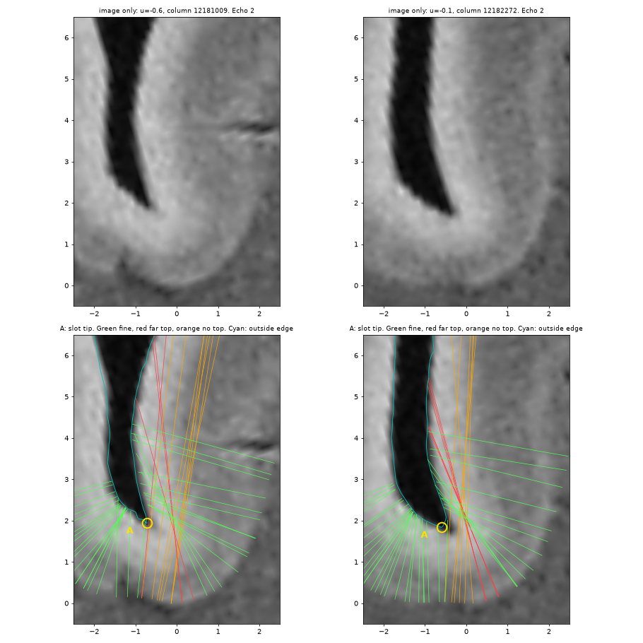

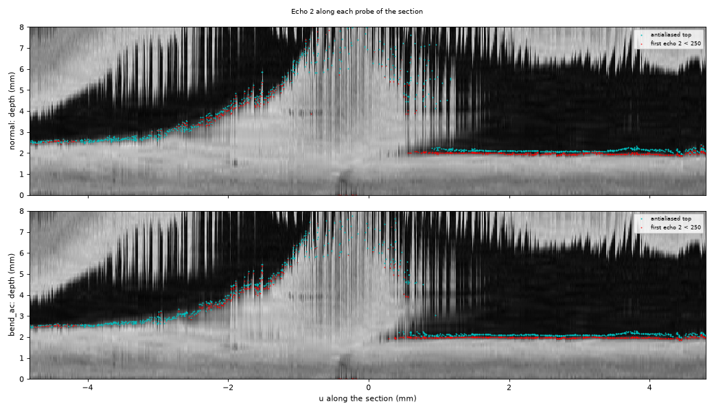

## Sparse depths (phase 6, step 5)

The fit samples each column every 0.04 mm to an 8 mm cap: 5.3 M samples in
the box. The test evaluates each cost at the straight rays and the final
paths with fewer samples, 10 seeds each, against the dense value.

- **sparse1:** one sample per 0.16 mm with a random offset, the same depths
  for the columns of a face, to the soft top + 0.48 mm.
- **sparse2:** sparse1 plus dense samples in a 0.32 mm window round the
  soft top and where the labels change.

| B7, relative to dense | agreement | length | length_agreement | return | alignment | total |
|---|---|---|---|---|---|---|
| sparse1 | −28 % | −11.5 % | +470 % | −55 % | −19 % | +36 % |
| sparse1, no truncation | −25.8 % | 0.0 % | +4.6 % | +6.5 % | +1.6 % | −2.6 % |

- Truncation at the top + 0.48 mm causes most of the error, not the
  sample density. The remaining agreement error comes from linear
  interpolation between the sparse samples.
- **Tops.** sparse1: median difference 0.0015 mm; 9–15 columns differ by
  more than 0.16 mm. sparse2: 1–4 columns differ by more than 0.16 mm.
- **Bending** in closed form from the spline: 11.899 over the full range,
  against 11.906 dense and 11.911 ± 0.079 sparse1.

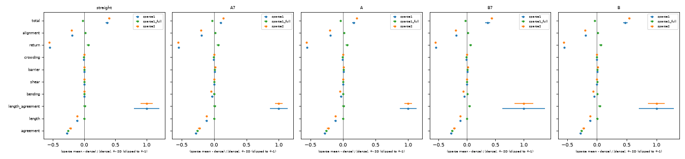

So the samples per column can go down by about 4× (sparse2) if each cost
is computed over the full range or truncated with a matching rule, and if
the profile interpolation is better than linear. This is evidence, not a
refit.

## Scaling

The user asked whether the run times show that the method cannot scale.
This is an analysis, not a measurement at scale.

- **Size.** The right white mesh has 13.76 M vertices. At 15,123 inner
  columns per box, the hemisphere is about 910 boxes.
- **Per box now.** About 545 s per fit on cpu: about 140 s per round for
  the warp refit, and about 2 s per cost evaluation (forward and
  backward on 5.3 M samples). Peak 14 GB for four arms in one process.
  About 910 × 545 s = 140 h of cpu for one arm, without convergence.
- **The work is linear and local.** Each term reads a column, its
  neighbours or its faces. So the work per evaluation is linear in samples,
  and boxes are independent except at the halo. This fits the GPU (memory
  traffic of a few hundred bytes per sample) and the block model.
- **Levers.**
  - Bend only where needed: the fit moved most columns by less than
    0.02 mm. A mask of candidate columns (censored, inverted faces, low
    coherence, near label 0) can cut the free columns by an order.
  - Sparse depths: about 4× fewer samples (above).
  - Multi-scale: fit a sample of columns per block and a coarse warp,
    then interpolate the bend and refine.
  - Fewer evaluations: a warm start from the neighbouring block and a
    warp refit less often than each round.
- **The real limit is not speed.** The full fit does not change the
  columns much, and rays beside a slot tip point the wrong way by more than
  the fit moves them. A faster fit of the same model does not fix them.

## What the results show and do not show

**Show.**

- With the stand-in soft top, an optimisation on these costs keeps the
  columns almost straight at this fundus. Painting the labels removed one
  drop. The other drop and the long fundus rays come from the direction of
  the rays, which graze the slot wall.
- On the phantoms, the fit moves columns by up to 0.19 mm, mostly toward
  the truth where it moves them most, with almost no change of the
  median error.
- As probes, a short bend on agreement, alignment, length and bending only
  finds the top far more often than straight rays and removes drop 2. The
  full fit's barrier and crowding hold the probes back.
- The antialiased top is better than smoothed label 0 and costs seconds.
- Straight rays fold below about 1.5 mm in a quarter of the box, so they
  can be probes but not columns.

**Do not show.**

- If bent columns are better or worse in real cortex. The fits did not
  converge, and the top is a stand-in. A real outside probability can
  change the result.
- If the fit can find a real bend. The curved phantom's bend is too small
  to tell.
- If the result holds at another site (phase 7 did not run).
- Anything about the user's column design (a diffeomorphism refined from
  the probes' evidence). It was not built.
- Where a correct column from the roots beside the slot tip should end.

## Open checkpoints

- **H2** (phase 5): reviewed with the user on 2026-11-07. The phantom
  errors are small and of a different kind from the site's; the bends
  mostly move toward the truth. Not yet formally closed.
- **H3** (phase 6): better, worse or not different at this fundus; which
  form of cost 3 to keep; if phase 7 is needed.
- **Phase 7** can run: the 23 marked M1S1 points
  (`prototypes/data/M1S1_points_full0.json`) are on the current grid
  (the dseg and the echoes have the same shape and affine), and all 23
  lie on label 42. The measurement of the profile split at the points
  needs new code.
- **H4**: the review of the PR. A merge needs the user's instruction.

## Data

Outputs are in `scratch/bent-columns/` (not kept): `box-paint/`,
`texture-paint-hyst/`, `fit-phantoms/`, `fit-site/` (views.json,
scan.md, sparse.json, phi_outside.npy), `probes/` (probes.json,
probes.md, bend_ac_paths.npz). The coordinator's notes are
`scratch/bent-columns/notes.md`.
