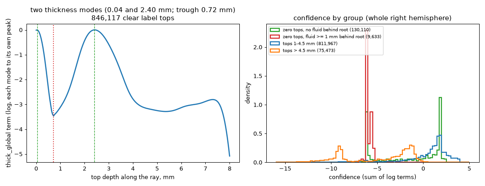
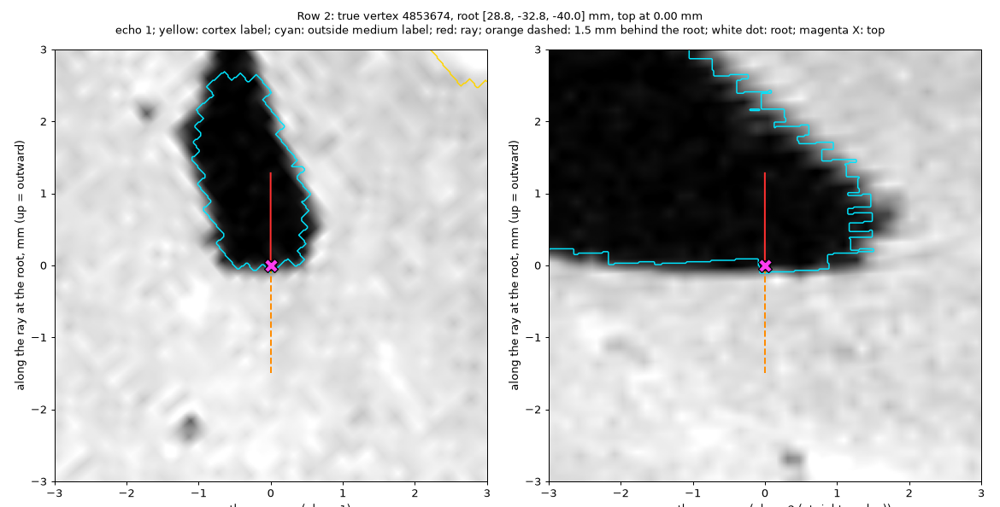
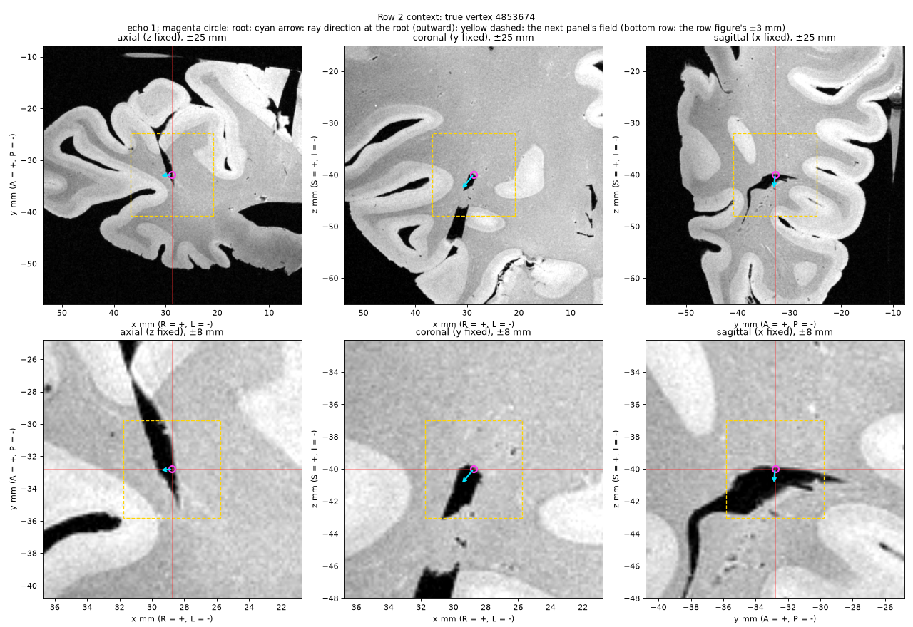
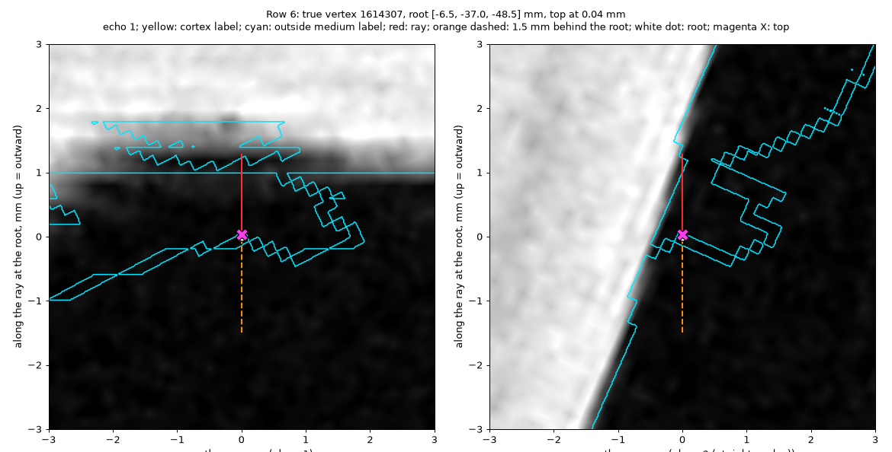
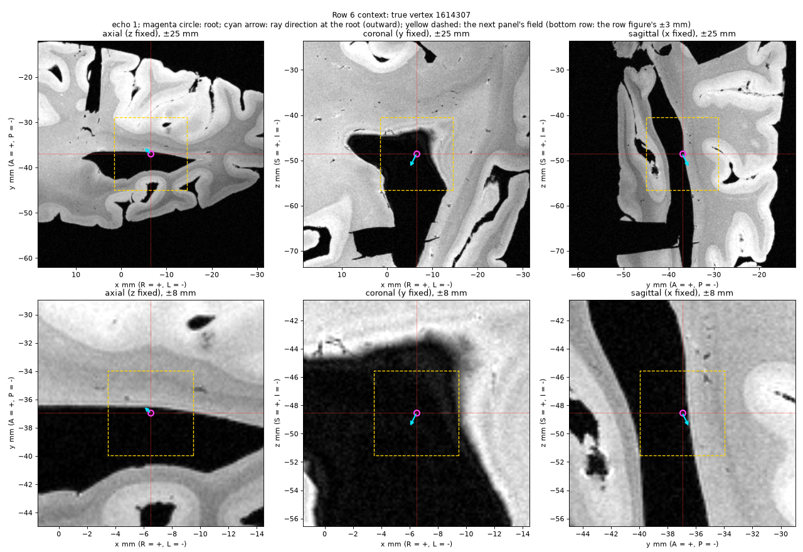
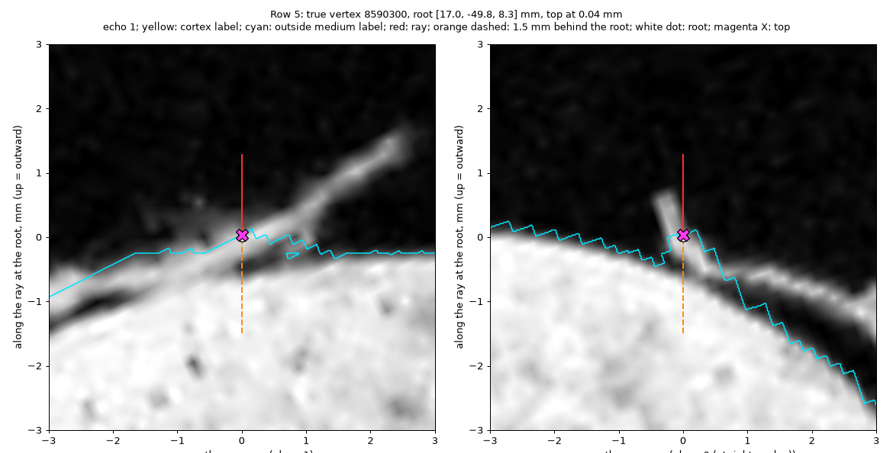
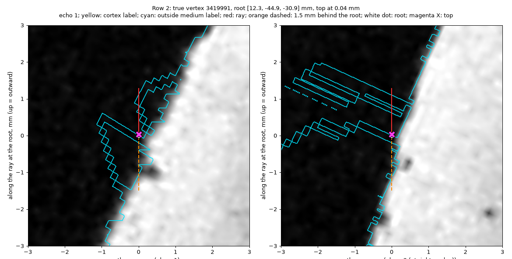

# Column top stage

**Question.** Can we find the top of each column (where cortex ends at the
outside medium) from the image contrast, and give each top a confidence?
The confidence must send uncertain sites to a person. A wrong top must not
stay silent. The user accepts that some regions need human review.

**Status.** The stage ran on the whole right hemisphere (1,179,148 coarse
columns). The user reviewed nine zero-thickness columns. The code is a
prototype in `prototypes/scripts/`. The scales of the confidence terms are
provisional.

**Short answer.**

- The stage is a second step after ray casting. It uses all three echoes,
  weighted as `orient` weights them, and the labels where they are clear.
- 1,121,499 columns get a top. 57,649 columns get no top.
- Cortical thickness has two modes: near 0 mm and 2.4 mm. The near-0 mode
  is real. The specimen has excisions, where white matter faces the outside
  medium directly. A two-mode prior scores both modes without a penalty.
- Evidence such as thickness is a soft prior on each column. It orders the
  review queue. It does not gate a column.
- In the review of nine zero-thickness columns, no wrong column stays
  silent. The two correct zero tops (excision edges) have high confidence.
  All the columns that the user said need a person are in the first 20 % of
  the review queue.
- The review shows that the stage finds segmentation errors, not only wrong
  tops. A root in fluid needs a label repair before its column can be judged.

## The pipeline

Each step is a script. Each step reads the output of the step before it.

1. **Tensor** (`top_tensor.py`). `orient`'s structure tensor for the
   hemisphere, with the cortex mask dilated by 0.48 mm. The local level comes
   from cortex voxels only. The detrending, gradients and tensor use the
   dilated mask. At radius 0 the script gives `orient`'s tensor (checked on
   superblock 2_2_4 to 1e-6). The dilated mask makes the rays turn toward the
   outside edge. On superblock 2_2_4, the median arrival angle at the pial
   edge went from 14.1° to 9.2°.
2. **Scan** (`top_scan.py`). Coarse eigenvector rays over the hemisphere, one
   superblock at a time. `SAVE_DIAG=1` writes the ray paths for step 3.
3. **Features** (`top_features.py`, GPU where it helps). For each owned
   column:
   - the first entry into the outside label along the whole ray (a label
     top; sample 0 is zero thickness);
   - candidate tops from a dark-sheet score S = max(λ1 − |λ2|, 0) of the
     second differences of the echoes. The echo weights are
     w = −C⁻¹c / (cᵀC⁻¹c), with c the log contrast of outside medium against
     the cortex level, and C the noise covariance;
   - evidence for each candidate: whether it is at the label, deep WM beyond
     it, and the mirror correlation of the profiles on the two sides;
   - the class of each sample (GM-like, WM-like or fluid-like) from the
     nearest class mean of the log echoes, weighted by C⁻¹. The ray extends
     1.5 mm inward from the root. The script records the GM-like and the
     fluid-like length behind the root.
4. **Confidence** (`top_confidence.py`). One global pass over the hemisphere,
   with no seams between superblocks. Propagation is best-first from a heap:
   the candidate with the highest score is fixed first, and its neighbours
   get offers. Label tops compete with sheet tops; they are not trusted in
   advance. The final score is a sum of log terms (below). The review queue
   puts the columns with no top first, then orders by confidence.
5. **Overlay** (`top_overlay.py`). Maps for the viewer, one value for each
   true vertex of the white surface (the nearest column within 1 mm):
   `top_conf`, `top_queue_pct`, `top_mm`, `top_source`, and each term.

## The confidence terms

| Term | Form | Scale |
|---|---|---|
| `thick_global` | log density of the clear label tops, each mode relative to its own peak; floor −6 | bandwidth 0.2 mm |
| `label_clear` | +1 for a label top with a clear run of outside medium | — |
| `at_label` | +1 when the top is within 1 voxel of the outside label | — |
| `sheet` | log(S / floor), clipped to [−1, 2] | floor: 90th percentile of S in cortex |
| `mirror` | 2(r − 0.3), clipped to [−2, 1], for a top away from the label | — |
| `far_wm` | ±0.5, for a top away from the label | — |
| `non_wm_behind_root` | −0.5(x/σ)², cap −8; x = GM-like + fluid-like length behind the root | σ = 0.32 mm, the RMS among clear tops at cortical depth |
| `thick_local` | −0.5(r/σ)², cap −8; r = residual to the plane of the neighbours' tops | σ = 0.059 mm, from the same residual among clear tops |
| `bank` | +0.5 for an opposite-bank top within 0.5 mm; −2 when an opposite ray passes within 0.2 mm and its own top is 0.5 mm or more further on | — |

The scales come from the data where possible. The other constants are
provisional and were not tuned to the review.



*Left: the global thickness term. Each mode is scored against its own peak,
so a top at either mode scores about 0. Right: the confidence by group.
Zero tops with fluid behind the root are near −6, at the front of the queue.*

## Results (whole right hemisphere)

| Measure | Value |
|---|---|
| Columns | 1,179,148 |
| With a top / no top | 1,121,499 / 57,649 |
| Zero-thickness tops (0–0.04 mm) | 169,494 |
| Thickness modes / trough | 0.04 mm and 2.4 mm / 0.72 mm |
| Confidence p10 / 25 / 50 / 75 / 90 | −6.07 / −1.61 / 1.0 / 1.77 / 2.47 |
| Median confidence, tops ≤ 4.5 mm / > 4.5 mm | 1.09 / −3.32 |
| Zero tops with ≥ 1 mm fluid-like signal behind the root | 9,633 |
| Bank disagreements | 22,990 |

Run times on the laptop (Apple M-series, MPS): tensor 138 s (peak 9.8 GB),
scan 219 s with 4 workers (peak 36.6 GB), features 110 s with 3 workers
(peak 12.2 GB), confidence 260 s (peak 10.6 GB), overlay under 1 min.

## How the stage changed during the review

Each change came from a result. No constant was tuned to hide a symptom.

1. **Dilated mask.** With `orient`'s cortex mask, the dark sheet at the pial
   edge was outside the mask. On superblock 2_2_4, the dilated mask reduced
   the columns with no top from 4,919 to 3,485.
2. **Soft priors, not thresholds.** A hard thickness range (1.0–4.5 mm)
   added about 1,050 columns with no top on 2_2_4. The user said that
   thickness is a prior on the probability that a column is correct. The
   confidence score replaced the rule.
3. **Zero thickness is valid.** The first hemisphere run started the label
   search at 0.5 mm. That was a hidden minimum thickness. The user asked why
   entering fluid at once is an error. It is not: at an excision, white
   matter faces fluid. The two-mode prior followed from this.
4. **Contrast behind the root.** A zero top can also come from a label
   error, with cortex behind the root. The stage now measures GM-like signal
   behind the root. The run along the ray toward the top failed: white
   matter is between GM and fluid on all three echoes, so partial volume at
   the top reads as WM-like. The measure behind the root does not depend on
   the top.
5. **Fluid behind the root.** The review found a root in fluid with high
   confidence (row 6 below). Fluid behind the root counted as nothing. The
   term now counts all non-WM signal behind the root. The class of the root
   sample itself is not a term: partial volume makes correct excision edges
   read fluid-like at the root.

## Review of zero-thickness columns (user, 2026-11-10)

Six columns came at random from the zero tops: three with much GM-like signal
behind the root, three with none. Three more came at random from the zero
tops with 1 mm or more of fluid-like signal behind the root. The user read
each one from echo 1 with the labels, and from axial, coronal and sagittal
context views.

| Row | User's reading | Confidence, queue position |
|---|---|---|
| 1 | Degenerated tissue; labels not trustworthy; a person must help | −5.5, 18 % |
| 2 | White matter facing fluid at an excision; top correct | 1.99, 84 % |
| 3 | Part of the optic nerve, detached from the hemisphere, lies across the gap | −6.0, 16 % |
| 4 | Edge of an excision; top correct | 1.99, 84 % |
| 5 | Root on loose tissue that a person must mask out | −6.2, 14 % |
| 6 | Root in fluid; a segmentation error for a person to repair | 2.27, 88 % before step 5; −5.73, 18 % after |
| fluid 1 | Segmentation error; root in the middle of fluid | −6.0, 17 % |
| fluid 2 | Segmentation error; the surface points in the wrong direction | −5.7, 18 % |
| fluid 3 | Segmentation error; root in fluid | −6.2, 14 % |













*Echo 1. Yellow: cortex label. Cyan: outside medium label. Red: the ray.
Orange dashed: 1.5 mm behind the root. White dot: the root. Magenta X: the
top. The context views show world planes through the root at ±25 mm and
±8 mm.*

## What the results show and do not show

- Nine columns show that the stage routes these error types to review. They
  do not give the rate of each error type. A catalogue of error types and
  their prevalence comes before a repair plan.
- The 9,633 zero tops with 1 mm or more of fluid behind the root were all
  errors in a sample of three. Their share of true excision faces is not
  measured.
- Normal cortical tops with GM-like signal behind the root also lose
  confidence (p99 1.44 mm). These roots sit inside cortex. The root is wrong,
  not the top, but the column goes to review.
- The three-class model cannot tell deep grey nuclei from cortex. Row 3 may
  have deep grey matter behind the root. The user did not confirm this.
- Earlier results on superblock 2_2_4: rows 2, 3 and 6 of the six-row test
  found tops near the user's tops with high confidence. Row 4 was wrong but
  near the front of the queue. Row 1 had no top.

## A joint solver (prototype, 2026-11-10)

The stage's propagation is best-first: each column takes its top from
the neighbours that were decided before it. The joint solver instead
treats all the tops as one problem, with the costs written as log
probabilities.

- **Evidence.** For each candidate top, the same sum of log terms as
  `top_confidence.py`. Candidates beyond the end of their ray (padding
  copies of the end point) are dropped: 55–58 % of all candidates.
- **Agreement.** For candidate i of column b and candidate j of a
  neighbour c: −½ ((k_i − x)·STEP / s_b)², capped at −8. Here x is where
  b's ray crosses c's top plane at j (the plane through c's candidate,
  normal to c's ray). s_b = √(s0² + sn_b²). s0 is the stage's
  `sigma_local_mm`, and sn_b is 1.4826 × the MAD of the neighbours'
  predictions for column b (`tl_spread.py`). The term is symmetric, and
  its weight is 2 / (deg b + deg c).
- **Inference.** Mean field. Each column holds a distribution q over its
  candidates. Columns of one colour of a greedy graph colouring update
  together: q_b ∝ exp(evidence + expected agreement). The agreement
  width starts at 4 × s_b and narrows to 1 × in five steps. The
  objective is the free energy (it includes the entropy of q).
- **Output.** For each column: the most probable candidate, its
  probability, the agreement there, and whether the column has a top.

The solver chooses a point on each column's ray. It does not move the
ray.

**Results.**

| Measure | Best-first | Mean field (colour groups) |
|---|---|---|
| Region (4 superblocks, 130,695 columns, 233,673 candidates): same top within 1 step | – | 92.7 % |
| Region: columns with no top | 7,643 | 2,730 |
| Region: share of tops deeper than 4.5 mm | 7.3 % | 6.6 % |
| Exact test (434 trusted columns given a false strongest candidate): restored | 100 % | 55 % |
| Exact test: unperturbed trusted columns broken | 0 % | 0.03 % |

On the whole hemisphere (MPS), the solver ran on 1,179,148 columns.
1,154,548 columns have a top. It took 278 sweeps and 65 s, and the
objective did not rise in any sweep.

`tl_spread.py` alone (the per-column scale in the local term, tops not
changed): sn has a median of 0.030 mm and a 90th percentile of
0.178 mm (s0 = 0.059 mm). The lag-1 autocorrelation of the local term
over neighbours falls from 0.38 to 0.094.

**Do not show.** If the mean-field tops are more correct than the
best-first tops. No marked sites were compared. The exact test favours
best-first, but the user found that this result is an artefact of the
segmentation, which is quite bad in places. The test's trusted columns
are columns with a clear label top, so the test depends on the labels.
It cannot compare the two methods until the segmentation is repaired.

## Open items

- Remove roots that do not face cortex (ventricle walls, cut faces) from the
  columns, or keep them as a class. Not decided.
- The ray casting may need the orient tensor cached in a standard format.
  The tensor is a scratch memmap now.
- `orient.py` does not use the dilated mask. A change there needs its own
  pull request.
- The confidence scales need data: sites that the user marks, with their
  distributions for each term.

## The code

All code is in `prototypes/scripts/`. Nothing moves to `src`.

| File | What it does |
|---|---|
| `top_paths.py` | The input paths, from environment variables (no script names a data directory). |
| `top_tensor.py` | The dilated-mask tensor for the hemisphere (memmap). |
| `top_scan.py` | The coarse ray scan; `SAVE_DIAG=1` writes the ray paths. |
| `coarse_kernels.py` | Torch kernels for the scan and the features (trilinear sampling, closed-form 3×3 eigenvalues, tracing, profiles), with a NumPy reference. |
| `bent_confidence.py` | The checks of the scan (silent, folded, disagrees) that `top_scan.py` uses. |
| `top_features.py` | The candidate tops and their evidence, per superblock. |
| `top_stage_lib.py` | Pure parts: the two-mode prior, the class of a sample, the lengths behind the root, the capped Gaussian term. |
| `top_confidence.py` | The global pass: propagation, the terms, the review queue. |
| `top_overlay.py` | The viewer maps (`.func.gii`). |
| `top_rows.py`, `top_row_context.py` | The row views and the context views for review. |
| `tl_spread.py` | The per-column scale sn of the local term (`sn.npy`), and its comparison with the stage. |
| `joint_tops.py` | The joint solver against best-first on one region, on the CPU, with the exact test. |
| `joint_gpu.py` | The joint solver in PyTorch, for the whole hemisphere or a region. |

Tests: `test_top_stage_lib.py`, `test_coarse_kernels.py`,
`test_bent_confidence.py`.

## How to run

Set the inputs:

```bash
export TOP_DSEG=<dseg.nii.gz> TOP_SURF=<white.surf.gii> TOP_NOISE=<orientnoise.json>
export TOP_ECHOES=<echo-1.nii>:<echo-2.nii>:<echo-3.nii>
```

Then run each step under `scripts/memguard`, with a cap of about 1.5 times
the peak above:

```bash
DEVICE=mps scripts/memguard 16 uv run python prototypes/scripts/top_tensor.py OUT 0.48
DEVICE=mps WORKERS=4 SAVE_DIAG=1 scripts/memguard 56 uv run python prototypes/scripts/top_scan.py OUT
DEVICE=mps WORKERS=3 scripts/memguard 19 uv run python prototypes/scripts/top_features.py OUT OUT/features
scripts/memguard 16 uv run python prototypes/scripts/top_confidence.py OUT/features OUT/conf
scripts/memguard 8 uv run python prototypes/scripts/top_overlay.py OUT/conf/top_confidence.npz $TOP_SURF OUT/overlay/top_conf.func.gii
```

The joint solver (prototype) needs the features, the confidence output
and `sn.npy`. The caps are the ones that the runs of 2026-11-10 used. The
peaks were not recorded.

```bash
scripts/memguard 12 uv run python prototypes/scripts/tl_spread.py OUT/features OUT/conf OUT/spread
scripts/memguard 16 uv run python prototypes/scripts/joint_tops.py OUT/features OUT/conf OUT/spread/sn.npy OUT/joint-region 1_1_1,1_1_2,2_1_1,2_1_2
scripts/memguard 30 uv run python prototypes/scripts/joint_gpu.py OUT/features OUT/conf OUT/spread/sn.npy OUT/joint mps
```
