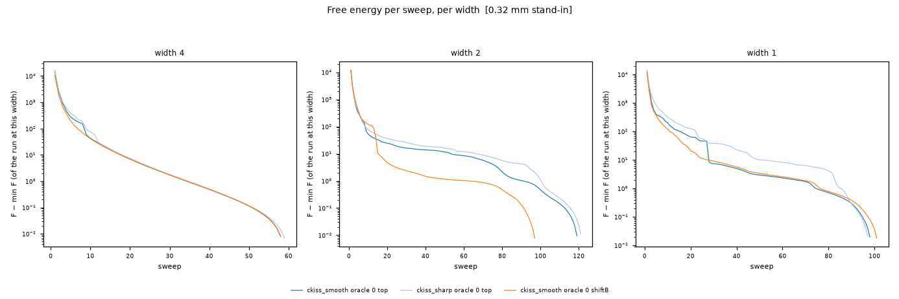
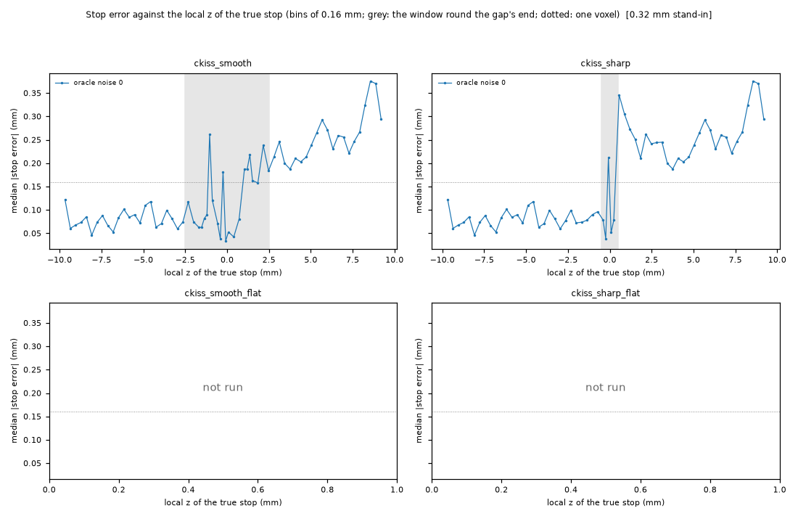
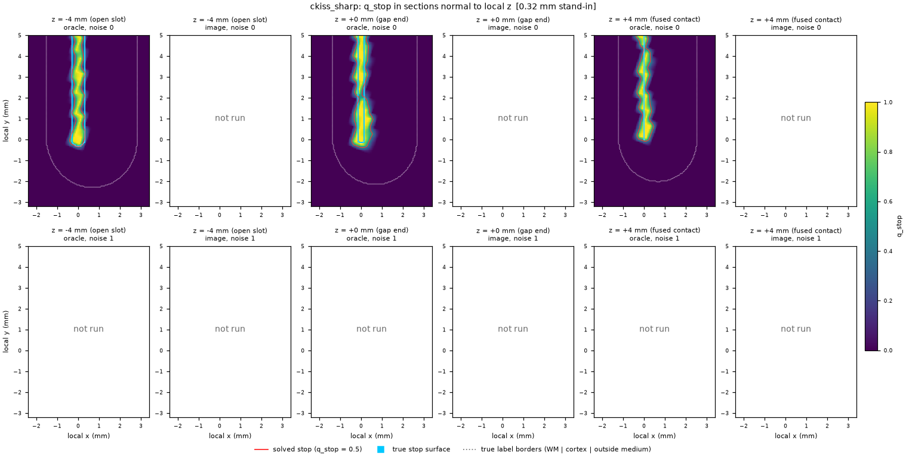
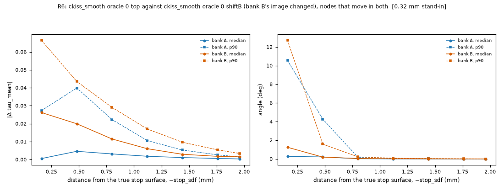

# Flow-field phantoms

This report gives the results of the stage in `docs/plans/flow-field-phantoms.md`. The
stage tests the flow-field column solver on phantoms with a closed-form truth. Each
section comes from one PR of the plan. This version has the section *Kissing surfaces*
(PR 4). The sections *Hairpins*, *Jumps*, *Grid*, *Uncertainty* and *Checkpoint* come
from later PRs.

## Kissing surfaces

### What ran

The plan's PR 4 runs use a uniform grid at 0.16 mm. One such run takes about 7–8 h and
about 16–17 GB. The coordinator decided (CD-11) to run stand-ins at 0.32 mm first. The
stand-ins use the same code and the same defaults. At 0.32 mm the FEM prior has its
correct length ℓ = 0.5 mm (CD-6). **Every number in this section is a 0.32 mm stand-in
result.** No 0.16 mm result exists yet. The first 0.16 mm run (ckiss_smooth, oracle, noise 0) is running. Its results go into this section when it ends.

Table 1. The PR 4 matrix and the state of each run (0.32 mm stand-in stage).

| phantom | source | noise | variant | state |
|---|---|---|---|---|
| ckiss_smooth | oracle | 0 | top | done at 0.32 mm (stand-in) |
| ckiss_sharp | oracle | 0 | top | done at 0.32 mm (stand-in) |
| ckiss_smooth | oracle | 0 | shiftB (R6) | done at 0.32 mm (stand-in) |
| ckiss_smooth | oracle | 0 | anchor (Q6) | running at 0.32 mm |
| ckiss_smooth | oracle | 0 | coarse first (Q6) | running at 0.32 mm |
| ckiss_smooth | oracle | 0 | top, 0.16 mm | running since 06:14 (heavy run) |
| all four ckiss phantoms | image | 0 and 1 | top | not run: time |
| all four ckiss phantoms | oracle | 1 | top | not run: time |
| ckiss_smooth_flat, ckiss_sharp_flat | oracle | 0 | top | not run: time |
| every run at 0.16 mm after the first | | | | not run: time |

"Time" means this: at this cost, the plan's matrix does not fit in one night.

### Inputs, code and cost

- The stop field is the oracle: p = Φ(stop_sdf / 0.08 mm), clipped to [0.02, 0.98]
  (CD-4). The tensor is the oracle too.
- The solver uses the plan's schedule: widths 4, 2, 1, at most 200 sweeps for each width.
  No setting was changed. The re-centring option of CD-13 is off. The contrast term uses
  one profile line per direction (CD-7).
- The views and numbers come from `prototypes/scripts/ff_kiss_views.py`.

Table 2. Cost and inference (0.32 mm stand-in). Each run has 156,065 nodes.

| run | time (min) | peak memory (GB) | sweeps per width | end of each width | free-energy rises | git commit |
|---|---|---|---|---|---|---|
| ckiss_smooth top | 61.3 | 2.71 | 59 / 120 / 99 | free-energy tolerance (all) | 0 | 86f856f |
| ckiss_sharp top | 63.8 | 2.79 | 60 / 122 / 98 | free-energy tolerance (all) | 0 | 1105ed1 |
| ckiss_smooth shiftB | 56.9 | 2.68 | 59 / 98 / 102 | free-energy tolerance (all) | 0 | 6a92779 |

No stand-in reached the cap of 200 sweeps. In the 0.64 mm dev runs, the anchor run and
the coarse run reached the cap at width 4 (dev runs only). Commit 6a92779 adds the anchor
origin and the CD-13 option to the solver. The option is off in the shiftB run. The
solver's docstring states that the default path then gives the same bits; this report
did not check that.

### Question 1: the fused contact

**Expected (plan).** With the oracle stop field, every stop is within one voxel of the
true contact, and no flow line crosses it.

Table 3. Columns whose true stop is a fused contact (CONTACT), 0.32 mm stand-in.
Distributions: median / p90 / max. A negative signed error is a stop in tissue, before
the true stop.

| run | bank | abs stop error (mm) | signed stop error (mm) | stopped / ended at an unresolved cell | own side of the slot plane |
|---|---|---|---|---|---|
| ckiss_smooth top | A | 0.272 / 0.431 / 0.552 | −0.272 / −0.133 / 0.077 | 445 / 25 | 1.000 |
| ckiss_smooth top | B | 0.170 / 0.292 / 0.478 | −0.170 / −0.061 / 0.118 | 576 / 47 | 0.998 |
| ckiss_sharp top | A | 0.290 / 0.459 / 0.584 | −0.290 / −0.142 / 0.179 | 548 / 22 | 1.000 |
| ckiss_sharp top | B | 0.178 / 0.325 / 0.510 | −0.178 / −0.051 / 0.170 | 630 / 19 | 0.998 |
| ckiss_smooth shiftB | A | 0.292 / 0.437 / 0.552 | −0.292 / −0.169 / 0.030 | 429 / 41 | 1.000 |
| ckiss_smooth shiftB | B | 0.121 / 0.214 / 0.390 | −0.121 / −0.029 / 0.075 | 563 / 60 | 0.991 |

- The CONTACT stops are early. The median error is 0.12–0.29 mm. Bank A has the larger
  error. At the open pia (PIA) the median error is 0.08–0.09 mm.
- Contact crossings: 1 (smooth), 1 (sharp), 3 (shiftB). All of them are bank-B columns.
  The tolerance is 0.02 mm (the half-width of the fused slot). The same count on the
  true paths is 0. The overlap and focal counts are 0 in all three runs.
- The width of the solved stop boundary (q_stop from 0.2 to 0.8 on the line through
  each stop) has a median of 0.21 mm, at CONTACT and at PIA stops alike.

**At 0.16 mm.** The CONTACT stops must come to within one voxel (0.16 mm). The contact
crossings must go to 0.

### Question 3: the end of the gap

**Expected (plan).** The smooth change behaves like the open and fused parts. The sharp
change can show grazing columns, sinks or a wrong boundary near the end face.

Table 4. Abs stop error (mm, median / p90 / max) by the local z of the true stop, and
places in the window round the gap's end (± 2.5 mm smooth, ± 0.5 mm sharp), 0.32 mm
stand-in.

| run | open part | window | fused part | unresolved cells: window / elsewhere | moving cortex nodes: window / elsewhere |
|---|---|---|---|---|---|
| ckiss_smooth top | 0.078 / 0.161 / 0.240 | 0.114 / 0.238 / 0.425 | 0.238 / 0.428 / 0.584 | 139 / 135 | 6056 / 19334 |
| ckiss_sharp top | 0.079 / 0.160 / 0.240 | 0.100 / 0.307 / 0.577 | 0.253 / 0.434 / 0.584 | 9 / 156 | 1165 / 24027 |
| ckiss_smooth shiftB | 0.082 / 0.164 / 0.392 | 0.093 / 0.198 / 0.359 | 0.208 / 0.405 / 0.552 | 154 / 170 | 6105 / 19436 |

- The stop error is small in the open part and larger in the fused part. In the fused
  part the error increases with z (figure).
- The window of the smooth phantom holds about half of the unresolved contact cells,
  but less than a quarter of the moving cortex nodes.
- There are no sinks and no focal points in any run, in the window or elsewhere.

**At 0.16 mm.** Compare the fused part with the open part. Look again for grazing
columns at the sharp end face.

### Question 4: the stopped region

**Expected (plan).** The outside medium is stopped at the open slot. At the fused contact
the stopped sheet is thinner than a cell. On a uniform grid the sheet is not resolved.

Table 5. The stopped region, 0.32 mm stand-in.

| run | sheet length at the contact, q_stop > 0.5 (mm, median / p90 / max, 9 lines) | true 2g (mm) | open slot: medium nodes with q_stop > 0.5 | open slot: deep cortex nodes with q_stop > 0.5 |
|---|---|---|---|---|
| ckiss_smooth top | 0.552 / 0.669 / 0.741 | 0.04 | 0.716 (n 1603) | 0 (n 8718) |
| ckiss_sharp top | 0.584 / 0.706 / 0.734 | 0.04 | 0.716 (n 1603) | 0 (n 8718) |
| ckiss_smooth shiftB | 0.538 / 0.661 / 0.741 | 0.04 | 0.729 (n 1603) | 0 (n 8718) |

- At the fused contact the solved sheet is about 0.55 mm thick. That is more than one
  grid spacing (0.32 mm) and about 14 times the true sheet (0.04 mm).
- At the open slot, about 72 % of the medium nodes are stopped. No cortex node deeper
  than one spacing is stopped.

**At 0.16 mm.** The sheet length must scale with the spacing. The plan expects a
resolved sheet only where the octree refines (PR 5).

### Question 5: τ at a contact

**Expected (plan).** The bank speed ratio is near tA / tB = 2.5 / 1.2 = 2.08. The levels
match the truth after one shared monotone map.

Table 6. Speeds at the moving cortex nodes of each bank, 0.32 mm stand-in (median / p90 /
max).

| run | bank | solved speed | true speed | solved / true | τ arrival at CONTACT (true 0) |
|---|---|---|---|---|---|
| ckiss_smooth top | A | 1.04 / 1.09 / 1.80 | 1.35 (all nodes) | 0.771 / 0.839 / 1.33 | −0.561 / −0.419 / −0.131 |
| ckiss_smooth top | B | 1.06 / 1.18 / 1.66 | 0.649 / 0.679 / 0.989 | 1.61 / 1.80 / 2.56 | −0.511 / −0.398 / −0.108 |
| ckiss_sharp top | A | 1.04 / 1.11 / 1.86 | 1.35 (all nodes) | 0.774 / 0.854 / 5.00 | −0.572 / −0.434 / −0.021 |
| ckiss_sharp top | B | 1.07 / 1.19 / 1.77 | 0.649 / 0.680 / 0.989 | 1.62 / 1.83 / 8.76 | −0.523 / −0.401 / −0.080 |

- The solved speed is about 1.05 in both banks. The solved bank ratio A/B is 0.98 (run.json:
  0.983 smooth, 0.975 sharp), against 2.08.
- One possible cause is the speed prior: log v near 0, SD 0.3. log 2.08 = 0.73, about
  2.4 SD. The prior was not changed.
- The levels: in bank A the median signed deviation is near 0 at φ = 0.1–0.3 and 0.06–0.46
  mm at φ = 0.4–0.9. In bank B the levels are deep: −1.2 mm at φ = 0.1, −0.87 mm at
  φ = 0.3, −0.08 to −0.30 mm at φ = 0.4–0.9. Both runs give these values.

**At 0.16 mm.** Look for the same speed ratio. A ratio near 1 at 0.16 mm also points at
the speed prior, not at the grid.

### Question 6: the origin of τ

**No result yet.** The anchor stand-in and the coarse-first stand-in are running.

- The plan's coarse grid is an initial field only, not a prior (CD-9). So the sweep
  comparison measures a warm start. The 0.64 mm first stage carries a different FEM
  prior (CD-6).
- In PR 3 the plan's exact test *Origin* failed in both parts (CD-12). A moved anchor
  bends the field locally, by up to 0.066 in τ. With the top origin, |τ arrival| is
  0.05–0.24, against a τ step Δτ of 0.04.

### The independence test (R6)

The shiftB run changes only bank B's image (its profile moves 0.2 mm toward the top).
The oracle stop field, the tensor and the truth do not change.

Table 7. |Δ tau_mean| and the angle between the two mean directions at nodes that move
in both runs, by the distance from the true stop surface, 0.32 mm stand-in (median / p90
/ max).

| distance (mm) | bank A: abs Δτ | bank A: angle (°) | bank B: abs Δτ | bank B: angle (°) |
|---|---|---|---|---|
| 0–0.32 | 0.0006 / 0.027 / 0.11 | 0.28 / 10.5 / 28.2 | 0.026 / 0.066 / 0.27 | 1.25 / 12.7 / 33.8 |
| 0.32–0.64 | 0.0046 / 0.040 / 0.11 | 0.22 / 4.3 / 40.7 | 0.020 / 0.044 / 0.24 | 0.20 / 1.6 / 28.4 |
| 0.64–0.96 | 0.0032 / 0.022 / 0.097 | 0.02 / 0.18 / 11.7 | 0.012 / 0.029 / 0.096 | 0.05 / 0.22 / 15.8 |
| 0.96–1.28 | 0.0019 / 0.011 / 0.072 | 0.01 / 0.06 / 2.1 | 0.006 / 0.017 / 0.063 | 0.02 / 0.08 / 1.3 |
| 1.28–2.0 | 0.0011 / 0.0053 / 0.060 | 0.0042 / 0.028 / 0.66 | 0.0030 / 0.0096 / 0.048 | 0.011 / 0.044 / 0.63 |

The last row joins three bins (1.28–1.6, 1.6–1.92, 1.92–2.0 mm). Each value in it is the
largest value of the three bins.

- Bank A changes when only bank B's image changes. In the first bin (0–0.32 mm) the p90
  of abs Δτ is 0.027 in bank A and 0.066 in bank B. In the next bin they are almost
  equal (0.040 and 0.044). The change falls with the distance from the stop surface in
  both banks.
- Per column (bank A, CONTACT stops, n 470): the stops move by 0.021 / 0.18 / 0.36 mm,
  and 42 columns change their end reason.
- Possible causes, not separated: coupling across unresolved contact cells (the stopped
  sheet is 0.55 mm at 0.32 mm; the true sheet is 0.04 mm), and the mean field that ends
  at a different restricted minimum. PR 3 found that most moving nodes end at the edge of
  their kept τ candidates; the CD-13 option is under test.

### Design decisions R1–R7 and R11

Evidence for every row: 0.32 mm stand-in only; 0.16 mm pending. R8–R10 are not in PR 4.

| # | supports | does not support | failure signature (plan) seen |
|---|---|---|---|
| R1 stop as a node state | stops on the own side of the slot plane (≥ 0.991); no cortex node stopped at the open slot | CONTACT stops early by 0.12–0.29 mm (median); PIA 0.08–0.09 mm | not decided: the stop error and the sheet are at the scale of the spacing; no image run |
| R2 speed to zero at the stop, τ jumps to τ_top | — | the integrator's jump −τ_arrival is positive at 2669 of 2670 stops (smooth; median 0.32), 2992 of 2992 (sharp), also at the pia | seen, with a caveat: τ at the q_stop = 0.5 crossing comes from the last moving nodes, up to one spacing below the stop (masked interpolation). It can measure the integrator, not the solver's jump state. A likely cause is that of CD-12. The provisional change for R2 (#208) failed again; its diagnosis agrees: the column jump is −τ_arrival from the masked interpolation, and the stop boundary sits beyond the pia because of the entropy of the moving candidates |
| R3 jump prior near zero | — | as R2 | seen, with the caveat of R2 |
| R4 τ_top = 0 as origin | — | — | not decided: Q6 pending |
| R5 no overlap | overlap 0; contact crossings 0 on the true paths | contact crossings 1, 1, 3, all bank B. Each crossing column starts in bank B's WM far from the fundus (local y 4.2–6.4 mm): not a start effect. Each ends STOPPED 0.000–0.010 mm past the far face of the fused slot (g = 0.02 mm), so it overshoots the contact by less than 1/16 voxel and does not run on into bank A | seen (count above zero), small |
| R6 no interpolation across the stop boundary | bank A changes less than bank B | bank A changes when only bank B changes (Table 7) | seen |
| R7 non-crossing, sinks checked | sinks 0, sink columns 0, focal points 0, overlap 0 | reversed edges 3, 3, 13 (their places against the stop set are not checked here) | not seen for sinks, focal points and overlap at this grid |
| R11 direction tied to ∇τ | direction against ∇τ: median 1.9–2.5° | — | not seen |

### The image inputs (CD-5)

The image stop terms are ranking scores, not calibrated log-odds (CD-5). No image run
ran in PR 4. So this section has no evidence on the stop field from the image.
