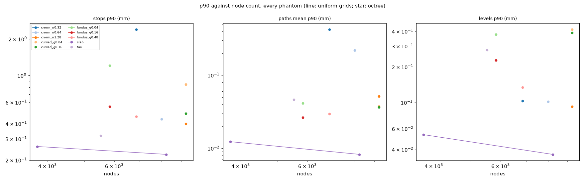
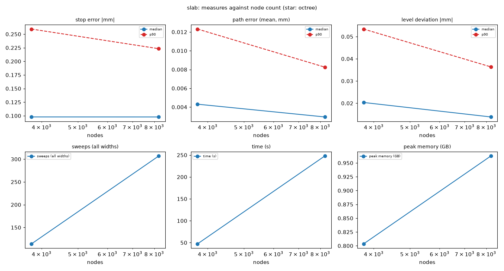
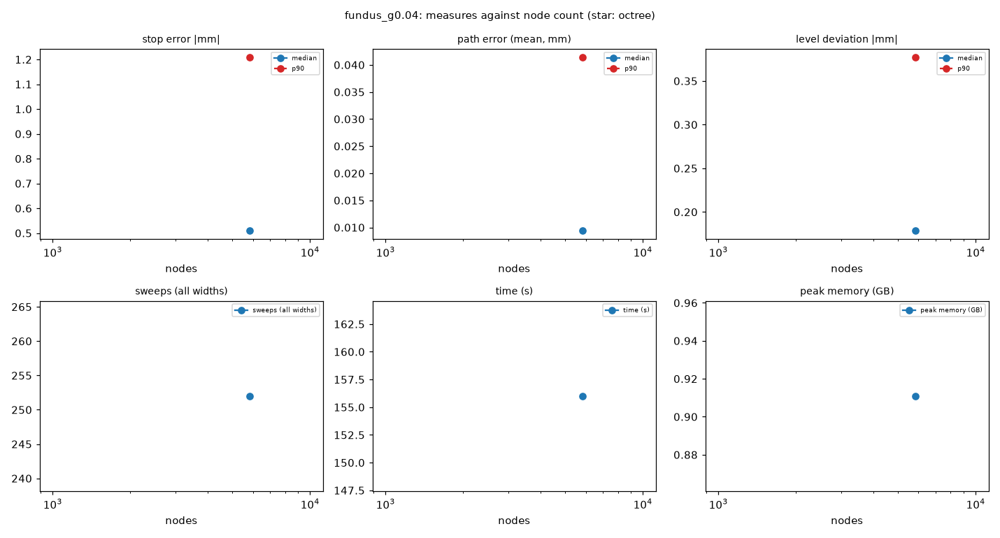

# Flow-field phantoms

This report gives the results of the stage in `docs/plans/flow-field-phantoms.md`. The
stage tests the flow-field column solver on phantoms with a closed-form truth. Each
section comes from one PR of the plan. This version has the section *Kissing surfaces*
(PR 4) and the sections *Hairpins*, *Jumps*, *Grid* and *Uncertainty* (PR 6, partial).
The section *Checkpoint* (PR 7) reads all of them and gives the choice for the user.

## Kissing surfaces

### What ran

The plan's PR 4 runs use a uniform grid at 0.16 mm. One such run takes about 7–8 h and
about 16–17 GB. The coordinator decided (CD-11) to run stand-ins at 0.32 mm first. The
stand-ins use the same code and the same defaults. At 0.32 mm the FEM prior has its
correct length ℓ = 0.5 mm (CD-6). **Every number in this section is a 0.32 mm stand-in
result.** No 0.16 mm result exists yet. The first 0.16 mm run (ckiss_smooth, oracle, noise 0) is running. Its results go into this section when it ends.

Table 1. The PR 4 matrix and the state of each run (0.32 mm stand-in stage).

| phantom | source | noise | variant | state |
|---|---|---|---|---|
| ckiss_smooth | oracle | 0 | top | done at 0.32 mm (stand-in) |
| ckiss_sharp | oracle | 0 | top | done at 0.32 mm (stand-in) |
| ckiss_smooth | oracle | 0 | shiftB (R6) | done at 0.32 mm (stand-in) |
| ckiss_smooth | oracle | 0 | anchor (Q6) | running at 0.32 mm |
| ckiss_smooth | oracle | 0 | coarse first (Q6) | running at 0.32 mm |
| ckiss_smooth | oracle | 0 | top, 0.16 mm | running since 06:14 (heavy run) |
| all four ckiss phantoms | image | 0 and 1 | top | not run: time |
| all four ckiss phantoms | oracle | 1 | top | not run: time |
| ckiss_smooth_flat, ckiss_sharp_flat | oracle | 0 | top | not run: time |
| every run at 0.16 mm after the first | | | | not run: time |

"Time" means this: at this cost, the plan's matrix does not fit in one night.

### Inputs, code and cost

- The stop field is the oracle: p = Φ(stop_sdf / 0.08 mm), clipped to [0.02, 0.98]
  (CD-4). The tensor is the oracle too.
- The solver uses the plan's schedule: widths 4, 2, 1, at most 200 sweeps for each width.
  No setting was changed. The re-centring option of CD-13 is off. The contrast term uses
  one profile line per direction (CD-7).
- The columns start at the roots (the plan's rule). The stand-ins were re-measured from
  their saved fields after PR 3's fix 88bc488. No new solve was made.
- The views and numbers come from `prototypes/scripts/ff_kiss_views.py`.

Table 2. Cost and inference (0.32 mm stand-in). Each run has 156,065 nodes.

| run | time (min) | peak memory (GB) | sweeps per width | end of each width | free-energy rises | git commit |
|---|---|---|---|---|---|---|
| ckiss_smooth top | 61.3 | 2.71 | 59 / 120 / 99 | free-energy tolerance (all) | 0 | 86f856f |
| ckiss_sharp top | 63.8 | 2.79 | 60 / 122 / 98 | free-energy tolerance (all) | 0 | 1105ed1 |
| ckiss_smooth shiftB | 56.9 | 2.68 | 59 / 98 / 102 | free-energy tolerance (all) | 0 | 6a92779 |

No stand-in reached the cap of 200 sweeps. In the 0.64 mm dev runs, the anchor run and
the coarse run reached the cap at width 4 (dev runs only). Commit 6a92779 adds the anchor
origin and the CD-13 option to the solver. The option is off in the shiftB run. The
solver's docstring states that the default path then gives the same bits; this report
did not check that.

### Question 1: the fused contact

**Expected (plan).** With the oracle stop field, every stop is within one voxel of the
true contact, and no flow line crosses it.

Table 3. Columns whose true stop is a fused contact (CONTACT), 0.32 mm stand-in.
Distributions: median / p90 / max. A negative signed error is a stop in tissue, before
the true stop.

| run | bank | abs stop error (mm) | signed stop error (mm) | stopped / ended at an unresolved cell | own side of the slot plane |
|---|---|---|---|---|---|
| ckiss_smooth top | A | 0.272 / 0.431 / 0.553 | −0.272 / −0.133 / 0.074 | 445 / 25 | 1.000 |
| ckiss_smooth top | B | 0.170 / 0.293 / 0.483 | −0.170 / −0.060 / 0.121 | 577 / 46 | 0.998 |
| ckiss_sharp top | A | 0.290 / 0.459 / 0.588 | −0.290 / −0.142 / 0.165 | 548 / 22 | 1.000 |
| ckiss_sharp top | B | 0.181 / 0.325 / 0.505 | −0.181 / −0.065 / 0.029 | 629 / 20 | 0.998 |
| ckiss_smooth shiftB | A | 0.292 / 0.437 / 0.552 | −0.292 / −0.169 / 0.028 | 429 / 41 | 1.000 |
| ckiss_smooth shiftB | B | 0.123 / 0.215 / 0.391 | −0.123 / −0.030 / 0.075 | 561 / 62 | 0.991 |

- The CONTACT stops are early. The median error is 0.12–0.29 mm. Bank A has the larger
  error. At the open pia (PIA) the median error is 0.08–0.09 mm.
- Contact crossings: 1 (smooth), 1 (sharp), 3 (shiftB). All of them are bank-B columns.
  The tolerance is 0.02 mm (the half-width of the fused slot). The same count on the
  true paths is 0. The overlap and focal counts are 0 in all three runs.
- The width of the solved stop boundary (q_stop from 0.2 to 0.8 on the line through
  each stop) has a median of 0.21 mm, at CONTACT and at PIA stops alike.

**At 0.16 mm.** The CONTACT stops must come to within one voxel (0.16 mm). The contact
crossings must go to 0.

### Question 3: the end of the gap

**Expected (plan).** The smooth change behaves like the open and fused parts. The sharp
change can show grazing columns, sinks or a wrong boundary near the end face.

Table 4. Abs stop error (mm, median / p90 / max) by the local z of the true stop, and
places in the window round the gap's end (± 2.5 mm smooth, ± 0.5 mm sharp), 0.32 mm
stand-in.

| run | open part | window | fused part | unresolved cells: window / elsewhere | moving cortex nodes: window / elsewhere |
|---|---|---|---|---|---|
| ckiss_smooth top | 0.078 / 0.161 / 0.240 | 0.115 / 0.238 / 0.425 | 0.236 / 0.428 / 0.602 | 139 / 135 | 6056 / 19334 |
| ckiss_sharp top | 0.079 / 0.161 / 0.240 | 0.079 / 0.169 / 0.331 | 0.252 / 0.432 / 0.602 | 9 / 156 | 1165 / 24027 |
| ckiss_smooth shiftB | 0.082 / 0.165 / 0.391 | 0.094 / 0.194 / 0.358 | 0.207 / 0.403 / 0.552 | 154 / 170 | 6105 / 19436 |

- The stop error is small in the open part and larger in the fused part. In the fused
  part the error increases with z (figure).
- The window of the smooth phantom holds about half of the unresolved contact cells,
  but less than a quarter of the moving cortex nodes.
- There are no sinks and no focal points in any run, in the window or elsewhere.

**At 0.16 mm.** Compare the fused part with the open part. Look again for grazing
columns at the sharp end face.

### Question 4: the stopped region

**Expected (plan).** The outside medium is stopped at the open slot. At the fused contact
the stopped sheet is thinner than a cell. On a uniform grid the sheet is not resolved.

Table 5. The stopped region, 0.32 mm stand-in.

| run | sheet length at the contact, q_stop > 0.5 (mm, median / p90 / max, 9 lines) | true 2g (mm) | open slot: medium nodes with q_stop > 0.5 | open slot: deep cortex nodes with q_stop > 0.5 |
|---|---|---|---|---|
| ckiss_smooth top | 0.552 / 0.669 / 0.741 | 0.04 | 0.716 (n 1603) | 0 (n 8718) |
| ckiss_sharp top | 0.584 / 0.706 / 0.734 | 0.04 | 0.716 (n 1603) | 0 (n 8718) |
| ckiss_smooth shiftB | 0.538 / 0.661 / 0.741 | 0.04 | 0.729 (n 1603) | 0 (n 8718) |

- At the fused contact the solved sheet is about 0.55 mm thick. That is more than one
  grid spacing (0.32 mm) and about 14 times the true sheet (0.04 mm).
- At the open slot, about 72 % of the medium nodes are stopped. No cortex node deeper
  than one spacing is stopped.

**At 0.16 mm.** The sheet length must scale with the spacing. The plan expects a
resolved sheet only where the octree refines (PR 5).

### Question 5: τ at a contact

**Expected (plan).** The bank speed ratio is near tA / tB = 2.5 / 1.2 = 2.08. The levels
match the truth after one shared monotone map.

Table 6. Speeds at the moving cortex nodes of each bank, 0.32 mm stand-in (median / p90 /
max).

| run | bank | solved speed | true speed | solved / true | τ arrival at CONTACT (true 0) |
|---|---|---|---|---|---|
| ckiss_smooth top | A | 1.04 / 1.09 / 1.80 | 1.35 (all nodes) | 0.771 / 0.839 / 1.33 | −0.559 / −0.418 / −0.128 |
| ckiss_smooth top | B | 1.06 / 1.18 / 1.66 | 0.649 / 0.679 / 0.989 | 1.61 / 1.80 / 2.56 | −0.511 / −0.396 / −0.105 |
| ckiss_sharp top | A | 1.04 / 1.11 / 1.86 | 1.35 (all nodes) | 0.774 / 0.854 / 5.00 | −0.573 / −0.435 / −0.021 |
| ckiss_sharp top | B | 1.07 / 1.19 / 1.77 | 0.649 / 0.680 / 0.989 | 1.62 / 1.83 / 8.76 | −0.526 / −0.414 / −0.008 |

- The solved speed is about 1.05 in both banks. The solved bank ratio A/B is 0.98 (run.json:
  0.983 smooth, 0.975 sharp), against 2.08.
- One possible cause is the speed prior: log v near 0, SD 0.3. log 2.08 = 0.73, about
  2.4 SD. The prior was not changed.
- The levels: in bank A the median signed deviation is near 0 at φ = 0.1–0.3 and 0.06–0.46
  mm at φ = 0.4–0.9. In bank B the levels are deep: −0.24 to −0.31 mm at φ = 0.2–0.5 and
  −0.08 to −0.18 mm at φ = 0.6–0.9. No bank-B column has a level at φ = 0.1. Both runs
  give these values. The abs level deviation in bank B is 0.19 / 0.32–0.33 / 0.60–0.69 mm
  (median / p90 / max).

**At 0.16 mm.** Look for the same speed ratio. A ratio near 1 at 0.16 mm also points at
the speed prior, not at the grid.

### Question 6: the origin of τ

**No result yet.** The anchor stand-in and the coarse-first stand-in are running.

- The plan's coarse grid is an initial field only, not a prior (CD-9). So the sweep
  comparison measures a warm start. The 0.64 mm first stage carries a different FEM
  prior (CD-6).
- In PR 3 the plan's exact test *Origin* failed in both parts (CD-12). A moved anchor
  bends the field locally, by up to 0.066 in τ. With the top origin, |τ arrival| is
  0.05–0.24, against a τ step Δτ of 0.04.

### The independence test (R6)

The shiftB run changes only bank B's image (its profile moves 0.2 mm toward the top).
The oracle stop field, the tensor and the truth do not change.

Table 7. |Δ tau_mean| and the angle between the two mean directions at nodes that move
in both runs, by the distance from the true stop surface, 0.32 mm stand-in (median / p90
/ max).

| distance (mm) | bank A: abs Δτ | bank A: angle (°) | bank B: abs Δτ | bank B: angle (°) |
|---|---|---|---|---|
| 0–0.32 | 0.0006 / 0.027 / 0.11 | 0.28 / 10.5 / 28.2 | 0.026 / 0.066 / 0.27 | 1.25 / 12.7 / 33.8 |
| 0.32–0.64 | 0.0046 / 0.040 / 0.11 | 0.22 / 4.3 / 40.7 | 0.020 / 0.044 / 0.24 | 0.20 / 1.6 / 28.4 |
| 0.64–0.96 | 0.0032 / 0.022 / 0.097 | 0.02 / 0.18 / 11.7 | 0.012 / 0.029 / 0.096 | 0.05 / 0.22 / 15.8 |
| 0.96–1.28 | 0.0019 / 0.011 / 0.072 | 0.01 / 0.06 / 2.1 | 0.006 / 0.017 / 0.063 | 0.02 / 0.08 / 1.3 |
| 1.28–2.0 | 0.0011 / 0.0053 / 0.060 | 0.0042 / 0.028 / 0.66 | 0.0030 / 0.0096 / 0.048 | 0.011 / 0.044 / 0.63 |

The last row joins three bins (1.28–1.6, 1.6–1.92, 1.92–2.0 mm). Each value in it is the
largest value of the three bins.

- Bank A changes when only bank B's image changes. In the first bin (0–0.32 mm) the p90
  of abs Δτ is 0.027 in bank A and 0.066 in bank B. In the next bin they are almost
  equal (0.040 and 0.044). The change falls with the distance from the stop surface in
  both banks.
- Per column (bank A, CONTACT stops, n 470): the stops move by 0.021 / 0.18 / 0.36 mm,
  and 42 columns change their end reason.
- Possible causes, not separated: coupling across unresolved contact cells (the stopped
  sheet is 0.55 mm at 0.32 mm; the true sheet is 0.04 mm), and the mean field that ends
  at a different restricted minimum. PR 3 found that most moving nodes end at the edge of
  their kept τ candidates; the CD-13 option is under test.

### Design decisions R1–R7 and R11

Evidence for every row: 0.32 mm stand-in only; 0.16 mm pending. R8–R10 are not in PR 4.

| # | supports | does not support | failure signature (plan) seen |
|---|---|---|---|
| R1 stop as a node state | stops on the own side of the slot plane (≥ 0.991); no cortex node stopped at the open slot | CONTACT stops early by 0.12–0.29 mm (median); PIA 0.08–0.09 mm | not decided: the stop error and the sheet are at the scale of the spacing; no image run |
| R2 speed to zero at the stop, τ jumps to τ_top | — | the integrator's jump −τ_arrival is positive at all stops: 2672 of 2672 (smooth; median 0.33), 2994 of 2994 (sharp), 2581 of 2581 (shiftB), also at the pia | seen, with a caveat: τ at the q_stop = 0.5 crossing comes from the last moving nodes, up to one spacing below the stop (masked interpolation). It can measure the integrator, not the solver's jump state. A likely cause is that of CD-12. The provisional change for R2 (#208) failed again; its diagnosis agrees: the column jump is −τ_arrival from the masked interpolation, and the stop boundary sits beyond the pia because of the entropy of the moving candidates |
| R3 jump prior near zero | — | as R2 | seen, with the caveat of R2 |
| R4 τ_top = 0 as origin | — | — | not decided: Q6 pending |
| R5 no overlap | overlap 0; contact crossings 0 on the true paths | contact crossings 1, 1, 3, all bank B. Each crossing column starts at its root in bank B, far from the fundus (local y 4.2–6.4 mm): not a start effect. Four of the five end STOPPED 0.000–0.010 mm past the far face of the fused slot (g = 0.02 mm): they overshoot the contact by less than 1/16 voxel. The fifth (shiftB) ends STOPPED inside the slot at local z = 0.74 mm, where g = 0.092 mm (the window of the gap's end): 0.024 mm past the slot plane, 0.068 mm before the far face. No crossing column runs on into bank A | seen (count above zero), small |
| R6 no interpolation across the stop boundary | bank A changes less than bank B | bank A changes when only bank B changes (Table 7) | seen |
| R7 non-crossing, sinks checked | sinks 0, sink columns 0, focal points 0, overlap 0 | reversed edges 3, 3, 13 (their places against the stop set are not checked here) | not seen for sinks, focal points and overlap at this grid |
| R11 direction tied to ∇τ | direction against ∇τ: median 1.9–2.5° | — | not seen |

### The image inputs (CD-5)

The image stop terms are ranking scores, not calibrated log-odds (CD-5). No image run
ran in PR 4. So this section has no evidence on the stop field from the image.

## PR 6: what ran (partial)

PR 6 (tasks 6.1–6.4) opened with partial results, by the coordinator's decision CD-15.
No new run starts after 12:00 EST on 2026-11-12. Runs that started before 12:00 can
finish. A later agent adds their results. **Every number below is from the runs that had
ended at 07:25 EST.** The code is `prototypes/scripts/ff_pr6_runs.py` (run driver),
`ff_sample.py` (task 6.4) and `ff_pr6_views.py` (tables and figures). The base is #205
(octree), with #209 (kissing surfaces) and the start fix of #204 (columns start at the
roots).

Table 8. The state of the PR 6 runs at 07:25 EST.

| task | run | state |
|---|---|---|
| 6.1 | fundus_g0.04, oracle, noise 0, uniform 0.16 mm | done (2162 s, 3.8 GB) |
| 6.1 | curved_g0.04, oracle, noise 0, uniform 0.16 mm | running since 07:21 (est. 4–8 h, 6.1 GB) |
| 6.1 | fundus_g0.04 oracle 1; fundus_g0.04 image 0; fundus_g0.16 and fundus_g0.48 oracle 0 (uniform 0.16 mm) | pending, slot A positions 6–9; probably cut at 12:00 |
| 6.1 | fundus_g0.04, oracle, noise 0, octree | running since 06:50 (round 0 refinement accepted) |
| 6.1 | curved_g0.04, oracle, noise 0, octree | pending, slot B position 2 |
| 6.1 | all other image and noise-1 cells; the other fundi and curved_g0.16 on the octree | not run: time (one 0.16 mm run takes 2–8 h) |
| 6.2 | abraded, oracle, noise 0, octree | pending, slot B position 3 |
| 6.2 | abraded, oracle, noise 0, uniform 0.32 mm (stand-in) | pending, slot B position 4 |
| 6.2 | abraded at 0.16 mm | not run: heavy (memguard stopped the probe at 8.2 GB in setup; est. 13–15 GB, 12–20 h) |
| 6.2 | abraded, image source, noise 1 | not run: time |
| 6.3 | 10 phantoms, oracle, noise 1, uniform 0.64 mm | done (55–217 s, 0.85–1.06 GB) |
| 6.3 | slab at 0.48 mm | done (257 s, 1.0 GB) |
| 6.3 | the other 9 phantoms at 0.48 mm, then all 10 at 0.32 mm | running and pending in slot C |
| 6.3 | 0.16 mm column, octree column, noise phantom, ckiss phantoms, abraded | not run: time |
| 6.4 | curved_g0.16, image, noise 1, seed 1, uniform 0.32 mm (stand-in), 32 sampled fields | pending, slot C positions 34–35 of 35; probably cut at 12:00 |
| 6.4 | seeds 2–4; ckiss_smooth and abraded; the octree | not run: time |

## Hairpins

The view is `ff_pr6_views.py hairpins`. Focal points are counted again from the saved
columns. The only hairpin run that ended is fundus_g0.04, oracle, noise 0, uniform
0.16 mm (287 496 nodes, 463 columns).

- Topology: focal points 0, crossings 0, overlap 0, sink nodes 0, sink columns 0.
  Reversed edges 42.
- 106 of 463 columns (23 %) end UNRESOLVED_CONTACT, with 293 unresolved cells, at the
  fused slot. Question 2 expected focal points at g = 0.04 mm on a uniform grid. They do
  not occur. The columns end unresolved instead.
- 357 columns stop. All stop early: signed median −0.074 mm, |error| p90 0.112 mm
  (CONTACT median 0.078 mm, HAIRPIN median 0.062 mm). 5 stops are on the wrong bank,
  0 of them farther than 0.08 mm from the plane x = 0.
- Speed ratio to the truth: median 1.03, p90 1.07. Direction against ∇τ: median 1.4°;
  against the truth: 0.09°. Levels |error| median 0.019 mm. Paths 0.001 mm. Spacing of
  the levels near the stop: ratio 1.16. Sweeps 18/14/40.

No octree hairpin run has ended. So there is no map of cells finer than 0.16 mm yet. The
first octree round on fundus_g0.04 accepted a refinement (F 214 171 → 180 028; 5832 →
17 060 nodes, cells to 0.32 mm). The scan at 0.64 mm (Table 9) also has unresolved
cells on every fundus and curved phantom (21–163), and none on the slab, crowns and τ.

## Jumps

The view is `ff_pr6_views.py jumps`. No abraded run has ended. The abraded octree run is
pending (slot B position 3), and the 0.32 mm stand-in is pending (slot B position 4).
Both can be cut at 12:00. The abraded phantom at 0.16 mm is not run (heavy).

The only jump evidence in PR 6 is on intact cortex. On fundus_g0.04 (oracle, noise 0,
0.16 mm) all jumps on intact cortex are positive: median 0.168, p90 0.21 (about 4 Δτ).
On the slab (#208) the jump was about 1 Δτ. This is R2's and R3's failure signature.
The causes are not separated: the integrator's readout of τ at the stop (#204, #208) or
the inference (#204, #207). `Columns.p_jump` is nan in every run, because `_measure_write`
does not pass it; the view reads the node p_jump from `field.npz`.

## Grid

The view is `ff_pr6_views.py grid`. The runs use oracle inputs and noise 1.0.

Table 9. The spacing scan (uniform 0.64 mm, and the slab at 0.48 mm). Distances in mm.

| run | nodes | stops med/p90 | paths med/p90 | levels med/p90 | unresolved | time (s) |
|---|---|---|---|---|---|---|
| slab 0.64 | 3757 | 0.098 / 0.259 | 0.004 / 0.012 | 0.020 / 0.053 | 0 | 47 |
| slab 0.48 | 8228 | 0.098 / 0.223 | 0.003 / 0.008 | 0.014 / 0.036 | 0 | 248 |
| crown_w0.32 0.64 | 6859 | 0.204 / 2.40 | 0.192 / 0.424 | 0.035 / 0.103 | 0 | 61 |
| crown_w0.64 0.64 | 8000 | 0.215 / 0.436 | 0.093 / 0.220 | 0.039 / 0.102 | 0 | 58 |
| crown_w1.28 0.64 | 9261 | 0.152 / 0.400 | 0.010 / 0.051 | 0.036 / 0.092 | 0 | 73 |
| fundus_g0.48 0.64 | 6859 | 0.162 / 0.459 | 0.007 / 0.030 | 0.061 / 0.134 | 21 | 142 |
| fundus_g0.16 0.64 | 5832 | 0.318 / 0.554 | 0.006 / 0.026 | 0.124 / 0.227 | 98 | 113 |
| fundus_g0.04 0.64 | 5832 | 0.510 / 1.21 | 0.009 / 0.041 | 0.179 / 0.377 | 63 | 156 |
| curved_g0.16 0.64 | 9261 | 0.224 / 0.484 | 0.006 / 0.036 | 0.170 / 0.388 | 163 | 195 |
| curved_g0.04 0.64 | 9261 | 0.459 / 0.843 | 0.004 / 0.038 | 0.171 / 0.415 | 127 | 206 |
| tau 0.64 | 5525 | 0.126 / 0.318 | 0.010 / 0.046 | 0.118 / 0.279 | 0 | 94 |

Focal points, overlap, crossings and sinks are 0 in every scan run. At 0.64 mm the stop
error grows as the fundus gap closes (median 0.16 → 0.32 → 0.51 mm for g = 0.48, 0.16,
0.04 mm). The narrow crown (w = 0.32 mm) has stops p90 2.4 mm and paths median 0.19 mm:
at 0.64 mm the grid does not resolve it. On the slab, 0.48 mm lowers the p90 of stops,
paths and levels; the stop median does not change (0.098 mm). The other phantoms have
only one spacing so far, so there is no curve against the node count yet.

No octree result is in the scan: the octree column of the scan is not run (time). The
octree evidence for R9 is in #205 and #206: on the noise phantom the first refinement
was accepted (ΔF −9417.6), and a control re-solve of the same grid gave the same gain
(ΔF −9418.8), so the gain came from the restart, not from the refinement. With the
control rule (#206) the refinement is refused by +1.14 in about 35 000.

## Uncertainty

Task 6.4 (question 8) is pending. The first calibration run (curved_g0.16, image,
noise 1, seed 1, uniform 0.32 mm stand-in, 32 sampled fields) is at positions 34–35 of
35 in slot C. It can be cut at 12:00. Seeds 2–4, ckiss_smooth and abraded, and the
octree are not run (time). The sampler (`ff_sample.py`) is tested: it draws 32 fields
from each node's q and q_stop, integrates columns from the roots, fits one map g on the
posterior-mean columns, and gives z = (0 − m)/σ per column for the stops (`stop_sdf`)
and the levels. It draws hanging nodes independently (CD-10). There is no SD of z yet.

## Design decisions R2, R3, R7–R10 (PR 6, partial)

| # | supports | does not support | state |
|---|---|---|---|
| R2 speed to zero at the stop, τ jumps to τ_top | spacing of the levels near the stop: ratio 1.16 (no strong pile-up) on fundus_g0.04 | jumps on intact cortex all positive, median 0.168 (about 4 Δτ) on fundus_g0.04; slab about 1 Δτ (#208); also #204, #209 | failure signature seen; cause not separated (integrator readout or inference, #204, #207, #208) |
| R3 jump prior near zero | — | as R2: positive jumps on intact cortex | partial: no abraded run yet, so no jump on a patch |
| R7 non-crossing, sinks checked | focal points 0, crossings 0, overlap 0, sinks 0 on fundus_g0.04 at 0.16 mm and in all 11 scan runs | 42 reversed edges on fundus_g0.04; 23 % of its columns end UNRESOLVED_CONTACT | partial: one 0.16 mm hairpin run; the signature (a count above zero away from the stop set) not seen |
| R8 adaptive grid, prior-shaped cells marked | the uniform grid at g = 0.04 mm gives no focal points | no focal point exists for the octree to remove; no octree run has ended | partial: octree runs running or pending |
| R9 refinement accepted by F | the control rule (#206) refuses the noise refinement | the original rule accepts a refinement on noise (#205); the gain is the restart | failed in #205; the change (#206) is under review; no PR 6 run on the slab or noise |
| R10 uncertainty from sampled fields | — | — | pending: no calibration run has ended |

## Checkpoint

This section is the checkpoint of the plan (PR 7). It reads the results of #202–#210
and of the three provisional design changes (#206, #207, #208). It adds no run. Some
runs continue (PR 4's 0.16 mm `ckiss_smooth` run, and PR 6's queues until 12:00 EST).
Rows that wait for these runs are marked **provisional, runs pending**.

"Grid" gives the spacing of the evidence. "0.32 mm stand-in" means a run at 0.32 mm in
place of the plan's 0.16 mm run (CD-11, CD-15). Every run used the oracle inputs (the
true stop field and the true tensor). No image run ended. So no row can separate the
evidence from the representation in the way that the plan's R1 signature does.

### The cause of a failure

Three causes can make a decision fail:

- **evidence:** the stop field or the contrast does not hold the answer.
- **representation:** the form of the field cannot hold the true answer.
- **inference:** the form can hold the answer, and the energy's minimum is near it, but
  the mean field does not find that minimum.

Two findings show that the inference does not reach the energy's minimum:

- **The candidate window** (#204, CD-13). Each node holds 9 τ values and 7 directions
  round its prediction. The window moves only at the re-centring steps. On the small
  slab (24³, 0.32 mm), 1114 of 1793 moving nodes end at the τ edge of their kept set,
  and 907 keep one τ only. A second solve from the first solve's result lowers F. On
  the noise phantom it lowers F by 9418.8 (#205). The CD-13 option (re-centre and solve
  a width again) lowers F by 20 % at about 5 × the time, and a restart still lowers F.
- **The stiff mode** (#207). On the τ phantom the true field has a lower F than the
  solved field (by 347 on the small grid, by 8811 at 0.16 mm). The collective change of
  τ and speed along a whole column is stiff under σ_c = Δτ/h. Node-wise updates move it
  slowly. Re-centring each sweep (#207) does not remove it.

A third finding is a bias of the inference at the stop boundary (#208). The moving state
spreads over up to 63 candidates. The stopped state is one state. So the entropy of the
moving q (median 1.88 nats) is as large as the stop log-odds that it must beat (up to
1.70). On the slab the boundary is 0.07–0.09 mm beyond the true pia with the oracle.

The integrator's readout is a fourth place where an error can come from. It is part of
the design (the masked interpolation and the stop at q_stop = 0.5), but it is not the
solver's state. #208 found that the energy's own jump is 0 on every boundary edge of the
slab. The nonzero column jumps are the integrator's −τ_arrival: the masked interpolation
does not advance τ past the last moving layer.

### The design decisions

Table 10. The design decisions R1–R11. "Supported" means the failure signature of the
plan did not occur. "Not supported" means it occurred.

| # | Decision | Result | Cause (if not supported) | Evidence | Grid |
|---|---|---|---|---|---|
| R1 | the top is a node state | **not decided**, provisional, runs pending. With the oracle, the stops are within one voxel on the slab (beyond the pia, median +0.073 mm, #204) and on fundus_g0.04 (early, median −0.074 mm, p90 0.112 mm). At the fused contact the stops are early by 0.12–0.29 mm (median). No image run, so the R1 signature (oracle right, image wrong) cannot be read | the offset at the pia: inference (the entropy bias, #208). The contact: not separated (the spacing, 0.32 mm) | #204, #208, *Hairpins*, Table 3, `kiss_q1q3_stop_vs_z_u0.32.png` | 0.16 mm (slab, fundus_g0.04), 0.32 mm stand-in (contact) |
| R2 | the speed jumps to 0, τ jumps to τ_top | **not supported**. Jumps on intact cortex are positive at every stop: slab median 0.040 (1 Δτ, #204), fundus_g0.04 median 0.168 (4 Δτ), ckiss median 0.33. The levels do not pile up near the stop (spacing ratio 1.16 on fundus_g0.04). The provisional change (#208) also fails | integrator readout (τ_arrival from masked interpolation) and inference (the entropy bias moves the boundary). Not the energy's jump: it is 0 on every slab boundary edge (#208) | #204, #208, #209, *Jumps* | 0.16 mm (slab, fundus_g0.04), 0.32 mm stand-in (ckiss) |
| R3 | the jump prior is almost always 0 | **not decided**, provisional, runs pending. No abraded run ended. The positive jumps on intact cortex have the cause of R2, not of the prior | — | *Jumps* | — |
| R4 | τ_top = 0 is the origin | **not decided**, provisional, runs pending. The anchor stand-in ended after PR 4 wrote its section. From its `run.json`: levels against the truth after the fitted map, median / p90 0.185 / 0.409 mm (top origin 0.182 / 0.409 mm). Sweeps 60/97/55 (anchor) against 59/120/99 (top): the top origin did not need fewer sweeps. The direct Δτ comparison after one constant is not computed. The coarse-first stand-in is running. The exact test *Origin* fails in both parts (CD-12) | the sweeps: not separated. The |τ_arrival| of 0.05–0.24 at the top: the cause of R2 | `pr4/ckiss_smooth/oracle_0_uniform0.32_anchor/run.json`, CD-12 | 0.32 mm stand-in |
| R5 | no cortex overlaps, by form | **supported, with a small exception**, provisional, runs pending. Overlap 0 in every run. Crossings of the stop set: 0 at 0.16 mm (fundus_g0.04) and in the 0.64 mm scan. At 0.32 mm on ckiss: 1, 1 and 3 columns. Four overshoot the far face of a 0.04 mm slot by 0.0003–0.0097 mm. One ends 0.024 mm past the slot plane in the window of the gap's end | integrator readout: an overshoot of at most about one RK4 step (0.01 mm) through a sheet thinner than a cell. Not the field | Table 3, *Hairpins*, Table 9 | 0.16 mm (fundus_g0.04), 0.32 mm stand-in (ckiss) |
| R6 | no interpolation across the stop boundary | **not supported**, provisional. Bank A changes when only bank B's image changes: abs Δτ p90 0.027 within 0.32 mm of the stop, and 42 of 470 CONTACT columns change their end reason. No shiftB run at 0.16 mm is queued | not separated: representation (coupling through 274 unresolved contact cells and a stopped sheet 0.55 mm thick, true 0.04 mm) or inference (a different restricted minimum, the candidate window) | Table 7, `kiss_r6_ckiss_smooth_oracle_0_u0.32.png` | 0.32 mm stand-in |
| R7 | non-crossing by form, sinks checked | **supported**. Sinks 0, focal points 0, overlap 0 in every run (ckiss, fundus_g0.04, 11 scan runs). Reversed edges 3–42 are not located against the stop set | — | *Hairpins*, Table 9, Table 3 | 0.16 mm (fundus_g0.04), 0.32 mm stand-in, 0.64 mm scan |
| R8 | the grid is adaptive and may go finer than the image | **not decided**, provisional, runs pending. On a uniform 0.16 mm grid at g = 0.04 mm there is no focal point for the octree to remove. 23 % of the columns end at an unresolved contact cell instead. No octree hairpin run ended. The non-conforming octree prior is weaker across coarse/fine faces (decay 0.415 against 0.502 mm, CD-10) | — | *Hairpins*, #205 | 0.16 mm |
| R9 | refinement is accepted by F | **not supported**. The original rule accepts a refinement on noise (ΔF −9417.6). A control re-solve of the same grid gives the same gain (ΔF −9418.8). The provisional change (#206, a control re-solve) refuses it, by +1.14 in about 35 000. Further restarts reverse that verdict (by −995 to −2236). A restart of the 0.64 mm grid accepts noise on 24³ (−503) | inference (one solve does not reach its own minimum, the candidate window). Also the criterion: F omits the log-determinant of Q_u and is not an evidence bound across spacings, and the 0.64 mm grid carries a different FEM prior (CD-6) | #205, #206 | octree 0.64/0.32 mm, 24³ and the plan box |
| R10 | uncertainty from sampled fields | **not decided**, provisional, runs pending. The sampler is tested. No calibration run ended | — | *Uncertainty* | — |
| R11 | a node holds its own direction, tied to τ | **not supported with the plan's inference, supported as a representation**. τ phantom: direction against ∇τ median 9.8°, p90 23° (#204). From the true field the angle is 1.07° median and F is 8811 lower (#207). The other phantoms: 1.4–2.5°. The change (#207, re-centring each sweep) also fails | inference (the stiff mode) | #204, #207 | 0.16 mm (τ phantom), 0.32 mm (small τ grid) |

### The provisional design changes

| Change | PR | What it changes | Result |
|---|---|---|---|
| R9: accept against a control | #206 | a change is accepted only if F beats a control re-solve of the current grid from the same start, with the same schedule | refuses every refinement on noise and slab (24³ and the plan box), and removes PR 5's coarsening artefact. The noise margin is +1.14 in about 35 000, and further restarts reverse it. So it is supported only within the restart effect. Cost: one control solve per state (20–75 % of a trial) |
| R2: the jump at the crossing | #208 | `jump_at = "crossing"`: the jump energy at the input stop field's 0.5 crossing on the edge, and τ_arrival advanced to the stop point | fails again on the slab (0.16 mm). Column jumps are 0, but τ_arrival is +0.002 to +0.056 (121 of 278 above Δτ). The stops move outward: median +0.126 mm (was +0.073). A moving node beyond the crossing that holds τ = 0 has no jump cost, so the boundary moves out |
| R11: τ re-centred every sweep | #207 | the τ candidates move to the prediction in every sweep | fails on the small τ grid: τ error median 0.127 (original 0.150, from the truth 0.021). Every width reaches the cap of 200 sweeps. The coarse-first diagnostic at 0.16 mm is running |

### Gaps and what each needs

1. **The inference does not reach the energy's minimum** (#204, #205, #206, #207). It
   affects R2, R4, R6, R9 and R11. It needs a mean field that is not restricted by its
   candidate window: a continuous τ per node (D1 below), or a collective update of τ and
   speed along a column, or a coarse grid used as a prior and not only as a start (CD-9).
   Then every R result must run again.
2. **The stop and the jump do not agree** (#204, #208). It affects R1–R4. It needs a
   rule that sets the stop and the jump at the same point. The choices are a question
   for the user (below).
3. **The integrator's readout at the stop.** The masked interpolation reads τ from the
   last moving layer, up to one spacing before the stop. It needs a readout that
   advances τ to the stop point, measured apart from the solver's state.
4. **A fused contact is not resolved on a uniform grid.** 274 unresolved contact cells
   (ckiss, 0.32 mm), 293 and 23 % of the columns (fundus_g0.04, 0.16 mm). It needs the
   octree results (R8), which are pending.
5. **The bank speeds at the connected kiss.** The solved ratio is 0.98 against 2.08.
   The speed prior (log v SD 0.3) is a possible cause. On the τ phantom the speed fails
   also from the true field (p90 0.100, tolerance 0.05). It needs a scan of the speed
   prior's SD as a finding (× 0.5 and × 2), not a tuned value.
6. **The image stop terms are ranking scores, not log-odds** (#203, CD-5). No image run
   is meaningful until they are calibrated. The image half of R1 is not tested. It needs
   a calibration (a question for the user).
7. **F is not an evidence bound across spacings** (#205). F omits the log-determinant of
   Q_u. The FEM prior with ℓ = 0.5 mm needs h ≤ about ℓ/2, so the 0.64 mm grid carries
   a different prior (CD-6). It needs a coarsest spacing of 0.32 mm (D6), and an
   acceptance rule that is valid after gap 1 is closed.
8. **The octree's hanging nodes are free** (CD-10). The prior is weaker across
   coarse/fine faces, and τ steps there (median 0.052, above Δτ). It needs constrained
   hanging nodes, if the user reverses CD-10.
9. **Cost.** One 0.16 mm run takes 2–8 h in NumPy (ckiss 16–17 GB). The plan's matrix
   does not fit one night. It needs the kernels of the later stages (GPU, batching)
   before the next phantom stage, or a smaller matrix.
10. **The image tensor near the outside medium.** Coherence is 0 at many stop points,
    and the direction falls back to a fixed axis (#203). It needs a direction from the
    stop field's gradient or the label distance there.
11. **Tools.** `ff_run` has no octree branch. `Columns.p_jump` is nan in every run.
    Reversed edges are not located against the stop set. Each is a small change.

### Proposed values for D1, D4 and D6

These are proposals from the evidence. The user decides.

- **D1, the form of the candidates.** Proposal: a continuous Gaussian form for τ (and
  for the speed u = log v) at each node, and the discrete fan for the direction only.
  Evidence: the discrete τ window restricts the solve (gap 1). Most moving nodes end at
  the τ edge of their kept set, and many keep one τ only. The entropy bias of the stop
  boundary comes from the count of discrete candidates (#208). A Gaussian form has no
  window and its entropy does not depend on a candidate count. The discrete direction
  fan shows no failure (R11 from the truth: 1.07°). This proposal needs its own test on
  the same phantoms before real data.
- **D4, the τ step and the kept candidates.** Proposal: if D1 stays discrete, keep
  Δτ = 0.04 and keep at least three τ values per node (the choice and its two
  neighbours), so that a choice is never at both edges. The evidence does not give a
  better Δτ: the level errors are already below Δτ where the solve converges
  (fundus_g0.04: levels 0.019 mm). The errors at the Δτ scale come from the inference
  and the readout, not from the step. If D1 becomes continuous, Δτ is only the step of
  the chains (arms A, B) and the readout.
- **D6, the field grid.** Proposal: coarsest spacing 0.32 mm. Evidence: the FEM prior
  keeps ℓ at 0.32 mm and 0.16 mm, but not at 0.64 mm (CD-6). The 0.64 mm scan does not
  resolve the narrow crown (stops p90 2.4 mm) and its fundus stop errors grow as g falls
  (median 0.16, 0.32, 0.51 mm). The indicator weighting and the hysteresis: no
  evidence. No octree hairpin run ended, and acceptance by F is not reliable until gap 1
  is closed. Keep the plan's values (refine above 2 × the median, coarsen below 0.5 ×)
  as provisional.

### The choice for the user

The plan gives three ways to go on:

1. **The field form goes on as it is.**
2. **The field form goes on, changed.**
3. **The field form goes on with chains at hairpins.**

**Recommendation: 2, the field form goes on changed.** Reason: where the tests are
clear, the representation holds. With the oracle there are no focal points, sinks or
overlaps (R7, R5). The stops are within one voxel at 0.16 mm on the slab and
fundus_g0.04. From the true field the direction and τ agree (R11). The failures (R2,
R6, R9, R11) trace to the inference and to the readout, which a change can address
(gaps 1–3). Chains at hairpins are not called for yet. The plan's trigger is a failure
at hairpins at image resolution. At 0.16 mm on fundus_g0.04 there is no focal point.
The open item there is the unresolved contact cells, and the octree runs decide it.
The changes come first, before real data: the inference (D1), the stop and jump rule,
the coarsest spacing (D6) and the calibration of the image stop terms. Then the same
phantoms run again.

### Questions for the user

1. The choice above: as it is, changed, or with chains at hairpins.
2. D1, D4 and D6: the proposals above.
3. **R9.** Does acceptance by F mean anything before one solve reaches its own minimum?
   (a) Acceptance waits for a solve that converges past its candidate window. (b) Keep
   the control rule of #206. (c) Replace acceptance by F with another criterion.
4. **R2.** How must the stop and the jump agree? (a) The integrator stops where the
   input stop field crosses 0.5 next to a stopped node. (b) The stop term is corrected
   for the entropy of the moving candidates (log K_eff). (c) R2's measure counts only the
   energy's own jump, not the readout.
5. **The image stop terms.** (a) Calibrate them as log-odds (a prior and a scale fitted
   on the phantoms). Then the image runs run again. (b) Change the slab test's limits.
   (c) Keep them, and read image runs as rankings only.
6. **The oracle stop field (CD-4).** Is "blurred by a Gaussian" meant as
   Φ(stop_sdf / σ), the exact blur of a flat surface? (a) Yes, keep CD-4. (b) No, the
   literal blur. Then the oracle loses most fused contacts and PR 4 runs again.
7. **The octree's hanging nodes (CD-10).** (a) Keep them free. (b) Constrain them. Then
   every octree run runs again.
8. **The noise phantom's input.** Is the null input (stop log-odds log(0.02/0.98)
   everywhere, coherence 0) the right "oracle" for it? (a) Yes. (b) Another null that
   the user names.
