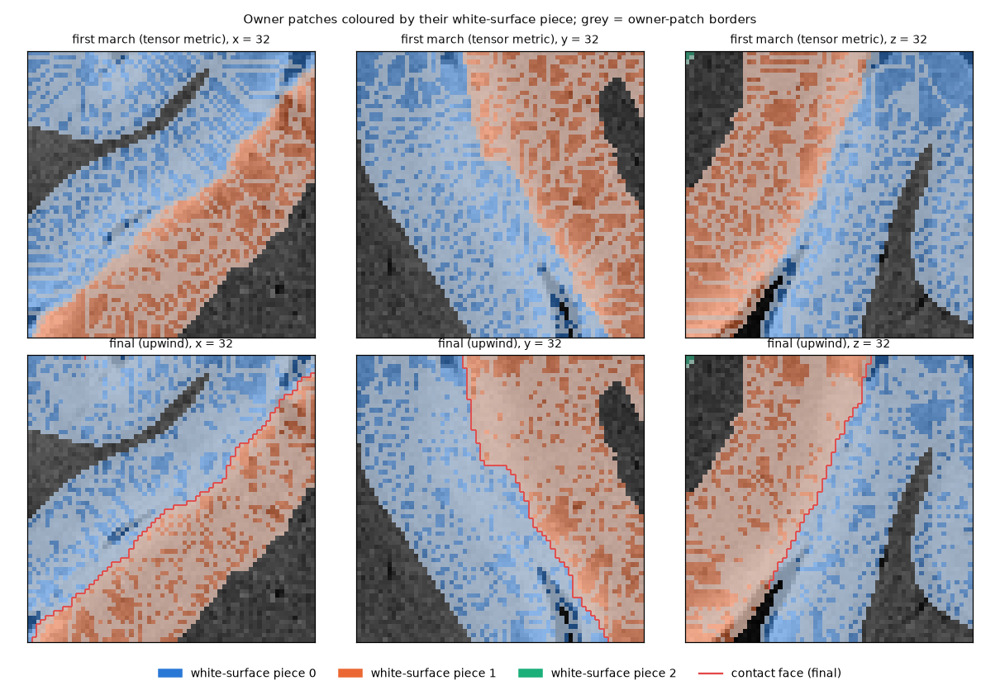
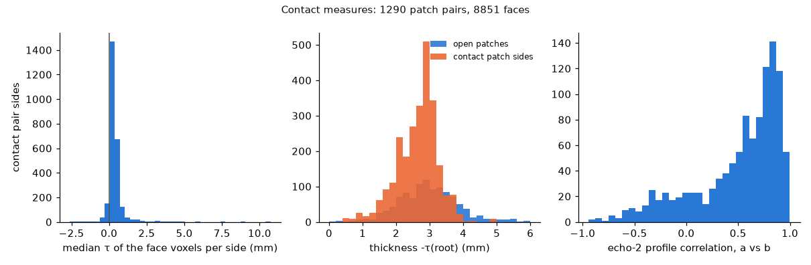
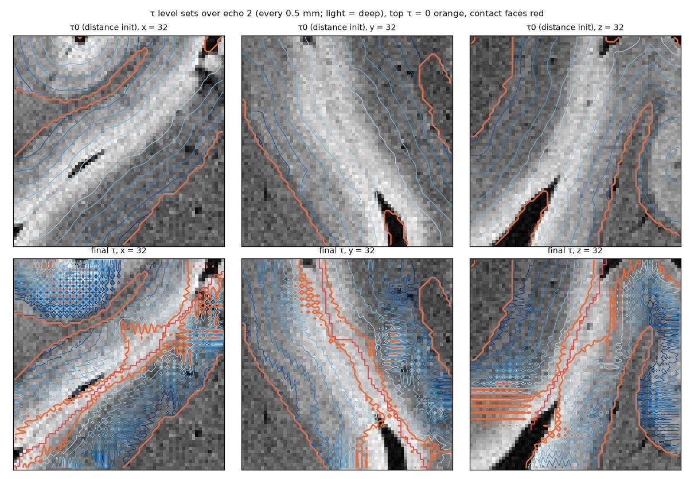
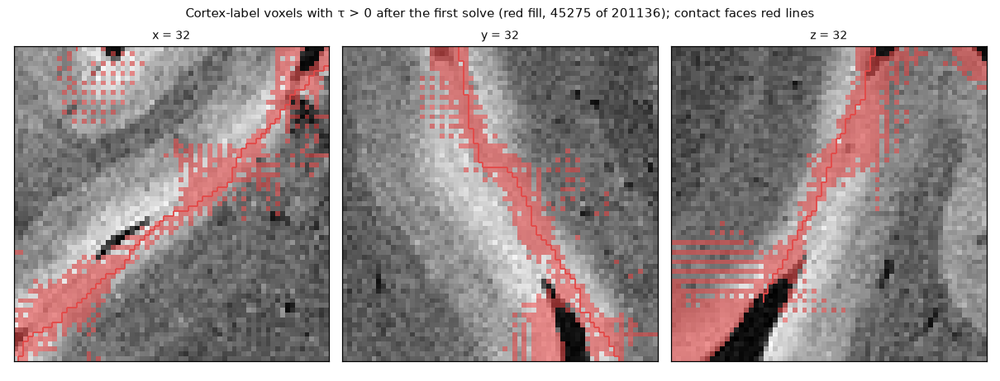
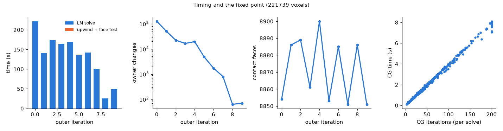
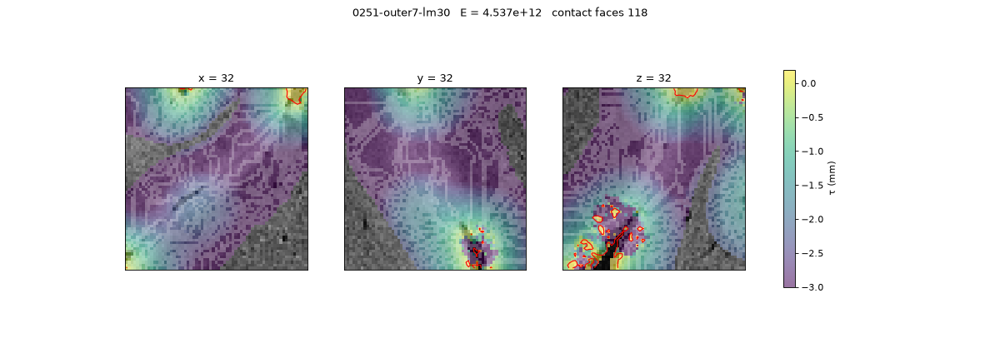
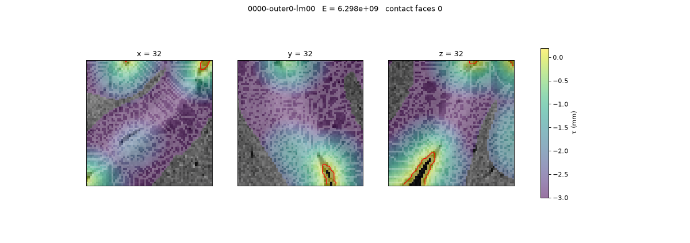
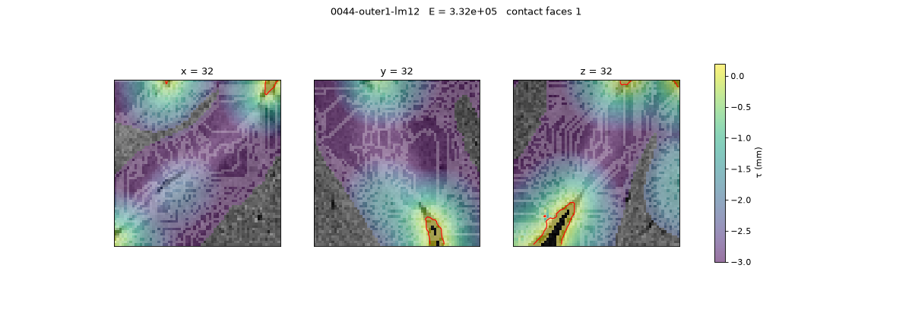

# Global sparse τ solve

**Question.** Can one global sparse solve give the τ field of the
continuous model (top anchor, equivolume, tangential smoothness, a weak pull
toward mm), with the contacts from an ownership field, at a cost per
iteration that is linear in the number of voxels?

**Status.** First prototype, tried on site 1 (kissing cortex, the fixed
labels, 10 mm crop) on 2026-11-17/18. The prototype replaces the tube
front-growth solver (PR mdtisdall/baillarger#218), which was too slow. The
code is in `prototypes/scripts/global_tau_*.py`. On 2026-11-18 a second
trial, the ridge form, removed the contacts that are decided before the
solve (see *Ridge form*). It is in the same code (`contacts=ridge`).

**Short answer.**

- The cost is linear, and it is low. On 221,739 voxels one Gauss–Newton
  iteration takes about 0.6 s for the Jacobian (27 coloured jvp passes) and
  about 1.3 s for the median CG solve (32 iterations at 0.04 s). The
  tube solver needed about 3.5 min for one sweep of the same crop.
- The ownership field works. The tensor march and the upwind pass put the
  contact of site 1 (between white-surface pieces 0 and 1) on the interface
  where the two sheets of cortex meet.
- The τ solve fails. After the first solve, τ has checkerboard blobs.
  45,275 of the 201,136 cortex voxels are at τ > 0 (beyond the top), and
  88% of the voxels next to a contact face are at τ > 0. Three causes are
  identified (see *What failed*). None of them is fixed in this PR.
- The outer loop does not reach a fixed point in 10 iterations. The owner
  changes fall from 126,910 to 63. Then the same voxels flip back and forth
  (a period-2 pattern).
- The prototype decides the contacts before it solves τ, from the
  ownership field and a 5 mm "same bank" test. This is wrong. A contact is
  a property of the top, and it must come from the τ solution (see
  *Contacts without banks*).
- The ridge form (second trial) finds contacts from τ, with upwind
  differences and no ownership faces. Its third version reaches a stable
  state on site 1 with a much cleaner τ: 462 cortex voxels at τ > 0
  (first run: 45,868), 3 topology events (first run: 1,560). But no
  contact forms at the kissing interface: τ stays at its start value there
  (median −1.28 mm, τ0 −1.29 mm). The labels give no stop evidence at a
  fused contact, and the equivolume term is very steep at a ridge voxel.
- The face test (G9) is too expensive at the agreed unit (about 8 h for
  the 710 units of one outer iteration). On a sample of 40 units, none of
  the 280 local solves converged in 30 LM iterations, so its moves and
  disagreements are not yet measurements.

## The design

The design was accepted by the user on 2026-11-17. The open details G1–G11
were asked and accepted as recommended on the same day. Two were changed
after the first site-1 checks (marked *changed*).

1. **Domain (G1).** The cortex label (42), dilated by 2 voxels into label 0,
   outside the white surface. Also the inner voxels within 1.5 voxels inside
   the white surface. The inner voxels carry the pull term only (R1).
2. **First ownership (G2).** A multi-source Dijkstra from the facing
   vertices of the white-surface patches (`tube_prep` patches, 0.5 mm) on
   the 26-neighbour graph. The step cost is sqrt(dᵀ M d), with
   M = n̂n̂ᵀ + (1 + α·coh)(I − n̂n̂ᵀ), α = 8. n̂ is the leading eigenvector of
   the echo 2 and 3 structure tensor (the laminar normal, the column
   direction). A tangential step costs up to 3× more where the contrast is
   coherent. The user proposed this metric.
3. **Contact faces (*replaced*, see *Contacts without banks*).** A face
   between two 6-neighbour voxels whose owner patches are more than 5 mm
   apart on the cropped patch graph is a contact face. In the code, "same
   bank" means only this pairwise relation (≤ 5 mm, from the tube solver).
   The face carries the ghost value τ = 0 (G7). The first derivative across
   the face is (0 − τ)/(h/2). The second-level derivatives are one-sided
   there.
4. **Initial τ (G3).** τ0 = −(distance to the nearest label-0 voxel or
   contact face), and τ0 > 0 in label 0.
5. **Solve (G4–G6).** Levenberg–Marquardt. The step solves
   (JᵀJ + λ diag(JᵀJ)) δ = −∇E. JᵀJ comes from the least-squares residuals
   of `tube_energy.ls_residuals` (f and the Student-t weights frozen). ∇E is
   the full gradient (with the stop term and log t). The Jacobian is built by
   colouring: 27 colours, one jvp pass each. The preconditioner is the exact
   inverse of JᵀJ on column lines (chains of voxels along ∇τ, at most 32
   voxels).
6. **Upwind ownership (G8).** The voxels in increasing τ take the owner of
   the lower 26-neighbour that is best aligned with −∇τ, with an owner
   patch at most 5 mm from its own (the same 5 mm relation).
7. **Face test (G9, *changed*).** A face unit is the set of contact faces
   between one pair of 1 mm coarse patches. The user chose this unit
   because the one-axis patches of G9 gave 3,629 patches on site 1, median
   1 face. Each unit is tried at the offsets −3…+3 voxels by a local LM
   solve. The move of −1, 0 or +1 with the smallest sum of both sides'
   energies is kept. The disagreement of the two sides is (B's best offset
   − A's best offset) × h. A positive value is a gap. A negative value means that the
   two sides' evidence disagrees. It is never read as overlap.
8. **Topology (G10).** After each solve, the Euler number of each component
   of {τ < 0}, cut at the contact faces, against the Euler number of its
   inner voxels. A difference is an event. Nothing is repaired.
9. **Outer loop (G11).** At most 10 iterations. A repeated state is an
   oscillation. It is reported and not damped.

The energy terms and constants are those of `tube_energy.py`
(`W_EQ = 0.569` is still provisional). The thickness-smoothness term is
counted once for each pair of adjacent patches.

**Libraries.** The user asked which parts can use existing libraries. The
march uses `scipy.sparse.csgraph.dijkstra`. CG uses
`scipy.sparse.linalg.cg`. The components use
`csgraph.connected_components`, and the Euler numbers use scikit-image. All
are BSD. JAX (Apache-2.0) gives the energy, its gradient and the jvp passes.
The stencil Jacobian, the line blocks and the ownership kernels are numba.
Two parts stay custom: LM, because the energy is not a sum of squares (the
stop term and log t), and the coloured Jacobian. Possible replacements are
in *Open questions*.

## Contacts without banks

The user does not want a concept of "bank" (a set of patches on one side of
a contact). The prototype has none as a set. It uses only the pairwise 5 mm
relation, which is not transitive and depends on the crop. That relation is
an arbitrary constant, and it is wrong in principle:

- **One sheet can meet itself at its top.** On the concave side of a bend,
  the columns converge. In a tight fundus, neighbouring columns of one sheet
  meet at the top obliquely or almost head-on. The change is continuous,
  from slight convergence to antiparallel walls. So no distance, angle or
  direction test on ownership borders can separate "one sheet" from "two
  sheets".
- **Where the columns meet decides it.** If they meet at the top, the stop
  set is reached from two directions. That is a contact, whether the
  columns come from one folded sheet or from two (for example a fused
  fundus). Below the top, columns must not meet: they do not cross in
  tissue. There, τ and ∇τ stay continuous across an ownership border, and
  nothing stops.
- **So a contact is a property of the top.** It is a stop set with tissue on
  both sides, reached from both sides. It needs no bank and no sheet.

The prototype does the opposite. It takes the contact faces from the
ownership march before τ is solved, and the ghost value then forces τ = 0
on them. A bend whose columns cross an ownership border below the top can
get a false stop there. It is possible that this causes part of items 3
and 4 of *What failed*. This is not tested.

A better order: the ownership field gives only a first guess. A face
becomes a contact only where the solved τ reaches 0 from both sides. The
second trial, the ridge form, does this (see *Ridge form*).

## Site 1: inputs

- Crop `scratch/tube-sites/site1-fixed/c10mm/site.npz` (65³ voxels at
  0.16 mm).
- Domain: 221,739 voxels, 14,977 of them inner. 1,740 patches (centre
  spacing median 0.424 mm). 27 colours. Every voxel has an owner.
- The cropped white surface is 3 pieces (1,043, 633 and 64 patches). On the
  full hemisphere mesh, pieces 0 and 1 are more than 12 mm apart: they are
  the two sheets of the kissing pair. Pieces 1 and 2 join 1.5 mm outside the
  crop, but on the cropped patch graph their patches are more than 5 mm
  apart.
  At the first ownership, 8,387 contact faces are between pieces 0 and 1,
  448 are inside piece 0, and 1 is between pieces 1 and 2.
- The first march takes 0.3 s.

## Site 1: ownership and contacts

- The march gives a contact between piece 0 and piece 1 along the bright
  band where the two sheets of cortex meet. The upwind pass keeps it there.
  Only 0–21 owner changes for each outer iteration go to a patch more than
  5 mm from the old owner.
- Final state: 8,851 contact faces (227 mm² of voxel faces), 1,290 patch
  pairs, 54 contact components, 600 of 1,740 patches touch a contact.
- Contact measures (`global_tau_contacts.py`, the measures of
  `tube_contacts.py`): label 0 next to the faces for 142 pairs, a thickness
  outlier for 113, an echo-2 profile correlation below 0 for 169, rule-only
  for 1. The profile correlation of most pairs is between 0.5 and 1.0.

## Site 1: the τ solve

| Outer | Solve (s) | LM iterations | E start | E end | Owner changes | To a patch > 5 mm away | Contact faces | Topology events |
|---|---|---|---|---|---|---|---|---|
| 0 | 221 | 30 | 1.01e10 | 1.36e6 | 126,910 | 13 | 8,854 | 1,731 |
| 1 | 141 | 30 | 2.14e6 | 1.32e6 | 51,306 | 21 | 8,886 | 1,637 |
| 2 | 174 | 30 | 1.38e6 | 1.22e6 | 22,431 | 6 | 8,889 | 1,604 |
| 3 | 164 | 30 | 1.22e6 | 1.13e6 | 16,585 | 3 | 8,861 | 1,578 |
| 4 | 169 | 30 | 1.14e6 | 1.04e6 | 19,642 | 2 | 8,900 | 1,570 |
| 5 | 136 | 30 | 1.04e6 | 1.02e6 | 4,880 | 0 | 8,853 | 1,568 |
| 6 | 142 | 30 | 1.03e6 | 1.02e6 | 1,725 | 2 | 8,885 | 1,563 |
| 7 | 100 | 29 | 1.02e6 | 1.02e6 | 800 | 1 | 8,851 | 1,560 |
| 8 | 25 | 7 | 1.02e6 | 1.02e6 | 63 | 2 | 8,886 | 1,560 |
| 9 | 49 | 15 | 1.02e6 | 1.02e6 | 69 | 0 | 8,851 | 1,560 |

E is the energy in nats. "E start" of an outer iteration is higher than the
end of the previous one because the owners, the contact faces and the
lagged pull direction ĝ₀ change between solves. The run took 22 min
(peak 2.9 GB).

Final energy by term: stop −454,790, align 116,185, smooth 192,547,
equi 122,430, pull 1,029,342, thickness 5,804, thickness smoothness 4,027.
Half of the pull energy (516,394) is in 1% of the voxels, at steep τ steps
beyond the top (|∇τ| up to about 10; the 99th percentile is 9.6).

## Timing

- 531 CG solves, 261 accepted LM steps. CG iterations: median 32,
  18 solves at the limit of 200. 0.040 s for each CG iteration (one JᵀJ
  product and one line solve). Median 1.3 s for each CG solve.
- Jacobian: median 0.56 s for each LM iteration (27 jvp passes and the
  scatter). Line factors: median 0.28 s.
- Every part is linear in the number of voxels. The march and the τ sort
  are N log N. The Jacobian costs 27 residual passes. At 50 µm the number
  of voxels for each mm³ is 33× larger. The cost of an iteration grows by
  the same factor. The number of CG and LM iterations can grow too: this
  is not measured.
- The first solve takes 221 s because the energy starts at 1e10 (see
  below). Later solves take 25–175 s. Most of them stop at 30 LM
  iterations with the energy still falling.

## What failed

1. **Checkerboard.** The final τ has blobs with an odd–even pattern
   (figure *τ0 and the final τ*). The first derivatives are central
   differences, (τ₊ − τ₋)/2h. A mode that alternates from voxel to voxel
   has a zero central difference, so no term of the energy sees it. The
   large first steps (item 2) excite this mode. The tube solver has the
   same stencil, but its windows were small.
2. **Large first steps and τ beyond the top.** τ0 has ridges where
   |∇τ| ≈ 0 (476 voxels). There, v = ∇τ/|∇τ|² is very large, and the
   equivolume term gives E(τ0) = 1.0e10. The first LM steps (λ = 1e-3
   to 1e-6) are very large, and LM accepts them because the energy falls a
   lot. τ0 has no cortex voxel at τ > 0. After the first solve, 45,275
   cortex voxels are at τ > 0, 9,474 at τ > 1 mm, and the largest τ is
   +51 mm. The stop term f·c has a gradient only for |τ| < h/2. A voxel
   at τ > h/2 gets no force from the stop evidence, so these voxels stay
   there (45,868 after outer 9).
3. **Contacts are beyond the top.** 88% of the voxels next to a contact
   face are at τ > 0 (median +0.29 mm). The ghost value holds τ = 0 on the
   face, but τ rises to about +0.2 mm in the 1–4 voxels next to it. It
   becomes negative from the fifth voxel. Each side stops some voxels short
   of the contact. This is a consequence of item 2. It is possible that the
   energy also prefers this state: the gradient terms are large next to a
   ghost face. This is not tested. A third possible cause: some of these
   faces are not contacts at all (see *Contacts without banks*).
4. **No fixed point.** In outer iterations 5–9 the contact-face count
   alternates between 8,851 and 8,886. The state after outer 8 and the
   final state differ in 22 voxels, but outer 8 and outer 9 each change
   63–69 owners. The exact state does not repeat, so the oscillation check
   (exact repeat) does not report it.
5. **Topology events.** 1,560 events after each solve. 1,558 of them are
   small components of τ < 0 (median 1 voxel) with no inner voxels: they
   are speckle from item 2. The two large components have Euler numbers 947
   and 189, against 0 and −2 for their inner voxels. The difference comes
   from τ > 0 cavities inside the tissue.
6. **Face test.** Too expensive, and its local solves do not converge.
   See *The face test*.

## The face test

The full test was too expensive for each outer iteration, so the user
chose one pass on a sample (`global_tau_facesample.py`). The pass used the
final state of the run above: 710 face units, 153 of them with a centroid
in the central cube of ±2 mm. The 40 units nearest the site centre were
tested, with 7 local LM solves for each unit (offsets −3…+3).

- **Cost.** 1,898 s for 40 units (peak 1.5 GB). 20–142 s for each unit,
  median 40 s. The project checks ran at the same time for part of the
  pass. Each window has a median of 5,058 unknowns (at most 11,006).
  All 710 units take about 8 h at the median rate. This is for one
  outer iteration.
- **No local solve converged.** All 280 local solves stopped at the limit
  of 30 LM iterations, also at k = 0. The global solve before them did not
  converge either. So the energies at the 7 offsets are compared before
  convergence.
- **Moves.** 31 of 40 units chose a move: 17 to −1, 14 to +1. The sum of
  both sides' energies at the chosen move minus k = 0: median −65 nats
  (range −2,089 to +709). A positive value is possible because the
  0 offset is also unconverged.
- **Disagreement.** From −0.96 to +0.80 mm. 23 of 40 units are at 0. 15 of
  40 are censored (one side's best offset is at ±3).
- On the synthetic two-sheet slab (LM limit 8), only k = 0 converged
  (2 iterations), and the other offsets stopped at the limit. Both sides
  then preferred k = 0 in every unit. That is a bias of the test, not a
  measurement.

These numbers do not yet measure where the evidence of each side puts the
face. They measure how far the local LM went in 30 iterations. The face
test needs converged local solves first.

## Watching τ evolve

The user asked to see how τ evolves during the solve, as for the tube
solver. With `snapshots=true`, `global_tau_run.py` writes one snapshot
before and after each LM iteration of each global solve, and one after each
ownership update: τ, the owners and the contact faces. 
`global_tau_movie.py SITE_NPZ RUN_DIR OUT_DIR --watch 15` renders each new
snapshot (three slices through the site: echo 2, τ, the top τ = 0, the
owner-patch borders and the contact faces) and writes a page with a slider
and a play button. Outside the domain, τ is filled from the side (inside
the white surface: below the top, the rest: above it), so the red line is
only the top. The site-1 run with snapshots repeats the run above.

## Ridge form (second trial)

**Design.** The user's decisions of 2026-11-18, after the first run:

- No contact faces, no ghost values, no 5 mm relation and no face test.
- First derivatives that are one-sided toward the lower τ (upwind, as in
  fast marching). A face is a ridge face where τ falls away on both sides
  of it.
- The energy terms of the first run. They already had the convex form of
  the 1D study (contact1d, branch `feature/ff-mfem-study`): the pull
  (ĝ₀·∇τ − 1)² in tissue and max(|∇τ| − 1, 0)² beyond the top, and
  equivolume weighted by the tissue fraction f. The stop term is the ramp f,
  as in 1D. One change: div v takes no v from a neighbour beyond the top.
- τ0 = −(distance to label 0), with no contact seeds.
- Owners from the upwind pass, with no 5 mm restriction. They set only the
  equivolume weight and the diagnostics.

**Ridge classes.** After each solve, a 6-face is a ridge face when τ falls
away on both sides of it and the face's axis is the largest component of
∇τ at both voxels. (Without the second condition, a flat slab gave ridges
from rounding differences of 1e-16 mm.) Each side's τ is extrapolated half
a voxel to the face with its own slope.

- *Contact*: both voxels in tissue (τ < 0), and both extrapolations reach
  τ ≥ 0. This is the top reached from both sides.
- *Below*: both voxels in tissue, and the top is not reached at the face.
  Columns meet inside tissue. This is not allowed, so each one is an error
  to report.
- *Beyond*: a voxel at τ ≥ 0, for example a ridge of τ in the outside
  medium between two banks.

Contacts are reported, not imposed. The topology check cuts at the contact
faces.

**Three versions on site 1.**

| Version | Change | Result |
|---|---|---|
| v1 | One-sided difference to the lower neighbour, the choice fixed at the start of each LM iteration | Diverged. E 2.9e8 → 3.9e12 in 10 outer iterations. τ reached −243 and +294 mm (1st and 99th percentiles). Ridge faces after outer 9: contact 115, below 1,413, beyond 2,172. |
| v2 | v1, and LM accepts a step only if the energy with the trial τ's own stencil falls; the 208 rim voxels fixed at τ0 | No step accepted (0 of 20 trials), τ stays at τ0. |
| v3 | The continuous split max(D−, 0) + min(D+, 0) on each axis; div v weights each neighbour's v by its f | A stable state after 2 outer iterations (no owner changes). E 6.3e9 → 3.3e5. |

*v1.* The energy that LM minimised was not the energy at the new τ. The
choice of difference was fixed during each iteration. In 13 of the 60 LM
steps of outer iterations 1 and 2, the energy fell with the fixed choice
but rose with the choice of the new τ. Also, 18 voxels at the rim of the
domain (no neighbour on one axis, so their own gradient terms are off)
were in no term: no neighbour used them, because each neighbour uses only
its lower neighbour. One of them moved 1.8e5 mm in one step.

*v2.* The energy jumps when the choice of difference changes. At a ridge
both neighbours are lower, and the choice changes the sign of the gradient
component, so the terms that use the direction of ∇τ (the pull, the
alignment, div v) jump. At τ0, 6,209 voxel axes are ridges, and on 5,801
of them the two neighbours are equal. A steepest-descent step of 1e-8
voxel changed 1,489 choices and increased E by 2.7e8 (E(τ0) = 2.9e8). The
energy with the fixed choice decreased by 3,079. So LM can find no step
that lowers the energy.

*v3.* The energy is continuous, but it is very steep at a ridge voxel. The
split gives ∇τ = 0 at a symmetric ridge. There, v = ∇τ / (|∇τ|² + ε) has a
peak of about 1/(2√ε) ≈ 1.6e4 within |∇τ| ≈ 3e-5. In a test with a tent
of τ, a step of 1e-5 mm increased the equivolume energy by 8e10. On site 1,
LM ended with λ = 1e2 to 1e3 and very small steps. The stable state is a
stall, not a measured minimum. The results:

- Cortex voxels at τ > 0: 462 of 201,136 (τ0: 0; first run: 45,868).
- Topology events: 3 (first run: 1,560). No checkerboard is visible.
- Thickness median 3.09 mm (first run 2.87 mm).
- Ridge faces: contact 1, below 67, beyond 144.
- **At the kissing interface no contact forms.** At the 8,851 contact-face
  voxels of the first run, τ has median −1.28 mm (10–90%: −3.35 to
  −0.13). τ0 there has median −1.29 mm. The ridge stays where τ0 put it,
  about 1.3 mm below the top. This is the result of the 1D study (a ridge
  away from the true sheet does not move), now in 3D.

Two causes are possible from these numbers. Neither is tested on its own.

1. *No evidence at a fused contact.* The stop term uses the labels. At the
   kissing interface both sides are cortex (label 42), so the stop term
   prefers tissue there. No term pushes τ up to 0. The 3D neighbours do not
   help, because the whole interface has no evidence: there is nothing to
   spread. The user's rule that a column's top comes from image contrast,
   not from the labels, is not in the energy yet.
2. *The steep equivolume term.* At a ridge voxel in tissue, v has no
   defined value. In 1D the kink was on an element boundary, at τ = 0, and
   v was evaluated only inside the elements, where the slope is not 0. On
   the voxel grid a ridge in tissue always has a voxel with ∇τ = 0 (or an
   ambiguous ∇τ).

Cost of v3: 98 s for 2 outer iterations (peak 2.9 GB); median CG 2
iterations, because λ was large.

## Tests

`prototypes/scripts/test_global_tau.py`, 18 tests, about 20 s:

- the colouring (27 colours separate every pair of voxels within L1 4);
- the 5 mm lookup between owner patches (`same_bank` in the code);
- the ghost gradient at a contact face (both sides, and one-sided);
- the coloured stencil Jacobian against the dense JAX Jacobian (Jv, Jᵀu,
  the diagonal and single entries of JᵀJ);
- the line preconditioner (the lines of a linear τ are the z columns; the
  line solve is the exact inverse of each block);
- the contact faces and the upwind owners (no owner goes to a patch more
  than 5 mm away);
- the anisotropic march (a step across n̂ costs 3× at coh 1);
- a one-sheet slab: the top stays at the label face, τ steps ≈ 0.16 mm per
  voxel, no contact, no topology event;
- a two-sheet slab with no label 0: one flat contact, the ±2 move, the face
  test runs;
- the snapshots: one before and after each LM iteration and one after the
  ownership update, and τ read back equals the solver's τ;
- the ridge form: the upwind split sees a voxel-to-voxel alternation that
  central differences do not; the three ridge classes on a tent of τ; the
  stencil Jacobian against the dense one with the split; the energy is
  continuous at a ridge plane with equal neighbours; a one-sheet slab
  keeps its top and has no ridge face; two sheets with 2 layers of
  label 0 between them give 36 "beyond" ridge faces and no contact.

## Open questions

- **Stop evidence at a fused contact.** The ridge form has no force that
  makes a top where the labels are cortex on both sides. Evidence from
  image contrast (the user's rule) is the candidate. Its form is open.
- **Equivolume at a ridge.** v = ∇τ/|∇τ|² is not defined at a ridge voxel
  in tissue. A discretisation with the ridge between cells, not on a voxel
  (finite elements with a kink, as in the 1D study with MFEM, or gradients
  on the cells of the voxel grid), avoids this. Both change the
  discretisation and need a decision.
- **The 5 mm relation** is still in the faces form (the first run): the
  contact faces, the upwind ownership and the sides of the face test. The
  ridge form does not use it.
- **Checkerboard.** A stencil without the odd–even null space. One option
  is face-centred first differences (the energy on the voxel faces). This
  changes the energy's discretisation and needs a decision.
- **Step size.** A trust region on the LM step (for example |δτ| ≤ h/2 for
  each voxel), or a τ0 with no ridges, or both. A step bound is a standard
  LM safeguard. It is not a constant to hide a symptom, but it is a
  design choice.
- **Stop term beyond the ramp.** With f = clip(0.5 − τ/h, 0, 1), a voxel
  beyond the ramp gets no force from the stop evidence. A smooth f (for
  example a logistic ramp) gives a force at every τ. This changes choice C.
- **Gap at a contact.** Does the energy prefer a gap next to a ghost face?
  A test on the two-sheet slab with no large steps answers this.
- **Fixed point.** The oscillation check needs a test that is not exact
  equality (for example the same voxels flipping in two iterations).
- **Libraries.** pyamg (MIT, already a dependency) can give an algebraic
  multigrid preconditioner for JᵀJ. It needs the explicit sparse JᵀJ.
  Optimistix (Apache-2.0) has LM with CG, but only for a sum of squares.
- **W_EQ = 0.569** is still provisional.

## Next step

The user chooses the next step after reading this report. The open
choices are the stop evidence at a fused contact and the discretisation
of equivolume at a ridge.
