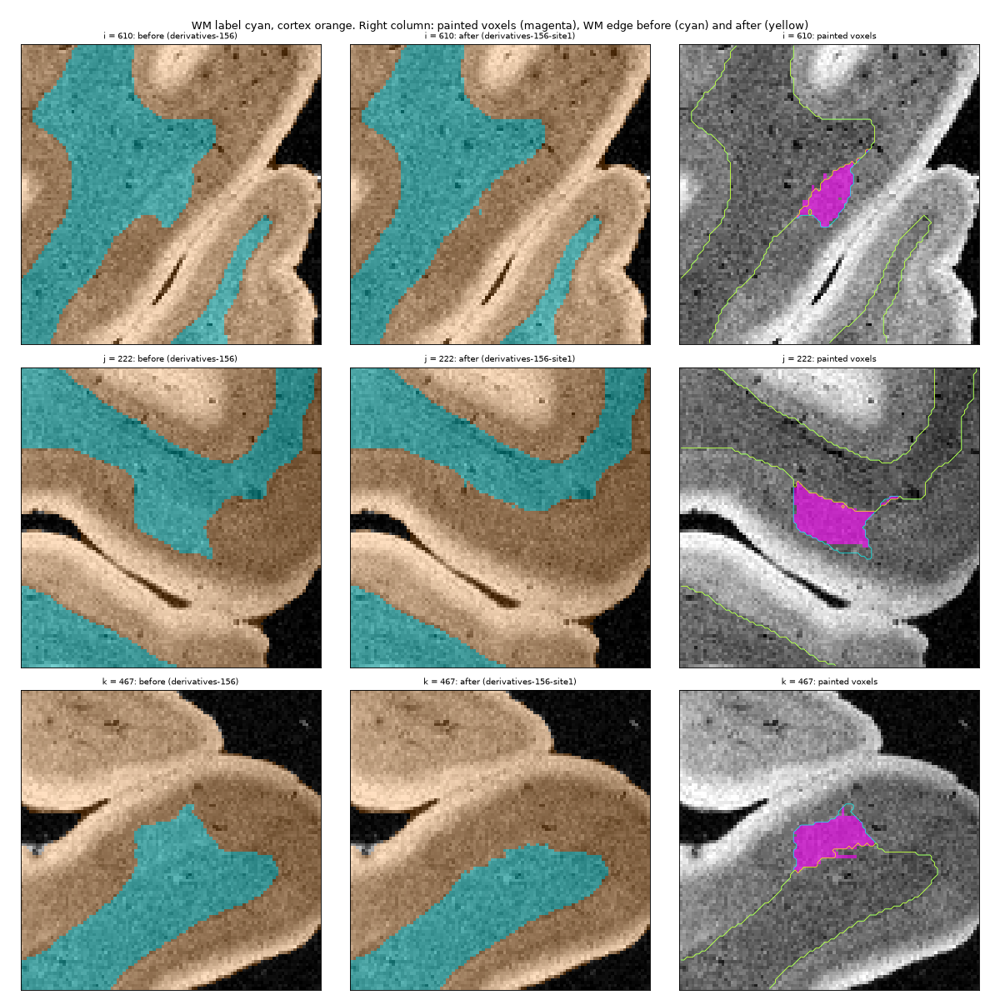
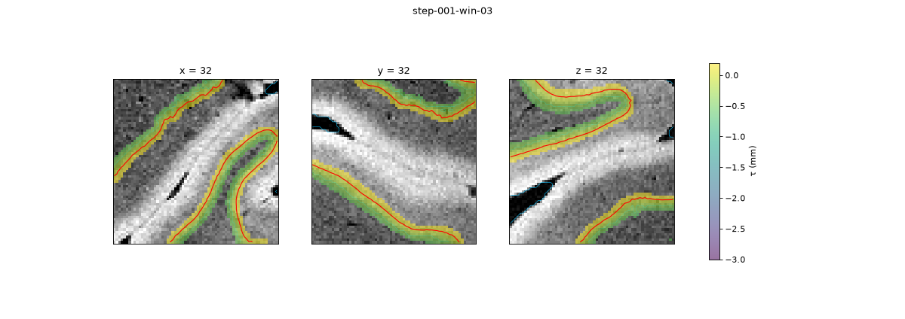

# Tube front-growth solver

**Question.** Can a front that grows out from the white surface, one tube
(white-surface patch) at a time, give the τ field of the continuous model
(top anchor, equivolume, tangential smoothness, a weak pull toward mm) and
make contacts between banks explicit?

**Status.** First prototype, tried on site 1 (kissing cortex, 50.96, −28.39,
−30.46 mm; sub-INDD121850, hemisphere R) on 2026-11-17. The user stopped it:
it is far too slow to be practical. The next prototype is a global sparse
solve (*Next step*). The code stays in `prototypes/scripts/tube_*.py` as a
record.

**Short answer.**

- The parts work: the energy and its terms, the one-sided stencils at a
  contact, the simple-point check, the shell rebuild, the colouring and the
  batched Newton solves. 12 unit tests pass.
- On a 10 mm crop of site 1, one sweep takes about 3.5 min. Step 1 did
  not reach the sweep tolerance in 3 sweeps. The front can move at most one
  voxel (0.16 mm) for each step. A run over the full cortical depth would take
  10 to 13 hours for 1 cm³.
- The cost has three causes, in this order:
  1. front growth with a step of one voxel;
  2. Gauss–Seidel sweeps over 16 colours of tubes;
  3. a dense Newton solve (Hessian and eigendecomposition) for each tube.

  None of these scales to a 50 µm whole hemisphere.

## What was built

- `tube_prep.py`: the site. White-surface patches by farthest-point
  sampling (0.5/√3 mm). Patch adjacency. The same-bank pairs (geodesic
  distance ≤ 5 mm on the patch graph). Coarse levels at 1, 2 and 4 mm. The
  laminar normal and coherence from echoes 2 and 3.
- `tube_energy.py`: the energy in nats per voxel (stop, align, smooth,
  equi, pull, thickness prior, tangential thickness smoothness), in JAX.
  Also a batched damped Newton (`jax.hessian`, eigenvalues with a floor,
  Armijo), and the Gauss–Newton residuals (`ls_residuals`).
- `tube_kernels.py` (numba): the local problems, the topology-checked sign
  changes, the prediction, the shell rebuild, the colouring, the contacts
  and the trace down the columns.
- `tube_solver.py`, `tube_run.py`: the steps (predict, shell, sweeps,
  full-depth sweeps, re-trace, coarse shift). Snapshots after each sweep
  and each step. The event log (retreat, advance, stop, contact, block,
  trace_fail, merge, topology_reject).
- `tube_contacts.py`, `tube_figures.py`, `tube_movie.py`: the contact
  measures for a person, and the figures. `tube_movie.py` makes a page that
  shows one frame for each sweep.
- `tube_newton_diag.py`, `tube_sweep_diag.py`: diagnostics of the
  Hessian (Newton against Gauss–Newton, negative curvature, the step
  length) and of the sweeps (correlation of Δτ between tubes). They ran
  only on a smoke test, not on site 1.

## Site 1: the labels first

The WM label at site 1 was wrong. The white surface follows the label, so
the τ results there could not be judged. The user fixed the labels with the
viewer's paint mode on a copy of `derivatives-156`, and `regenerate` made
the outputs again.

- A regeneration of the copy without edits gave byte-identical data files.
  Only the provenance in the JSON sidecars was different.
- With 5685 edited voxels, 5680 kept their painted label. The topology fix
  changed 5 single voxels (4 `cavity_fill`, 1 `small_piece`).

## Site 1: the solver

10 mm crop of the fixed labels (65³ voxels at 0.16 mm): 1740 tubes, centre
spacing median 0.424 mm, 16 colours, 41,593 band voxels.

| Sweep (step 1) | Time | Max \|Δτ\| | Median \|Δτ\| | Voxels with \|Δτ\| > 2 mm | Newton iterations, mean (max) |
|---|---|---|---|---|---|
| 1 | 4.4 min (with JAX compiles) | 4.36 mm | 0.162 mm | 4 | 7.4 (20) |
| 2 | 3.6 min | 4.02 mm | 0.006 mm | 2 | 5.7 (20) |
| 3 | 3.5 min | 6.83 mm | 0.004 mm | 3 | 4.9 (20) |

- Most of the band converges in 2 sweeps. The median change of sweep 1
  (0.16 mm) is the prediction step of one voxel.
- 2 to 4 voxels in a few tubes jump by more than 2 mm in each sweep. In
  sweep 2, their median τ went from +2.89 to −1.08 mm. These few voxels set
  the maximum change, so the tolerance (0.01 mm) is never met. Then each
  step uses all 10 sweeps. The cause was not examined.
- An earlier profile on a 16 mm crop (5955 tubes) found that the JAX Newton
  solves take 31 of 39 s, recompiles about 8 s, and about 5% of the solves
  stop at 20 iterations.

## What failed

- **Speed.** About 3.5 min per sweep for 1 cm³. With up to 10 sweeps per
  step and 15 to 20 steps to cross the cortex, that is 10 to 13 hours.
- **Scaling.** The number of steps grows with the thickness in voxels:
  about 50 steps at 50 µm. The dense Newton solve of each tube costs O(U³)
  for U unknowns. At 50 µm a tube has about 33 times more voxels.
- **Convergence test.** A maximum over all voxels lets a few voxels keep
  every step at the sweep limit.
- **Inner voxels.** The thickness prior first pulled the inner voxels (inside
  the white surface) down by up to 1.6 mm in one sweep, with no change in the
  cortex. Now the inner voxels carry the pull term only (user decision R1).

## Open questions

- Why do a few shell voxels jump by several mm in each sweep? A test with
  the energy along those voxels' path would show whether this is a real
  minimum or an error in the shell rebuild.
- Newton or Gauss–Newton: `tube_newton_diag.py` can answer this on site-1
  snapshots. The next prototype starts with Gauss–Newton/LM (user decision).
- `W_EQ = 0.569` is provisional.

## Next step

One global sparse τ solve on the dilated cortex label, with Gauss–Newton/LM
and CG, and a column-line preconditioner. The contacts come from an
ownership field:

1. A multi-source fast march from the white-surface patches through the
   cortex label. A face between owners that are not in the same bank is a
   contact face.
2. The stencils are cut at the contact faces. Each contact face is a shared
   stop set, with τ = 0 on both sides.
3. The ownership is calculated again by an upwind pass along −∇τ.
4. A contact face moves by ±1 voxel when this makes the sum of the energies
   of the two sides smaller.

The topology of each bank's top is checked after each solve. If the fixed
point oscillates, this is reported and not damped. The user accepted these
conditions for a first prototype. The contact measures of
`tube_contacts.py` stay the same.
